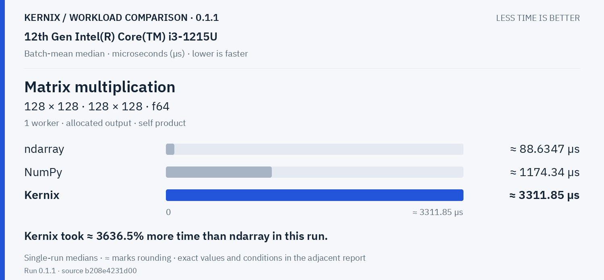
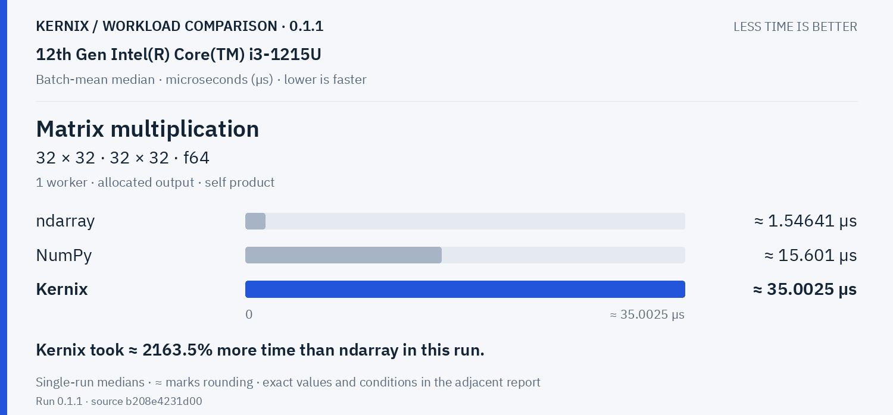
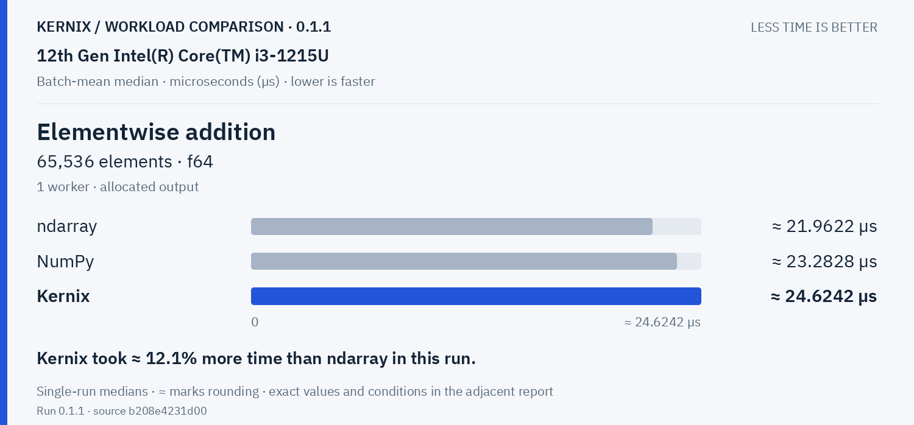
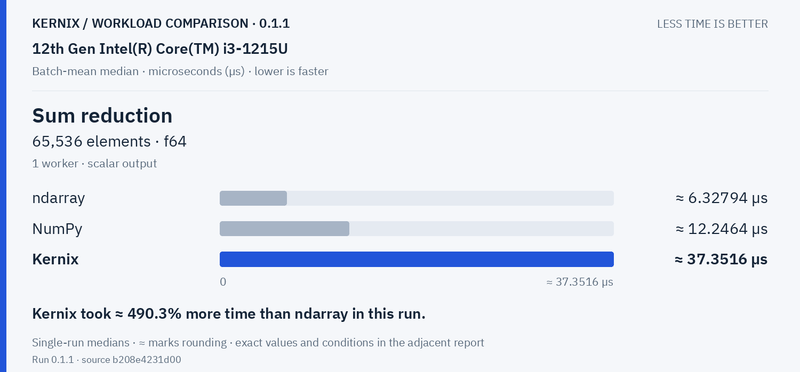

# Kernix 0.1.1 · performance brief

12th Gen Intel(R) Core(TM) i3-1215U / Linux

**Batch-mean median, microseconds per operation. Lower is faster. All recorded digits retained.**

5 workloads · 15 observations

No previous-version baseline attached. Sequential run changes are descriptive; paired process evidence is shown separately.

[Interactive HTML (open locally)](report.html) · [Vector PDF](latency.pdf) · [Raw measurements](raw.json)

## Charts by workload

**Shorter bars mean less time.** Blue is Kernix; grey is another library; teal is an explicitly selected Kernix backend. Entries are sorted by the recorded median, with a separate zero-based scale per chart. These point observations do not establish a statistical ranking.

Expand a group to see every chart here on GitHub. Click a chart to enlarge it. The exact table below keeps every source digit.

Matrix multiplication · 2 workloads

**Matrix multiplication · 32 × 32 · 32 × 32 · f64**

Kernix: **35.00251748251748 µs**. Kernix took ≈ 2163.5% more time than ndarray in this run.

**Matrix multiplication · 128 × 128 · 128 × 128 · f64**

Kernix: **3311.847 µs**. Kernix took ≈ 3636.5% more time than ndarray in this run.

Statistics & activations · 3 workloads

**Elementwise addition · 65,536 elements · f64**

Kernix: **24.624215551181103 µs**. Kernix took ≈ 12.1% more time than ndarray in this run.

**Sum reduction · 65,536 elements · f64**

Kernix: **37.351614925373135 µs**. Kernix took ≈ 490.3% more time than ndarray in this run.

**Row softmax · 256 × 64 · f64**

Kernix: **765.8913636363636 µs**. Kernix took ≈ 955.7% more time than ndarray in this run.

## Exact latency table

All values below are microseconds per operation. **Lower is faster.** Missing entries were not measured.

| Workload | Kernix | ndarray | NumPy |
|---|---:|---:|---:|
| Matrix multiplication · 32 × 32 · 32 × 32 · f64 | 35.00251748251748 | **1.5464088575493288** | 15.60095258889582 |
| Matrix multiplication · 128 × 128 · 128 × 128 · f64 | 3311.847 | **88.63474558303886** | 1174.3400454545454 |
| Elementwise addition · 65,536 elements · f64 | 24.624215551181103 | **21.962192273924495** | 23.282751396648044 |
| Sum reduction · 65,536 elements · f64 | 37.351614925373135 | **6.327939762085548** | 12.24643095004897 |
| Row softmax · 256 × 64 · f64 | 765.8913636363636 | **72.54767246376812** | 211.21431092436975 |

## Version comparison

0 of 5 workloads have paired evidence. Exploratory 95% intervals resample process pairs, not calls. No multiple-comparison adjustment.

| Workload | Current / baseline [95% interval] | Interpretation |
|---|---:|---|
| Matrix multiplication · 32 × 32 · 32 × 32 · f64 | — | No paired comparison |
| Matrix multiplication · 128 × 128 · 128 × 128 · f64 | — | No paired comparison |
| Elementwise addition · 65,536 elements · f64 | — | No paired comparison |
| Sum reduction · 65,536 elements · f64 | — | No paired comparison |
| Row softmax · 256 × 64 · f64 | — | No paired comparison |

## Historical statistic

These are medians of 15 warmed batch means, not per-call medians. The original p95 field is the maximum of those 15 batch means. No per-call p95/p99, accuracy or allocation probes are inferred.

## Method and provenance

CPU affinity was not pinned. Frequency and background load are uncontrolled.

Numbers retain source precision; recorded digits do not imply equivalent physical measurement accuracy. Lowest observed medians are bold only when peers were measured. No aggregate winner or universal ranking is inferred.

[Original report and commentary](original-report.txt) · [Raw measurements](raw.json)

Measured source `b208e4231d00635eb4abb5c1647222f5779c43a9`. Run `0.1.1`. Rendering does not change measurements.
