# Kernix 0.10.0 · performance brief

12th Gen Intel(R) Core(TM) i3-1215U / Linux

**Per-call median, microseconds per operation. Lower is faster. All recorded digits retained.**

31 workloads · 108 observations

Baseline: 0.9.0-registry-010. Sequential run changes are descriptive; paired process evidence is shown separately.

[Interactive HTML (open locally)](report.html) · [Vector PDF](latency.pdf) · [Raw measurements](raw.json)

[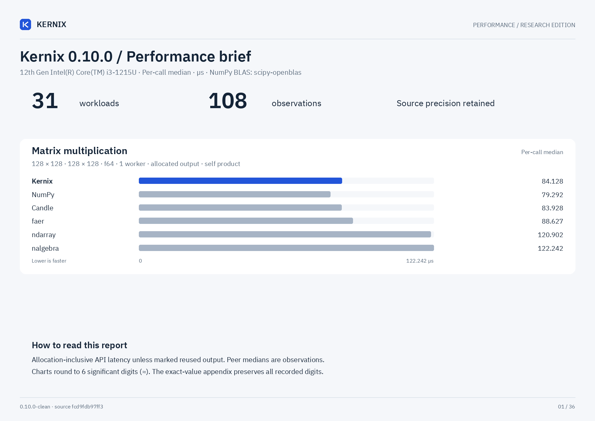](latency.pdf)

## Charts by workload

**Shorter bars mean less time.** Blue is Kernix; grey is another library; teal is an explicitly selected Kernix backend. Entries are sorted by the recorded median, with a separate zero-based scale per chart. These point observations do not establish a statistical ranking.

Expand a group to see every chart here on GitHub. Click a chart to enlarge it. The exact table below keeps every source digit.

Matrix multiplication · 8 workloads

**Matrix multiplication · 32 × 32 · 32 × 32 · f64**

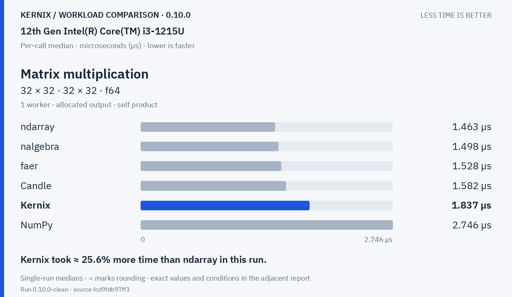

Kernix: **1.837 µs**. Kernix took ≈ 25.6% more time than ndarray in this run.

**Matrix multiplication · 64 × 64 · 64 × 64 · f64**

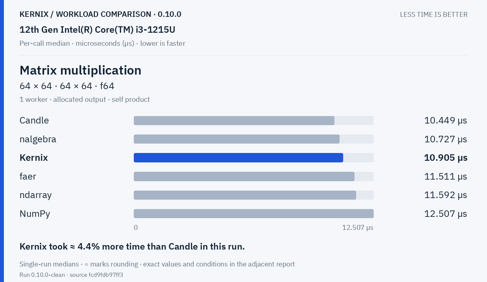

Kernix: **10.905 µs**. Kernix took ≈ 4.4% more time than Candle in this run.

**Matrix multiplication · 128 × 128 · 128 × 128 · f64**

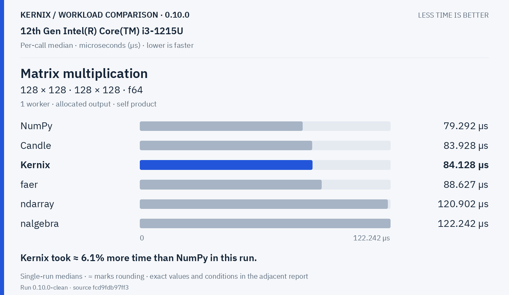

Kernix: **84.128 µs**. Kernix took ≈ 6.1% more time than NumPy in this run.

**Matrix multiplication · 256 × 256 · 256 × 256 · f64**

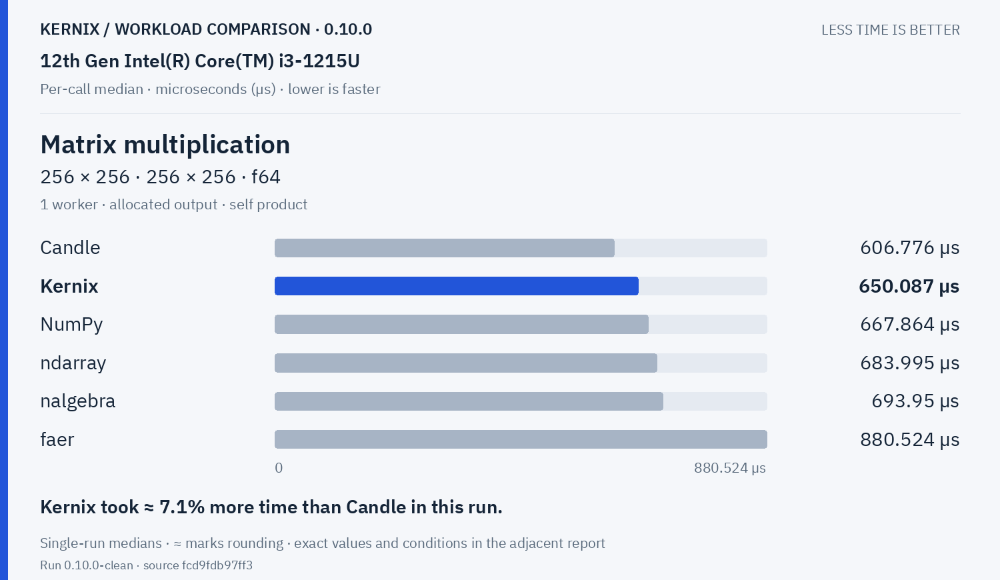

Kernix: **650.087 µs**. Kernix took ≈ 7.1% more time than Candle in this run.

**Matrix multiplication · 64 × 64 · 64 × 64 · f32**

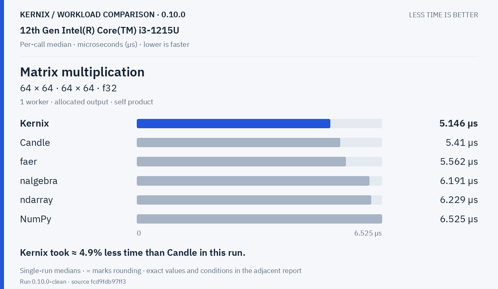

Kernix: **5.146 µs**. Kernix took ≈ 4.9% less time than Candle in this run.

**Matrix multiplication · 128 × 128 · 128 × 128 · f32**

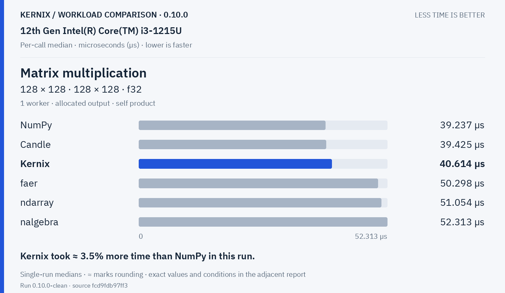

Kernix: **40.614 µs**. Kernix took ≈ 3.5% more time than NumPy in this run.

**Matrix multiplication · 256 × 256 · 256 × 256 · f32**

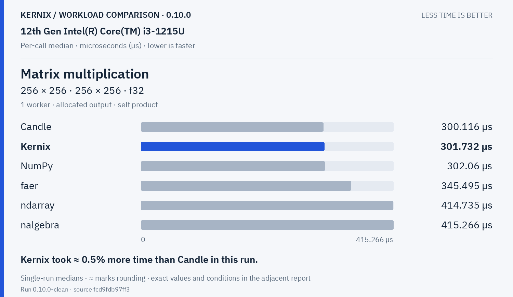

Kernix: **301.732 µs**. Kernix took ≈ 0.5% more time than Candle in this run.

**Batched multiplication · 4 × 16 × 32 · 1 × 32 × 16 · f64**

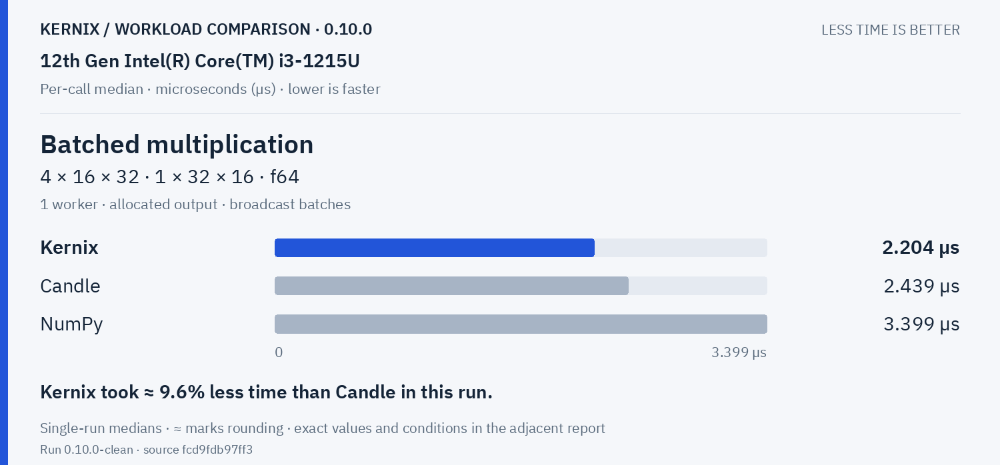

Kernix: **2.204 µs**. Kernix took ≈ 9.6% less time than Candle in this run.

Explicit parallel execution · 4 workloads

**Matmul · 2 workers · reused output · 64 × 64 · 64 × 64 · f64**

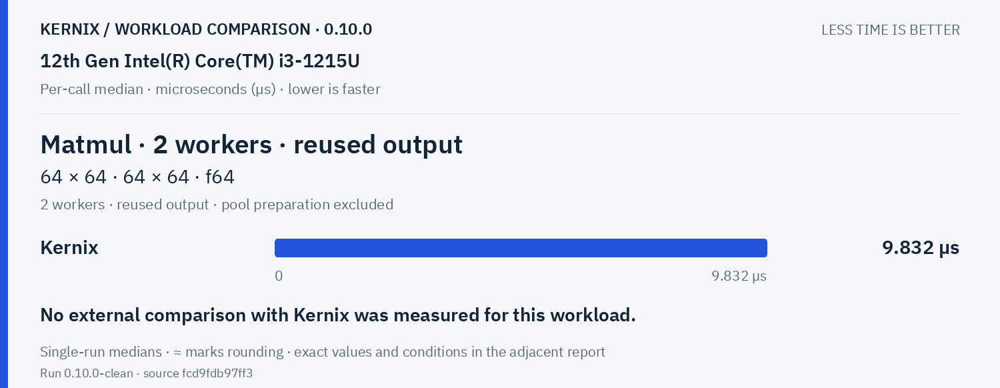

Kernix: **9.832 µs**. No external comparison with Kernix was measured for this workload.

**Matmul · 2 workers · reused output · 128 × 128 · 128 × 128 · f64**

Kernix: **81.816 µs**. No external comparison with Kernix was measured for this workload.

**Matmul · 2 workers · reused output · 256 × 256 · 256 × 256 · f64**

Kernix: **307.403 µs**. No external comparison with Kernix was measured for this workload.

**Matmul · 2 workers · reused output · 128 × 128 · 128 × 128 · f32**

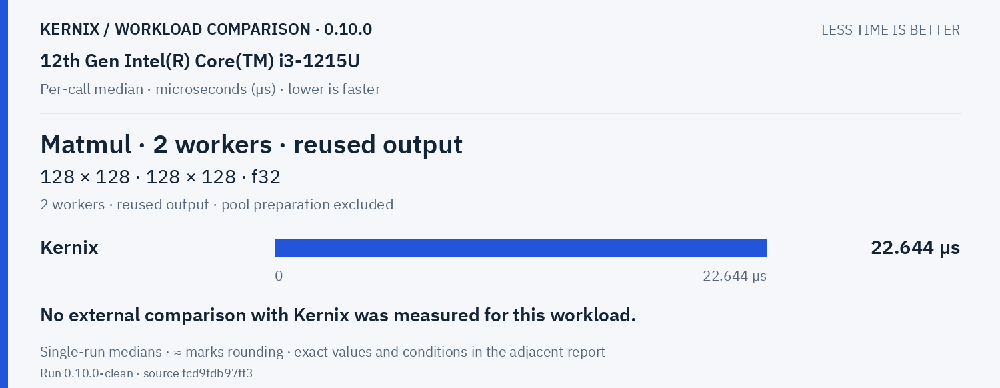

Kernix: **22.644 µs**. No external comparison with Kernix was measured for this workload.

Decompositions & solvers · 9 workloads

**Column-pivoted QR · 96 × 32 · f64**

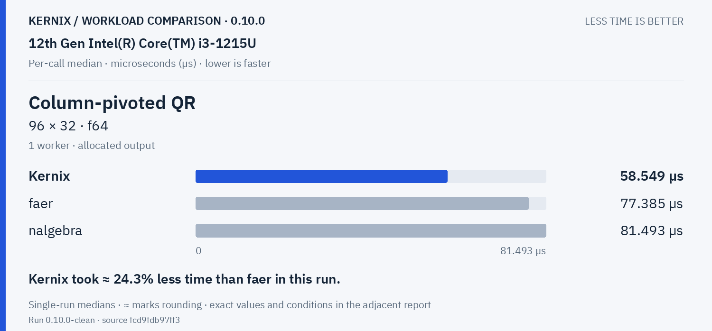

Kernix: **58.549 µs**. Kernix took ≈ 24.3% less time than faer in this run.

**Column-pivoted QR · 256 × 64 · f64**

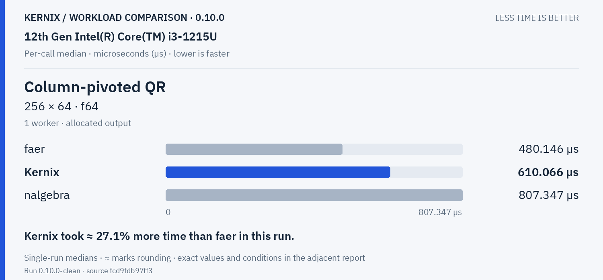

Kernix: **610.066 µs**. Kernix took ≈ 27.1% more time than faer in this run.

**Minimum-norm least squares · 64 × 32, rank 16, 4 RHS · f64**

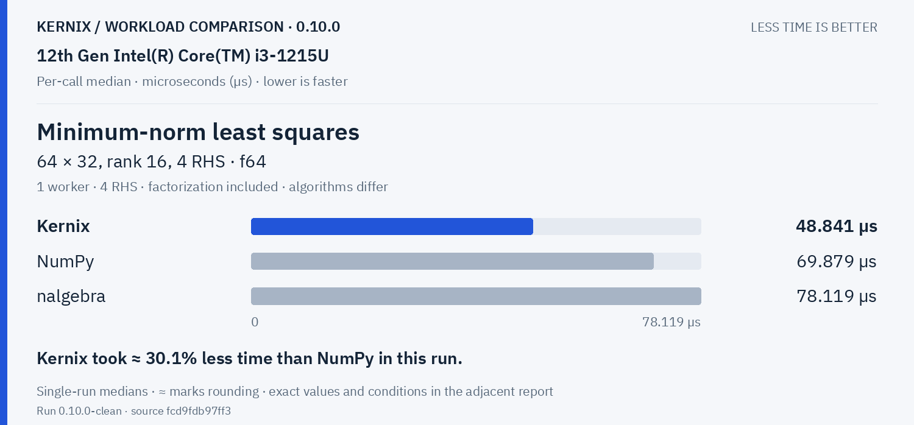

Kernix: **48.841 µs**. Kernix took ≈ 30.1% less time than NumPy in this run.

**Minimum-norm least squares · 32 × 64, rank 32, 4 RHS · f64**

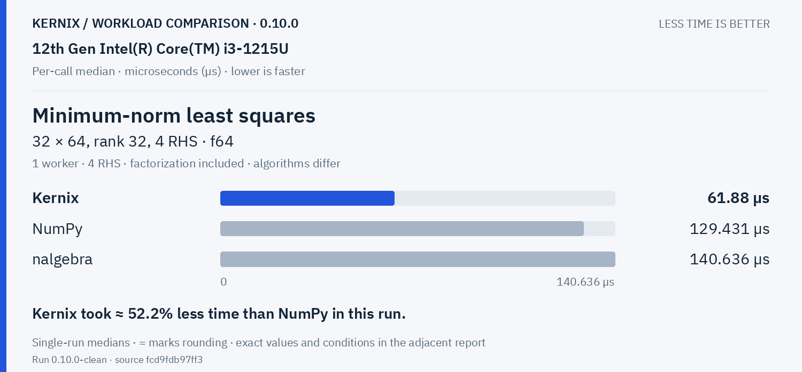

Kernix: **61.88 µs**. Kernix took ≈ 52.2% less time than NumPy in this run.

**Thin QR · 96 × 32 · f64**

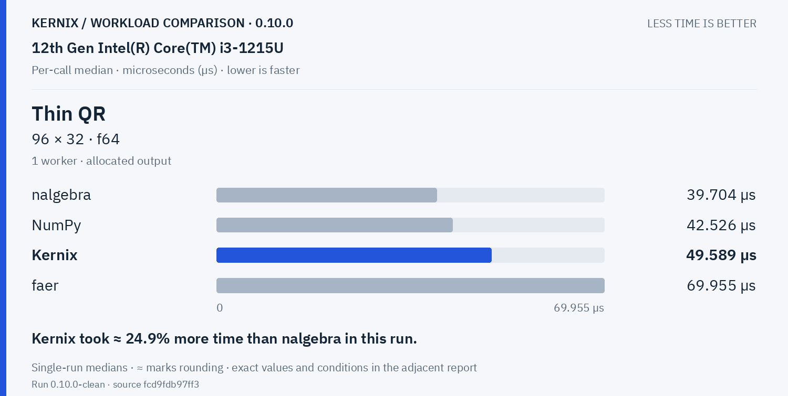

Kernix: **49.589 µs**. Kernix took ≈ 24.9% more time than nalgebra in this run.

**Thin QR · 256 × 64 · f64**

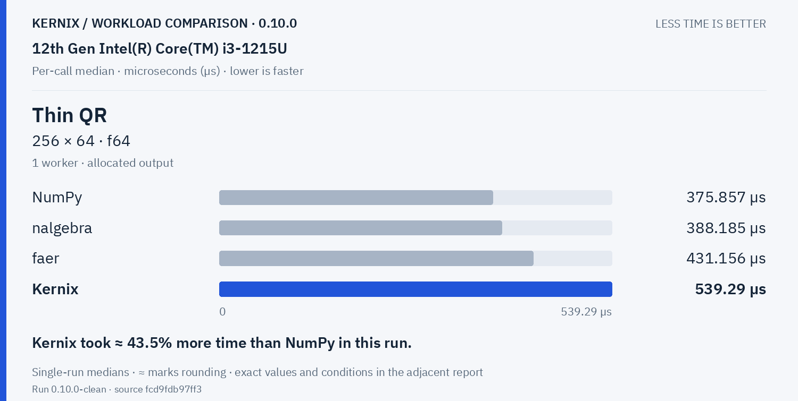

Kernix: **539.29 µs**. Kernix took ≈ 43.5% more time than NumPy in this run.

**Cholesky factorization · 64 × 64 · f64**

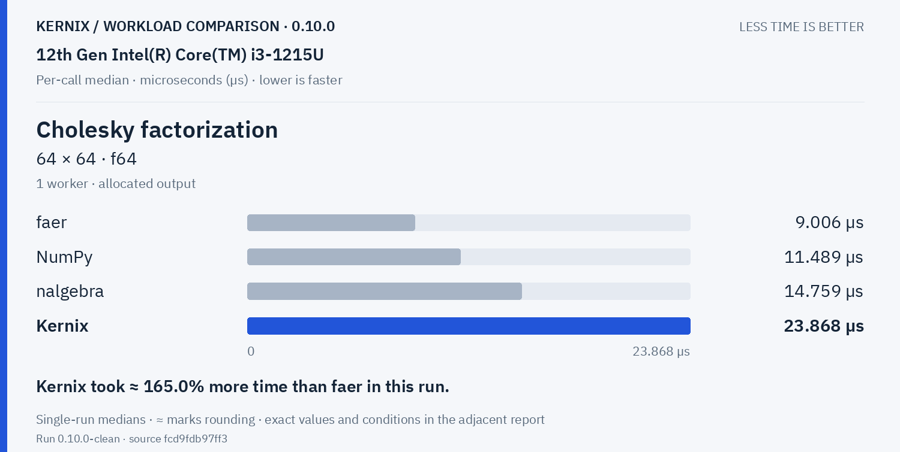

Kernix: **23.868 µs**. Kernix took ≈ 165.0% more time than faer in this run.

**Cholesky factorization · 128 × 128 · f64**

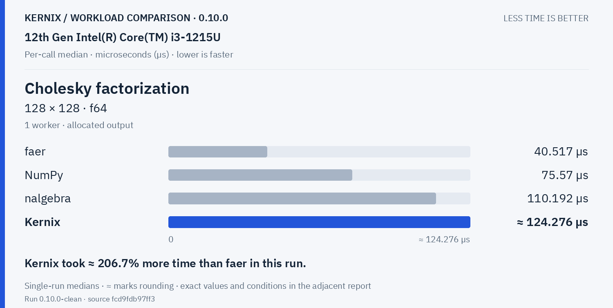

Kernix: **124.27599999999999 µs**. Kernix took ≈ 206.7% more time than faer in this run.

**Cholesky factorization · 256 × 256 · f64**

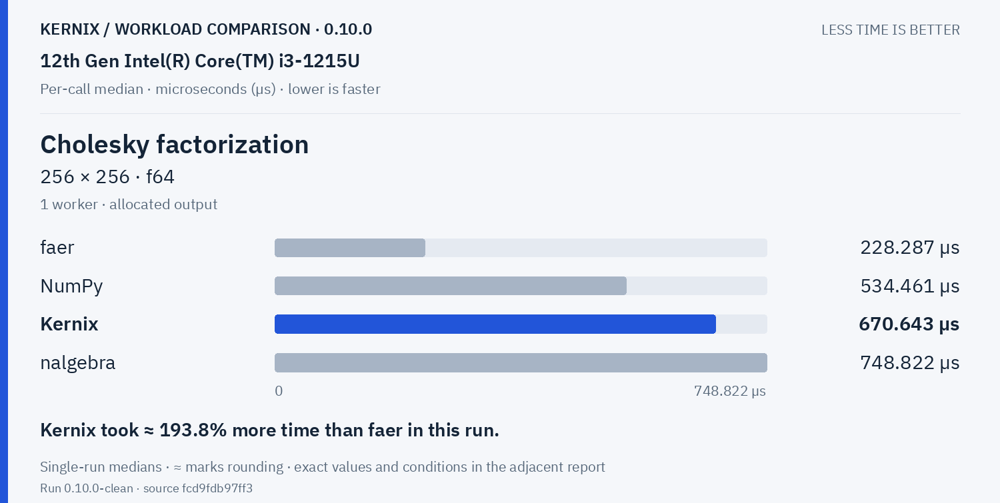

Kernix: **670.643 µs**. Kernix took ≈ 193.8% more time than faer in this run.

Training & autodiff · 6 workloads

**Shared-variable backward · sum(X * X), 64 × 32; prepared graph · f64**

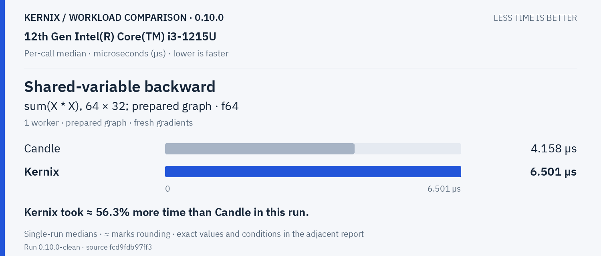

Kernix: **6.501 µs**. Kernix took ≈ 56.3% more time than Candle in this run.

**Record + backward · sum(A · W), 32 × 16 · 16 × 8 · f64**

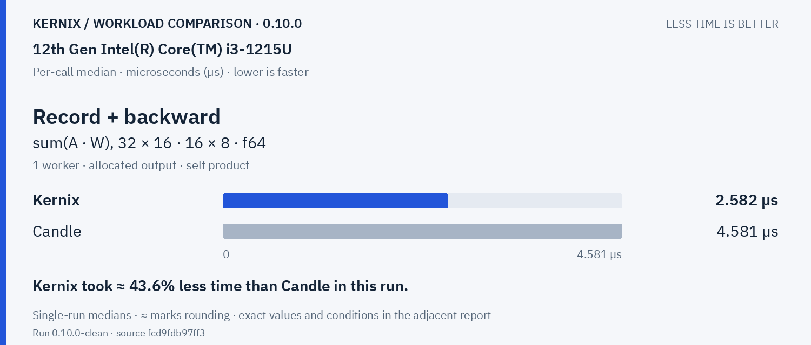

Kernix: **2.582 µs**. Kernix took ≈ 43.6% less time than Candle in this run.

**Model inference · batched normalized/sliced MLP · f64**

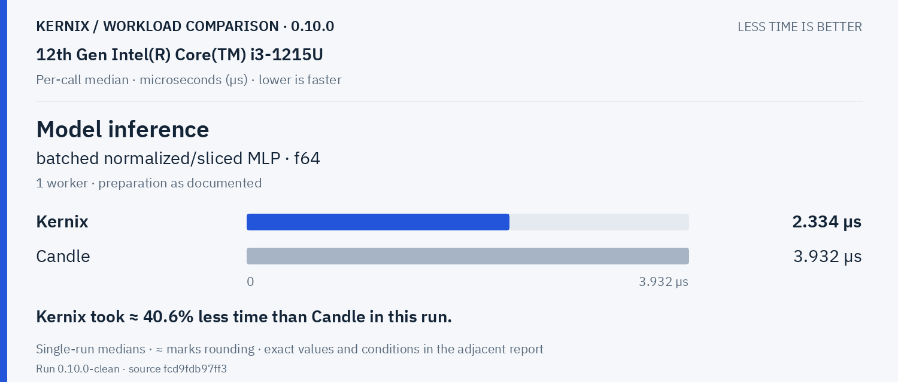

Kernix: **2.334 µs**. Kernix took ≈ 40.6% less time than Candle in this run.

**Model recording + forward · batched normalized/sliced MLP · f64**

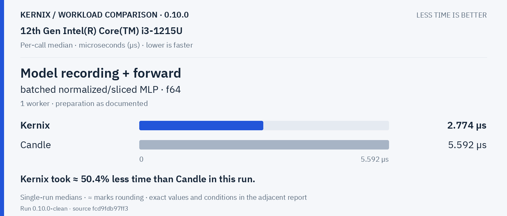

Kernix: **2.774 µs**. Kernix took ≈ 50.4% less time than Candle in this run.

**Model backward · prepared graph → fresh gradients · f64**

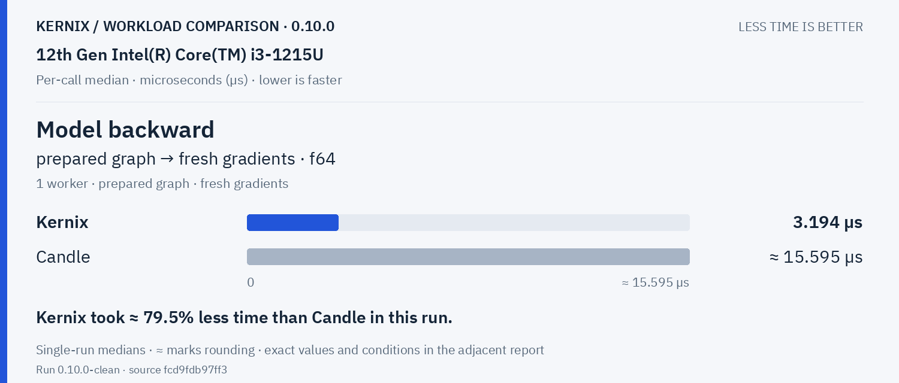

Kernix: **3.194 µs**. Kernix took ≈ 79.5% less time than Candle in this run.

**Parameter update · transactional SGD, fixed gradients · f64**

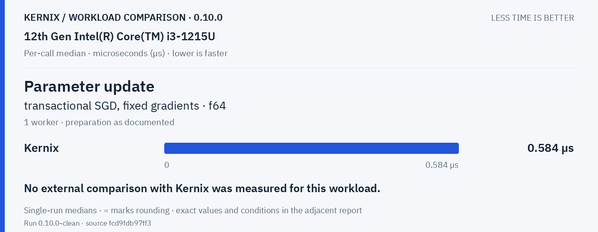

Kernix: **0.584 µs**. No external comparison with Kernix was measured for this workload.

Tensor contractions · 1 workloads

**Coalesced tensor contraction · 16 × 32 × 8 · 32 × 8 × 16 · f64**

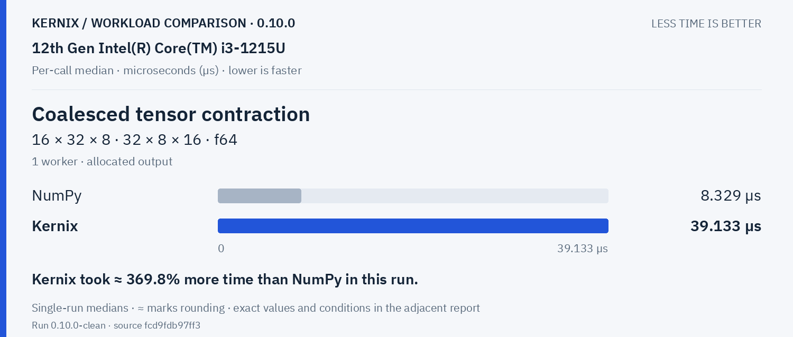

Kernix: **39.133 µs**. Kernix took ≈ 369.8% more time than NumPy in this run.

Statistics & activations · 1 workloads

**Row softmax · 256 × 64 · f64**

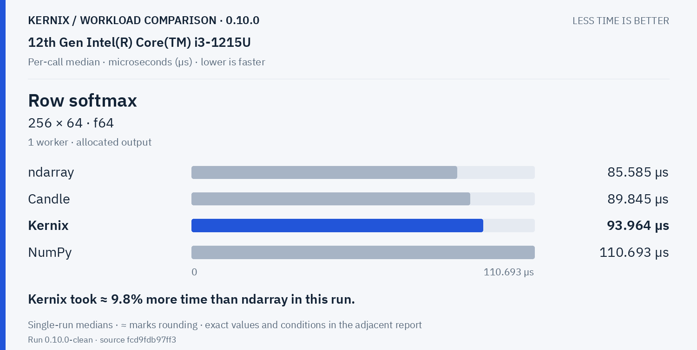

Kernix: **93.964 µs**. Kernix took ≈ 9.8% more time than ndarray in this run.

Tensor construction · 2 workloads

**Create zeros · 64 × 64 · f32**

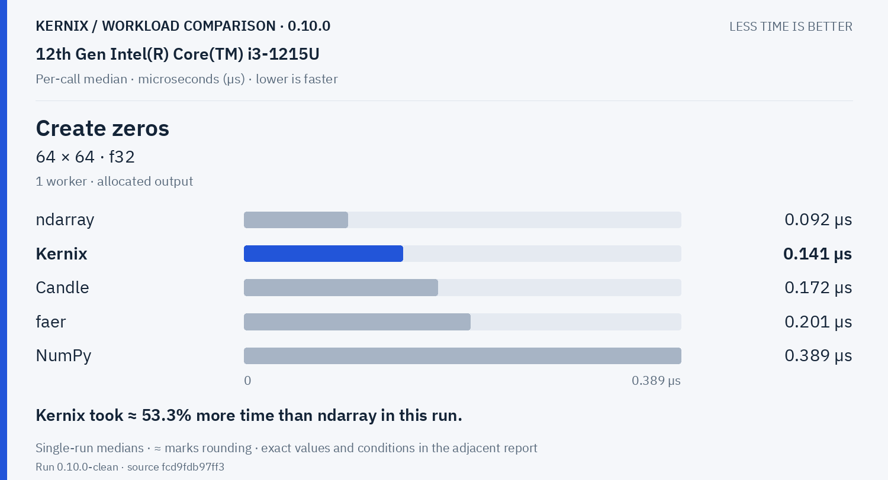

Kernix: **0.141 µs**. Kernix took ≈ 53.3% more time than ndarray in this run.

**Create ones · 64 × 64 · f32**

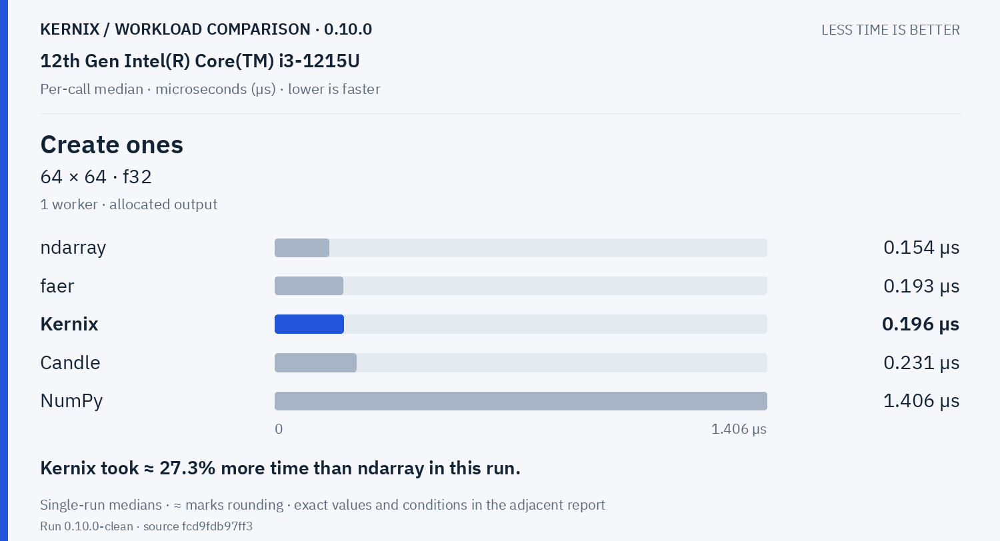

Kernix: **0.196 µs**. Kernix took ≈ 27.3% more time than ndarray in this run.

## Exact latency table

All values below are microseconds per operation. **Lower is faster.** Missing entries were not measured.

| Workload | Kernix | ndarray | nalgebra | faer | Candle | NumPy | Sequential run change |
|---|---:|---:|---:|---:|---:|---:|---:|
| Matrix multiplication · 32 × 32 · 32 × 32 · f64 | 1.837 | **1.463** | 1.498 | 1.528 | 1.582 | 2.746 | +8.9% |
| Matrix multiplication · 64 × 64 · 64 × 64 · f64 | 10.905 | 11.592 | 10.727 | 11.511 | **10.449** | 12.507 | -39.2% |
| Matrix multiplication · 128 × 128 · 128 × 128 · f64 | 84.128 | 120.902 | 122.242 | 88.627 | 83.928 | **79.292** | +1.1% |
| Matrix multiplication · 256 × 256 · 256 × 256 · f64 | 650.087 | 683.995 | 693.95 | 880.524 | **606.776** | 667.864 | +0.4% |
| Matrix multiplication · 64 × 64 · 64 × 64 · f32 | **5.146** | 6.229 | 6.191 | 5.562 | 5.41 | 6.525 | +1.3% |
| Matrix multiplication · 128 × 128 · 128 × 128 · f32 | 40.614 | 51.054 | 52.313 | 50.298 | 39.425 | **39.237** | +5.1% |
| Matrix multiplication · 256 × 256 · 256 × 256 · f32 | 301.732 | 414.735 | 415.266 | 345.495 | **300.116** | 302.06 | +2.3% |
| Batched multiplication · 4 × 16 × 32 · 1 × 32 × 16 · f64 | **2.204** | — | — | — | 2.439 | 3.399 | +6.3% |
| Matmul · 2 workers · reused output · 64 × 64 · 64 × 64 · f64 | 9.832 | — | — | — | — | — | -5.7% |
| Matmul · 2 workers · reused output · 128 × 128 · 128 × 128 · f64 | 81.816 | — | — | — | — | — | -22.1% |
| Matmul · 2 workers · reused output · 256 × 256 · 256 × 256 · f64 | 307.403 | — | — | — | — | — | -27.4% |
| Matmul · 2 workers · reused output · 128 × 128 · 128 × 128 · f32 | 22.644 | — | — | — | — | — | -22.7% |
| Column-pivoted QR · 96 × 32 · f64 | **58.549** | — | 81.493 | 77.385 | — | — | +0.1% |
| Column-pivoted QR · 256 × 64 · f64 | 610.066 | — | 807.347 | **480.146** | — | — | +1.7% |
| Minimum-norm least squares · 64 × 32, rank 16, 4 RHS · f64 | **48.841** | — | 78.119 | — | — | 69.879 | -5.7% |
| Minimum-norm least squares · 32 × 64, rank 32, 4 RHS · f64 | **61.88** | — | 140.636 | — | — | 129.431 | -24.2% |
| Thin QR · 96 × 32 · f64 | 49.589 | — | **39.704** | 69.955 | — | 42.526 | +4.2% |
| Thin QR · 256 × 64 · f64 | 539.29 | — | 388.185 | 431.156 | — | **375.857** | +1.5% |
| Cholesky factorization · 64 × 64 · f64 | 23.868 | — | 14.759 | **9.006** | — | 11.489 | +10.6% |
| Cholesky factorization · 128 × 128 · f64 | 124.27599999999999 | — | 110.192 | **40.517** | — | 75.57 | +3.5% |
| Cholesky factorization · 256 × 256 · f64 | 670.643 | — | 748.822 | **228.287** | — | 534.461 | -2.1% |
| Shared-variable backward · sum(X * X), 64 × 32; prepared graph · f64 | 6.501 | — | — | — | **4.158** | — | +0.2% |
| Record + backward · sum(A · W), 32 × 16 · 16 × 8 · f64 | **2.582** | — | — | — | 4.581 | — | +2.5% |
| Model inference · batched normalized/sliced MLP · f64 | **2.334** | — | — | — | 3.932 | — | -9.3% |
| Model recording + forward · batched normalized/sliced MLP · f64 | **2.774** | — | — | — | 5.592 | — | -5.2% |
| Model backward · prepared graph → fresh gradients · f64 | **3.194** | — | — | — | 15.594999999999998 | — | -3.5% |
| Parameter update · transactional SGD, fixed gradients · f64 | 0.584 | — | — | — | — | — | -0.2% |
| Coalesced tensor contraction · 16 × 32 × 8 · 32 × 8 × 16 · f64 | 39.133 | — | — | — | — | **8.329** | -94.3% |
| Row softmax · 256 × 64 · f64 | 93.964 | **85.585** | — | — | 89.845 | 110.693 | +0.3% |
| Create zeros · 64 × 64 · f32 | 0.141 | **0.092** | — | 0.201 | 0.172 | 0.389 | -9.6% |
| Create ones · 64 × 64 · f32 | 0.196 | **0.154** | — | 0.193 | 0.231 | 1.406 | -4.4% |

## Version comparison

13 of 31 workloads have paired evidence. Exploratory 95% intervals resample process pairs, not calls. No multiple-comparison adjustment.

### Version changes at a glance

The vertical line marks unchanged time. Left is faster; right is slower. Ranges are exploratory 95% intervals over fresh-process pairs. An interval crossing the line leaves direction unclear.

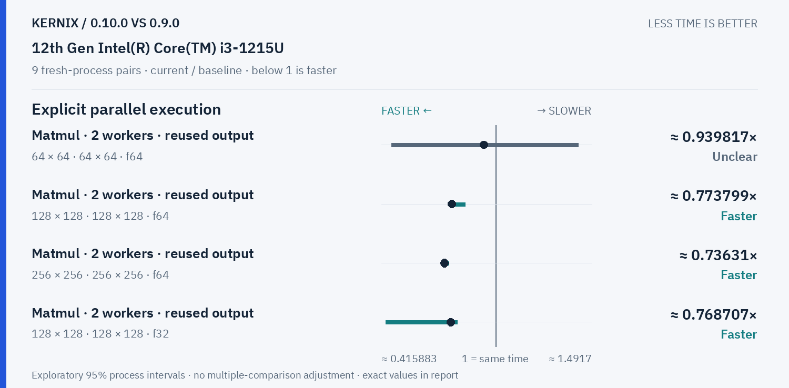

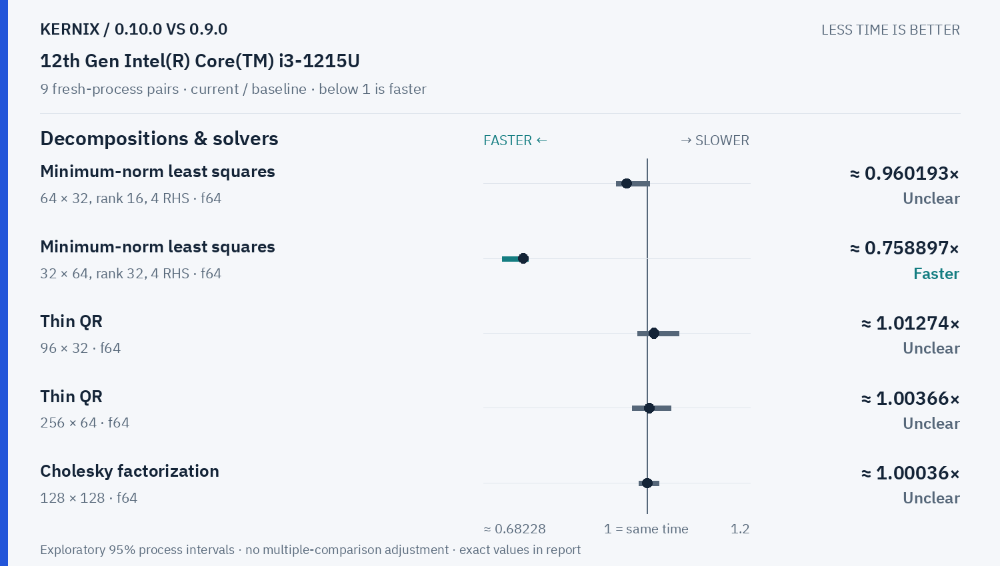

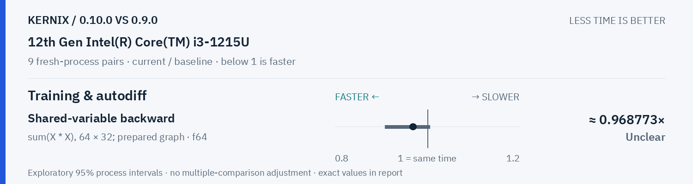

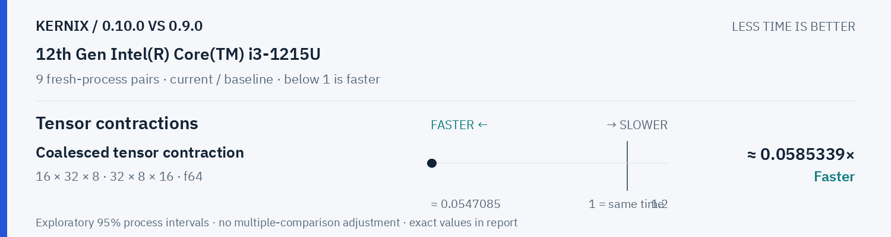

| Workload | Current / baseline [95% interval] | Interpretation |
|---|---:|---|
| Matrix multiplication · 32 × 32 · 32 × 32 · f64 | — | No paired comparison |
| Matrix multiplication · 64 × 64 · 64 × 64 · f64 | — | No paired comparison |
| Matrix multiplication · 128 × 128 · 128 × 128 · f64 | 1.0172824791418356× [0.9823877983479045, 1.0442190966043439] | Timing direction unclear |
| Matrix multiplication · 256 × 256 · 256 × 256 · f64 | — | No paired comparison |
| Matrix multiplication · 64 × 64 · 64 × 64 · f32 | — | No paired comparison |
| Matrix multiplication · 128 × 128 · 128 × 128 · f32 | 0.9942393049390877× [0.9576774193548387, 1.0324791345424285] | Timing direction unclear |
| Matrix multiplication · 256 × 256 · 256 × 256 · f32 | — | No paired comparison |
| Batched multiplication · 4 × 16 × 32 · 1 × 32 × 16 · f64 | — | No paired comparison |
| Matmul · 2 workers · reused output · 64 × 64 · 64 × 64 · f64 | 0.939817091159406× [0.4675953414021466, 1.4206664022213407] | Timing direction unclear |
| Matmul · 2 workers · reused output · 128 × 128 · 128 × 128 · f64 | 0.7737991100292854× [0.768674522566667, 0.8446403359519241] | Observed time reduction |
| Matmul · 2 workers · reused output · 256 × 256 · 256 × 256 · f64 | 0.7363103488972145× [0.7254634944389963, 0.7608528926076653] | Observed time reduction |
| Matmul · 2 workers · reused output · 128 × 128 · 128 × 128 · f32 | 0.7687074829931972× [0.4377720919575346, 0.8030099989691785] | Observed time reduction |
| Column-pivoted QR · 96 × 32 · f64 | — | No paired comparison |
| Column-pivoted QR · 256 × 64 · f64 | — | No paired comparison |
| Minimum-norm least squares · 64 × 32, rank 16, 4 RHS · f64 | 0.9601934957454249× [0.9392138063279003, 1.005085111813559] | Timing direction unclear |
| Minimum-norm least squares · 32 × 64, rank 32, 4 RHS · f64 | 0.7588965246897702× [0.7181894083969466, 0.7686042740278929] | Observed time reduction |
| Thin QR · 96 × 32 · f64 | 1.0127366207057724× [0.9813273721187985, 1.0610946896340843] | Timing direction unclear |
| Thin QR · 256 × 64 · f64 | 1.0036583839038473× [0.970302782264253, 1.0459129820712867] | Timing direction unclear |
| Cholesky factorization · 64 × 64 · f64 | — | No paired comparison |
| Cholesky factorization · 128 × 128 · f64 | 1.0003607237430008× [0.9832872672183858, 1.022784057586786] | Timing direction unclear |
| Cholesky factorization · 256 × 256 · f64 | — | No paired comparison |
| Shared-variable backward · sum(X * X), 64 × 32; prepared graph · f64 | 0.9687731241675299× [0.9081661486295564, 1.005344231373782] | Timing direction unclear |
| Record + backward · sum(A · W), 32 × 16 · 16 × 8 · f64 | — | No paired comparison |
| Model inference · batched normalized/sliced MLP · f64 | — | No paired comparison |
| Model recording + forward · batched normalized/sliced MLP · f64 | — | No paired comparison |
| Model backward · prepared graph → fresh gradients · f64 | — | No paired comparison |
| Parameter update · transactional SGD, fixed gradients · f64 | — | No paired comparison |
| Coalesced tensor contraction · 16 × 32 × 8 · 32 × 8 × 16 · f64 | 0.05853394018885557× [0.0575878995545003, 0.061997534457761586] | Observed time reduction |
| Row softmax · 256 × 64 · f64 | — | No paired comparison |
| Create zeros · 64 × 64 · f32 | — | No paired comparison |
| Create ones · 64 × 64 · f32 | — | No paired comparison |

## Method and provenance

CPU affinity pinned to logical CPU 0. Frequency and background load are uncontrolled.

Minimum-norm rows use pivoted QR plus scaled implicit RZ in Kernix; NumPy native lstsq; nalgebra native SVD/solve. Algorithm costs and rank policies differ. See original method for thresholds.

Numbers retain source precision; recorded digits do not imply equivalent physical measurement accuracy. Lowest observed medians are bold only when peers were measured. No aggregate winner or universal ranking is inferred.

[Original report and commentary](original-report.txt) · [Raw measurements](raw.json)

Measured source `fcd9fdb97ff307e9c50d0526e8b4e1a580cb44a9`. Run `0.10.0-clean`. Rendering does not change measurements.
