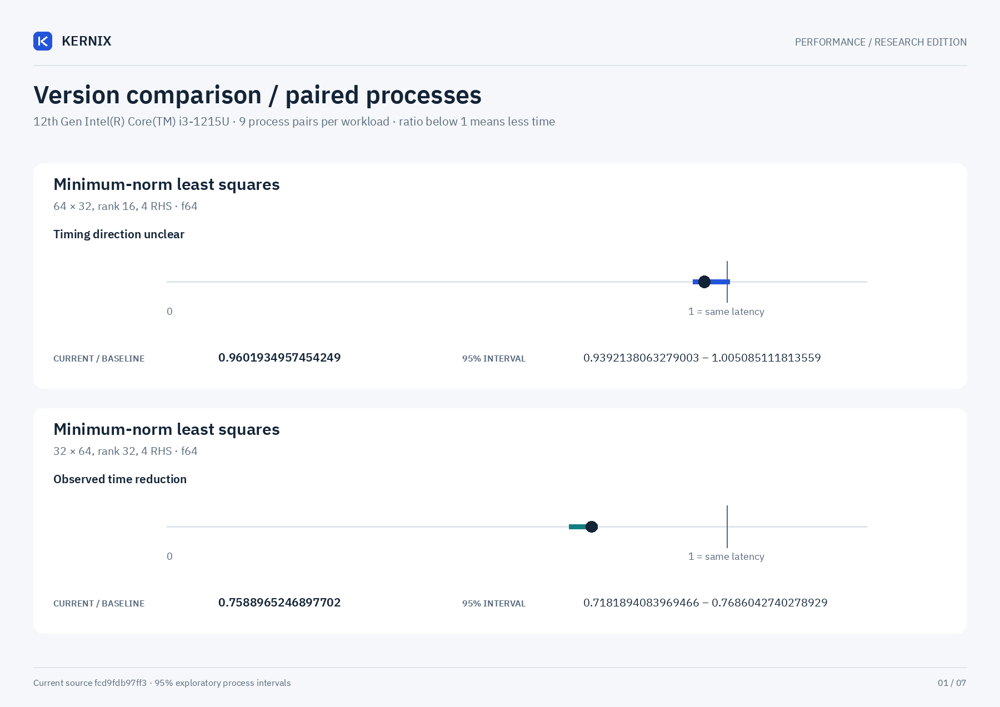
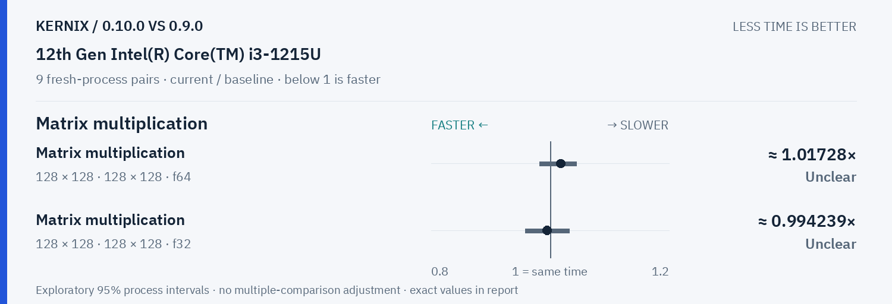

# Kernix 0.10.0 · paired process comparison

9 fresh-process pairs per workload. Ratios below 1 mean less time.

[Interactive HTML (open locally)](report.html) · [Vector PDF](latency.pdf) · [Original process evidence](paired.json)

### Version changes at a glance

The vertical line marks unchanged time. Left is faster; right is slower. Ranges are exploratory 95% intervals over fresh-process pairs. An interval crossing the line leaves direction unclear.

## Exact process ratios

| Workload | Current / baseline [95% interval] | Interpretation |
|---|---:|---|
| Minimum-norm least squares · 64 × 32, rank 16, 4 RHS · f64 | 0.9601934957454249× [0.9392138063279003, 1.005085111813559] | Timing direction unclear |
| Minimum-norm least squares · 32 × 64, rank 32, 4 RHS · f64 | 0.7588965246897702× [0.7181894083969466, 0.7686042740278929] | Observed time reduction |
| Coalesced tensor contraction · 16 × 32 × 8 · 32 × 8 × 16 · f64 | 0.05853394018885557× [0.0575878995545003, 0.061997534457761586] | Observed time reduction |
| Shared-variable backward · sum(X * X), 64 × 32; prepared graph · f64 | 0.9687731241675299× [0.9081661486295564, 1.005344231373782] | Timing direction unclear |
| Matmul · 2 workers · reused output · 64 × 64 · 64 × 64 · f64 | 0.939817091159406× [0.4675953414021466, 1.4206664022213407] | Timing direction unclear |
| Matmul · 2 workers · reused output · 128 × 128 · 128 × 128 · f64 | 0.7737991100292854× [0.768674522566667, 0.8446403359519241] | Observed time reduction |
| Matmul · 2 workers · reused output · 256 × 256 · 256 × 256 · f64 | 0.7363103488972145× [0.7254634944389963, 0.7608528926076653] | Observed time reduction |
| Matmul · 2 workers · reused output · 128 × 128 · 128 × 128 · f32 | 0.7687074829931972× [0.4377720919575346, 0.8030099989691785] | Observed time reduction |
| Matrix multiplication · 128 × 128 · 128 × 128 · f64 | 1.0172824791418356× [0.9823877983479045, 1.0442190966043439] | Timing direction unclear |
| Matrix multiplication · 128 × 128 · 128 × 128 · f32 | 0.9942393049390877× [0.9576774193548387, 1.0324791345424285] | Timing direction unclear |
| Thin QR · 96 × 32 · f64 | 1.0127366207057724× [0.9813273721187985, 1.0610946896340843] | Timing direction unclear |
| Thin QR · 256 × 64 · f64 | 1.0036583839038473× [0.970302782264253, 1.0459129820712867] | Timing direction unclear |
| Cholesky factorization · 128 × 128 · f64 | 1.0003607237430008× [0.9832872672183858, 1.022784057586786] | Timing direction unclear |

## Method

95% percentile bootstrap over paired process blocks; 10000 resamples; exploratory, no multiple-comparison adjustment

Current `0.10.0-clean`; baseline `0.9.0-registry-010`. All source ratio digits, paired observations and process ordering are preserved. No absolute peer latencies are inferred.
