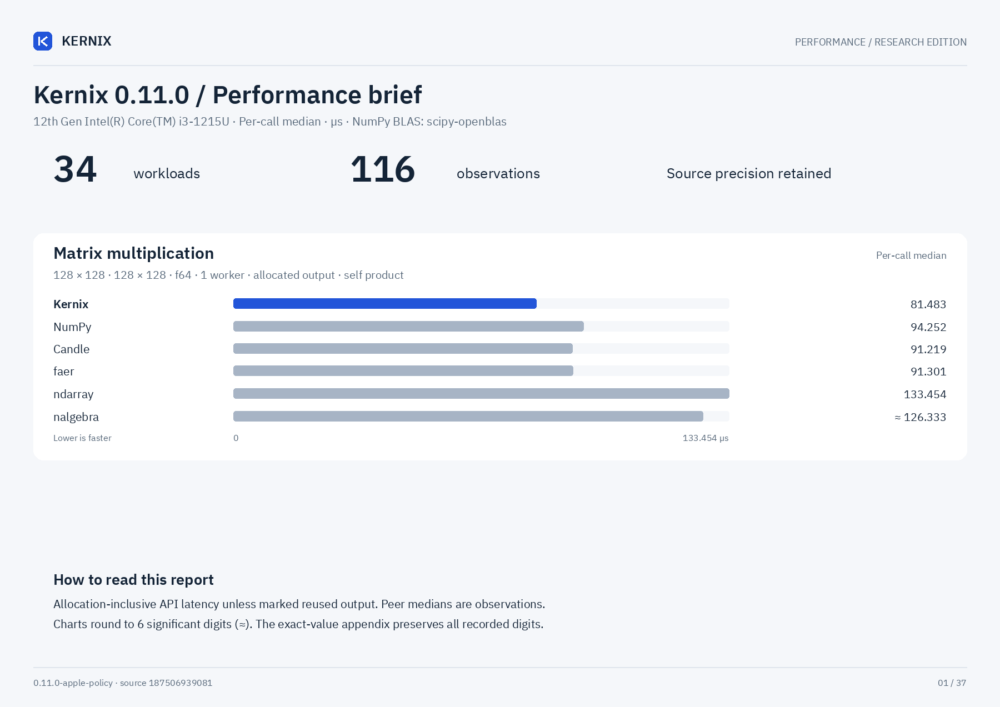

# Kernix 0.11.0 · performance brief

12th Gen Intel(R) Core(TM) i3-1215U / Linux

**Per-call median, microseconds per operation. Lower is faster. All recorded digits retained.**

34 workloads · 116 observations

Baseline: 0.10.0-registry-011. Sequential run changes are descriptive; paired process evidence is shown separately.

[Open the visual report](report.html) · [Vector PDF](latency.pdf) · [Raw measurements](raw.json)

| Workload | Kernix | ndarray | nalgebra | faer | Candle | NumPy | Sequential run change |
|---|---:|---:|---:|---:|---:|---:|---:|
| Independent matrix operands · 128 × 128 · 128 × 128 · f64 | **79.522** | — | — | — | — | 82.316 | +7.5% |
| Independent matrix operands · 128 × 128 · 128 × 128 · f32 | **40.851** | — | — | — | — | 41.398 | +19.3% |
| Matrix multiplication · 32 × 32 · 32 × 32 · f64 | 1.822 | **1.61** | 1.693 | 1.646 | 1.752 | 4.777 | +19.9% |
| Matrix multiplication · 64 × 64 · 64 × 64 · f64 | **10.685** | 12.993 | 11.254 | 12.064 | 11.06 | 12.896 | +11.5% |
| Matrix multiplication · 128 × 128 · 128 × 128 · f64 | **81.483** | 133.454 | 126.33300000000001 | 91.301 | 91.219 | 94.252 | +7.2% |
| Matrix multiplication · 256 × 256 · 256 × 256 · f64 | 651.551 | 745.908 | 730.698 | 834.945 | **644.914** | 686.909 | +15.3% |
| Matrix multiplication · 64 × 64 · 64 × 64 · f32 | **5.239** | 7.002 | 6.643 | 5.852 | 5.459 | 6.689 | +14.5% |
| Matrix multiplication · 128 × 128 · 128 × 128 · f32 | 46.01 | 54.284 | 54.141 | 47.184 | 41.717 | **41.294** | +15.4% |
| Matrix multiplication · 256 × 256 · 256 × 256 · f32 | 346.674 | 453.024 | 446.141 | 358.189 | **311.22** | 333.271 | +12.1% |
| Batched multiplication · 4 × 16 × 32 · 1 × 32 × 16 · f64 | **2.279** | — | — | — | 2.293 | 3.41 | +20.8% |
| Matmul · 2 workers · reused output · 64 × 64 · 64 × 64 · f64 | 11.276 | — | — | — | — | — | +16.6% |
| Matmul · 2 workers · reused output · 128 × 128 · 128 × 128 · f64 | 79.016 | — | — | — | — | — | +91.4% |
| Matmul · 2 workers · reused output · 256 × 256 · 256 × 256 · f64 | 343.076 | — | — | — | — | — | +16.4% |
| Matmul · 2 workers · reused output · 128 × 128 · 128 × 128 · f32 | 41.048 | — | — | — | — | — | +4.8% |
| Cholesky factorization · 512 × 512 · f64 | 4062.093 | — | 8337.880000000001 | **2059.3780000000002** | — | 8994.431 | -21.2% |
| Column-pivoted QR · 96 × 32 · f64 | **61.85** | — | 84.895 | 81.252 | — | — | +15.8% |
| Column-pivoted QR · 256 × 64 · f64 | 602.805 | — | 856.584 | **514.231** | — | — | +15.9% |
| Minimum-norm least squares · 64 × 32, rank 16, 4 RHS · f64 | **54.399** | — | 81.705 | — | — | 74.806 | +26.1% |
| Minimum-norm least squares · 32 × 64, rank 32, 4 RHS · f64 | **66.701** | — | 152.598 | — | — | 146.425 | +17.0% |
| Thin QR · 96 × 32 · f64 | 53.055 | — | **43.968** | 75.509 | — | 45.085 | +19.2% |
| Thin QR · 256 × 64 · f64 | 588.471 | — | 434.514 | 508.628 | — | **430.596** | +21.2% |
| Cholesky factorization · 64 × 64 · f64 | 23.116 | — | 15.5 | **9.262** | — | 11.825 | +18.1% |
| Cholesky factorization · 128 × 128 · f64 | 128.36799999999999 | — | 111.377 | **47.544** | — | 77.201 | +8.1% |
| Cholesky factorization · 256 × 256 · f64 | 579.5 | — | 774.853 | **227.006** | — | 605.474 | -23.2% |
| Shared-variable backward · sum(X * X), 64 × 32; prepared graph · f64 | 6.946 | — | — | — | **4.717** | — | +14.8% |
| Record + backward · sum(A · W), 32 × 16 · 16 × 8 · f64 | **2.753** | — | — | — | 4.459 | — | +6.3% |
| Model inference · batched normalized/sliced MLP · f64 | **4.036** | — | — | — | 4.733 | — | +87.3% |
| Model recording + forward · batched normalized/sliced MLP · f64 | **2.84** | — | — | — | 8.494 | — | +1.6% |
| Model backward · prepared graph → fresh gradients · f64 | **3.515** | — | — | — | 21.894 | — | +11.6% |
| Parameter update · transactional SGD, fixed gradients · f64 | 0.584 | — | — | — | — | — | +11.0% |
| Coalesced tensor contraction · 16 × 32 × 8 · 32 × 8 × 16 · f64 | 41.049 | — | — | — | — | **8.467** | +16.6% |
| Row softmax · 256 × 64 · f64 | 100.743 | **78.637** | — | — | 97.887 | 117.684 | +18.3% |
| Create zeros · 64 × 64 · f32 | **0.155** | 0.195 | — | 0.175 | 0.168 | 0.445 | -15.8% |
| Create ones · 64 × 64 · f32 | 0.205 | **0.169** | — | 0.207 | 0.25 | 1.399 | -9.3% |

## Version comparison

12 of 34 workloads have paired evidence. Exploratory 95% intervals resample process pairs, not calls. No multiple-comparison adjustment.

| Workload | Current / baseline [95% interval] | Interpretation |
|---|---:|---|
| Independent matrix operands · 128 × 128 · 128 × 128 · f64 | 1.004740888037442× [0.9773611561443327, 1.030975013083748] | Timing direction unclear |
| Independent matrix operands · 128 × 128 · 128 × 128 · f32 | 0.9811129303784333× [0.963422583838335, 1.0074494501596312] | Timing direction unclear |
| Matrix multiplication · 32 × 32 · 32 × 32 · f64 | — | No paired comparison |
| Matrix multiplication · 64 × 64 · 64 × 64 · f64 | — | No paired comparison |
| Matrix multiplication · 128 × 128 · 128 × 128 · f64 | 1.0025052882854137× [0.9880735938161069, 1.0225046982059274] | Timing direction unclear |
| Matrix multiplication · 256 × 256 · 256 × 256 · f64 | 1.0114855606885347× [0.990548270142216, 1.0288933273574434] | Timing direction unclear |
| Matrix multiplication · 64 × 64 · 64 × 64 · f32 | — | No paired comparison |
| Matrix multiplication · 128 × 128 · 128 × 128 · f32 | 1.0289899805308893× [0.9526051404500709, 1.0830772982199464] | Timing direction unclear |
| Matrix multiplication · 256 × 256 · 256 × 256 · f32 | 1.0025730309864649× [0.9680604337742499, 1.0144496787739743] | Timing direction unclear |
| Batched multiplication · 4 × 16 × 32 · 1 × 32 × 16 · f64 | — | No paired comparison |
| Matmul · 2 workers · reused output · 64 × 64 · 64 × 64 · f64 | — | No paired comparison |
| Matmul · 2 workers · reused output · 128 × 128 · 128 × 128 · f64 | 0.872338778354107× [0.5543263964950712, 1.3800706430704246] | Timing direction unclear |
| Matmul · 2 workers · reused output · 256 × 256 · 256 × 256 · f64 | 1.0384417006440088× [0.9568996441051641, 1.3675399257855017] | Timing direction unclear |
| Matmul · 2 workers · reused output · 128 × 128 · 128 × 128 · f32 | 0.9749494851133238× [0.5880299992574441, 1.1664146010099716] | Timing direction unclear |
| Cholesky factorization · 512 × 512 · f64 | 0.5982396425193351× [0.5947366010193733, 0.6118751691686888] | Observed time reduction |
| Column-pivoted QR · 96 × 32 · f64 | — | No paired comparison |
| Column-pivoted QR · 256 × 64 · f64 | — | No paired comparison |
| Minimum-norm least squares · 64 × 32, rank 16, 4 RHS · f64 | — | No paired comparison |
| Minimum-norm least squares · 32 × 64, rank 32, 4 RHS · f64 | — | No paired comparison |
| Thin QR · 96 × 32 · f64 | — | No paired comparison |
| Thin QR · 256 × 64 · f64 | — | No paired comparison |
| Cholesky factorization · 64 × 64 · f64 | — | No paired comparison |
| Cholesky factorization · 128 × 128 · f64 | 1.0334319165802792× [1.0075385294162393, 1.0426613786824277] | Observed time increase |
| Cholesky factorization · 256 × 256 · f64 | 0.7762255134210398× [0.7593444192198485, 0.8109318717436064] | Observed time reduction |
| Shared-variable backward · sum(X * X), 64 × 32; prepared graph · f64 | — | No paired comparison |
| Record + backward · sum(A · W), 32 × 16 · 16 × 8 · f64 | — | No paired comparison |
| Model inference · batched normalized/sliced MLP · f64 | — | No paired comparison |
| Model recording + forward · batched normalized/sliced MLP · f64 | — | No paired comparison |
| Model backward · prepared graph → fresh gradients · f64 | — | No paired comparison |
| Parameter update · transactional SGD, fixed gradients · f64 | — | No paired comparison |
| Coalesced tensor contraction · 16 × 32 × 8 · 32 × 8 × 16 · f64 | — | No paired comparison |
| Row softmax · 256 × 64 · f64 | — | No paired comparison |
| Create zeros · 64 × 64 · f32 | — | No paired comparison |
| Create ones · 64 × 64 · f32 | — | No paired comparison |

## Method and provenance

CPU affinity pinned to logical CPU 0. Frequency and background load are uncontrolled.

Minimum-norm rows use pivoted QR plus scaled implicit RZ in Kernix; NumPy native lstsq; nalgebra native SVD/solve. Algorithm costs and rank policies differ. See original method for thresholds.

Numbers retain source precision; recorded digits do not imply equivalent physical measurement accuracy. Lowest observed medians are bold only when peers were measured. No aggregate winner or universal ranking is inferred.

[Original report and commentary](original-report.txt) · [Raw measurements](raw.json)

Measured source `18750693908110110d85d02d0f11af8d58bfae8b`. Run `0.11.0-apple-policy`. Rendering does not change measurements.
