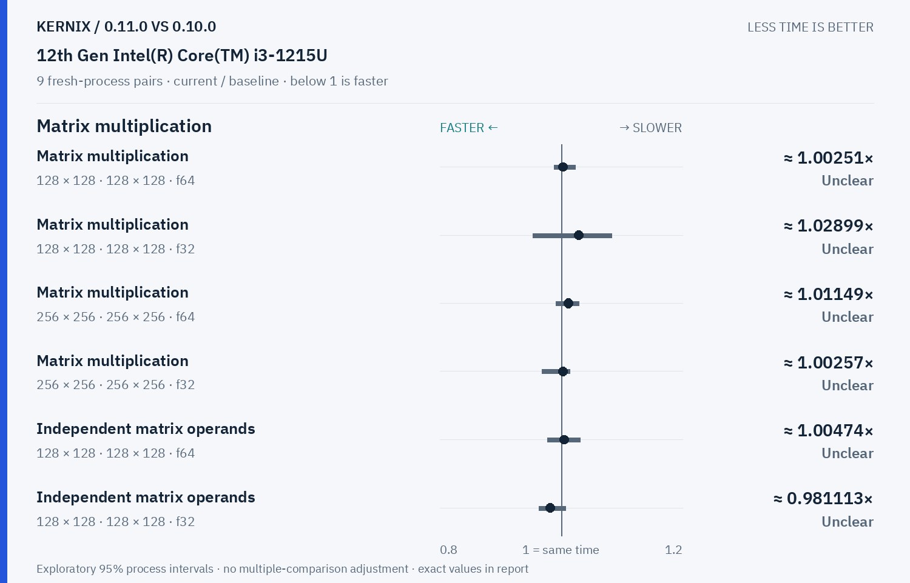
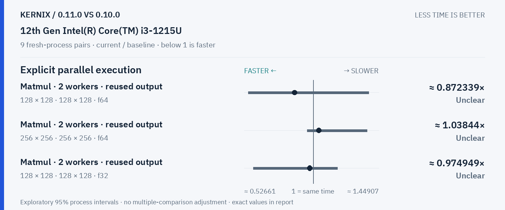
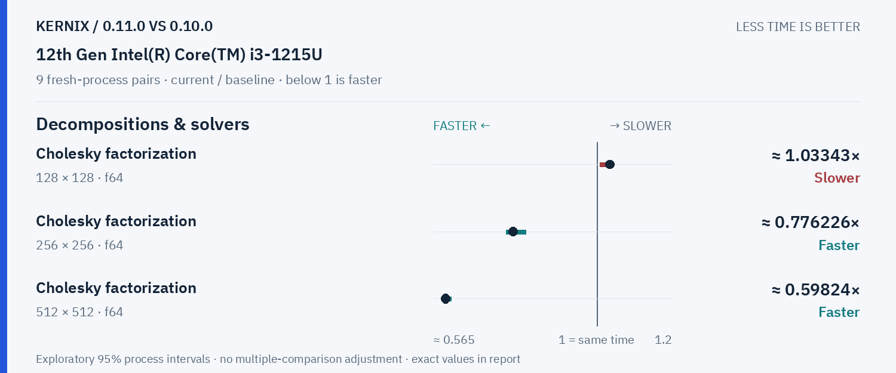

# Kernix 0.11.0 · paired process comparison

9 fresh-process pairs per workload. Ratios below 1 mean less time.

[Interactive HTML (open locally)](report.html) · [Vector PDF](latency.pdf) · [Original process evidence](paired.json)

### Version changes at a glance

The vertical line marks unchanged time. Left is faster; right is slower. Ranges are exploratory 95% intervals over fresh-process pairs. An interval crossing the line leaves direction unclear.

## Exact process ratios

| Workload | Current / baseline [95% interval] | Interpretation |
|---|---:|---|
| Matrix multiplication · 128 × 128 · 128 × 128 · f64 | 1.0025052882854137× [0.9880735938161069, 1.0225046982059274] | Timing direction unclear |
| Matrix multiplication · 128 × 128 · 128 × 128 · f32 | 1.0289899805308893× [0.9526051404500709, 1.0830772982199464] | Timing direction unclear |
| Matrix multiplication · 256 × 256 · 256 × 256 · f64 | 1.0114855606885347× [0.990548270142216, 1.0288933273574434] | Timing direction unclear |
| Matrix multiplication · 256 × 256 · 256 × 256 · f32 | 1.0025730309864649× [0.9680604337742499, 1.0144496787739743] | Timing direction unclear |
| Independent matrix operands · 128 × 128 · 128 × 128 · f64 | 1.004740888037442× [0.9773611561443327, 1.030975013083748] | Timing direction unclear |
| Independent matrix operands · 128 × 128 · 128 × 128 · f32 | 0.9811129303784333× [0.963422583838335, 1.0074494501596312] | Timing direction unclear |
| Cholesky factorization · 128 × 128 · f64 | 1.0334319165802792× [1.0075385294162393, 1.0426613786824277] | Observed time increase |
| Cholesky factorization · 256 × 256 · f64 | 0.7762255134210398× [0.7593444192198485, 0.8109318717436064] | Observed time reduction |
| Cholesky factorization · 512 × 512 · f64 | 0.5982396425193351× [0.5947366010193733, 0.6118751691686888] | Observed time reduction |
| Matmul · 2 workers · reused output · 128 × 128 · 128 × 128 · f64 | 0.872338778354107× [0.5543263964950712, 1.3800706430704246] | Timing direction unclear |
| Matmul · 2 workers · reused output · 256 × 256 · 256 × 256 · f64 | 1.0384417006440088× [0.9568996441051641, 1.3675399257855017] | Timing direction unclear |
| Matmul · 2 workers · reused output · 128 × 128 · 128 × 128 · f32 | 0.9749494851133238× [0.5880299992574441, 1.1664146010099716] | Timing direction unclear |

## Method

95% percentile bootstrap over paired process blocks; 10000 resamples; exploratory, no multiple-comparison adjustment

Current `0.11.0-apple-policy`; baseline `0.10.0-registry-011`. All source ratio digits, paired observations and process ordering are preserved. No absolute peer latencies are inferred.
