# Kernix 0.11.0 · performance brief

12th Gen Intel(R) Core(TM) i3-1215U / Linux

**Per-call median, microseconds per operation. Lower is faster. All recorded digits retained.**

35 workloads · 119 observations

No previous-version baseline attached. Sequential run changes are descriptive; paired process evidence is shown separately.

[Interactive HTML (open locally)](report.html) · [Vector PDF](latency.pdf) · [Raw measurements](raw.json)

## Charts by workload

**Shorter bars mean less time.** Blue is Kernix; grey is another library; teal is an explicitly selected Kernix backend. Entries are sorted by the recorded median, with a separate zero-based scale per chart. These point observations do not establish a statistical ranking.

Expand a group to see every chart here on GitHub. Click a chart to enlarge it. The exact table below keeps every source digit.

Matrix multiplication · 11 workloads

**Independent matrix operands · 128 × 128 · 128 × 128 · f64**

Kernix: **70.656 µs**. Kernix took ≈ 3.3% less time than NumPy in this run.

**Independent matrix operands · 128 × 128 · 128 × 128 · f32**

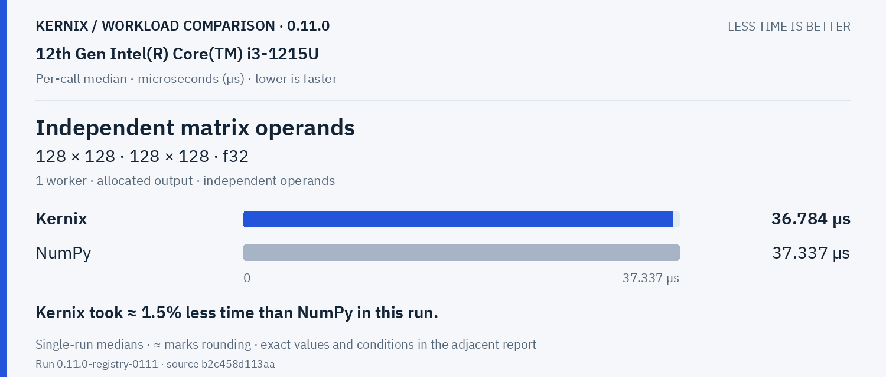

Kernix: **36.784 µs**. Kernix took ≈ 1.5% less time than NumPy in this run.

**Matrix multiplication · 32 × 32 · 32 × 32 · f64**

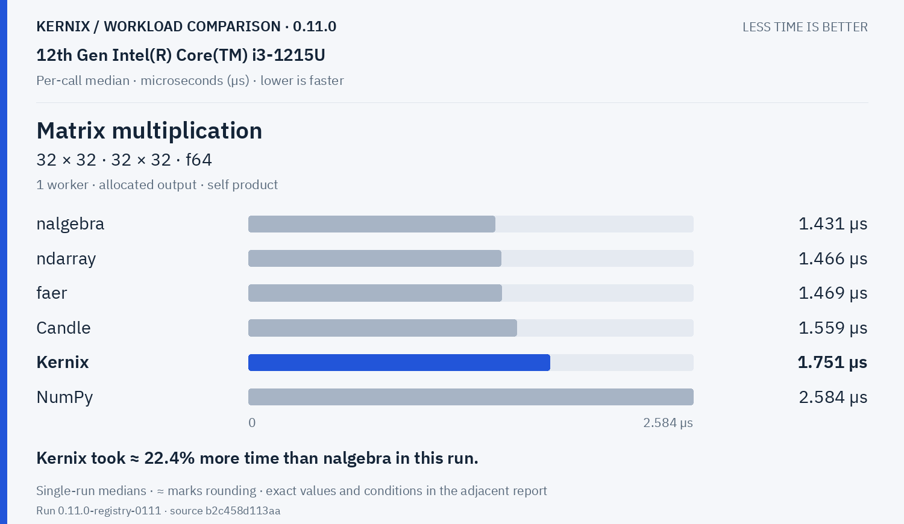

Kernix: **1.751 µs**. Kernix took ≈ 22.4% more time than nalgebra in this run.

**Matrix multiplication · 64 × 64 · 64 × 64 · f64**

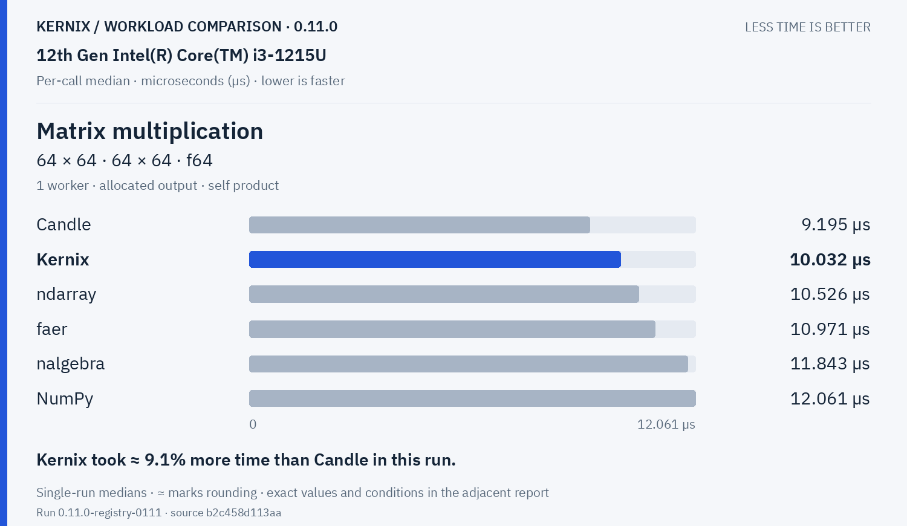

Kernix: **10.032 µs**. Kernix took ≈ 9.1% more time than Candle in this run.

**Matrix multiplication · 128 × 128 · 128 × 128 · f64**

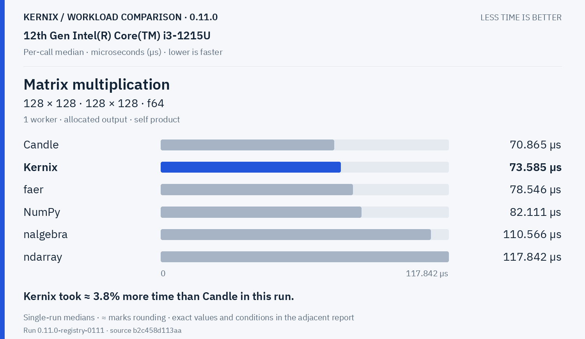

Kernix: **73.585 µs**. Kernix took ≈ 3.8% more time than Candle in this run.

**Matrix multiplication · 256 × 256 · 256 × 256 · f64**

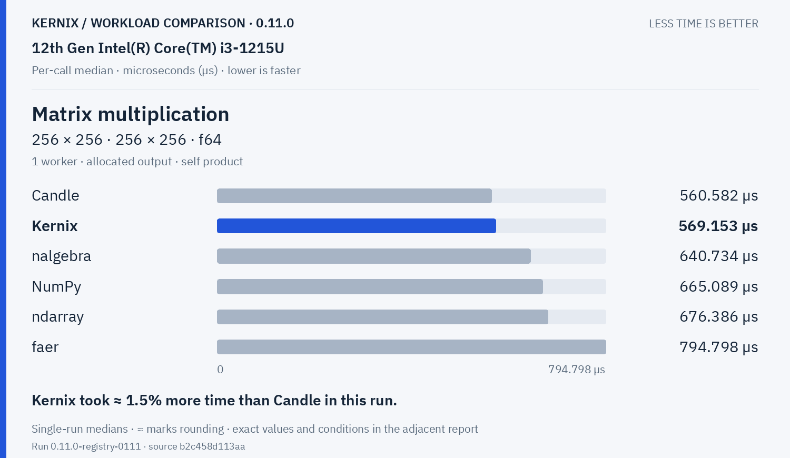

Kernix: **569.153 µs**. Kernix took ≈ 1.5% more time than Candle in this run.

**Matrix multiplication · 64 × 64 · 64 × 64 · f32**

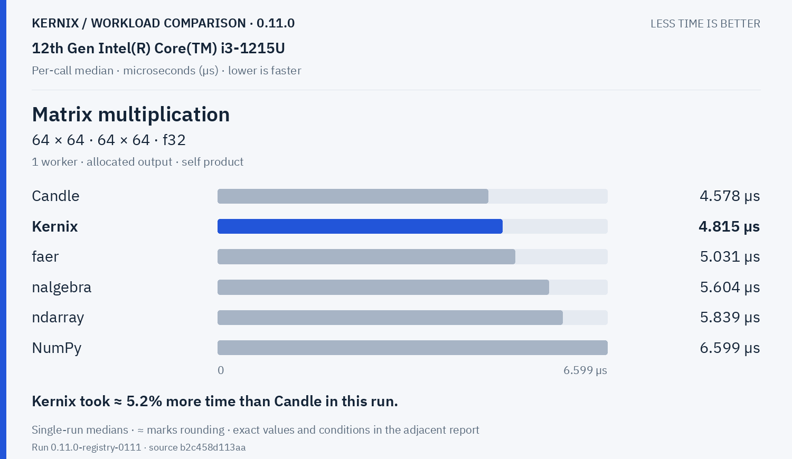

Kernix: **4.815 µs**. Kernix took ≈ 5.2% more time than Candle in this run.

**Matrix multiplication · 128 × 128 · 128 × 128 · f32**

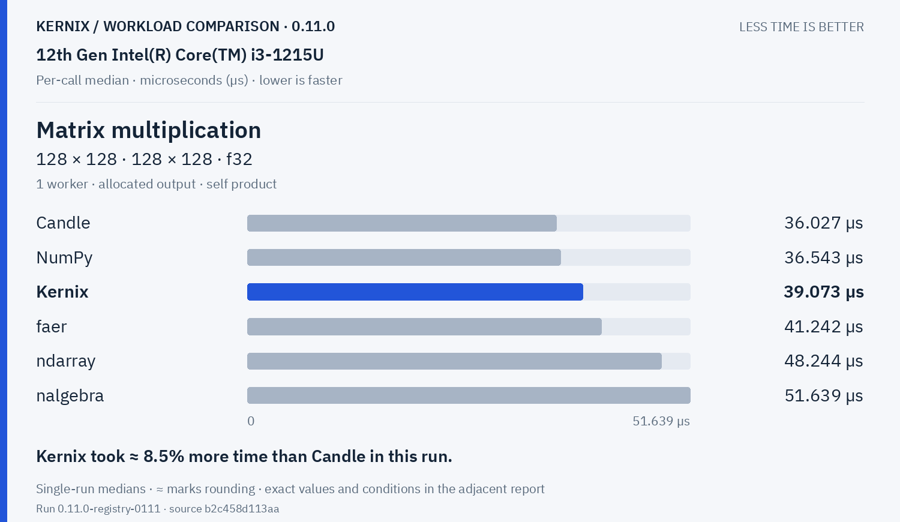

Kernix: **39.073 µs**. Kernix took ≈ 8.5% more time than Candle in this run.

**Matrix multiplication · 256 × 256 · 256 × 256 · f32**

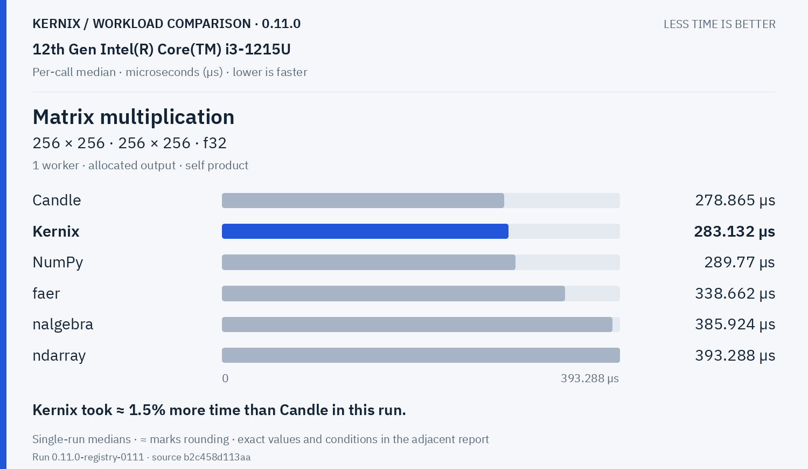

Kernix: **283.132 µs**. Kernix took ≈ 1.5% more time than Candle in this run.

**Batched multiplication · 4 × 16 × 32 · 1 × 32 × 16 · f64**

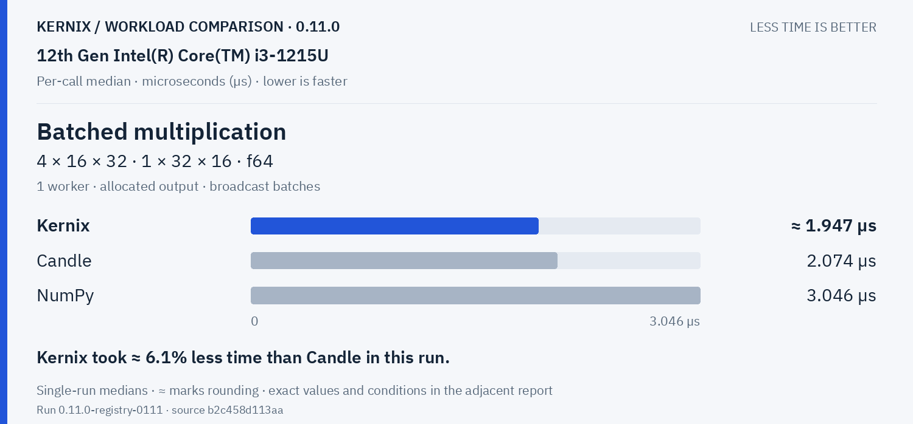

Kernix: **1.9470000000000002 µs**. Kernix took ≈ 6.1% less time than Candle in this run.

**Batched multiplication · 4 × 16 × 32 · 1 × 32 × 16 · f32**

Kernix: **1.388 µs**. Kernix took ≈ 5.0% less time than Candle in this run.

Explicit parallel execution · 4 workloads

**Matmul · 2 workers · reused output · 64 × 64 · 64 × 64 · f64**

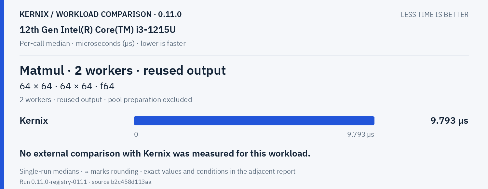

Kernix: **9.793 µs**. No external comparison with Kernix was measured for this workload.

**Matmul · 2 workers · reused output · 128 × 128 · 128 × 128 · f64**

Kernix: **42.23 µs**. No external comparison with Kernix was measured for this workload.

**Matmul · 2 workers · reused output · 256 × 256 · 256 × 256 · f64**

Kernix: **295.463 µs**. No external comparison with Kernix was measured for this workload.

**Matmul · 2 workers · reused output · 128 × 128 · 128 × 128 · f32**

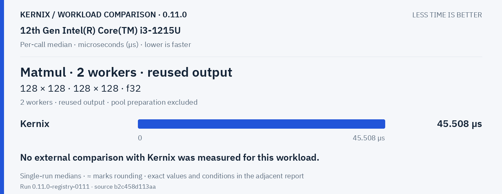

Kernix: **45.508 µs**. No external comparison with Kernix was measured for this workload.

Decompositions & solvers · 10 workloads

**Cholesky factorization · 512 × 512 · f64**

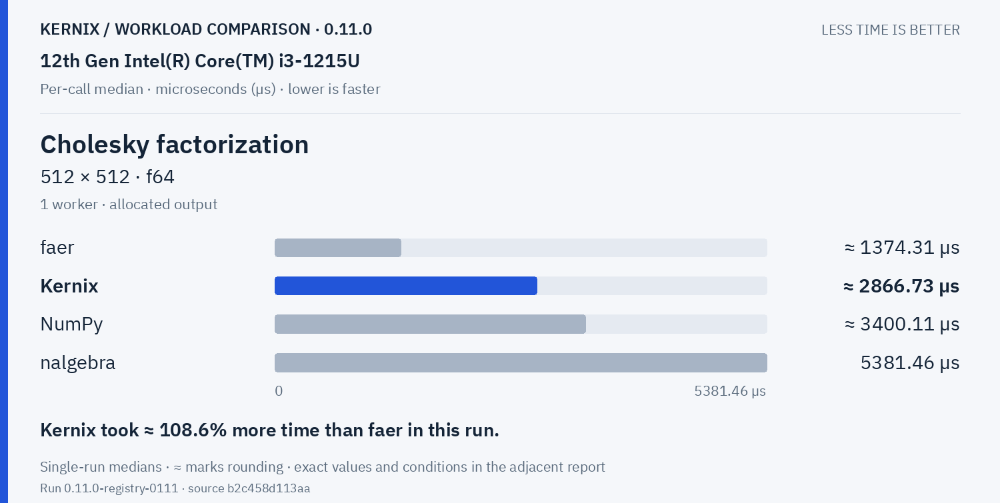

Kernix: **2866.731 µs**. Kernix took ≈ 108.6% more time than faer in this run.

**Column-pivoted QR · 96 × 32 · f64**

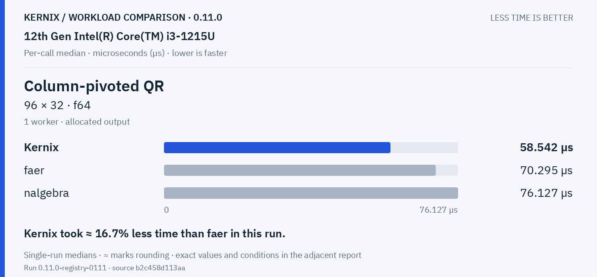

Kernix: **58.542 µs**. Kernix took ≈ 16.7% less time than faer in this run.

**Column-pivoted QR · 256 × 64 · f64**

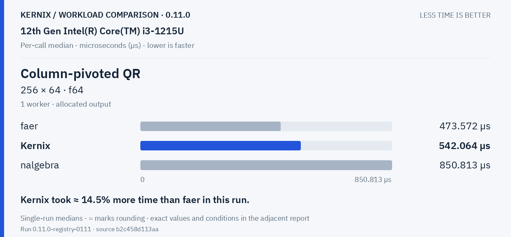

Kernix: **542.064 µs**. Kernix took ≈ 14.5% more time than faer in this run.

**Minimum-norm least squares · 64 × 32, rank 16, 4 RHS · f64**

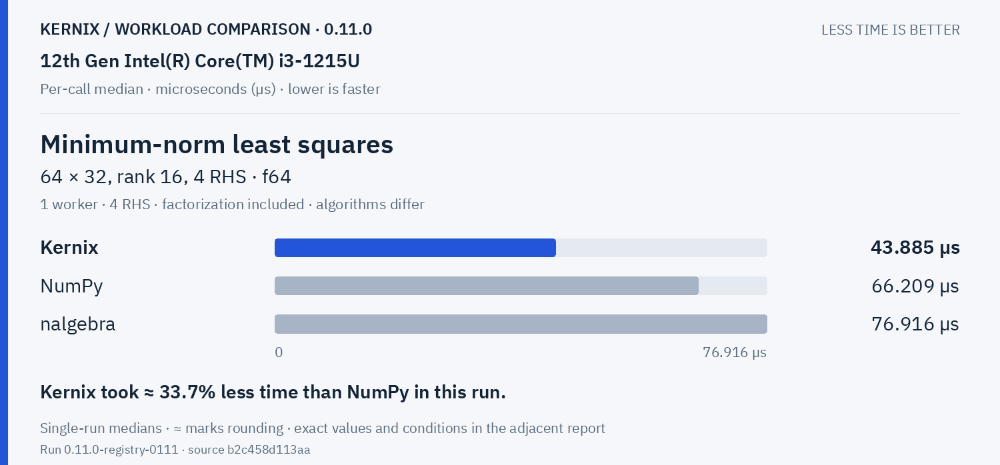

Kernix: **43.885 µs**. Kernix took ≈ 33.7% less time than NumPy in this run.

**Minimum-norm least squares · 32 × 64, rank 32, 4 RHS · f64**

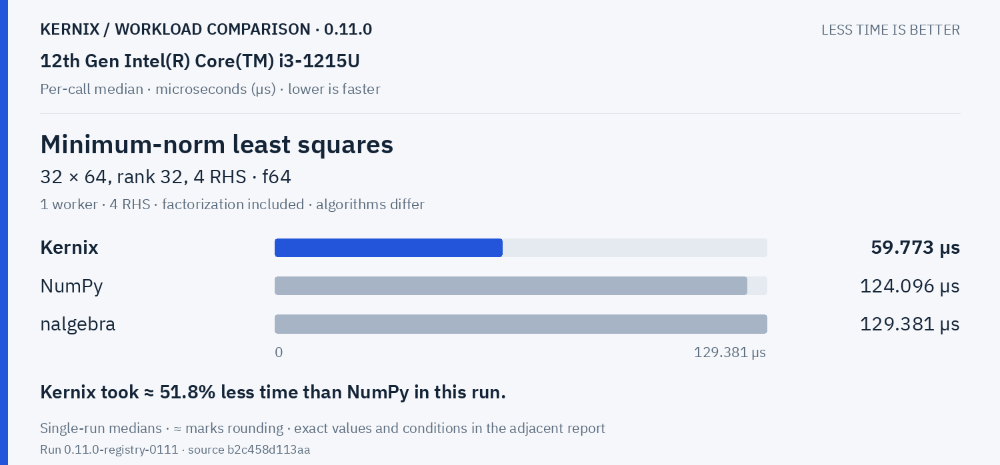

Kernix: **59.773 µs**. Kernix took ≈ 51.8% less time than NumPy in this run.

**Thin QR · 96 × 32 · f64**

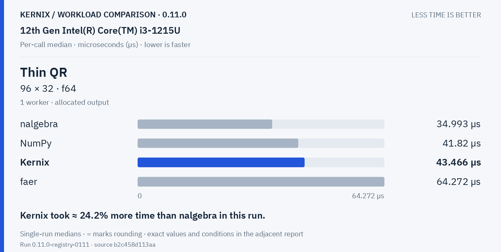

Kernix: **43.466 µs**. Kernix took ≈ 24.2% more time than nalgebra in this run.

**Thin QR · 256 × 64 · f64**

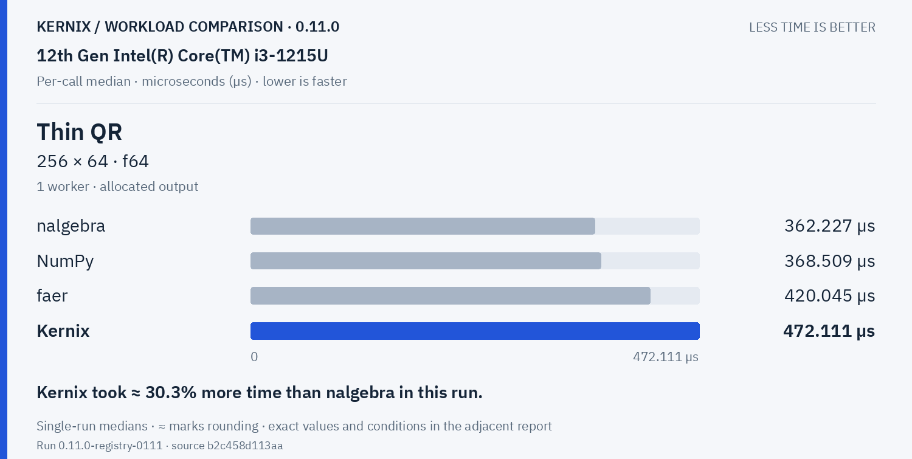

Kernix: **472.111 µs**. Kernix took ≈ 30.3% more time than nalgebra in this run.

**Cholesky factorization · 64 × 64 · f64**

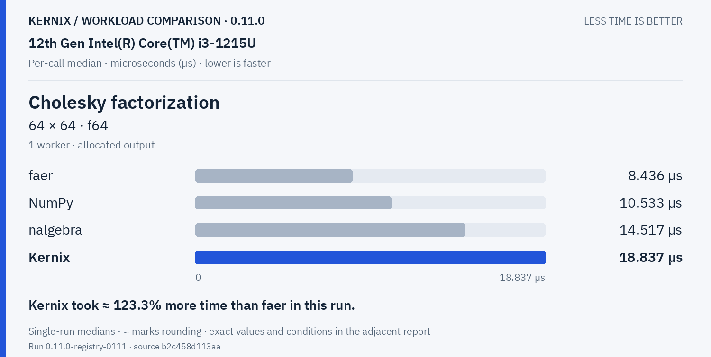

Kernix: **18.837 µs**. Kernix took ≈ 123.3% more time than faer in this run.

**Cholesky factorization · 128 × 128 · f64**

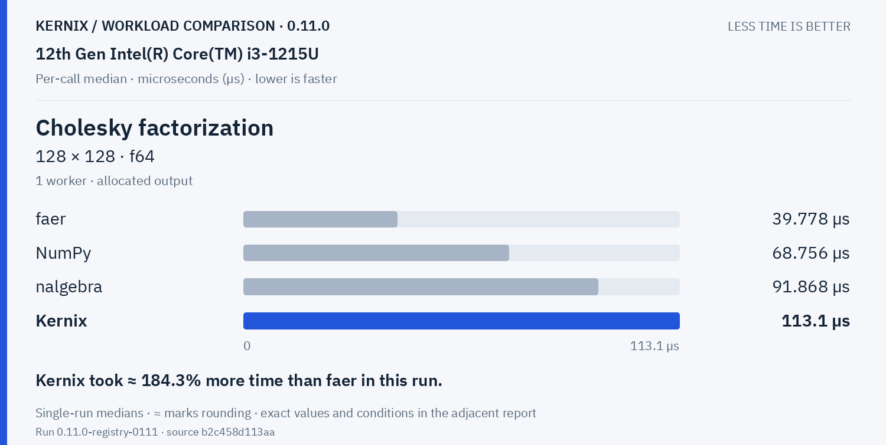

Kernix: **113.1 µs**. Kernix took ≈ 184.3% more time than faer in this run.

**Cholesky factorization · 256 × 256 · f64**

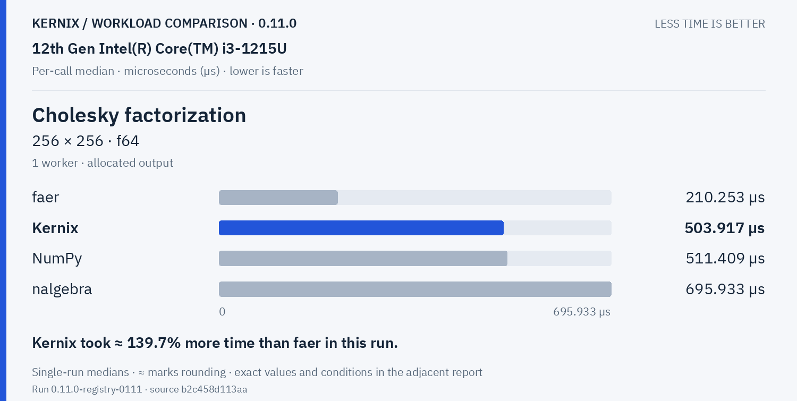

Kernix: **503.917 µs**. Kernix took ≈ 139.7% more time than faer in this run.

Training & autodiff · 6 workloads

**Shared-variable backward · sum(X * X), 64 × 32; prepared graph · f64**

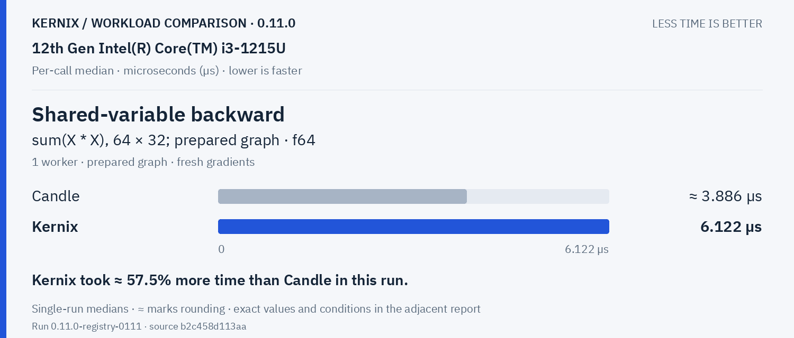

Kernix: **6.122 µs**. Kernix took ≈ 57.5% more time than Candle in this run.

**Record + backward · sum(A · W), 32 × 16 · 16 × 8 · f64**

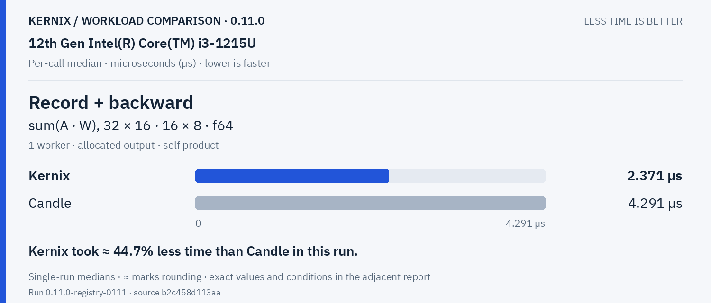

Kernix: **2.371 µs**. Kernix took ≈ 44.7% less time than Candle in this run.

**Model inference · batched normalized/sliced MLP · f64**

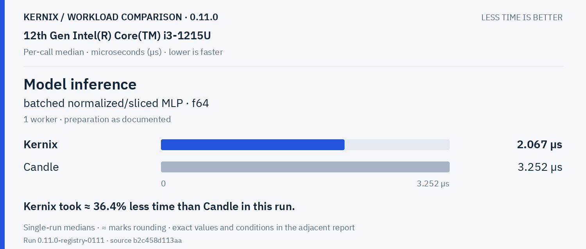

Kernix: **2.067 µs**. Kernix took ≈ 36.4% less time than Candle in this run.

**Model recording + forward · batched normalized/sliced MLP · f64**

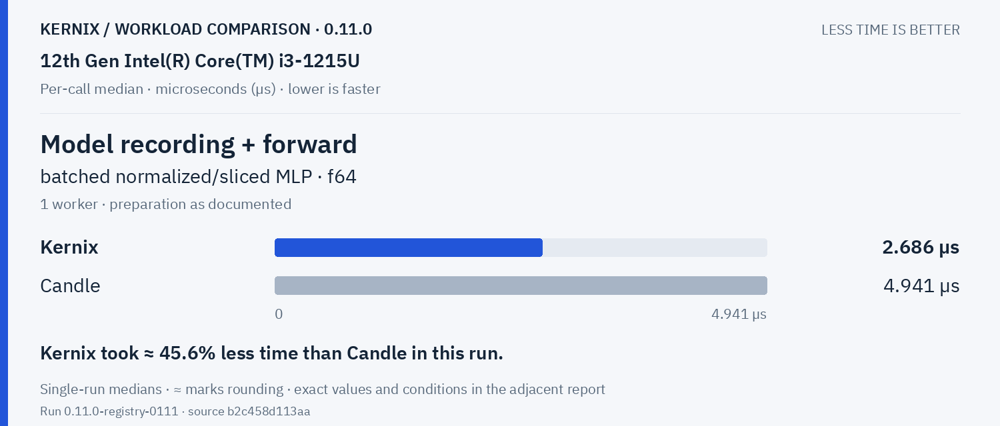

Kernix: **2.686 µs**. Kernix took ≈ 45.6% less time than Candle in this run.

**Model backward · prepared graph → fresh gradients · f64**

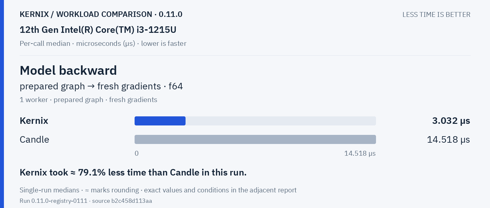

Kernix: **3.032 µs**. Kernix took ≈ 79.1% less time than Candle in this run.

**Parameter update · transactional SGD, fixed gradients · f64**

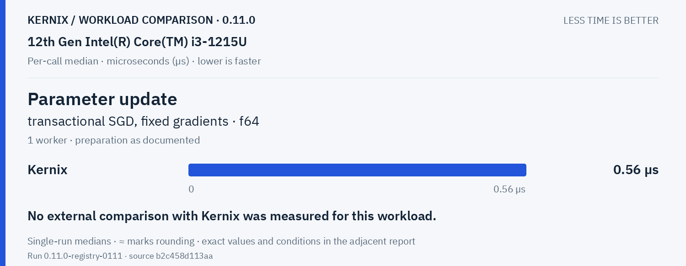

Kernix: **0.56 µs**. No external comparison with Kernix was measured for this workload.

Tensor contractions · 1 workloads

**Coalesced tensor contraction · 16 × 32 × 8 · 32 × 8 × 16 · f64**

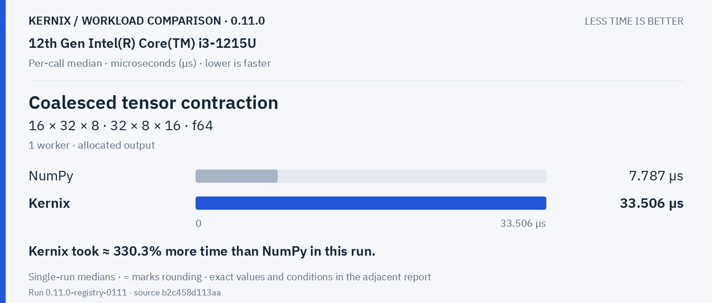

Kernix: **33.506 µs**. Kernix took ≈ 330.3% more time than NumPy in this run.

Statistics & activations · 1 workloads

**Row softmax · 256 × 64 · f64**

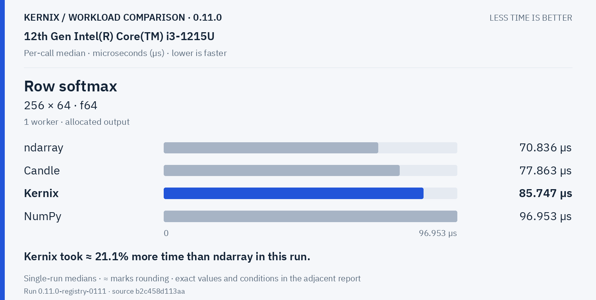

Kernix: **85.747 µs**. Kernix took ≈ 21.1% more time than ndarray in this run.

Tensor construction · 2 workloads

**Create zeros · 64 × 64 · f32**

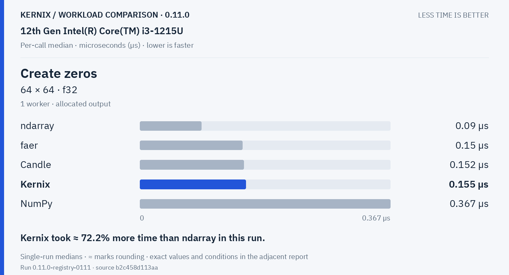

Kernix: **0.155 µs**. Kernix took ≈ 72.2% more time than ndarray in this run.

**Create ones · 64 × 64 · f32**

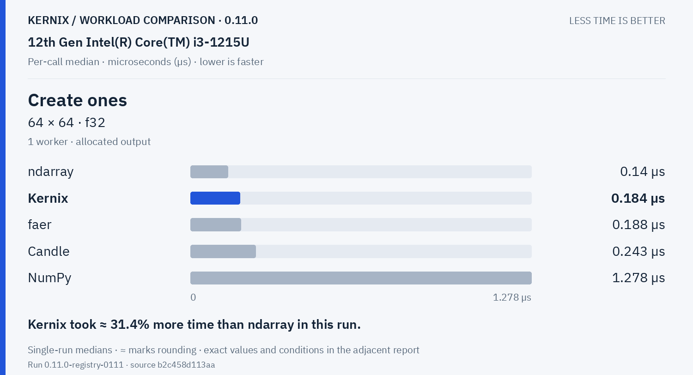

Kernix: **0.184 µs**. Kernix took ≈ 31.4% more time than ndarray in this run.

## Exact latency table

All values below are microseconds per operation. **Lower is faster.** Missing entries were not measured.

| Workload | Kernix | ndarray | nalgebra | faer | Candle | NumPy |
|---|---:|---:|---:|---:|---:|---:|
| Independent matrix operands · 128 × 128 · 128 × 128 · f64 | **70.656** | — | — | — | — | 73.091 |
| Independent matrix operands · 128 × 128 · 128 × 128 · f32 | **36.784** | — | — | — | — | 37.337 |
| Matrix multiplication · 32 × 32 · 32 × 32 · f64 | 1.751 | 1.466 | **1.431** | 1.469 | 1.559 | 2.584 |
| Matrix multiplication · 64 × 64 · 64 × 64 · f64 | 10.032 | 10.526 | 11.843 | 10.971 | **9.195** | 12.061 |
| Matrix multiplication · 128 × 128 · 128 × 128 · f64 | 73.585 | 117.842 | 110.566 | 78.546 | **70.865** | 82.111 |
| Matrix multiplication · 256 × 256 · 256 × 256 · f64 | 569.153 | 676.386 | 640.734 | 794.798 | **560.582** | 665.089 |
| Matrix multiplication · 64 × 64 · 64 × 64 · f32 | 4.815 | 5.839 | 5.604 | 5.031 | **4.578** | 6.599 |
| Matrix multiplication · 128 × 128 · 128 × 128 · f32 | 39.073 | 48.244 | 51.639 | 41.242 | **36.027** | 36.543 |
| Matrix multiplication · 256 × 256 · 256 × 256 · f32 | 283.132 | 393.288 | 385.924 | 338.662 | **278.865** | 289.77 |
| Batched multiplication · 4 × 16 × 32 · 1 × 32 × 16 · f64 | **1.9470000000000002** | — | — | — | 2.074 | 3.046 |
| Batched multiplication · 4 × 16 × 32 · 1 × 32 × 16 · f32 | **1.388** | — | — | — | 1.461 | 2.15 |
| Matmul · 2 workers · reused output · 64 × 64 · 64 × 64 · f64 | 9.793 | — | — | — | — | — |
| Matmul · 2 workers · reused output · 128 × 128 · 128 × 128 · f64 | 42.23 | — | — | — | — | — |
| Matmul · 2 workers · reused output · 256 × 256 · 256 × 256 · f64 | 295.463 | — | — | — | — | — |
| Matmul · 2 workers · reused output · 128 × 128 · 128 × 128 · f32 | 45.508 | — | — | — | — | — |
| Cholesky factorization · 512 × 512 · f64 | 2866.731 | — | 5381.46 | **1374.314** | — | 3400.107 |
| Column-pivoted QR · 96 × 32 · f64 | **58.542** | — | 76.127 | 70.295 | — | — |
| Column-pivoted QR · 256 × 64 · f64 | 542.064 | — | 850.813 | **473.572** | — | — |
| Minimum-norm least squares · 64 × 32, rank 16, 4 RHS · f64 | **43.885** | — | 76.916 | — | — | 66.209 |
| Minimum-norm least squares · 32 × 64, rank 32, 4 RHS · f64 | **59.773** | — | 129.381 | — | — | 124.096 |
| Thin QR · 96 × 32 · f64 | 43.466 | — | **34.993** | 64.272 | — | 41.82 |
| Thin QR · 256 × 64 · f64 | 472.111 | — | **362.227** | 420.045 | — | 368.509 |
| Cholesky factorization · 64 × 64 · f64 | 18.837 | — | 14.517 | **8.436** | — | 10.533 |
| Cholesky factorization · 128 × 128 · f64 | 113.1 | — | 91.868 | **39.778** | — | 68.756 |
| Cholesky factorization · 256 × 256 · f64 | 503.917 | — | 695.933 | **210.253** | — | 511.409 |
| Shared-variable backward · sum(X * X), 64 × 32; prepared graph · f64 | 6.122 | — | — | — | **3.8859999999999995** | — |
| Record + backward · sum(A · W), 32 × 16 · 16 × 8 · f64 | **2.371** | — | — | — | 4.291 | — |
| Model inference · batched normalized/sliced MLP · f64 | **2.067** | — | — | — | 3.252 | — |
| Model recording + forward · batched normalized/sliced MLP · f64 | **2.686** | — | — | — | 4.941 | — |
| Model backward · prepared graph → fresh gradients · f64 | **3.032** | — | — | — | 14.518 | — |
| Parameter update · transactional SGD, fixed gradients · f64 | 0.56 | — | — | — | — | — |
| Coalesced tensor contraction · 16 × 32 × 8 · 32 × 8 × 16 · f64 | 33.506 | — | — | — | — | **7.787** |
| Row softmax · 256 × 64 · f64 | 85.747 | **70.836** | — | — | 77.863 | 96.953 |
| Create zeros · 64 × 64 · f32 | 0.155 | **0.09** | — | 0.15 | 0.152 | 0.367 |
| Create ones · 64 × 64 · f32 | 0.184 | **0.14** | — | 0.188 | 0.243 | 1.278 |

## Version comparison

0 of 35 workloads have paired evidence. Exploratory 95% intervals resample process pairs, not calls. No multiple-comparison adjustment.

| Workload | Current / baseline [95% interval] | Interpretation |
|---|---:|---|
| Independent matrix operands · 128 × 128 · 128 × 128 · f64 | — | No paired comparison |
| Independent matrix operands · 128 × 128 · 128 × 128 · f32 | — | No paired comparison |
| Matrix multiplication · 32 × 32 · 32 × 32 · f64 | — | No paired comparison |
| Matrix multiplication · 64 × 64 · 64 × 64 · f64 | — | No paired comparison |
| Matrix multiplication · 128 × 128 · 128 × 128 · f64 | — | No paired comparison |
| Matrix multiplication · 256 × 256 · 256 × 256 · f64 | — | No paired comparison |
| Matrix multiplication · 64 × 64 · 64 × 64 · f32 | — | No paired comparison |
| Matrix multiplication · 128 × 128 · 128 × 128 · f32 | — | No paired comparison |
| Matrix multiplication · 256 × 256 · 256 × 256 · f32 | — | No paired comparison |
| Batched multiplication · 4 × 16 × 32 · 1 × 32 × 16 · f64 | — | No paired comparison |
| Batched multiplication · 4 × 16 × 32 · 1 × 32 × 16 · f32 | — | No paired comparison |
| Matmul · 2 workers · reused output · 64 × 64 · 64 × 64 · f64 | — | No paired comparison |
| Matmul · 2 workers · reused output · 128 × 128 · 128 × 128 · f64 | — | No paired comparison |
| Matmul · 2 workers · reused output · 256 × 256 · 256 × 256 · f64 | — | No paired comparison |
| Matmul · 2 workers · reused output · 128 × 128 · 128 × 128 · f32 | — | No paired comparison |
| Cholesky factorization · 512 × 512 · f64 | — | No paired comparison |
| Column-pivoted QR · 96 × 32 · f64 | — | No paired comparison |
| Column-pivoted QR · 256 × 64 · f64 | — | No paired comparison |
| Minimum-norm least squares · 64 × 32, rank 16, 4 RHS · f64 | — | No paired comparison |
| Minimum-norm least squares · 32 × 64, rank 32, 4 RHS · f64 | — | No paired comparison |
| Thin QR · 96 × 32 · f64 | — | No paired comparison |
| Thin QR · 256 × 64 · f64 | — | No paired comparison |
| Cholesky factorization · 64 × 64 · f64 | — | No paired comparison |
| Cholesky factorization · 128 × 128 · f64 | — | No paired comparison |
| Cholesky factorization · 256 × 256 · f64 | — | No paired comparison |
| Shared-variable backward · sum(X * X), 64 × 32; prepared graph · f64 | — | No paired comparison |
| Record + backward · sum(A · W), 32 × 16 · 16 × 8 · f64 | — | No paired comparison |
| Model inference · batched normalized/sliced MLP · f64 | — | No paired comparison |
| Model recording + forward · batched normalized/sliced MLP · f64 | — | No paired comparison |
| Model backward · prepared graph → fresh gradients · f64 | — | No paired comparison |
| Parameter update · transactional SGD, fixed gradients · f64 | — | No paired comparison |
| Coalesced tensor contraction · 16 × 32 × 8 · 32 × 8 × 16 · f64 | — | No paired comparison |
| Row softmax · 256 × 64 · f64 | — | No paired comparison |
| Create zeros · 64 × 64 · f32 | — | No paired comparison |
| Create ones · 64 × 64 · f32 | — | No paired comparison |

## Method and provenance

CPU affinity pinned to logical CPU 0. Frequency and background load are uncontrolled.

Minimum-norm rows use pivoted QR plus scaled implicit RZ in Kernix; NumPy native lstsq; nalgebra native SVD/solve. Algorithm costs and rank policies differ. See original method for thresholds.

Numbers retain source precision; recorded digits do not imply equivalent physical measurement accuracy. Lowest observed medians are bold only when peers were measured. No aggregate winner or universal ranking is inferred.

[Original report and commentary](original-report.txt) · [Raw measurements](raw.json)

Measured source `b2c458d113aa23aa24e93fbfdabd55b55e3e6831`. Run `0.11.0-registry-0111`. Rendering does not change measurements.
