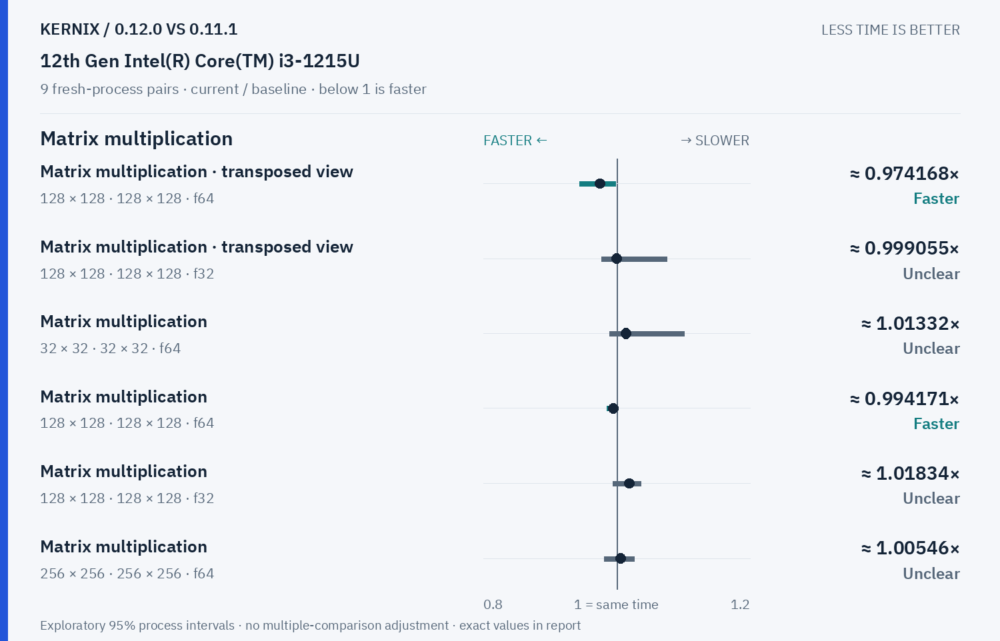
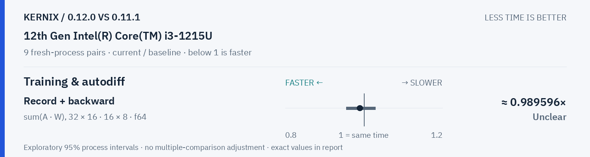

# Kernix 0.12.0 · paired process comparison

9 fresh-process pairs per workload. Ratios below 1 mean less time.

[Interactive HTML (open locally)](report.html) · [Vector PDF](latency.pdf) · [Original process evidence](paired.json)

### Version changes at a glance

The vertical line marks unchanged time. Left is faster; right is slower. Ranges are exploratory 95% intervals over fresh-process pairs. An interval crossing the line leaves direction unclear.

## Exact process ratios

| Workload | Current / baseline [95% interval] | Interpretation |
|---|---:|---|
| Cholesky solve · reused factor · 128 × 128, 1 RHS · f64 | 0.8549598323436954× [0.8378494623655914, 0.8691263176701804] | Observed time reduction |
| Cholesky solve · reused factor · 256 × 256, 64 RHS · f64 | 0.3604773282010496× [0.35471006182411524, 0.38053385725526634] | Observed time reduction |
| LU solve · reused factor · 256 × 256, 64 RHS · f64 | 0.44287614487737254× [0.4398298429214799, 0.4580180849626527] | Observed time reduction |
| Thin QR · 512 × 128 · f64 | 0.7576909363946751× [0.7432072422955074, 0.8038720198704554] | Observed time reduction |
| Thin QR · 1024 × 256 · f64 | 0.4991791918264273× [0.4803599515307621, 0.5078611944426149] | Observed time reduction |
| Matrix multiplication · transposed view · 128 × 128 · 128 × 128 · f64 | 0.9741677808632452× [0.9438496742229416, 0.9984214886844286] | Observed time reduction |
| Matrix multiplication · transposed view · 128 × 128 · 128 × 128 · f32 | 0.9990550437042287× [0.9766783174641437, 1.0745344105206183] | Timing direction unclear |
| Thin QR · 256 × 64 · f64 | 0.9788347720307858× [0.9634141448186757, 0.989606890943739] | Observed time reduction |
| Matrix multiplication · 32 × 32 · 32 × 32 · f64 | 1.0133164235890932× [0.9890243902439024, 1.1006211180124224] | Timing direction unclear |
| Matrix multiplication · 128 × 128 · 128 × 128 · f64 | 0.9941706698332163× [0.9845926337875073, 0.9993919658419922] | Observed time reduction |
| Matrix multiplication · 128 × 128 · 128 × 128 · f32 | 1.0183357601251146× [0.993922368385511, 1.0356599674090168] | Timing direction unclear |
| Matrix multiplication · 256 × 256 · 256 × 256 · f64 | 1.0054575241831976× [0.981300896638036, 1.025779538880808] | Timing direction unclear |
| Matrix multiplication · 256 × 256 · 256 × 256 · f32 | 0.9973555103077842× [0.9729474862969293, 0.9986107093239619] | Observed time reduction |
| Record + backward · sum(A · W), 32 × 16 · 16 × 8 · f64 | 0.9895963379109447× [0.9548841059602649, 1.0287800687285222] | Timing direction unclear |
| Independent matrix operands · 128 × 128 · 128 × 128 · f64 | 1.0028067202414839× [0.9733149389042176, 1.0364563187268607] | Timing direction unclear |
| Independent matrix operands · 128 × 128 · 128 × 128 · f32 | 1.0011050291676304× [0.9775446246082573, 1.0589875111507583] | Timing direction unclear |
| Batched multiplication · 4 × 16 × 32 · 1 × 32 × 16 · f64 | 1.1025043680838673× [0.9660265878877399, 1.1978680879413723] | Timing direction unclear |
| Batched multiplication · 4 × 16 × 32 · 1 × 32 × 16 · f32 | 1.0519618239660657× [1.006554307116105, 1.1666666666666667] | Observed time increase |
| Cholesky factorization · 128 × 128 · f64 | 0.995463411620374× [0.9778598743749026, 1.0276817508382503] | Timing direction unclear |
| Cholesky factorization · 256 × 256 · f64 | 1.01549232141547× [1.0091252328428177, 1.031882568924252] | Observed time increase |
| Cholesky factorization · 512 × 512 · f64 | 1.00042872342826× [0.9864813132222578, 1.0167709594881083] | Timing direction unclear |
| Matmul · 2 workers · reused output · 128 × 128 · 128 × 128 · f64 | 1.003797530380243× [0.7079180180333158, 1.7986926866237212] | Timing direction unclear |
| Matmul · 2 workers · reused output · 256 × 256 · 256 × 256 · f64 | 0.965063468796831× [0.9576436699021517, 1.0025281357038003] | Timing direction unclear |
| Matmul · 2 workers · reused output · 128 × 128 · 128 × 128 · f32 | 1.0060232840382972× [0.9759132167367722, 1.7554905490549055] | Timing direction unclear |

## Method

95% percentile bootstrap over paired process blocks; 10000 resamples; exploratory, no multiple-comparison adjustment

Current `0.12.0-final`; baseline `0.11.1-registry-0120`. All source ratio digits, paired observations and process ordering are preserved. No absolute peer latencies are inferred.
