# Kernix 0.13.0 · performance brief

12th Gen Intel(R) Core(TM) i3-1215U / Linux

**Per-call median, microseconds per operation. Lower is faster. All recorded digits retained.**

51 workloads · 175 observations

Baseline: 0.12.0-git-0130. Sequential run changes are descriptive; paired process evidence is shown separately.

[Interactive HTML (open locally)](report.html) · [Vector PDF](latency.pdf) · [Raw measurements](raw.json)

[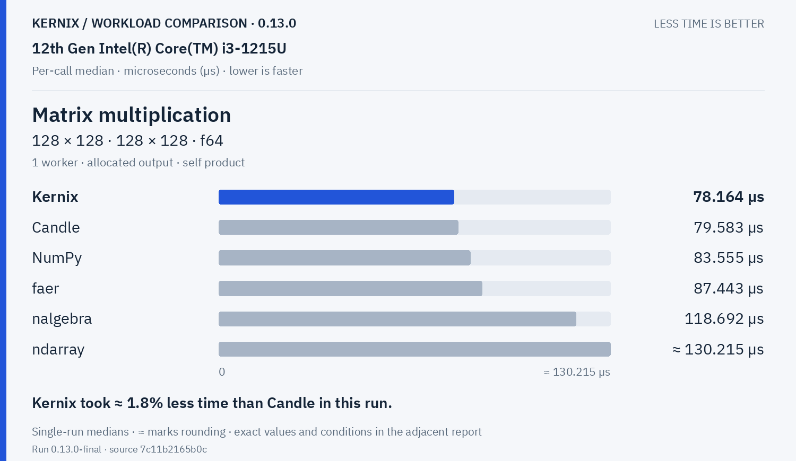](latency.pdf)

## Charts by workload

**Shorter bars mean less time.** Blue is Kernix; grey is a comparison implementation; teal is an explicitly selected Kernix backend. Entries are sorted by the recorded median, with a separate zero-based scale per chart. These point observations do not establish a statistical ranking.

Expand a group to see every chart here on GitHub. Click a chart to enlarge it. The exact table below keeps every source digit.

Sparse matrices & memory · 5 workloads

**Sparse matrix × vector · 2048 × 2048 · five diagonals · f64**

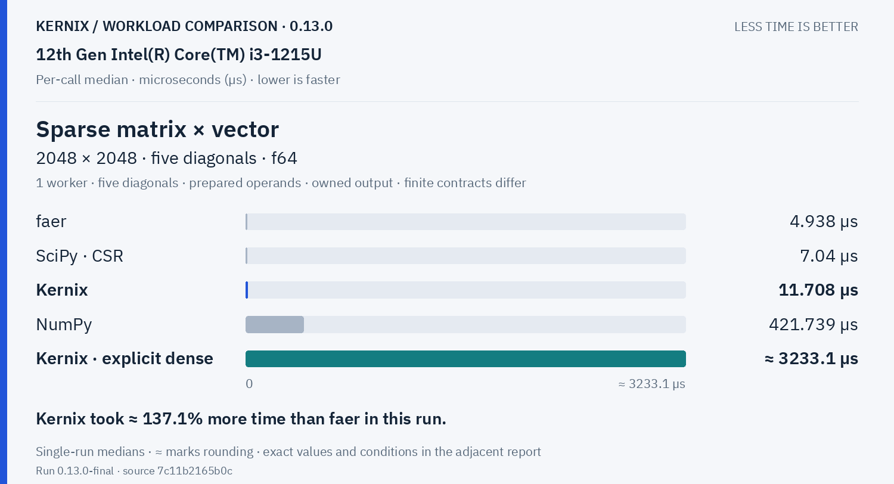

Kernix: **11.708 µs**. Kernix took ≈ 137.1% more time than faer in this run.

**Sparse × dense matrix · 512 × 512 · 32 RHS · five diagonals · f64**

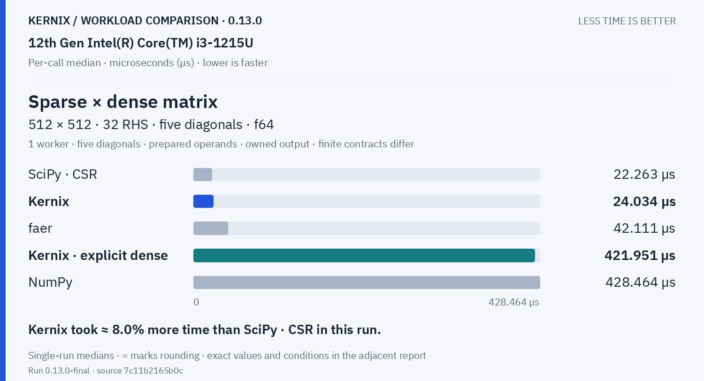

Kernix: **24.034 µs**. Kernix took ≈ 8.0% more time than SciPy · CSR in this run.

**Sparse × dense matrix · 512 × 512 · 32 RHS · five diagonals · f32**

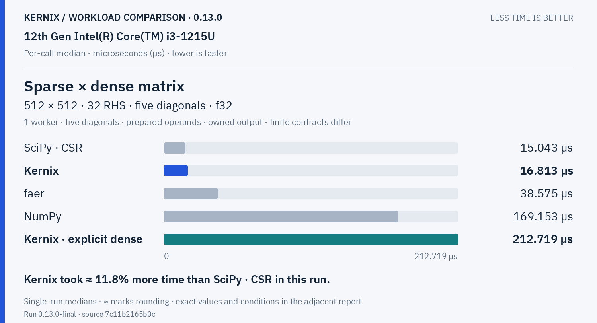

Kernix: **16.813 µs**. Kernix took ≈ 11.8% more time than SciPy · CSR in this run.

**Sparse × sparse matrix · 256 × 256 · five diagonals each · f64**

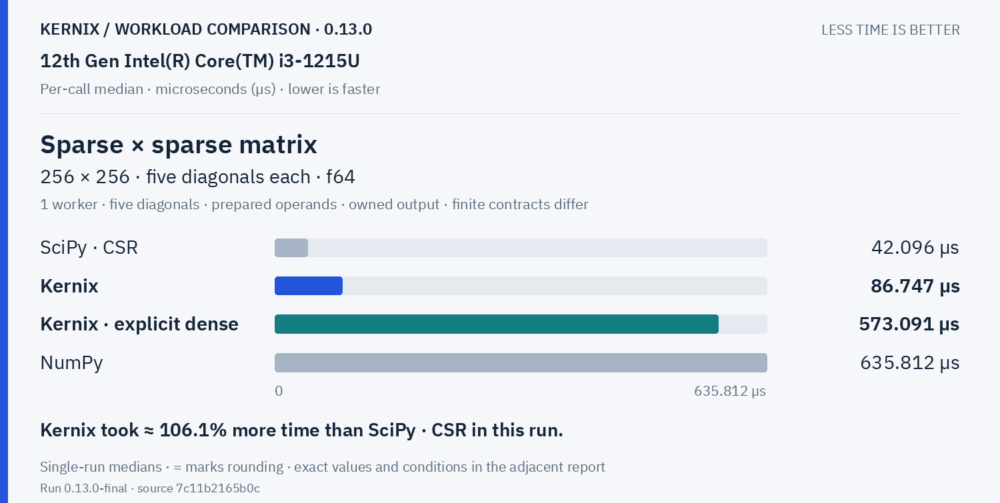

Kernix: **86.747 µs**. Kernix took ≈ 106.1% more time than SciPy · CSR in this run.

**Automatic CSR construction · 512 × 512 · clone + scan + compress · f64**

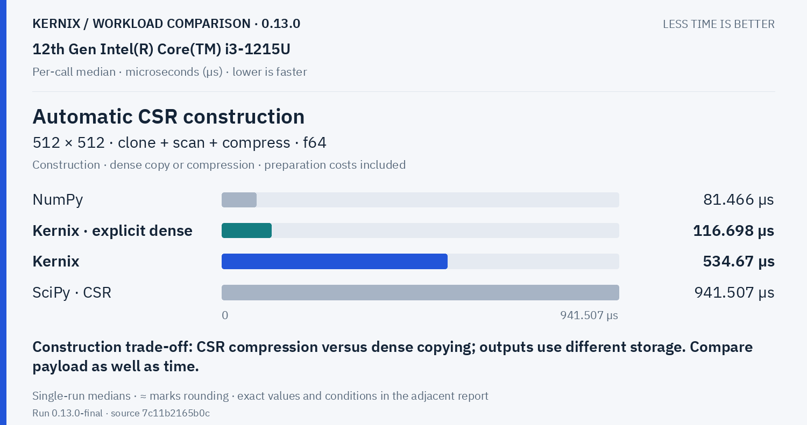

Kernix: **534.67 µs**. Construction trade-off: CSR compression versus dense copying; outputs use different storage. Compare payload as well as time.

Matrix multiplication · 13 workloads

**Matrix multiplication · transposed view · 128 × 128 · 128 × 128 · f64**

Kernix: **114.249 µs**. Kernix took ≈ 46.0% more time than NumPy in this run.

**Matrix multiplication · transposed view · 128 × 128 · 128 × 128 · f32**

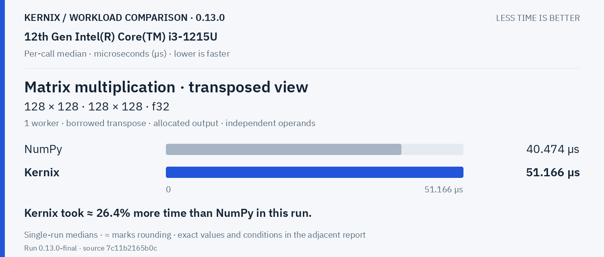

Kernix: **51.166 µs**. Kernix took ≈ 26.4% more time than NumPy in this run.

**Independent matrix operands · 128 × 128 · 128 × 128 · f64**

Kernix: **72.444 µs**. Kernix took ≈ 4.9% less time than NumPy in this run.

**Independent matrix operands · 128 × 128 · 128 × 128 · f32**

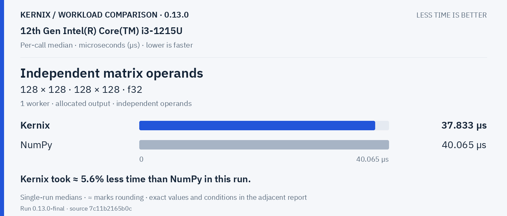

Kernix: **37.833 µs**. Kernix took ≈ 5.6% less time than NumPy in this run.

**Matrix multiplication · 32 × 32 · 32 × 32 · f64**

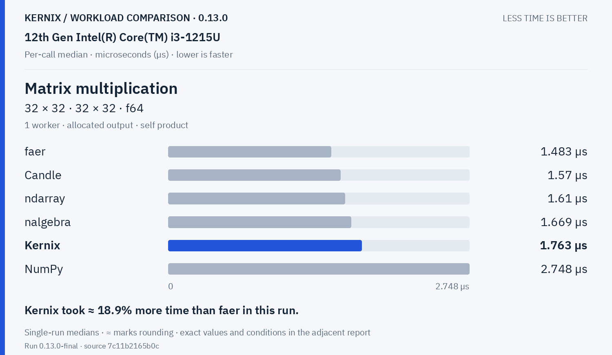

Kernix: **1.763 µs**. Kernix took ≈ 18.9% more time than faer in this run.

**Matrix multiplication · 64 × 64 · 64 × 64 · f64**

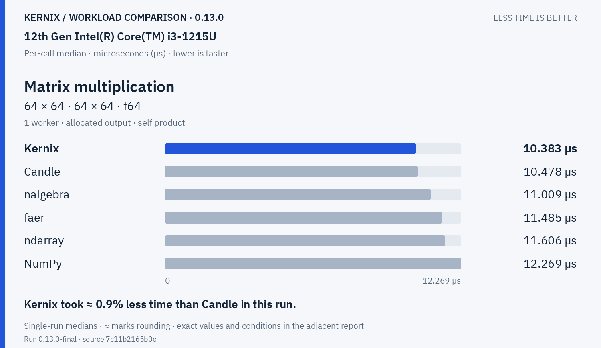

Kernix: **10.383 µs**. Kernix took ≈ 0.9% less time than Candle in this run.

**Matrix multiplication · 128 × 128 · 128 × 128 · f64**

Kernix: **78.164 µs**. Kernix took ≈ 1.8% less time than Candle in this run.

**Matrix multiplication · 256 × 256 · 256 × 256 · f64**

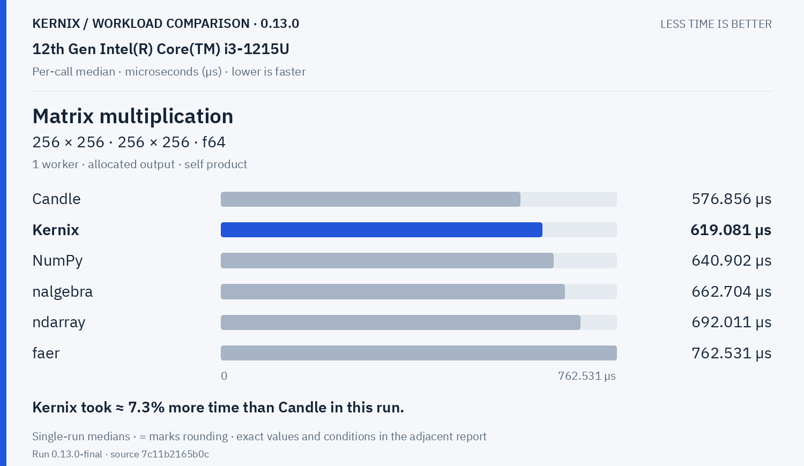

Kernix: **619.081 µs**. Kernix took ≈ 7.3% more time than Candle in this run.

**Matrix multiplication · 64 × 64 · 64 × 64 · f32**

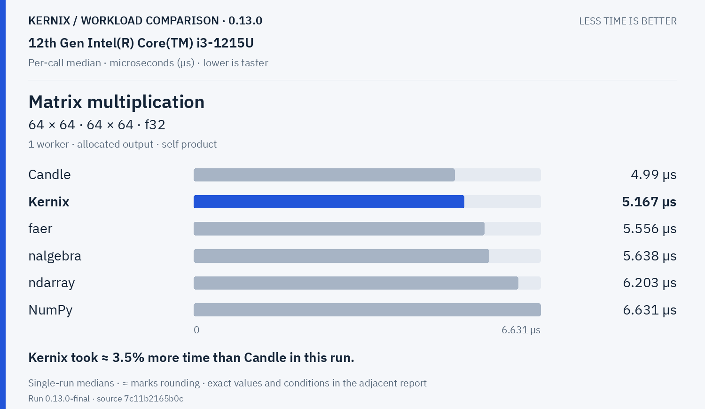

Kernix: **5.167 µs**. Kernix took ≈ 3.5% more time than Candle in this run.

**Matrix multiplication · 128 × 128 · 128 × 128 · f32**

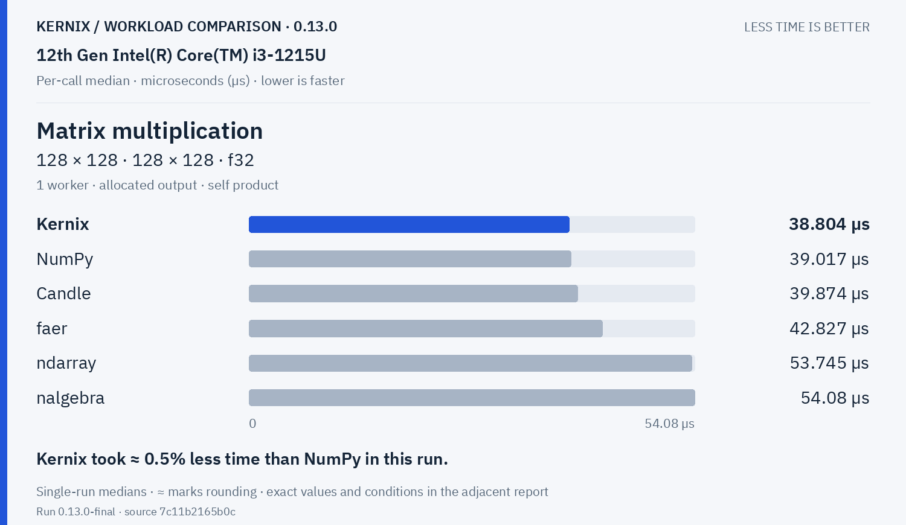

Kernix: **38.804 µs**. Kernix took ≈ 0.5% less time than NumPy in this run.

**Matrix multiplication · 256 × 256 · 256 × 256 · f32**

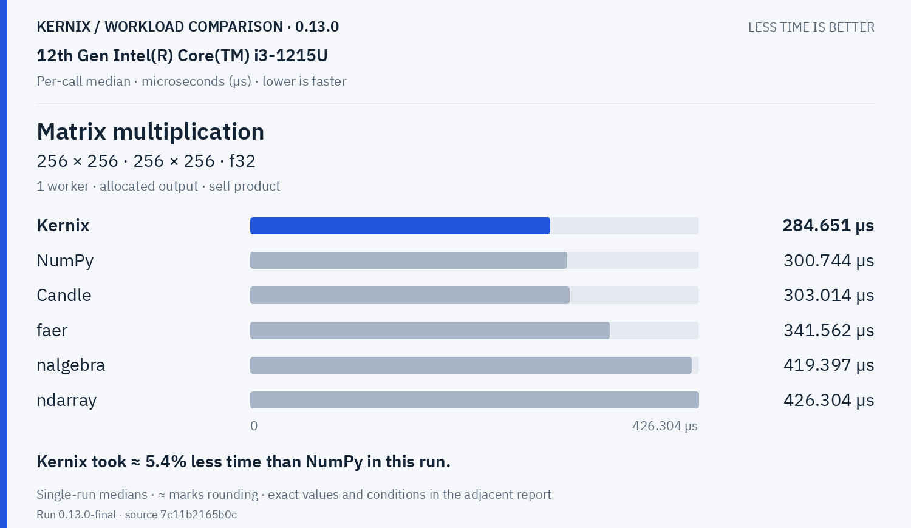

Kernix: **284.651 µs**. Kernix took ≈ 5.4% less time than NumPy in this run.

**Batched multiplication · 4 × 16 × 32 · 1 × 32 × 16 · f64**

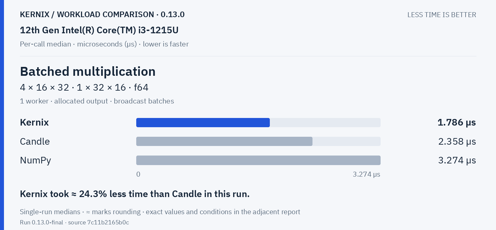

Kernix: **1.786 µs**. Kernix took ≈ 24.3% less time than Candle in this run.

**Batched multiplication · 4 × 16 × 32 · 1 × 32 × 16 · f32**

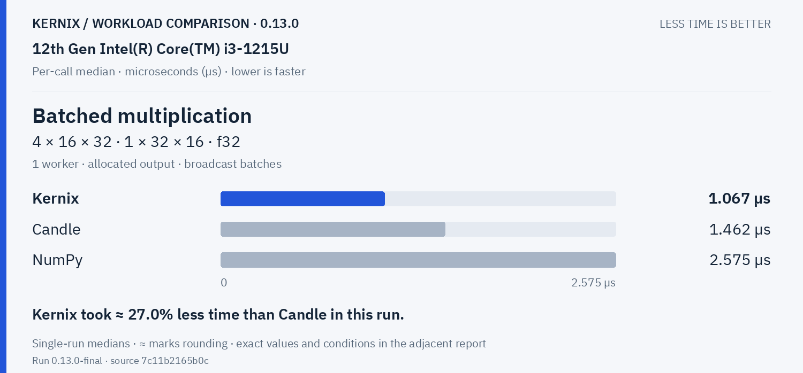

Kernix: **1.067 µs**. Kernix took ≈ 27.0% less time than Candle in this run.

Explicit parallel execution · 4 workloads

**Matmul · 2 workers · reused output · 64 × 64 · 64 × 64 · f64**

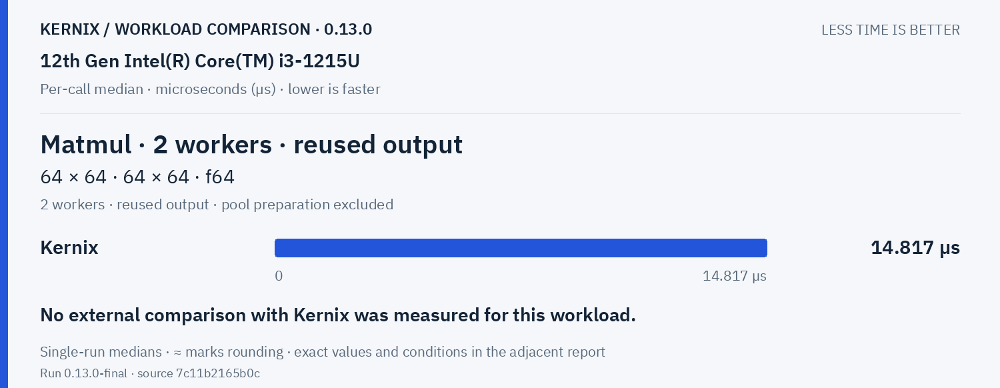

Kernix: **14.817 µs**. No external comparison with Kernix was measured for this workload.

**Matmul · 2 workers · reused output · 128 × 128 · 128 × 128 · f64**

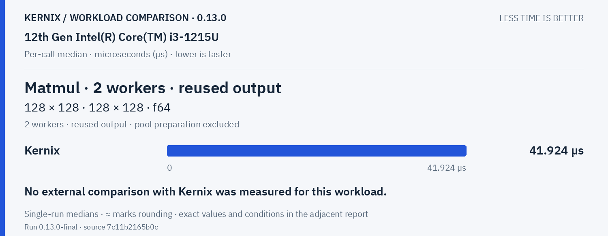

Kernix: **41.924 µs**. No external comparison with Kernix was measured for this workload.

**Matmul · 2 workers · reused output · 256 × 256 · 256 × 256 · f64**

Kernix: **318.499 µs**. No external comparison with Kernix was measured for this workload.

**Matmul · 2 workers · reused output · 128 × 128 · 128 × 128 · f32**

Kernix: **41.307 µs**. No external comparison with Kernix was measured for this workload.

Decompositions & solvers · 19 workloads

**Cholesky solve · reused factor · 128 × 128, 1 RHS · f64**

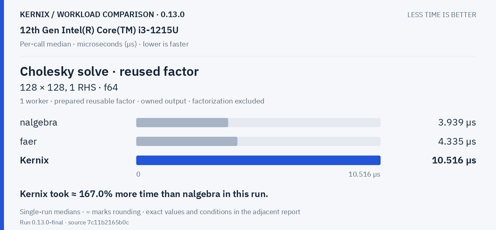

Kernix: **10.516 µs**. Kernix took ≈ 167.0% more time than nalgebra in this run.

**Cholesky solve · reused factor · 256 × 256, 64 RHS · f64**

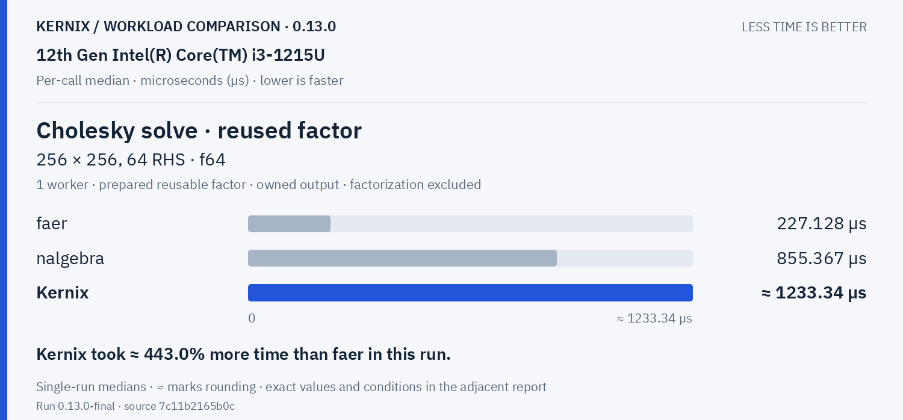

Kernix: **1233.339 µs**. Kernix took ≈ 443.0% more time than faer in this run.

**Cholesky solve · reused factor · 512 × 512, 128 RHS · f64**

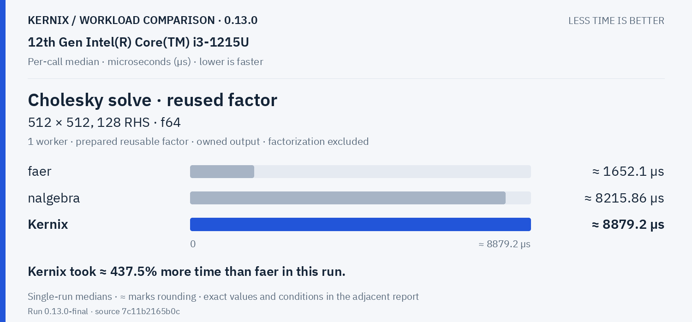

Kernix: **8879.196 µs**. Kernix took ≈ 437.5% more time than faer in this run.

**LU solve · reused factor · 256 × 256, 64 RHS · f64**

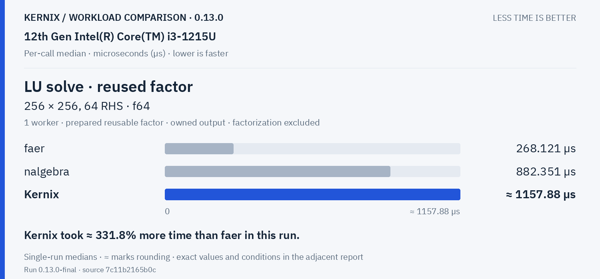

Kernix: **1157.877 µs**. Kernix took ≈ 331.8% more time than faer in this run.

**Cholesky rank-one update · 256 × 256 · f64**

Kernix: **125.06799999999999 µs**. Kernix took ≈ 411.2% more time than nalgebra in this run.

**Cholesky rank-one downdate · 256 × 256 · f64**

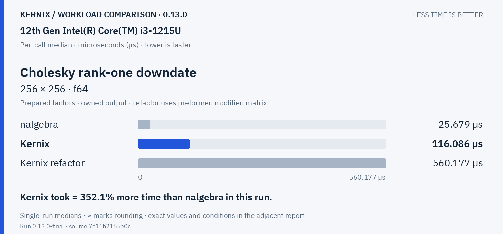

Kernix: **116.086 µs**. Kernix took ≈ 352.1% more time than nalgebra in this run.

**Cholesky rank-one update · 512 × 512 · f64**

Kernix: **767.096 µs**. Kernix took ≈ 402.9% more time than nalgebra in this run.

**Thin QR · 512 × 128 · f64**

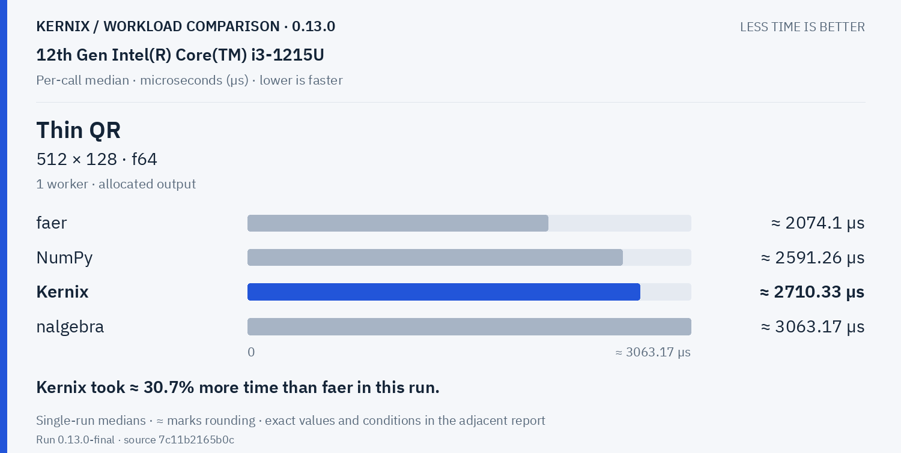

Kernix: **2710.334 µs**. Kernix took ≈ 30.7% more time than faer in this run.

**Thin QR · 1024 × 256 · f64**

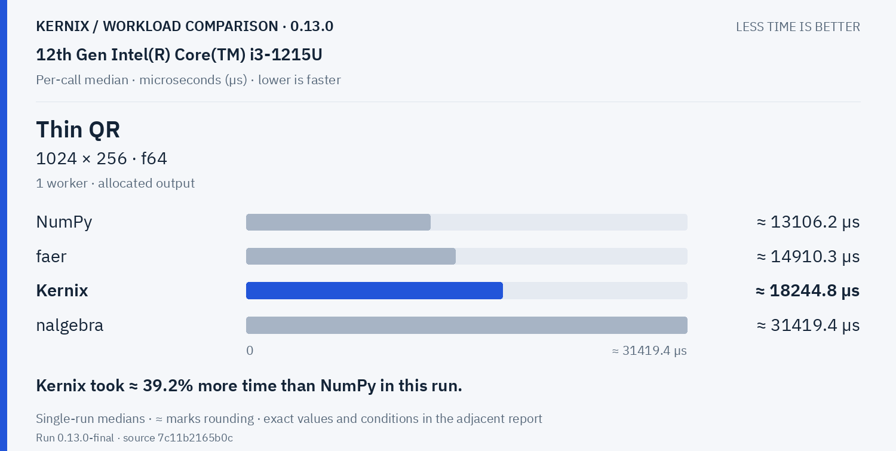

Kernix: **18244.794 µs**. Kernix took ≈ 39.2% more time than NumPy in this run.

**Cholesky factorization · 512 × 512 · f64**

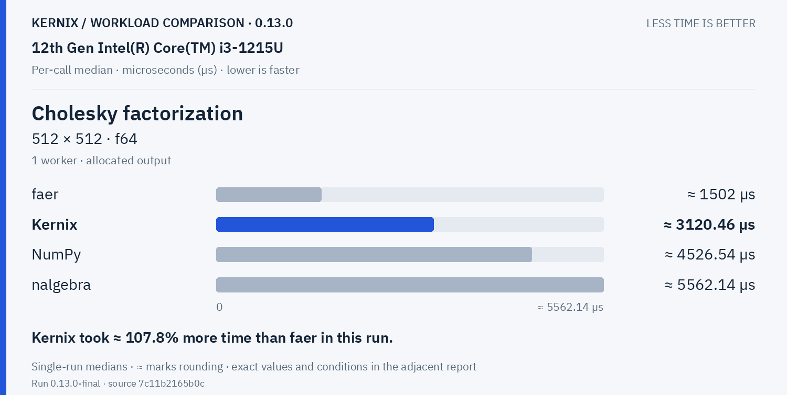

Kernix: **3120.465 µs**. Kernix took ≈ 107.8% more time than faer in this run.

**Column-pivoted QR · 96 × 32 · f64**

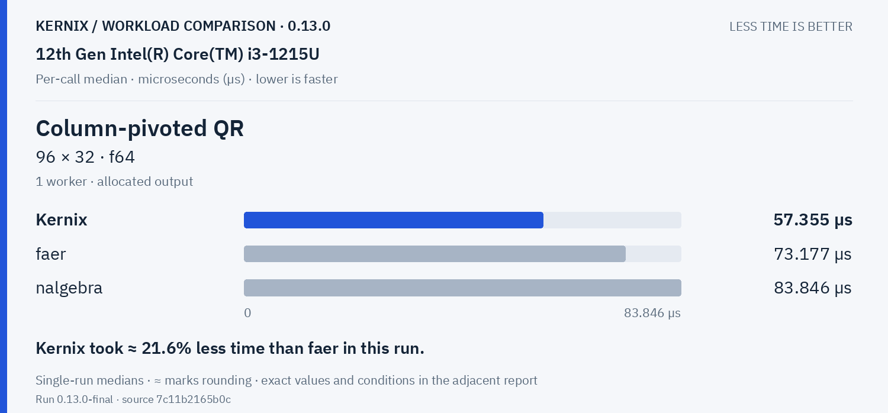

Kernix: **57.355 µs**. Kernix took ≈ 21.6% less time than faer in this run.

**Column-pivoted QR · 256 × 64 · f64**

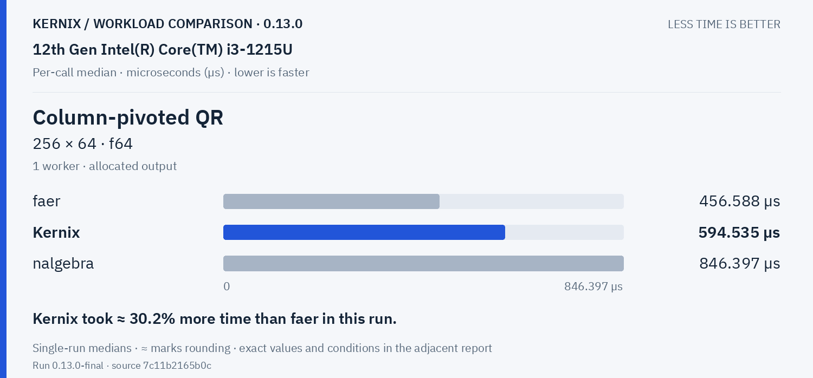

Kernix: **594.535 µs**. Kernix took ≈ 30.2% more time than faer in this run.

**Minimum-norm least squares · 64 × 32, rank 16, 4 RHS · f64**

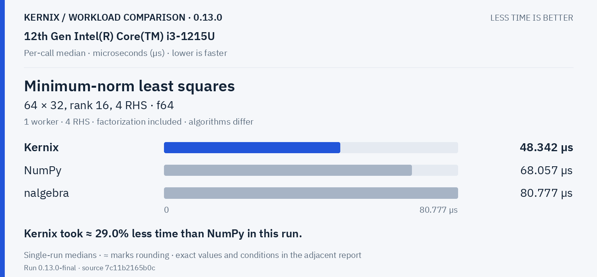

Kernix: **48.342 µs**. Kernix took ≈ 29.0% less time than NumPy in this run.

**Minimum-norm least squares · 32 × 64, rank 32, 4 RHS · f64**

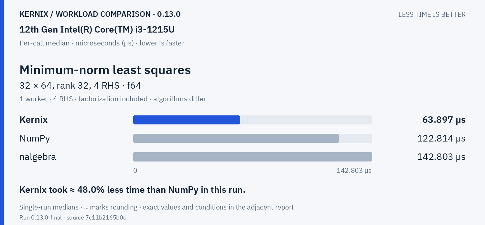

Kernix: **63.897 µs**. Kernix took ≈ 48.0% less time than NumPy in this run.

**Thin QR · 96 × 32 · f64**

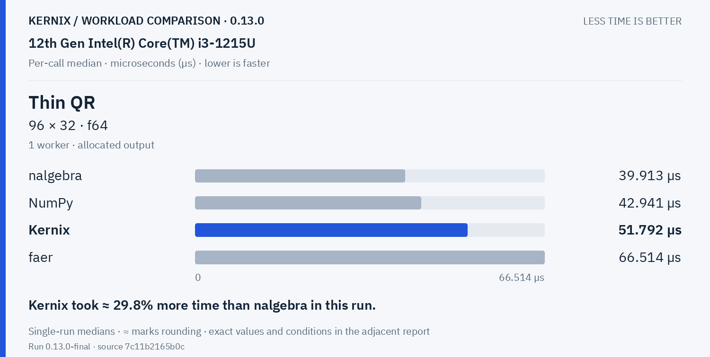

Kernix: **51.792 µs**. Kernix took ≈ 29.8% more time than nalgebra in this run.

**Thin QR · 256 × 64 · f64**

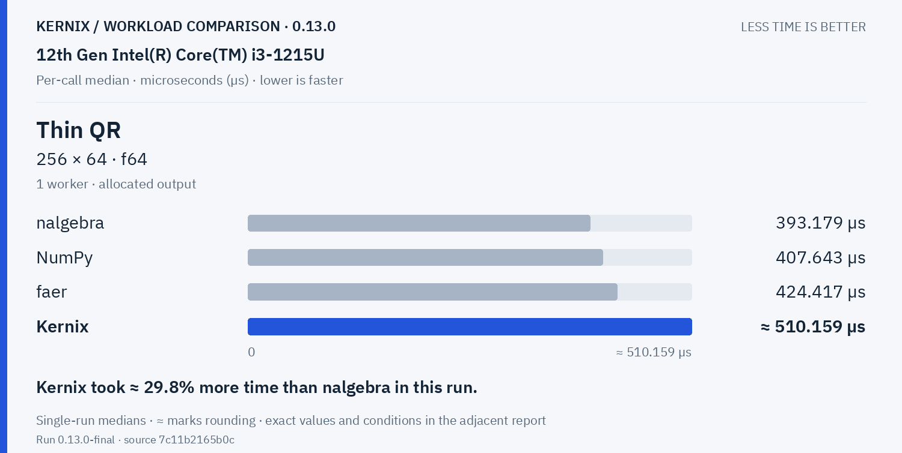

Kernix: **510.15900000000006 µs**. Kernix took ≈ 29.8% more time than nalgebra in this run.

**Cholesky factorization · 64 × 64 · f64**

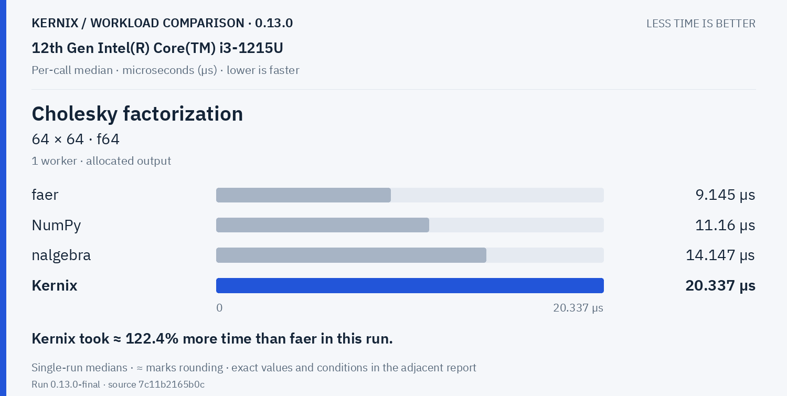

Kernix: **20.337 µs**. Kernix took ≈ 122.4% more time than faer in this run.

**Cholesky factorization · 128 × 128 · f64**

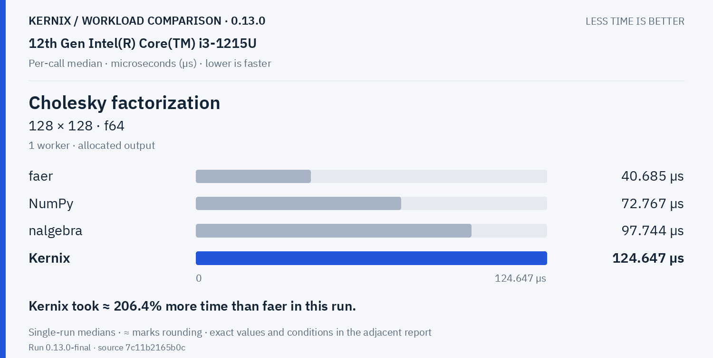

Kernix: **124.647 µs**. Kernix took ≈ 206.4% more time than faer in this run.

**Cholesky factorization · 256 × 256 · f64**

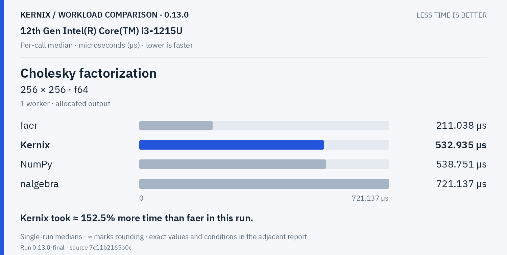

Kernix: **532.935 µs**. Kernix took ≈ 152.5% more time than faer in this run.

Training & autodiff · 6 workloads

**Shared-variable backward · sum(X * X), 64 × 32; prepared graph · f64**

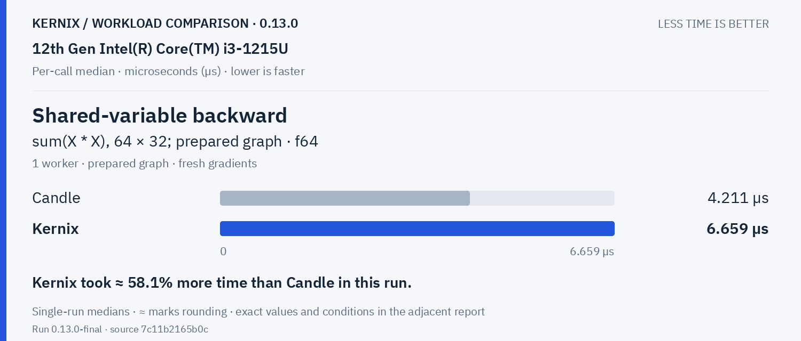

Kernix: **6.659 µs**. Kernix took ≈ 58.1% more time than Candle in this run.

**Record + backward · sum(A · W), 32 × 16 · 16 × 8 · f64**

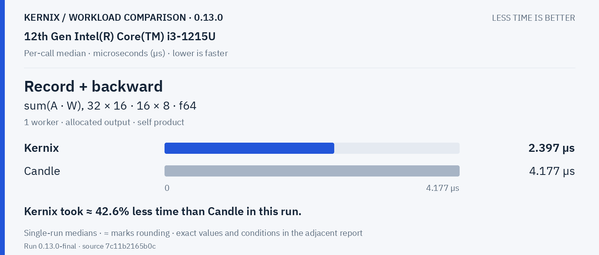

Kernix: **2.397 µs**. Kernix took ≈ 42.6% less time than Candle in this run.

**Model inference · batched normalized/sliced MLP · f64**

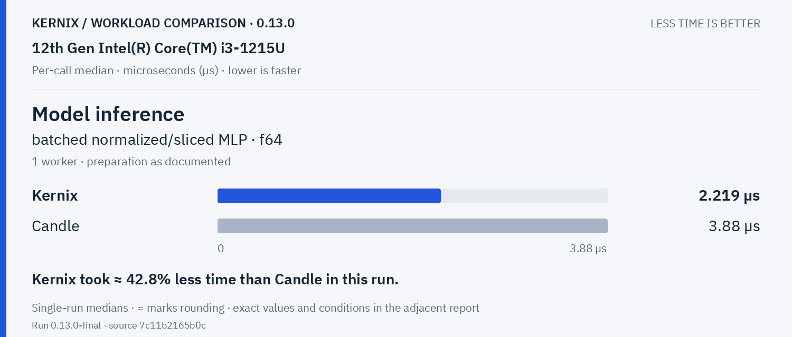

Kernix: **2.219 µs**. Kernix took ≈ 42.8% less time than Candle in this run.

**Model recording + forward · batched normalized/sliced MLP · f64**

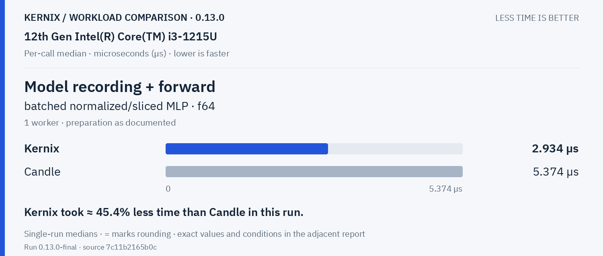

Kernix: **2.934 µs**. Kernix took ≈ 45.4% less time than Candle in this run.

**Model backward · prepared graph → fresh gradients · f64**

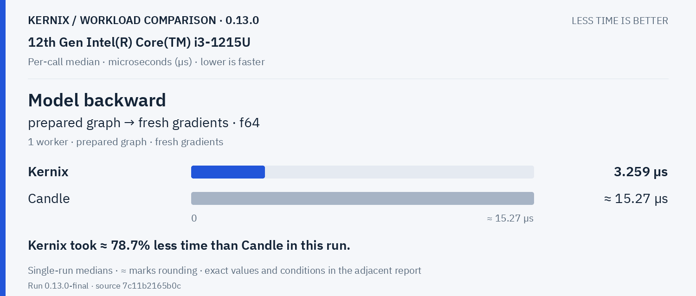

Kernix: **3.259 µs**. Kernix took ≈ 78.7% less time than Candle in this run.

**Parameter update · transactional SGD, fixed gradients · f64**

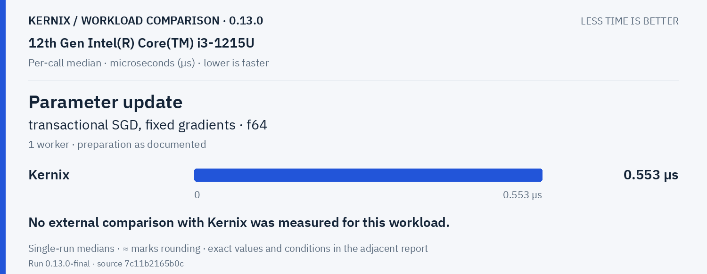

Kernix: **0.553 µs**. No external comparison with Kernix was measured for this workload.

Tensor contractions · 1 workloads

**Coalesced tensor contraction · 16 × 32 × 8 · 32 × 8 × 16 · f64**

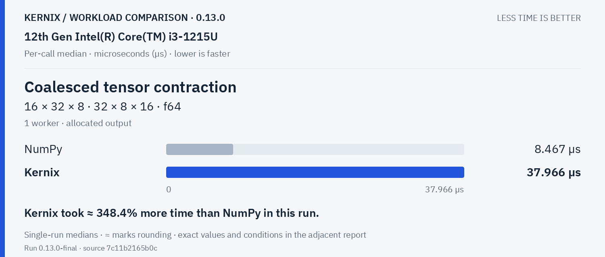

Kernix: **37.966 µs**. Kernix took ≈ 348.4% more time than NumPy in this run.

Statistics & activations · 1 workloads

**Row softmax · 256 × 64 · f64**

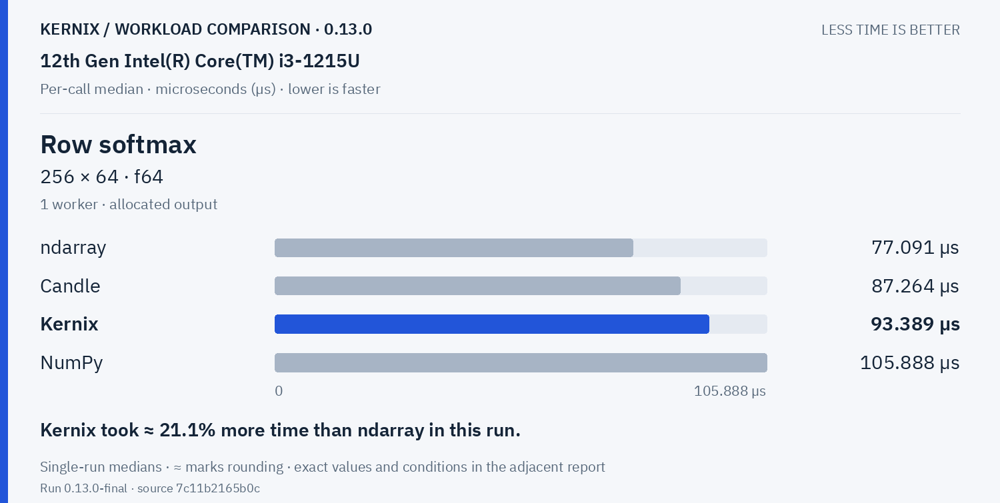

Kernix: **93.389 µs**. Kernix took ≈ 21.1% more time than ndarray in this run.

Tensor construction · 2 workloads

**Create zeros · 64 × 64 · f32**

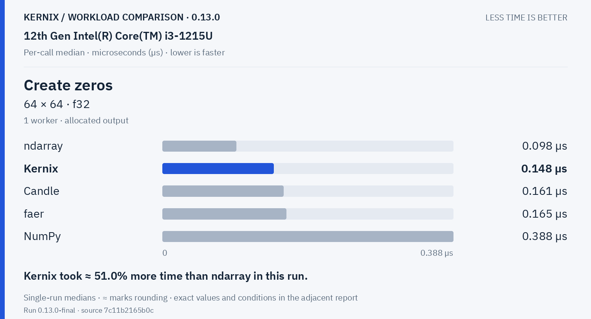

Kernix: **0.148 µs**. Kernix took ≈ 51.0% more time than ndarray in this run.

**Create ones · 64 × 64 · f32**

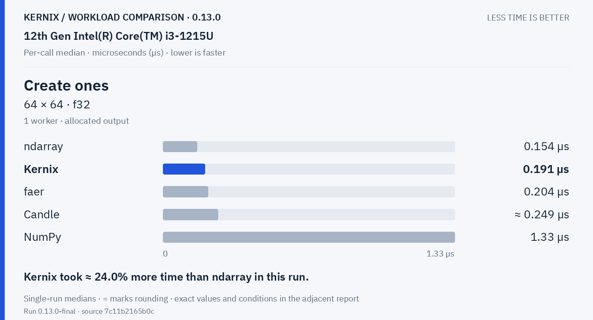

Kernix: **0.191 µs**. Kernix took ≈ 24.0% more time than ndarray in this run.

## Exact latency table

All values below are microseconds per operation. **Lower is faster.** Missing entries were not measured.

| Workload | Kernix | ndarray | nalgebra | faer | Candle | NumPy | Kernix refactor | Kernix · explicit dense | SciPy · CSR | Sequential run change |
|---|---:|---:|---:|---:|---:|---:|---:|---:|---:|---:|
| Sparse matrix × vector · 2048 × 2048 · five diagonals · f64 | 11.708 | — | — | **4.938** | — | 421.739 | — | 3233.102 | 7.04 | — |
| Sparse × dense matrix · 512 × 512 · 32 RHS · five diagonals · f64 | 24.034 | — | — | 42.111 | — | 428.464 | — | 421.951 | **22.263** | — |
| Sparse × dense matrix · 512 × 512 · 32 RHS · five diagonals · f32 | 16.813 | — | — | 38.575 | — | 169.153 | — | 212.719 | **15.043** | — |
| Sparse × sparse matrix · 256 × 256 · five diagonals each · f64 | 86.747 | — | — | — | — | 635.812 | — | 573.091 | **42.096** | — |
| Automatic CSR construction · 512 × 512 · clone + scan + compress · f64 | 534.67 | — | — | — | — | **81.466** | — | 116.698 | 941.507 | — |
| Matrix multiplication · transposed view · 128 × 128 · 128 × 128 · f64 | 114.249 | — | — | — | — | **78.262** | — | — | — | -8.5% |
| Matrix multiplication · transposed view · 128 × 128 · 128 × 128 · f32 | 51.166 | — | — | — | — | **40.474** | — | — | — | +3.9% |
| Independent matrix operands · 128 × 128 · 128 × 128 · f64 | **72.444** | — | — | — | — | 76.145 | — | — | — | -2.4% |
| Independent matrix operands · 128 × 128 · 128 × 128 · f32 | **37.833** | — | — | — | — | 40.065 | — | — | — | +5.3% |
| Matrix multiplication · 32 × 32 · 32 × 32 · f64 | 1.763 | 1.61 | 1.669 | **1.483** | 1.57 | 2.748 | — | — | — | +9.4% |
| Matrix multiplication · 64 × 64 · 64 × 64 · f64 | **10.383** | 11.606 | 11.009 | 11.485 | 10.478 | 12.269 | — | — | — | +5.6% |
| Matrix multiplication · 128 × 128 · 128 × 128 · f64 | **78.164** | 130.21500000000001 | 118.692 | 87.443 | 79.583 | 83.555 | — | — | — | +3.4% |
| Matrix multiplication · 256 × 256 · 256 × 256 · f64 | 619.081 | 692.011 | 662.704 | 762.531 | **576.856** | 640.902 | — | — | — | +7.0% |
| Matrix multiplication · 64 × 64 · 64 × 64 · f32 | 5.167 | 6.203 | 5.638 | 5.556 | **4.99** | 6.631 | — | — | — | +1.1% |
| Matrix multiplication · 128 × 128 · 128 × 128 · f32 | **38.804** | 53.745 | 54.08 | 42.827 | 39.874 | 39.017 | — | — | — | -2.2% |
| Matrix multiplication · 256 × 256 · 256 × 256 · f32 | **284.651** | 426.304 | 419.397 | 341.562 | 303.014 | 300.744 | — | — | — | -3.2% |
| Batched multiplication · 4 × 16 × 32 · 1 × 32 × 16 · f64 | **1.786** | — | — | — | 2.358 | 3.274 | — | — | — | -4.6% |
| Batched multiplication · 4 × 16 × 32 · 1 × 32 × 16 · f32 | **1.067** | — | — | — | 1.462 | 2.575 | — | — | — | +0.9% |
| Matmul · 2 workers · reused output · 64 × 64 · 64 × 64 · f64 | 14.817 | — | — | — | — | — | — | — | — | +24.3% |
| Matmul · 2 workers · reused output · 128 × 128 · 128 × 128 · f64 | 41.924 | — | — | — | — | — | — | — | — | +2.3% |
| Matmul · 2 workers · reused output · 256 × 256 · 256 × 256 · f64 | 318.499 | — | — | — | — | — | — | — | — | +8.8% |
| Matmul · 2 workers · reused output · 128 × 128 · 128 × 128 · f32 | 41.307 | — | — | — | — | — | — | — | — | +3.5% |
| Cholesky solve · reused factor · 128 × 128, 1 RHS · f64 | 10.516 | — | **3.939** | 4.335 | — | — | — | — | — | -0.3% |
| Cholesky solve · reused factor · 256 × 256, 64 RHS · f64 | 1233.339 | — | 855.367 | **227.128** | — | — | — | — | — | +12.7% |
| Cholesky solve · reused factor · 512 × 512, 128 RHS · f64 | 8879.196 | — | 8215.864 | **1652.097** | — | — | — | — | — | -1.0% |
| LU solve · reused factor · 256 × 256, 64 RHS · f64 | 1157.877 | — | 882.351 | **268.121** | — | — | — | — | — | +7.3% |
| Cholesky rank-one update · 256 × 256 · f64 | 125.06799999999999 | — | **24.466** | — | — | — | 514.27799999999994 | — | — | +2.8% |
| Cholesky rank-one downdate · 256 × 256 · f64 | 116.086 | — | **25.679** | — | — | — | 560.177 | — | — | -3.5% |
| Cholesky rank-one update · 512 × 512 · f64 | 767.096 | — | **152.543** | — | — | — | 3179.033 | — | — | +1.0% |
| Thin QR · 512 × 128 · f64 | 2710.334 | — | 3063.173 | **2074.102** | — | 2591.262 | — | — | — | +1.0% |
| Thin QR · 1024 × 256 · f64 | 18244.794 | — | 31419.420000000004 | 14910.293 | — | **13106.153** | — | — | — | +19.5% |
| Cholesky factorization · 512 × 512 · f64 | 3120.465 | — | 5562.141 | **1501.998** | — | 4526.544 | — | — | — | +1.3% |
| Column-pivoted QR · 96 × 32 · f64 | **57.355** | — | 83.846 | 73.177 | — | — | — | — | — | -0.0% |
| Column-pivoted QR · 256 × 64 · f64 | 594.535 | — | 846.397 | **456.588** | — | — | — | — | — | -1.0% |
| Minimum-norm least squares · 64 × 32, rank 16, 4 RHS · f64 | **48.342** | — | 80.777 | — | — | 68.057 | — | — | — | +4.0% |
| Minimum-norm least squares · 32 × 64, rank 32, 4 RHS · f64 | **63.897** | — | 142.803 | — | — | 122.814 | — | — | — | +3.1% |
| Thin QR · 96 × 32 · f64 | 51.792 | — | **39.913** | 66.514 | — | 42.941 | — | — | — | +6.2% |
| Thin QR · 256 × 64 · f64 | 510.15900000000006 | — | **393.179** | 424.417 | — | 407.643 | — | — | — | +2.9% |
| Cholesky factorization · 64 × 64 · f64 | 20.337 | — | 14.147 | **9.145** | — | 11.16 | — | — | — | -1.1% |
| Cholesky factorization · 128 × 128 · f64 | 124.647 | — | 97.744 | **40.685** | — | 72.767 | — | — | — | +9.4% |
| Cholesky factorization · 256 × 256 · f64 | 532.935 | — | 721.137 | **211.038** | — | 538.751 | — | — | — | +5.2% |
| Shared-variable backward · sum(X * X), 64 × 32; prepared graph · f64 | 6.659 | — | — | — | **4.211** | — | — | — | — | +0.4% |
| Record + backward · sum(A · W), 32 × 16 · 16 × 8 · f64 | **2.397** | — | — | — | 4.177 | — | — | — | — | +1.2% |
| Model inference · batched normalized/sliced MLP · f64 | **2.219** | — | — | — | 3.88 | — | — | — | — | -5.4% |
| Model recording + forward · batched normalized/sliced MLP · f64 | **2.934** | — | — | — | 5.374 | — | — | — | — | +10.1% |
| Model backward · prepared graph → fresh gradients · f64 | **3.259** | — | — | — | 15.270000000000002 | — | — | — | — | -2.3% |
| Parameter update · transactional SGD, fixed gradients · f64 | 0.553 | — | — | — | — | — | — | — | — | +4.9% |
| Coalesced tensor contraction · 16 × 32 × 8 · 32 × 8 × 16 · f64 | 37.966 | — | — | — | — | **8.467** | — | — | — | -0.0% |
| Row softmax · 256 × 64 · f64 | 93.389 | **77.091** | — | — | 87.264 | 105.888 | — | — | — | +3.9% |
| Create zeros · 64 × 64 · f32 | 0.148 | **0.098** | — | 0.165 | 0.161 | 0.388 | — | — | — | +1.4% |
| Create ones · 64 × 64 · f32 | 0.191 | **0.154** | — | 0.204 | 0.24900000000000003 | 1.33 | — | — | — | +3.8% |

## Matrix memory

Initialized input payload bytes, including sparse indices/offsets. Excludes capacity, object metadata, allocator overhead and construction peak. Same five-diagonal values; SciPy index width is measured rather than assumed.

| Workload | Implementation | Stored entries | Payload bytes | Dense bytes | Index bytes |
|---|---|---:|---:|---:|---:|
| Sparse matrix × vector · 2048 × 2048 · five diagonals · f64 | faer | 10240 | 180232 | 33554432 | 8 |
| Sparse matrix × vector · 2048 × 2048 · five diagonals · f64 | SciPy · CSR | 10240 | 131076 | 33554432 | 4 |
| Sparse matrix × vector · 2048 × 2048 · five diagonals · f64 | NumPy | 10240 | 33554432 | 33554432 | 0 |
| Sparse matrix × vector · 2048 × 2048 · five diagonals · f64 | Kernix · explicit dense | 10240 | 33554432 | 33554432 | 0 |
| Sparse matrix × vector · 2048 × 2048 · five diagonals · f64 | Kernix | 10240 | 180232 | 33554432 | 8 |
| Sparse × dense matrix · 512 × 512 · 32 RHS · five diagonals · f64 | SciPy · CSR | 2560 | 32772 | 2097152 | 4 |
| Sparse × dense matrix · 512 × 512 · 32 RHS · five diagonals · f64 | Kernix · explicit dense | 2560 | 2097152 | 2097152 | 0 |
| Sparse × dense matrix · 512 × 512 · 32 RHS · five diagonals · f64 | NumPy | 2560 | 2097152 | 2097152 | 0 |
| Sparse × dense matrix · 512 × 512 · 32 RHS · five diagonals · f64 | faer | 2560 | 45064 | 2097152 | 8 |
| Sparse × dense matrix · 512 × 512 · 32 RHS · five diagonals · f64 | Kernix | 2560 | 45064 | 2097152 | 8 |
| Sparse × dense matrix · 512 × 512 · 32 RHS · five diagonals · f32 | SciPy · CSR | 2560 | 22532 | 1048576 | 4 |
| Sparse × dense matrix · 512 × 512 · 32 RHS · five diagonals · f32 | Kernix | 2560 | 34824 | 1048576 | 8 |
| Sparse × dense matrix · 512 × 512 · 32 RHS · five diagonals · f32 | Kernix · explicit dense | 2560 | 1048576 | 1048576 | 0 |
| Sparse × dense matrix · 512 × 512 · 32 RHS · five diagonals · f32 | NumPy | 2560 | 1048576 | 1048576 | 0 |
| Sparse × dense matrix · 512 × 512 · 32 RHS · five diagonals · f32 | faer | 2560 | 34824 | 1048576 | 8 |
| Sparse × sparse matrix · 256 × 256 · five diagonals each · f64 | NumPy | 1280 | 524288 | 524288 | 0 |
| Sparse × sparse matrix · 256 × 256 · five diagonals each · f64 | SciPy · CSR | 1280 | 16388 | 524288 | 4 |
| Sparse × sparse matrix · 256 × 256 · five diagonals each · f64 | Kernix · explicit dense | 1280 | 524288 | 524288 | 0 |
| Sparse × sparse matrix · 256 × 256 · five diagonals each · f64 | Kernix | 1280 | 22536 | 524288 | 8 |
| Automatic CSR construction · 512 × 512 · clone + scan + compress · f64 | Kernix | 2560 | 45064 | 2097152 | 8 |
| Automatic CSR construction · 512 × 512 · clone + scan + compress · f64 | SciPy · CSR | 2560 | 32772 | 2097152 | 4 |
| Automatic CSR construction · 512 × 512 · clone + scan + compress · f64 | Kernix · explicit dense | 2560 | 2097152 | 2097152 | 0 |
| Automatic CSR construction · 512 × 512 · clone + scan + compress · f64 | NumPy | 2560 | 2097152 | 2097152 | 0 |

## Version comparison

24 of 51 workloads have paired evidence. Exploratory 95% intervals resample process pairs, not calls. No multiple-comparison adjustment.

### Version changes at a glance

The vertical line marks unchanged time. Left is faster; right is slower. Ranges are exploratory 95% intervals over fresh-process pairs. An interval crossing the line leaves direction unclear.

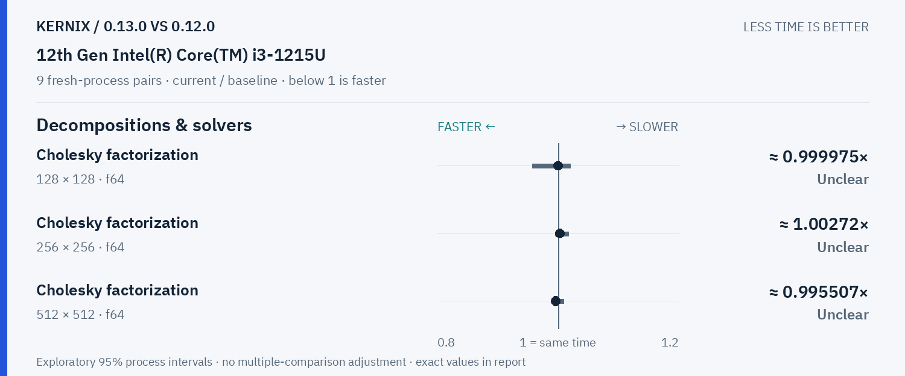

| Workload | Current / baseline [95% interval] | Interpretation |
|---|---:|---|
| Sparse matrix × vector · 2048 × 2048 · five diagonals · f64 | — | No paired comparison |
| Sparse × dense matrix · 512 × 512 · 32 RHS · five diagonals · f64 | — | No paired comparison |
| Sparse × dense matrix · 512 × 512 · 32 RHS · five diagonals · f32 | — | No paired comparison |
| Sparse × sparse matrix · 256 × 256 · five diagonals each · f64 | — | No paired comparison |
| Automatic CSR construction · 512 × 512 · clone + scan + compress · f64 | — | No paired comparison |
| Matrix multiplication · transposed view · 128 × 128 · 128 × 128 · f64 | 0.9831306771759503× [0.9551129339915351, 1.003657321991281] | Timing direction unclear |
| Matrix multiplication · transposed view · 128 × 128 · 128 × 128 · f32 | 0.9934463407134071× [0.9661845078310577, 1.020309534524252] | Timing direction unclear |
| Independent matrix operands · 128 × 128 · 128 × 128 · f64 | 1.0067189532578082× [0.9902451192773774, 1.0252092008985458] | Timing direction unclear |
| Independent matrix operands · 128 × 128 · 128 × 128 · f32 | 0.9839558786663324× [0.952405309950067, 1.032131599162936] | Timing direction unclear |
| Matrix multiplication · 32 × 32 · 32 × 32 · f64 | 0.9724178403755869× [0.9392735527809307, 1.0354141656662665] | Timing direction unclear |
| Matrix multiplication · 64 × 64 · 64 × 64 · f64 | — | No paired comparison |
| Matrix multiplication · 128 × 128 · 128 × 128 · f64 | 0.9959442169907882× [0.9779128596239522, 1.0724055236388552] | Timing direction unclear |
| Matrix multiplication · 256 × 256 · 256 × 256 · f64 | 1.011560810163837× [0.9898909353651273, 1.0408148018602503] | Timing direction unclear |
| Matrix multiplication · 64 × 64 · 64 × 64 · f32 | — | No paired comparison |
| Matrix multiplication · 128 × 128 · 128 × 128 · f32 | 1.0037062955187517× [0.9742674775091722, 1.0601348384263685] | Timing direction unclear |
| Matrix multiplication · 256 × 256 · 256 × 256 · f32 | 0.9931872157146883× [0.9654477634052472, 1.0037845234361267] | Timing direction unclear |
| Batched multiplication · 4 × 16 × 32 · 1 × 32 × 16 · f64 | 0.9970831307729704× [0.975418410041841, 1.1335920177383592] | Timing direction unclear |
| Batched multiplication · 4 × 16 × 32 · 1 × 32 × 16 · f32 | 1.0075329566854991× [0.9835271317829457, 1.0893697083725307] | Timing direction unclear |
| Matmul · 2 workers · reused output · 64 × 64 · 64 × 64 · f64 | — | No paired comparison |
| Matmul · 2 workers · reused output · 128 × 128 · 128 × 128 · f64 | 0.9689889449139503× [0.5479324905546913, 1.0396271522059357] | Timing direction unclear |
| Matmul · 2 workers · reused output · 256 × 256 · 256 × 256 · f64 | 1.004840059681939× [0.9558712930918805, 1.0174677693830658] | Timing direction unclear |
| Matmul · 2 workers · reused output · 128 × 128 · 128 × 128 · f32 | 0.9979826594557473× [0.7234320374036477, 1.0175336583620342] | Timing direction unclear |
| Cholesky solve · reused factor · 128 × 128, 1 RHS · f64 | 0.971888310459063× [0.9472371095915727, 1.0012012012012013] | Timing direction unclear |
| Cholesky solve · reused factor · 256 × 256, 64 RHS · f64 | 0.998881793149922× [0.9383370732247256, 1.0158104873311955] | Timing direction unclear |
| Cholesky solve · reused factor · 512 × 512, 128 RHS · f64 | — | No paired comparison |
| LU solve · reused factor · 256 × 256, 64 RHS · f64 | 0.9928007590421402× [0.8941054039275927, 1.0236462883336268] | Timing direction unclear |
| Cholesky rank-one update · 256 × 256 · f64 | — | No paired comparison |
| Cholesky rank-one downdate · 256 × 256 · f64 | — | No paired comparison |
| Cholesky rank-one update · 512 × 512 · f64 | — | No paired comparison |
| Thin QR · 512 × 128 · f64 | 1.015420789872515× [1.0044781525261148, 1.0341645738980965] | Observed time increase |
| Thin QR · 1024 × 256 · f64 | 0.994849890466581× [0.9756770639941873, 1.034197175088076] | Timing direction unclear |
| Cholesky factorization · 512 × 512 · f64 | 0.9955066144074014× [0.9943410264683163, 1.0087164543796072] | Timing direction unclear |
| Column-pivoted QR · 96 × 32 · f64 | — | No paired comparison |
| Column-pivoted QR · 256 × 64 · f64 | — | No paired comparison |
| Minimum-norm least squares · 64 × 32, rank 16, 4 RHS · f64 | — | No paired comparison |
| Minimum-norm least squares · 32 × 64, rank 32, 4 RHS · f64 | — | No paired comparison |
| Thin QR · 96 × 32 · f64 | — | No paired comparison |
| Thin QR · 256 × 64 · f64 | 0.9949400259294162× [0.974955375897472, 1.0243504436603224] | Timing direction unclear |
| Cholesky factorization · 64 × 64 · f64 | — | No paired comparison |
| Cholesky factorization · 128 × 128 · f64 | 0.9999751676185746× [0.9566231767752397, 1.0203783587570383] | Timing direction unclear |
| Cholesky factorization · 256 × 256 · f64 | 1.0027173195152603× [0.9950857348226192, 1.0172574780149357] | Timing direction unclear |
| Shared-variable backward · sum(X * X), 64 × 32; prepared graph · f64 | — | No paired comparison |
| Record + backward · sum(A · W), 32 × 16 · 16 × 8 · f64 | 1.0118367346938775× [0.9757423672103722, 1.0385412349772067] | Timing direction unclear |
| Model inference · batched normalized/sliced MLP · f64 | — | No paired comparison |
| Model recording + forward · batched normalized/sliced MLP · f64 | — | No paired comparison |
| Model backward · prepared graph → fresh gradients · f64 | — | No paired comparison |
| Parameter update · transactional SGD, fixed gradients · f64 | — | No paired comparison |
| Coalesced tensor contraction · 16 × 32 × 8 · 32 × 8 × 16 · f64 | — | No paired comparison |
| Row softmax · 256 × 64 · f64 | — | No paired comparison |
| Create zeros · 64 × 64 · f32 | — | No paired comparison |
| Create ones · 64 × 64 · f32 | — | No paired comparison |

## Method and provenance

CPU affinity pinned to logical CPU 0. Frequency and background load are uncontrolled.

Minimum-norm rows use pivoted QR plus scaled implicit RZ in Kernix; NumPy native lstsq; nalgebra native SVD/solve. Algorithm costs and rank policies differ. See original method for thresholds. Kernix/nalgebra: prepared base factor, owned modified factor; refactor: same Kernix version, full factorization of preformed modified matrix; base setup and matrix formation excluded Rank two; cyclic five diagonals; exact dyadic values; 1 worker; owned output; prepared operands except auto construction. Kernix Matrix finite checks vs peer IEEE policies; payload excludes capacity, metadata and allocator overhead. CSR indices usize in Kernix/faer and actual recorded SciPy width. SpGEMM heap merge vs SciPy column accumulator; fill-in depends on pattern. Construction: Kernix clones a Vec then validates/scans/compresses; SciPy borrows dense input and allocates CSR output; NumPy/dense Kernix copy only. Construction compares API trade-offs, not identical algorithms. No universal sparse speed or density threshold claim.

Numbers retain source precision; recorded digits do not imply equivalent physical measurement accuracy. Lowest observed medians are bold only when peers were measured. No aggregate winner or universal ranking is inferred.

[Original report and commentary](original-report.txt) · [Raw measurements](raw.json)

Measured source `7c11b2165b0cb7b523db4d938a36f1396396a138`. Run `0.13.0-final`. Rendering does not change measurements.
