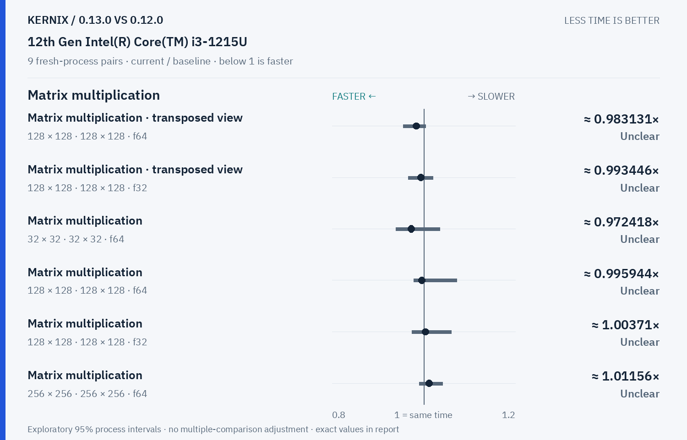
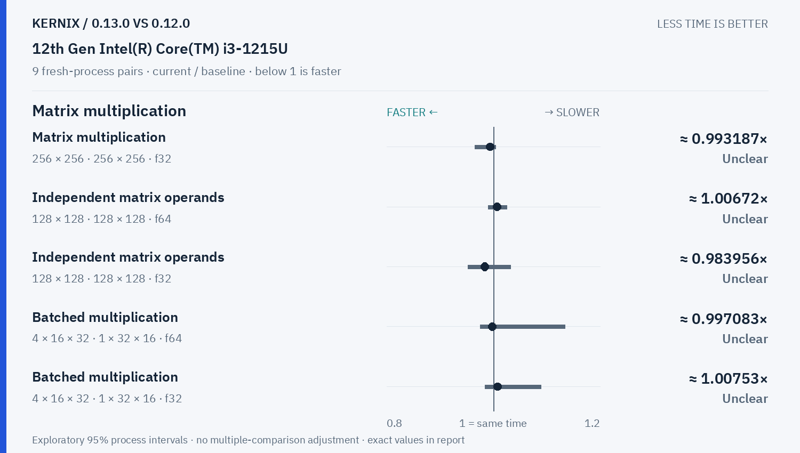
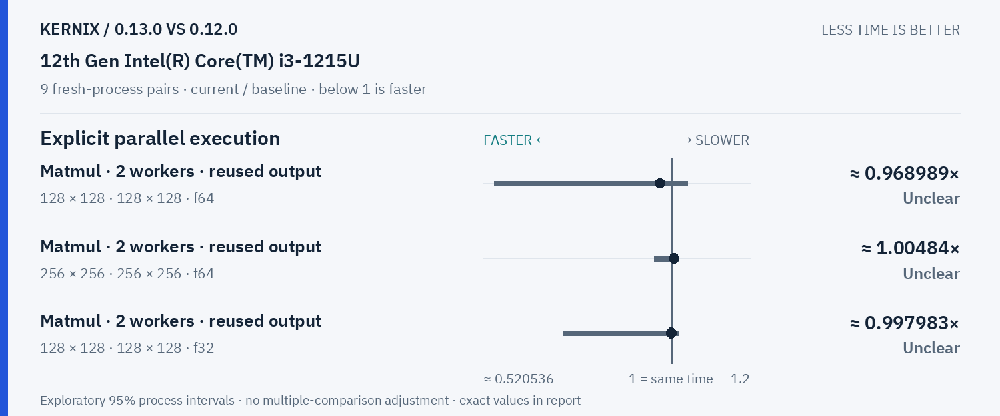
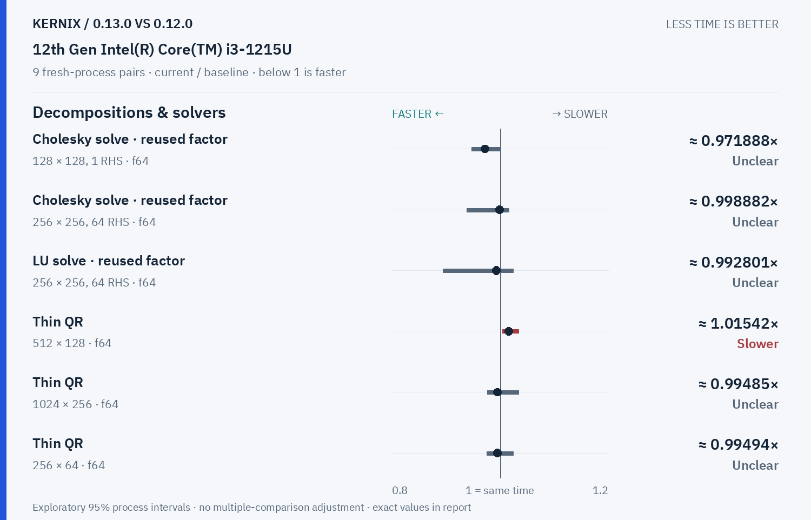
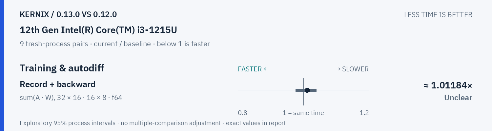

# Kernix 0.13.0 · paired process comparison

9 fresh-process pairs per workload. Ratios below 1 mean less time.

[Interactive HTML (open locally)](report.html) · [Vector PDF](latency.pdf) · [Original process evidence](paired.json)

### Version changes at a glance

The vertical line marks unchanged time. Left is faster; right is slower. Ranges are exploratory 95% intervals over fresh-process pairs. An interval crossing the line leaves direction unclear.

## Exact process ratios

| Workload | Current / baseline [95% interval] | Interpretation |
|---|---:|---|
| Cholesky solve · reused factor · 128 × 128, 1 RHS · f64 | 0.971888310459063× [0.9472371095915727, 1.0012012012012013] | Timing direction unclear |
| Cholesky solve · reused factor · 256 × 256, 64 RHS · f64 | 0.998881793149922× [0.9383370732247256, 1.0158104873311955] | Timing direction unclear |
| LU solve · reused factor · 256 × 256, 64 RHS · f64 | 0.9928007590421402× [0.8941054039275927, 1.0236462883336268] | Timing direction unclear |
| Thin QR · 512 × 128 · f64 | 1.015420789872515× [1.0044781525261148, 1.0341645738980965] | Observed time increase |
| Thin QR · 1024 × 256 · f64 | 0.994849890466581× [0.9756770639941873, 1.034197175088076] | Timing direction unclear |
| Matrix multiplication · transposed view · 128 × 128 · 128 × 128 · f64 | 0.9831306771759503× [0.9551129339915351, 1.003657321991281] | Timing direction unclear |
| Matrix multiplication · transposed view · 128 × 128 · 128 × 128 · f32 | 0.9934463407134071× [0.9661845078310577, 1.020309534524252] | Timing direction unclear |
| Thin QR · 256 × 64 · f64 | 0.9949400259294162× [0.974955375897472, 1.0243504436603224] | Timing direction unclear |
| Matrix multiplication · 32 × 32 · 32 × 32 · f64 | 0.9724178403755869× [0.9392735527809307, 1.0354141656662665] | Timing direction unclear |
| Matrix multiplication · 128 × 128 · 128 × 128 · f64 | 0.9959442169907882× [0.9779128596239522, 1.0724055236388552] | Timing direction unclear |
| Matrix multiplication · 128 × 128 · 128 × 128 · f32 | 1.0037062955187517× [0.9742674775091722, 1.0601348384263685] | Timing direction unclear |
| Matrix multiplication · 256 × 256 · 256 × 256 · f64 | 1.011560810163837× [0.9898909353651273, 1.0408148018602503] | Timing direction unclear |
| Matrix multiplication · 256 × 256 · 256 × 256 · f32 | 0.9931872157146883× [0.9654477634052472, 1.0037845234361267] | Timing direction unclear |
| Record + backward · sum(A · W), 32 × 16 · 16 × 8 · f64 | 1.0118367346938775× [0.9757423672103722, 1.0385412349772067] | Timing direction unclear |
| Independent matrix operands · 128 × 128 · 128 × 128 · f64 | 1.0067189532578082× [0.9902451192773774, 1.0252092008985458] | Timing direction unclear |
| Independent matrix operands · 128 × 128 · 128 × 128 · f32 | 0.9839558786663324× [0.952405309950067, 1.032131599162936] | Timing direction unclear |
| Batched multiplication · 4 × 16 × 32 · 1 × 32 × 16 · f64 | 0.9970831307729704× [0.975418410041841, 1.1335920177383592] | Timing direction unclear |
| Batched multiplication · 4 × 16 × 32 · 1 × 32 × 16 · f32 | 1.0075329566854991× [0.9835271317829457, 1.0893697083725307] | Timing direction unclear |
| Cholesky factorization · 128 × 128 · f64 | 0.9999751676185746× [0.9566231767752397, 1.0203783587570383] | Timing direction unclear |
| Cholesky factorization · 256 × 256 · f64 | 1.0027173195152603× [0.9950857348226192, 1.0172574780149357] | Timing direction unclear |
| Cholesky factorization · 512 × 512 · f64 | 0.9955066144074014× [0.9943410264683163, 1.0087164543796072] | Timing direction unclear |
| Matmul · 2 workers · reused output · 128 × 128 · 128 × 128 · f64 | 0.9689889449139503× [0.5479324905546913, 1.0396271522059357] | Timing direction unclear |
| Matmul · 2 workers · reused output · 256 × 256 · 256 × 256 · f64 | 1.004840059681939× [0.9558712930918805, 1.0174677693830658] | Timing direction unclear |
| Matmul · 2 workers · reused output · 128 × 128 · 128 × 128 · f32 | 0.9979826594557473× [0.7234320374036477, 1.0175336583620342] | Timing direction unclear |

## Method

95% percentile bootstrap over paired process blocks; 10000 resamples; exploratory, no multiple-comparison adjustment

Current `0.13.0-final`; baseline `0.12.0-git-0130`. All source ratio digits, paired observations and process ordering are preserved. No absolute peer latencies are inferred.
