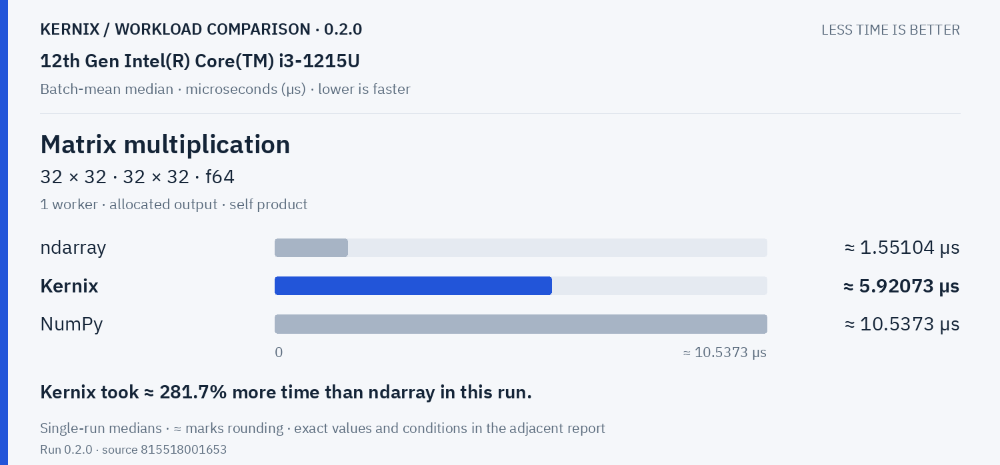
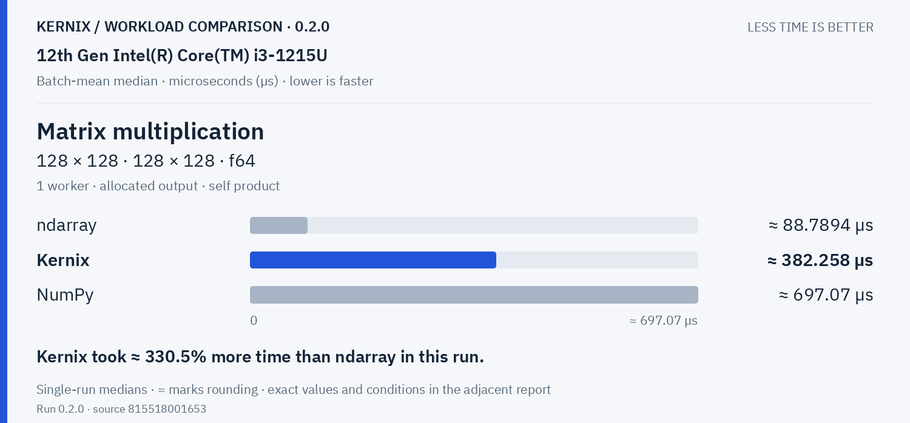
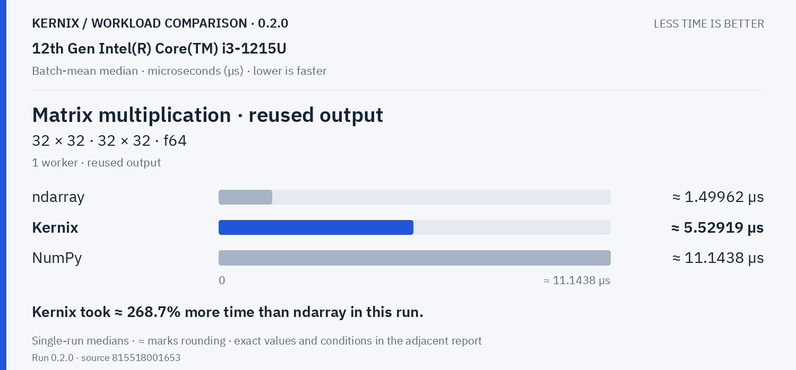
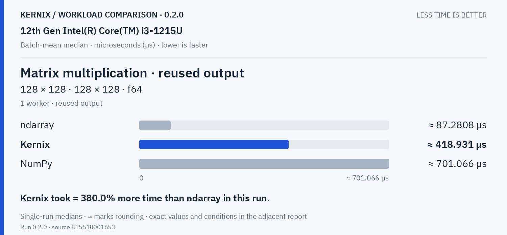
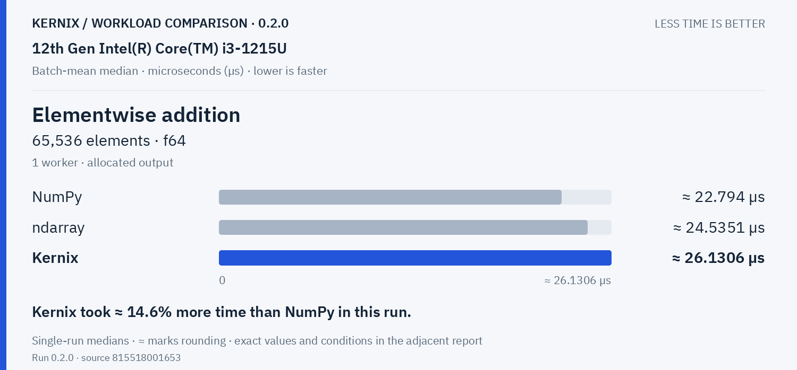
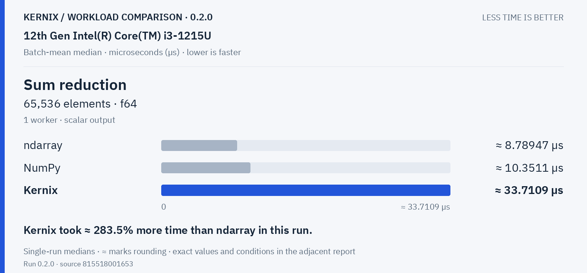
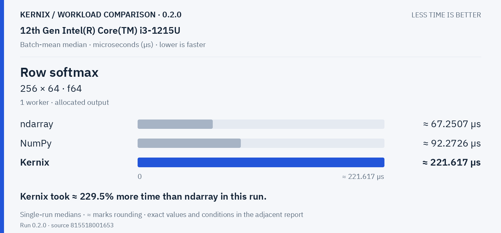

# Kernix 0.2.0 · performance brief

12th Gen Intel(R) Core(TM) i3-1215U / Linux

**Batch-mean median, microseconds per operation. Lower is faster. All recorded digits retained.**

7 workloads · 21 observations

No previous-version baseline attached. Sequential run changes are descriptive; paired process evidence is shown separately.

[Open the visual report](report.html) · [Vector PDF](latency.pdf) · [Raw measurements](raw.json)

## Charts by workload

**Shorter bars mean less time.** Blue is Kernix; grey is another library; teal is an explicitly selected Kernix backend. Entries are sorted by the recorded median, with a separate zero-based scale per chart. These point observations do not establish a statistical ranking.

Expand a group to see every chart here on GitHub. Click a chart to enlarge it. The exact table below keeps every source digit.

Matrix multiplication · 2 workloads

**Matrix multiplication · 32 × 32 · 32 × 32 · f64**

**Matrix multiplication · 128 × 128 · 128 × 128 · f64**

Explicit parallel execution · 2 workloads

**Matrix multiplication · reused output · 32 × 32 · 32 × 32 · f64**

**Matrix multiplication · reused output · 128 × 128 · 128 × 128 · f64**

Statistics & activations · 3 workloads

**Elementwise addition · 65,536 elements · f64**

**Sum reduction · 65,536 elements · f64**

**Row softmax · 256 × 64 · f64**

## Exact latency table

All values below are microseconds per operation. **Lower is faster.** Missing entries were not measured.

| Workload | Kernix | ndarray | NumPy |
|---|---:|---:|---:|
| Matrix multiplication · 32 × 32 · 32 × 32 · f64 | 5.9207331281079805 | **1.5510405732365532** | 10.537275600505689 |
| Matrix multiplication · 128 × 128 · 128 × 128 · f64 | 382.25798484848486 | **88.7894219858156** | 697.0703333333334 |
| Matrix multiplication · reused output · 32 × 32 · 32 × 32 · f64 | 5.52918597965502 | **1.4996237178333633** | 11.143829768270945 |
| Matrix multiplication · reused output · 128 × 128 · 128 × 128 · f64 | 418.93075 | **87.28080139372822** | 701.0661111111111 |
| Elementwise addition · 65,536 elements · f64 | 26.130575757575756 | 24.53514019607843 | **22.793959890610757** |
| Sum reduction · 65,536 elements · f64 | 33.71090026954178 | **8.789467135325132** | 10.351081953642384 |
| Row softmax · 256 × 64 · f64 | 221.61737168141594 | **67.2507345844504** | 92.27262361623616 |

## Version comparison

0 of 7 workloads have paired evidence. Exploratory 95% intervals resample process pairs, not calls. No multiple-comparison adjustment.

| Workload | Current / baseline [95% interval] | Interpretation |
|---|---:|---|
| Matrix multiplication · 32 × 32 · 32 × 32 · f64 | — | No paired comparison |
| Matrix multiplication · 128 × 128 · 128 × 128 · f64 | — | No paired comparison |
| Matrix multiplication · reused output · 32 × 32 · 32 × 32 · f64 | — | No paired comparison |
| Matrix multiplication · reused output · 128 × 128 · 128 × 128 · f64 | — | No paired comparison |
| Elementwise addition · 65,536 elements · f64 | — | No paired comparison |
| Sum reduction · 65,536 elements · f64 | — | No paired comparison |
| Row softmax · 256 × 64 · f64 | — | No paired comparison |

## Historical statistic

These are medians of 15 warmed batch means, not per-call medians. The original p95 field is the maximum of those 15 batch means. No per-call p95/p99, accuracy or allocation probes are inferred.

## Method and provenance

CPU affinity was not pinned. Frequency and background load are uncontrolled.

Numbers retain source precision; recorded digits do not imply equivalent physical measurement accuracy. Lowest observed medians are bold only when peers were measured. No aggregate winner or universal ranking is inferred.

[Original report and commentary](original-report.txt) · [Raw measurements](raw.json)

Measured source `815518001653562c8881f986a439f65464eebeea`. Run `0.2.0`. Rendering does not change measurements.
