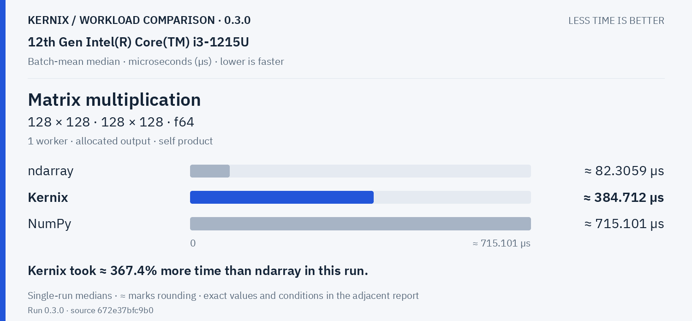
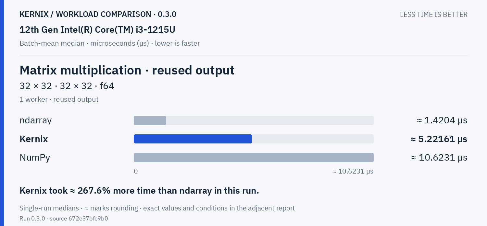
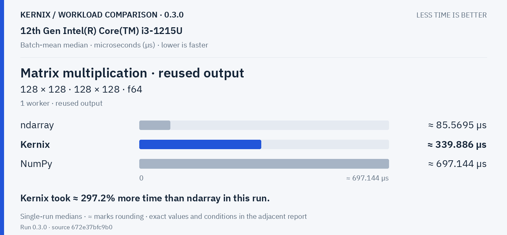
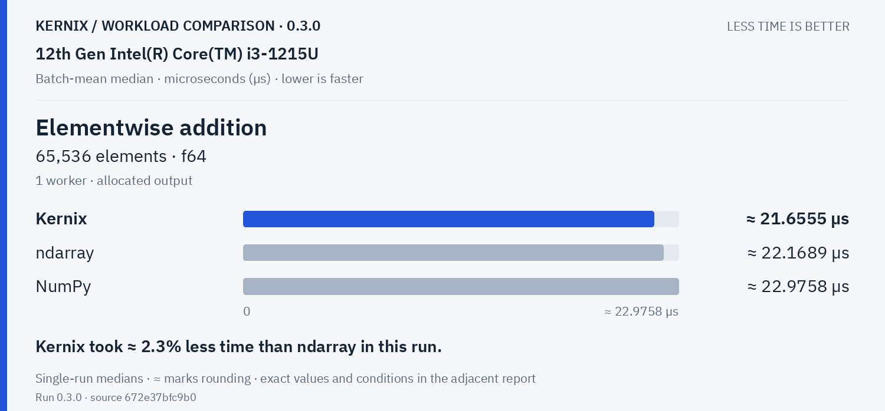
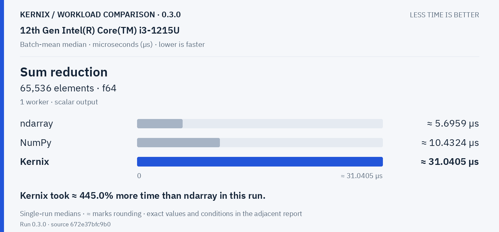
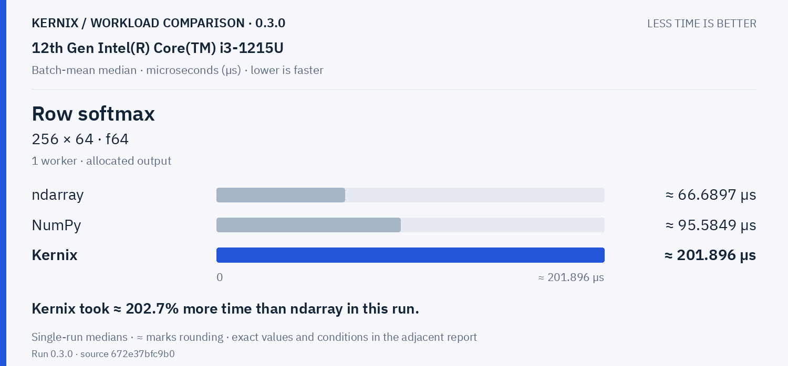
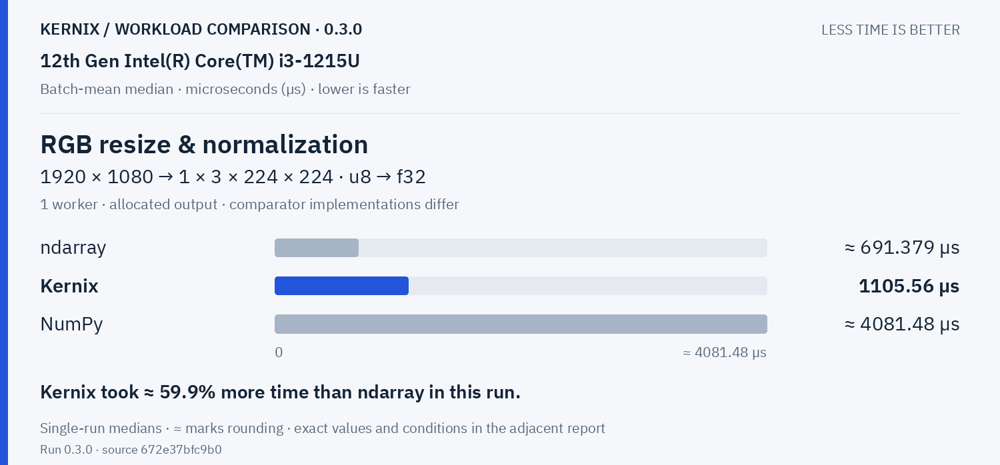
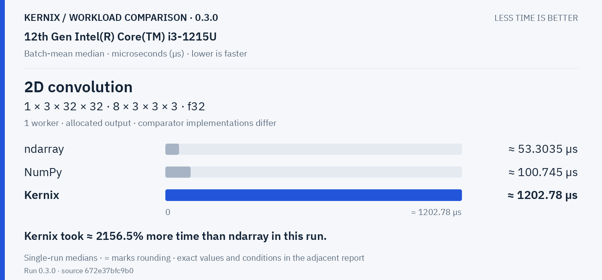

# Kernix 0.3.0 · performance brief

12th Gen Intel(R) Core(TM) i3-1215U / Linux

**Batch-mean median, microseconds per operation. Lower is faster. All recorded digits retained.**

9 workloads · 27 observations

No previous-version baseline attached. Sequential run changes are descriptive; paired process evidence is shown separately.

[Interactive HTML (open locally)](report.html) · [Vector PDF](latency.pdf) · [Raw measurements](raw.json)

## Charts by workload

**Shorter bars mean less time.** Blue is Kernix; grey is another library; teal is an explicitly selected Kernix backend. Entries are sorted by the recorded median, with a separate zero-based scale per chart. These point observations do not establish a statistical ranking.

Expand a group to see every chart here on GitHub. Click a chart to enlarge it. The exact table below keeps every source digit.

Matrix multiplication · 2 workloads

**Matrix multiplication · 32 × 32 · 32 × 32 · f64**

Kernix: **5.6099288759255105 µs**. Kernix took ≈ 286.5% more time than ndarray in this run.

**Matrix multiplication · 128 × 128 · 128 × 128 · f64**

Kernix: **384.7123846153846 µs**. Kernix took ≈ 367.4% more time than ndarray in this run.

Explicit parallel execution · 2 workloads

**Matrix multiplication · reused output · 32 × 32 · 32 × 32 · f64**

Kernix: **5.221606516290727 µs**. Kernix took ≈ 267.6% more time than ndarray in this run.

**Matrix multiplication · reused output · 128 × 128 · 128 × 128 · f64**

Kernix: **339.8856216216216 µs**. Kernix took ≈ 297.2% more time than ndarray in this run.

Statistics & activations · 3 workloads

**Elementwise addition · 65,536 elements · f64**

Kernix: **21.655509956709957 µs**. Kernix took ≈ 2.3% less time than ndarray in this run.

**Sum reduction · 65,536 elements · f64**

Kernix: **31.040481389578163 µs**. Kernix took ≈ 445.0% more time than ndarray in this run.

**Row softmax · 256 × 64 · f64**

Kernix: **201.89640322580645 µs**. Kernix took ≈ 202.7% more time than ndarray in this run.

Vision workloads · 2 workloads

**RGB resize &amp; normalization · 1920 × 1080 → 1 × 3 × 224 × 224 · u8 → f32**

Kernix: **1105.56 µs**. Kernix took ≈ 59.9% more time than ndarray in this run.

**2D convolution · 1 × 3 × 32 × 32 · 8 × 3 × 3 × 3 · f32**

Kernix: **1202.7825714285714 µs**. Kernix took ≈ 2156.5% more time than ndarray in this run.

## Exact latency table

All values below are microseconds per operation. **Lower is faster.** Missing entries were not measured.

| Workload | Kernix | ndarray | NumPy |
|---|---:|---:|---:|
| Matrix multiplication · 32 × 32 · 32 × 32 · f64 | 5.6099288759255105 | **1.4514304208998549** | 10.75141143594153 |
| Matrix multiplication · 128 × 128 · 128 × 128 · f64 | 384.7123846153846 | **82.30586513157895** | 715.1009142857143 |
| Matrix multiplication · reused output · 32 × 32 · 32 × 32 · f64 | 5.221606516290727 | **1.420400999943185** | 10.623101954120646 |
| Matrix multiplication · reused output · 128 × 128 · 128 × 128 · f64 | 339.8856216216216 | **85.56947781569966** | 697.1443055555555 |
| Elementwise addition · 65,536 elements · f64 | **21.655509956709957** | 22.168906028368794 | 22.975808999081728 |
| Sum reduction · 65,536 elements · f64 | 31.040481389578163 | **5.6959009111617315** | 10.432436795994994 |
| Row softmax · 256 × 64 · f64 | 201.89640322580645 | **66.68974933333334** | 95.58492366412214 |
| RGB resize & normalization · 1920 × 1080 → 1 × 3 × 224 × 224 · u8 → f32 | 1105.56 | **691.3791891891892** | 4081.478285714286 |
| 2D convolution · 1 × 3 × 32 × 32 · 8 × 3 × 3 × 3 · f32 | 1202.7825714285714 | **53.30354893617021** | 100.74453413654618 |

## Version comparison

0 of 9 workloads have paired evidence. Exploratory 95% intervals resample process pairs, not calls. No multiple-comparison adjustment.

| Workload | Current / baseline [95% interval] | Interpretation |
|---|---:|---|
| Matrix multiplication · 32 × 32 · 32 × 32 · f64 | — | No paired comparison |
| Matrix multiplication · 128 × 128 · 128 × 128 · f64 | — | No paired comparison |
| Matrix multiplication · reused output · 32 × 32 · 32 × 32 · f64 | — | No paired comparison |
| Matrix multiplication · reused output · 128 × 128 · 128 × 128 · f64 | — | No paired comparison |
| Elementwise addition · 65,536 elements · f64 | — | No paired comparison |
| Sum reduction · 65,536 elements · f64 | — | No paired comparison |
| Row softmax · 256 × 64 · f64 | — | No paired comparison |
| RGB resize & normalization · 1920 × 1080 → 1 × 3 × 224 × 224 · u8 → f32 | — | No paired comparison |
| 2D convolution · 1 × 3 × 32 × 32 · 8 × 3 × 3 × 3 · f32 | — | No paired comparison |

## Historical statistic

These are medians of 15 warmed batch means, not per-call medians. The original p95 field is the maximum of those 15 batch means. No per-call p95/p99, accuracy or allocation probes are inferred.

## Method and provenance

CPU affinity was not pinned. Frequency and background load are uncontrolled.

Numbers retain source precision; recorded digits do not imply equivalent physical measurement accuracy. Lowest observed medians are bold only when peers were measured. No aggregate winner or universal ranking is inferred.

[Original report and commentary](original-report.txt) · [Raw measurements](raw.json)

Measured source `672e37bfc9b05882096615881d6932082b3a7c46`. Run `0.3.0`. Rendering does not change measurements.
