# Kernix 0.4.0-openblas · performance brief

12th Gen Intel(R) Core(TM) i3-1215U / Linux

**Batch-mean median, microseconds per operation. Lower is faster. All recorded digits retained.**

13 workloads · 38 observations

No previous-version baseline attached. Sequential run changes are descriptive; paired process evidence is shown separately.

[Interactive HTML (open locally)](report.html) · [Vector PDF](latency.pdf) · [Raw measurements](raw.json)

## Charts by workload

**Shorter bars mean less time.** Blue is Kernix; grey is a comparison implementation; teal is an explicitly selected Kernix backend. Entries are sorted by the recorded median, with a separate zero-based scale per chart. These point observations do not establish a statistical ranking.

Expand a group to see every chart here on GitHub. Click a chart to enlarge it. The exact table below keeps every source digit.

Matrix multiplication · 2 workloads

**Matrix multiplication · 32 × 32 · 32 × 32 · f64**

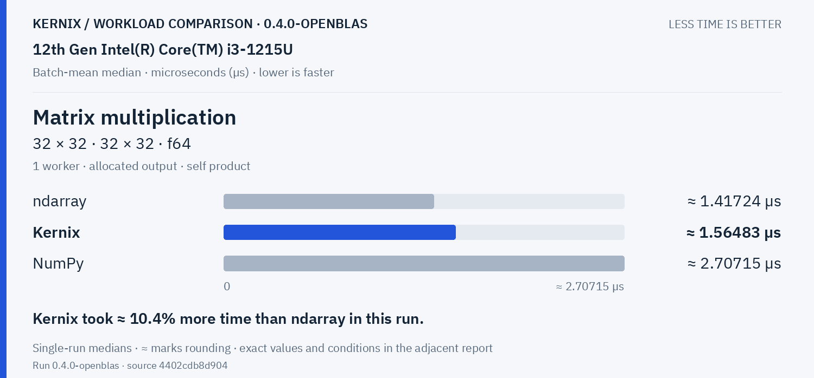

Kernix: **1.564825937284847 µs**. Kernix took ≈ 10.4% more time than ndarray in this run.

**Matrix multiplication · 128 × 128 · 128 × 128 · f64**

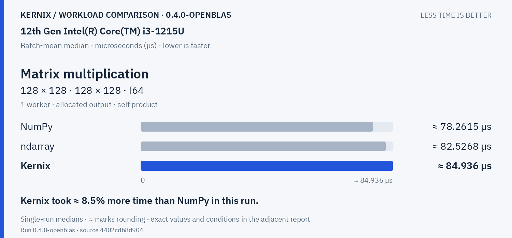

Kernix: **84.93596271186441 µs**. Kernix took ≈ 8.5% more time than NumPy in this run.

Explicit parallel execution · 2 workloads

**Matrix multiplication · reused output · 32 × 32 · 32 × 32 · f64**

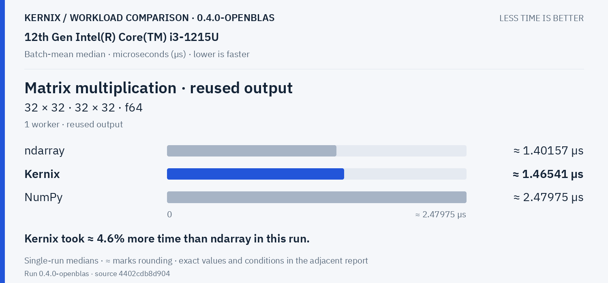

Kernix: **1.4654065412343941 µs**. Kernix took ≈ 4.6% more time than ndarray in this run.

**Matrix multiplication · reused output · 128 × 128 · 128 × 128 · f64**

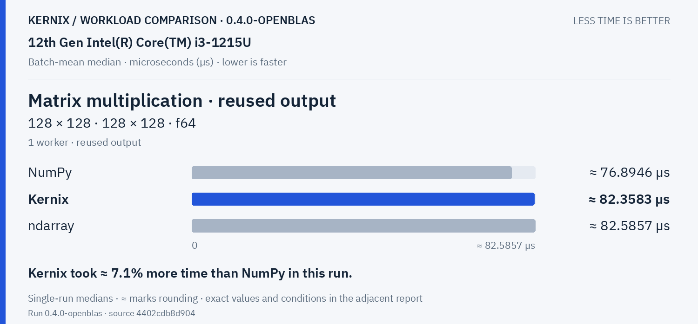

Kernix: **82.35834539473684 µs**. Kernix took ≈ 7.1% more time than NumPy in this run.

Decompositions & solvers · 3 workloads

**Cholesky factorization · 64 × 64 · f64**

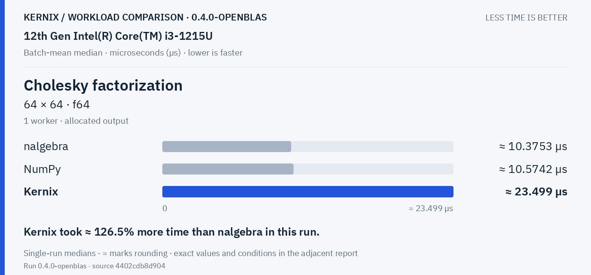

Kernix: **23.499029135338347 µs**. Kernix took ≈ 126.5% more time than nalgebra in this run.

**Linear system solve · 64 × 64 · f64**

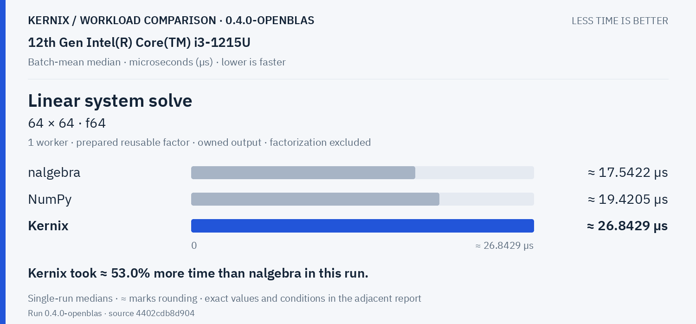

Kernix: **26.84285729613734 µs**. Kernix took ≈ 53.0% more time than nalgebra in this run.

**Thin QR · 96 × 32 · f64**

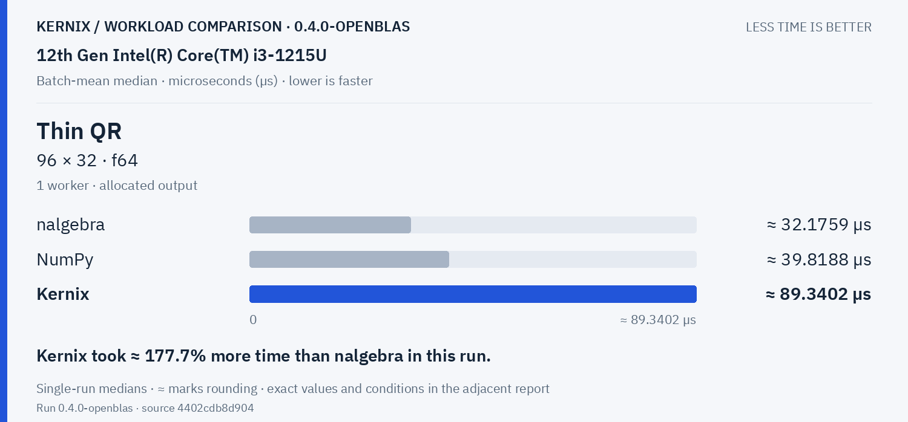

Kernix: **89.34021428571429 µs**. Kernix took ≈ 177.7% more time than nalgebra in this run.

Training & autodiff · 1 workloads

**Dense training step · 32 × 16 × 8 · f64**

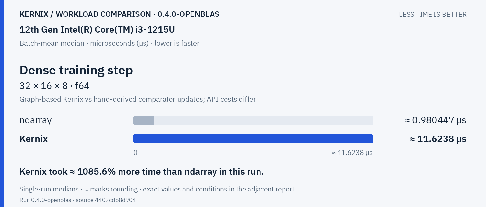

Kernix: **11.62384658298466 µs**. Kernix took ≈ 1085.6% more time than ndarray in this run.

Statistics & activations · 3 workloads

**Elementwise addition · 65,536 elements · f64**

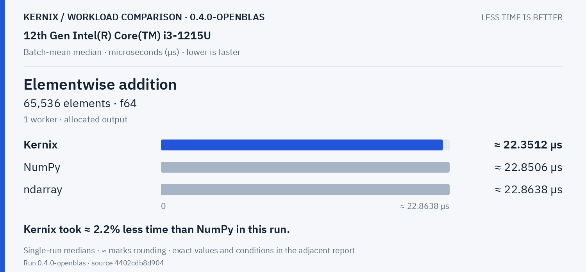

Kernix: **22.35119928507596 µs**. Kernix took ≈ 2.2% less time than NumPy in this run.

**Sum reduction · 65,536 elements · f64**

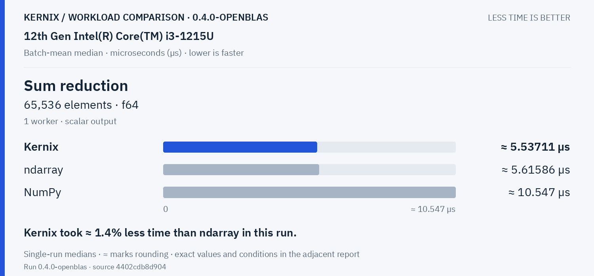

Kernix: **5.537106288751107 µs**. Kernix took ≈ 1.4% less time than ndarray in this run.

**Row softmax · 256 × 64 · f64**

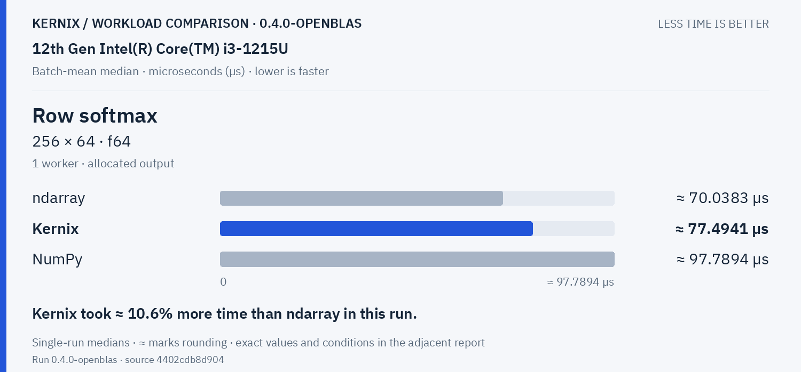

Kernix: **77.49405263157895 µs**. Kernix took ≈ 10.6% more time than ndarray in this run.

Vision workloads · 2 workloads

**RGB resize &amp; normalization · 1920 × 1080 → 1 × 3 × 224 × 224 · u8 → f32**

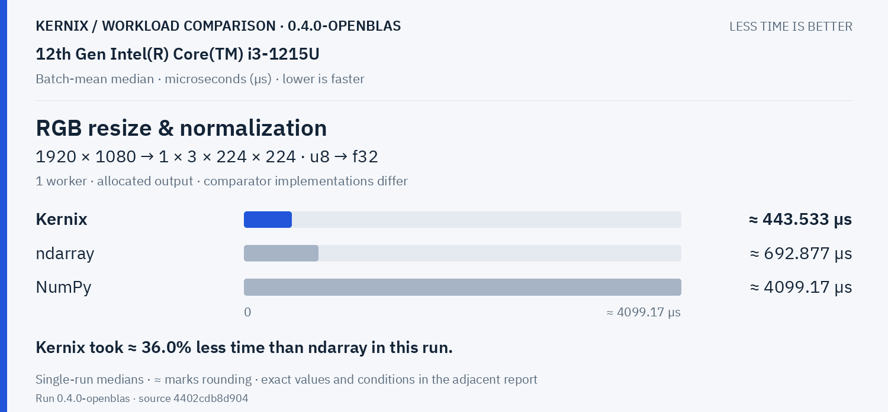

Kernix: **443.5329298245614 µs**. Kernix took ≈ 36.0% less time than ndarray in this run.

**2D convolution · 1 × 3 × 32 × 32 · 8 × 3 × 3 × 3 · f32**

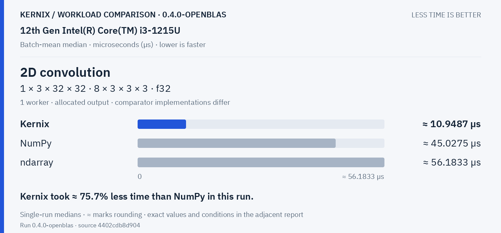

Kernix: **10.948694833625219 µs**. Kernix took ≈ 75.7% less time than NumPy in this run.

## Exact latency table

All values below are microseconds per operation. **Lower is faster.** Missing entries were not measured.

| Workload | Kernix | ndarray | nalgebra | NumPy |
|---|---:|---:|---:|---:|
| Matrix multiplication · 32 × 32 · 32 × 32 · f64 | 1.564825937284847 | **1.4172448979591836** | — | 2.7071532965248457 |
| Matrix multiplication · 128 × 128 · 128 × 128 · f64 | 84.93596271186441 | 82.52684488448846 | — | **78.2614625** |
| Matrix multiplication · reused output · 32 × 32 · 32 × 32 · f64 | 1.4654065412343941 | **1.401565814553201** | — | 2.479748859353303 |
| Matrix multiplication · reused output · 128 × 128 · 128 × 128 · f64 | 82.35834539473684 | 82.58573597359736 | — | **76.89455214723926** |
| Cholesky factorization · 64 × 64 · f64 | 23.499029135338347 | — | **10.375264315352697** | 10.574162790697674 |
| Linear system solve · 64 × 64 · f64 | 26.84285729613734 | — | **17.542236325385693** | 19.42051940993789 |
| Thin QR · 96 × 32 · f64 | 89.34021428571429 | — | **32.17587644787645** | 39.81875318471337 |
| Dense training step · 32 × 16 × 8 · f64 | 11.62384658298466 | **0.9804473116592808** | — | — |
| Elementwise addition · 65,536 elements · f64 | **22.35119928507596** | 22.863823583180987 | — | 22.85056803652968 |
| Sum reduction · 65,536 elements · f64 | **5.537106288751107** | 5.6158618598382745 | — | 10.547035428089413 |
| Row softmax · 256 × 64 · f64 | 77.49405263157895 | **70.03828851540617** | — | 97.78942578125 |
| RGB resize & normalization · 1920 × 1080 → 1 × 3 × 224 × 224 · u8 → f32 | **443.5329298245614** | 692.8767297297297 | — | 4099.1665714285714 |
| 2D convolution · 1 × 3 × 32 × 32 · 8 × 3 × 3 × 3 · f32 | **10.948694833625219** | 56.18325168539326 | — | 45.02747122302158 |

## Version comparison

0 of 13 workloads have paired evidence. Exploratory 95% intervals resample process pairs, not calls. No multiple-comparison adjustment.

| Workload | Current / baseline [95% interval] | Interpretation |
|---|---:|---|
| Matrix multiplication · 32 × 32 · 32 × 32 · f64 | — | No paired comparison |
| Matrix multiplication · 128 × 128 · 128 × 128 · f64 | — | No paired comparison |
| Matrix multiplication · reused output · 32 × 32 · 32 × 32 · f64 | — | No paired comparison |
| Matrix multiplication · reused output · 128 × 128 · 128 × 128 · f64 | — | No paired comparison |
| Cholesky factorization · 64 × 64 · f64 | — | No paired comparison |
| Linear system solve · 64 × 64 · f64 | — | No paired comparison |
| Thin QR · 96 × 32 · f64 | — | No paired comparison |
| Dense training step · 32 × 16 × 8 · f64 | — | No paired comparison |
| Elementwise addition · 65,536 elements · f64 | — | No paired comparison |
| Sum reduction · 65,536 elements · f64 | — | No paired comparison |
| Row softmax · 256 × 64 · f64 | — | No paired comparison |
| RGB resize & normalization · 1920 × 1080 → 1 × 3 × 224 × 224 · u8 → f32 | — | No paired comparison |
| 2D convolution · 1 × 3 × 32 × 32 · 8 × 3 × 3 × 3 · f32 | — | No paired comparison |

## Historical statistic

These are medians of 15 warmed batch means, not per-call medians. The original p95 field is the maximum of those 15 batch means. No per-call p95/p99, accuracy or allocation probes are inferred.

## Method and provenance

CPU affinity pinned to logical CPU 0. Frequency and background load are uncontrolled.

Numbers retain source precision; recorded digits do not imply equivalent physical measurement accuracy. Lowest observed medians are bold only when peers were measured. No aggregate winner or universal ranking is inferred.

[Original report and commentary](original-report.txt) · [Raw measurements](raw.json)

Measured source `4402cdb8d904c8987ebc95e83d87ccfd8086c5c1`. Run `0.4.0-openblas`. Rendering does not change measurements.
