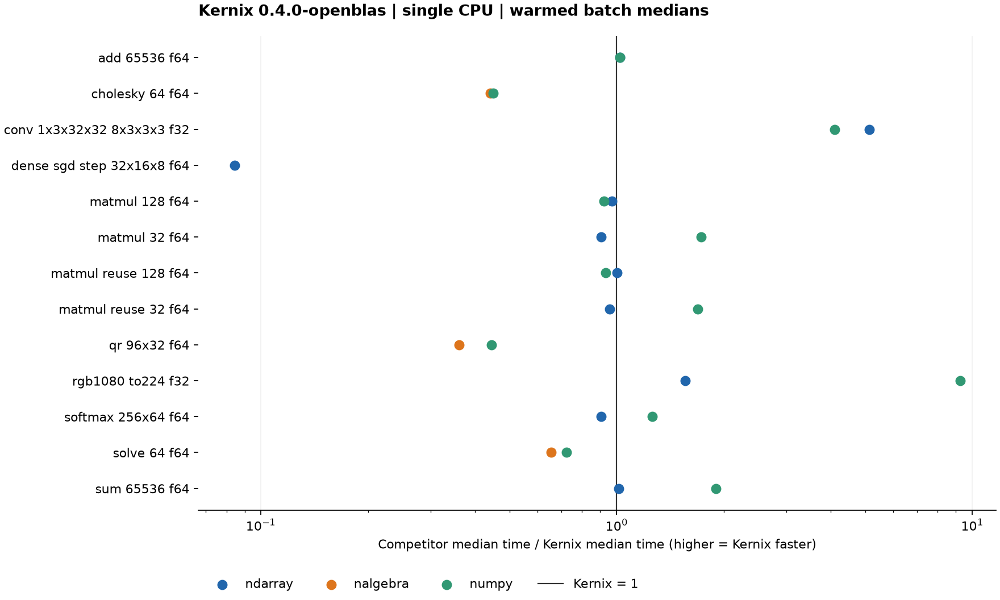

# Kernix benchmark report: 0.4.0-openblas

Measured 2026-10-19T15:36:51Z on 12th Gen Intel(R) Core(TM) i3-1215U.

Rust: rustc 1.99.0 (b940084d7 2026-09-28); NumPy: 2.5.4; one CPU thread; dtype in workload name.

Source: `4402cdb8d904c8987ebc95e83d87ccfd8086c5c1`; working tree dirty: True.

## Comparative CPU results

| Workload | Kernix p50 / p95 (us) | ndarray p50 / p95 (us) | nalgebra p50 / p95 (us) | NumPy p50 / p95 (us) |
|---|---:|---:|---:|---:|
| add_65536_f64 | 22.351 / 28.415 | 22.864 / 33.791 | not measured | 22.851 / 25.158 |
| cholesky_64_f64 | 23.499 / 27.150 | not measured | 10.375 / 10.933 | 10.574 / 11.259 |
| conv_1x3x32x32_8x3x3x3_f32 | 10.949 / 13.967 | 56.183 / 59.737 | not measured | 45.027 / 53.652 |
| dense_sgd_step_32x16x8_f64 | 11.624 / 12.115 | 0.980 / 1.021 | not measured | not measured |
| matmul_128_f64 | 84.936 / 90.912 | 82.527 / 86.046 | not measured | 78.261 / 90.052 |
| matmul_32_f64 | 1.565 / 1.590 | 1.417 / 1.448 | not measured | 2.707 / 2.958 |
| matmul_reuse_128_f64 | 82.358 / 88.533 | 82.586 / 94.910 | not measured | 76.895 / 83.264 |
| matmul_reuse_32_f64 | 1.465 / 1.506 | 1.402 / 1.477 | not measured | 2.480 / 2.573 |
| qr_96x32_f64 | 89.340 / 90.946 | not measured | 32.176 / 33.876 | 39.819 / 49.330 |
| rgb1080_to224_f32 | 443.533 / 517.043 | 692.877 / 774.473 | not measured | 4099.167 / 5105.179 |
| softmax_256x64_f64 | 77.494 / 82.663 | 70.038 / 73.538 | not measured | 97.789 / 105.044 |
| solve_64_f64 | 26.843 / 28.653 | not measured | 17.542 / 18.087 | 19.421 / 21.781 |
| sum_65536_f64 | 5.537 / 5.902 | 5.616 / 5.847 | not measured | 10.547 / 11.074 |

## Method and limits

Operations allocate outputs except scalar sums and explicitly named matmul_reuse cases.
Reuse cases time preallocated output writes in all libraries. Inputs are preallocated and
contiguous. Kernix and ndarray share the matrixmultiply GEMM engine (no external BLAS); NumPy
uses the build recorded in raw.json. BLAS/OMP thread counts are fixed to one.
CPU affinity: 0. Warmed sequential samples on a shared laptop; CPU frequency
and other system load are uncontrolled. p95 is the maximum of 15 batch means,
not a per-request tail-latency guarantee. Different sum orders may round differently.
The ndarray softmax is an explicitly coded stable rowwise comparison, not a native
ndarray softmax API. NumPy timings include Python call overhead. No GPU comparison.
Vision workloads, when present: ndarray uses explicit bilinear/conv loops, while
NumPy uses vectorized bilinear interpolation and sliding-window einsum. No native
convolution/resize API is implied for ndarray. RGB input is 1920x1080 packed u8;
output is 1x3x224x224 f32 (602112 bytes), with no full-resolution float tensor.
No claim that a complete Full HD model reaches 120 FPS follows from these measurements.
The dense SGD case compares a validated reverse-mode Kernix graph against explicit
analytical ndarray derivatives, including weight reset/copy in both. Graph lifetime,
finite validation and parameter safety have costs; these are different API levels.
LU solve includes factorization; QR materializes thin Q and R in all measured libraries.
Historical reports were not pinned and lack source archives; their trends are indicative.
source.tar.gz preserves the exact current source; SHA-256 is recorded in raw.json.
raw.json contains all measurements, dependencies and environment metadata.
