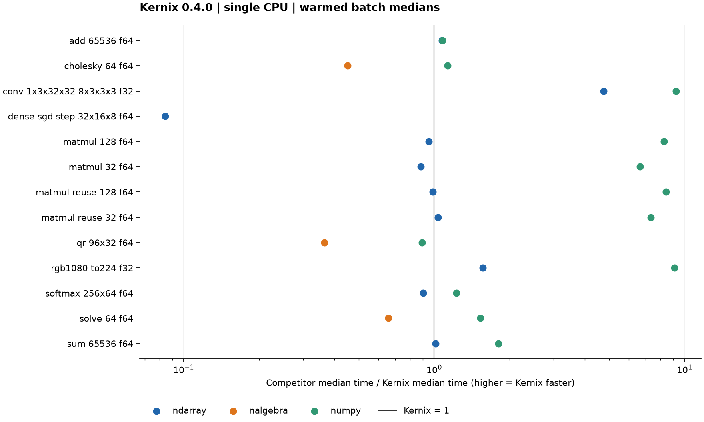

# Kernix benchmark report: 0.4.0

Measured 2026-10-19T15:30:22Z on 12th Gen Intel(R) Core(TM) i3-1215U.

Rust: rustc 1.99.0 (b940084d7 2026-09-28); NumPy: 2.5.4; one CPU thread; dtype in workload name.

Source: `5eb38d83dd0358c8d9b41632c75dd69a9fbecd09`; working tree dirty: True.

## Comparative CPU results

| Workload | Kernix p50 / p95 (us) | ndarray p50 / p95 (us) | nalgebra p50 / p95 (us) | NumPy p50 / p95 (us) |
|---|---:|---:|---:|---:|
| add_65536_f64 | 21.234 / 25.319 | 22.837 / 26.352 | not measured | 22.885 / 24.518 |
| cholesky_64_f64 | 23.375 / 29.874 | not measured | 10.565 / 11.283 | 26.422 / 31.419 |
| conv_1x3x32x32_8x3x3x3_f32 | 11.361 / 12.180 | 53.901 / 62.483 | not measured | 104.830 / 127.856 |
| dense_sgd_step_32x16x8_f64 | 11.459 / 15.331 | 0.966 / 1.077 | not measured | not measured |
| matmul_128_f64 | 86.102 / 106.241 | 82.070 / 85.425 | not measured | 712.690 / 778.549 |
| matmul_32_f64 | 1.600 / 1.750 | 1.417 / 1.475 | not measured | 10.640 / 11.270 |
| matmul_reuse_128_f64 | 82.316 / 84.365 | 81.199 / 83.094 | not measured | 693.151 / 744.129 |
| matmul_reuse_32_f64 | 1.462 / 1.560 | 1.514 / 1.645 | not measured | 10.730 / 11.177 |
| qr_96x32_f64 | 88.613 / 95.848 | not measured | 32.264 / 36.608 | 79.375 / 84.898 |
| rgb1080_to224_f32 | 438.953 / 693.094 | 685.549 / 733.465 | not measured | 3994.365 / 4506.484 |
| softmax_256x64_f64 | 77.015 / 80.423 | 69.556 / 90.497 | not measured | 94.432 / 99.027 |
| solve_64_f64 | 26.964 / 29.068 | not measured | 17.685 / 18.618 | 41.193 / 42.833 |
| sum_65536_f64 | 5.538 / 6.956 | 5.607 / 5.909 | not measured | 10.016 / 10.516 |

## Method and limits

Operations allocate outputs except scalar sums and explicitly named matmul_reuse cases.
Reuse cases time preallocated output writes in all libraries. Inputs are preallocated and
contiguous. Kernix and ndarray share the matrixmultiply GEMM engine (no external BLAS); NumPy
uses the build recorded in raw.json. BLAS/OMP thread counts are fixed to one.
CPU affinity: 0. Warmed sequential samples on a shared laptop; CPU frequency
and other system load are uncontrolled. p95 is the maximum of 15 batch means,
not a per-request tail-latency guarantee. Different sum orders may round differently.
The ndarray softmax is an explicitly coded stable rowwise comparison, not a native
ndarray softmax API. NumPy timings include Python call overhead. No GPU comparison.
Vision workloads, when present: ndarray uses explicit bilinear/conv loops, while
NumPy uses vectorized bilinear interpolation and sliding-window einsum. No native
convolution/resize API is implied for ndarray. RGB input is 1920x1080 packed u8;
output is 1x3x224x224 f32 (602112 bytes), with no full-resolution float tensor.
No claim that a complete Full HD model reaches 120 FPS follows from these measurements.
The dense SGD case compares a validated reverse-mode Kernix graph against explicit
analytical ndarray derivatives, including weight reset/copy in both. Graph lifetime,
finite validation and parameter safety have costs; these are different API levels.
LU solve includes factorization; QR materializes thin Q and R in all measured libraries.
Historical reports were not pinned and lack source archives; their trends are indicative.
source.tar.gz preserves the exact current source; SHA-256 is recorded in raw.json.
raw.json contains all measurements, dependencies and environment metadata.
