# Kernix 0.4.0 · performance brief

12th Gen Intel(R) Core(TM) i3-1215U / Linux

**Batch-mean median, microseconds per operation. Lower is faster. All recorded digits retained.**

13 workloads · 38 observations

No previous-version baseline attached. Sequential run changes are descriptive; paired process evidence is shown separately.

[Open the visual report](report.html) · [Vector PDF](latency.pdf) · [Raw measurements](raw.json)

## Charts by workload

**Shorter bars mean less time.** Blue is Kernix; grey is another library; teal is an explicitly selected Kernix backend. Entries are sorted by the recorded median, with a separate zero-based scale per chart. These point observations do not establish a statistical ranking.

Expand a group to see every chart here on GitHub. Click a chart to enlarge it. The exact table below keeps every source digit.

Matrix multiplication · 2 workloads

**Matrix multiplication · 32 × 32 · 32 × 32 · f64**

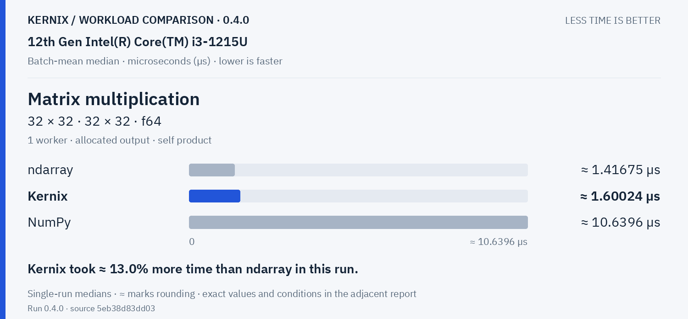

**Matrix multiplication · 128 × 128 · 128 × 128 · f64**

Explicit parallel execution · 2 workloads

**Matrix multiplication · reused output · 32 × 32 · 32 × 32 · f64**

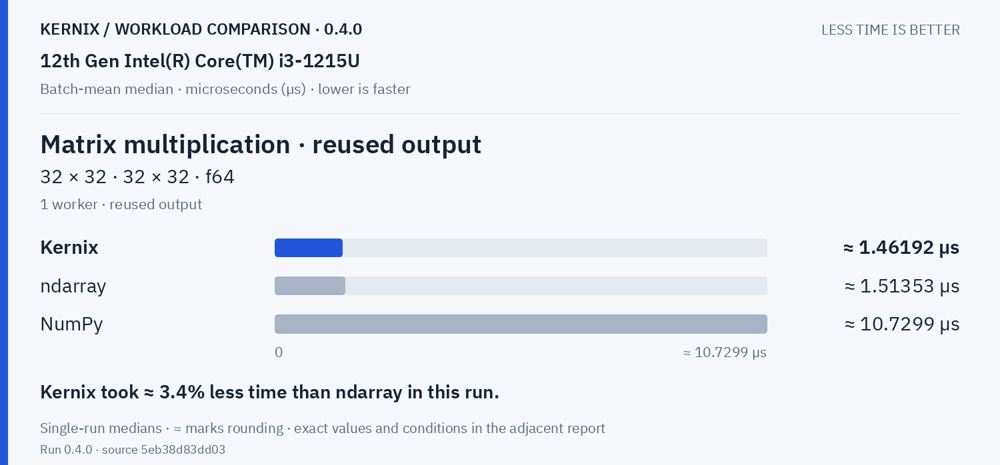

**Matrix multiplication · reused output · 128 × 128 · 128 × 128 · f64**

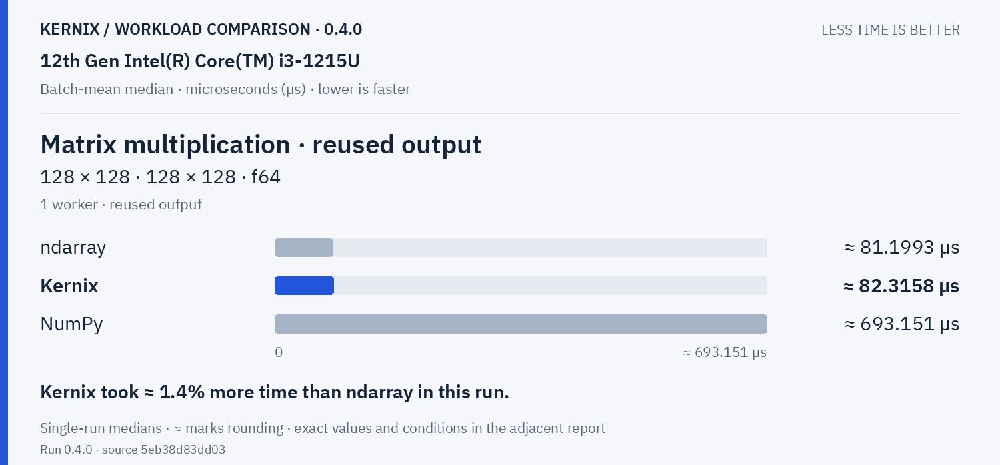

Decompositions & solvers · 3 workloads

**Cholesky factorization · 64 × 64 · f64**

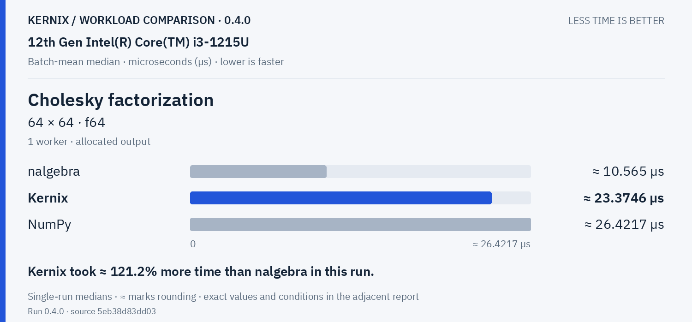

**Linear system solve · 64 × 64 · f64**

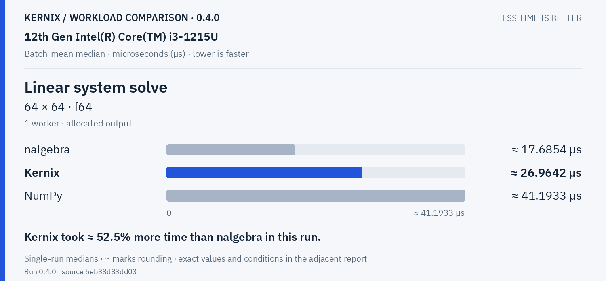

**Thin QR · 96 × 32 · f64**

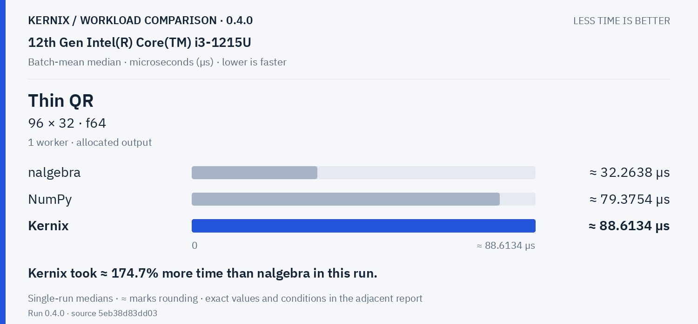

Training & autodiff · 1 workloads

**Dense training step · 32 × 16 × 8 · f64**

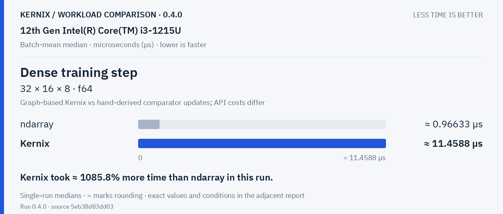

Statistics & activations · 3 workloads

**Elementwise addition · 65,536 elements · f64**

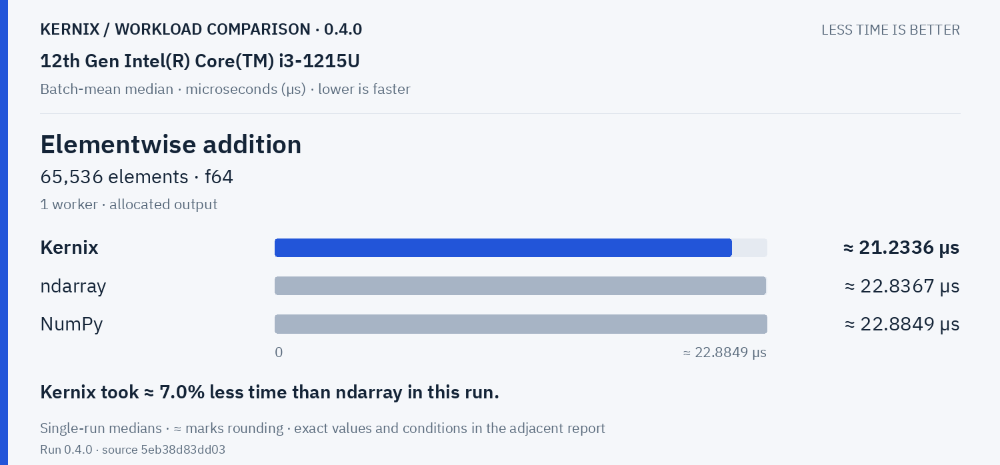

**Sum reduction · 65,536 elements · f64**

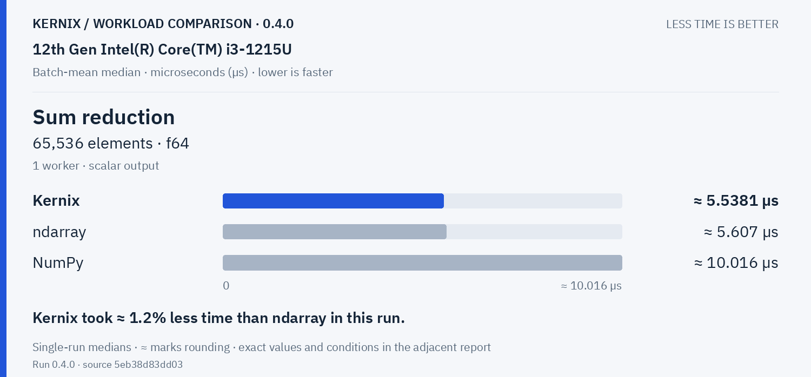

**Row softmax · 256 × 64 · f64**

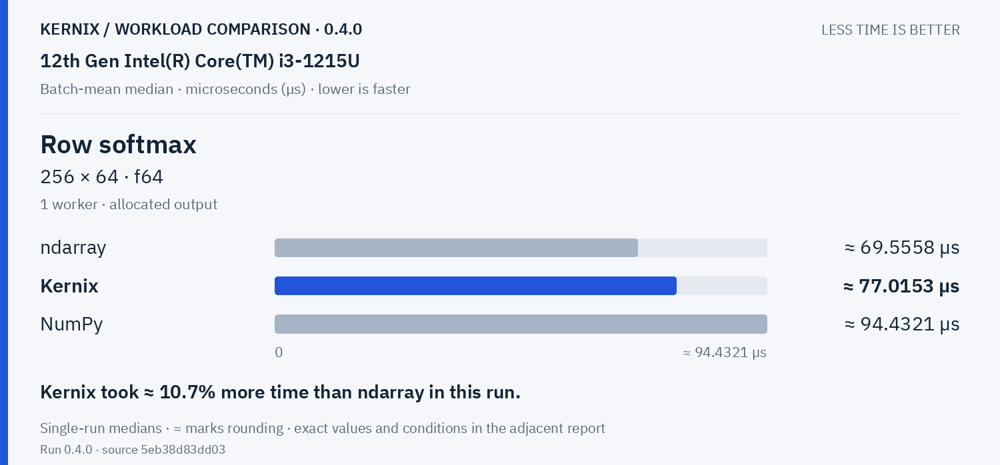

Vision workloads · 2 workloads

**RGB resize &amp; normalization · 1920 × 1080 → 1 × 3 × 224 × 224 · u8 → f32**

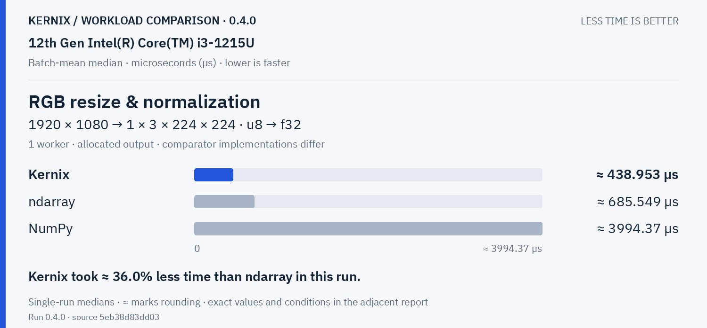

**2D convolution · 1 × 3 × 32 × 32 · 8 × 3 × 3 × 3 · f32**

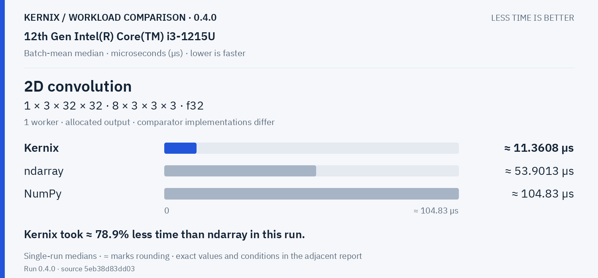

## Exact latency table

All values below are microseconds per operation. **Lower is faster.** Missing entries were not measured.

| Workload | Kernix | ndarray | nalgebra | NumPy |
|---|---:|---:|---:|---:|
| Matrix multiplication · 32 × 32 · 32 × 32 · f64 | 1.6002428470844268 | **1.4167458491528305** | — | 10.639569787234042 |
| Matrix multiplication · 128 × 128 · 128 × 128 · f64 | 86.10232989690722 | **82.06983934426229** | — | 712.6897777777778 |
| Matrix multiplication · reused output · 32 × 32 · 32 × 32 · f64 | **1.4619173147769136** | 1.5135317229688824 | — | 10.7299141999142 |
| Matrix multiplication · reused output · 128 × 128 · 128 × 128 · f64 | 82.31577302631579 | **81.19930844155845** | — | 693.1505675675676 |
| Cholesky factorization · 64 × 64 · f64 | 23.3746476635514 | — | **10.564963244613435** | 26.421718057022175 |
| Linear system solve · 64 × 64 · f64 | 26.96424676724138 | — | **17.685366336633662** | 41.19326194398682 |
| Thin QR · 96 × 32 · f64 | 88.61339929328622 | — | **32.263832258064514** | 79.3753746031746 |
| Dense training step · 32 × 16 × 8 · f64 | 11.458840971585701 | **0.9663295068027211** | — | — |
| Elementwise addition · 65,536 elements · f64 | **21.23355432937182** | 22.83665296803653 | — | 22.884931381518756 |
| Sum reduction · 65,536 elements · f64 | **5.538095459579181** | 5.607004709576138 | — | 10.016018822587104 |
| Row softmax · 256 × 64 · f64 | 77.01527076923077 | **69.55583888888889** | — | 94.43209056603773 |
| RGB resize & normalization · 1920 × 1080 → 1 × 3 × 224 × 224 · u8 → f32 | **438.9531379310345** | 685.5493513513514 | — | 3994.3654285714286 |
| 2D convolution · 1 × 3 × 32 × 32 · 8 × 3 × 3 × 3 · f32 | **11.360770104497955** | 53.90127370689655 | — | 104.8302510460251 |

## Version comparison

0 of 13 workloads have paired evidence. Exploratory 95% intervals resample process pairs, not calls. No multiple-comparison adjustment.

| Workload | Current / baseline [95% interval] | Interpretation |
|---|---:|---|
| Matrix multiplication · 32 × 32 · 32 × 32 · f64 | — | No paired comparison |
| Matrix multiplication · 128 × 128 · 128 × 128 · f64 | — | No paired comparison |
| Matrix multiplication · reused output · 32 × 32 · 32 × 32 · f64 | — | No paired comparison |
| Matrix multiplication · reused output · 128 × 128 · 128 × 128 · f64 | — | No paired comparison |
| Cholesky factorization · 64 × 64 · f64 | — | No paired comparison |
| Linear system solve · 64 × 64 · f64 | — | No paired comparison |
| Thin QR · 96 × 32 · f64 | — | No paired comparison |
| Dense training step · 32 × 16 × 8 · f64 | — | No paired comparison |
| Elementwise addition · 65,536 elements · f64 | — | No paired comparison |
| Sum reduction · 65,536 elements · f64 | — | No paired comparison |
| Row softmax · 256 × 64 · f64 | — | No paired comparison |
| RGB resize & normalization · 1920 × 1080 → 1 × 3 × 224 × 224 · u8 → f32 | — | No paired comparison |
| 2D convolution · 1 × 3 × 32 × 32 · 8 × 3 × 3 × 3 · f32 | — | No paired comparison |

## Historical statistic

These are medians of 15 warmed batch means, not per-call medians. The original p95 field is the maximum of those 15 batch means. No per-call p95/p99, accuracy or allocation probes are inferred.

## Method and provenance

CPU affinity pinned to logical CPU 0. Frequency and background load are uncontrolled.

Numbers retain source precision; recorded digits do not imply equivalent physical measurement accuracy. Lowest observed medians are bold only when peers were measured. No aggregate winner or universal ranking is inferred.

[Original report and commentary](original-report.txt) · [Raw measurements](raw.json)

Measured source `5eb38d83dd0358c8d9b41632c75dd69a9fbecd09`. Run `0.4.0`. Rendering does not change measurements.
