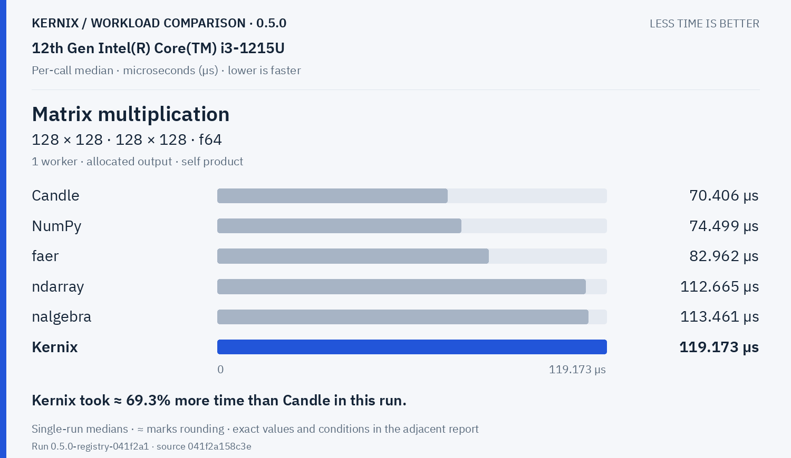
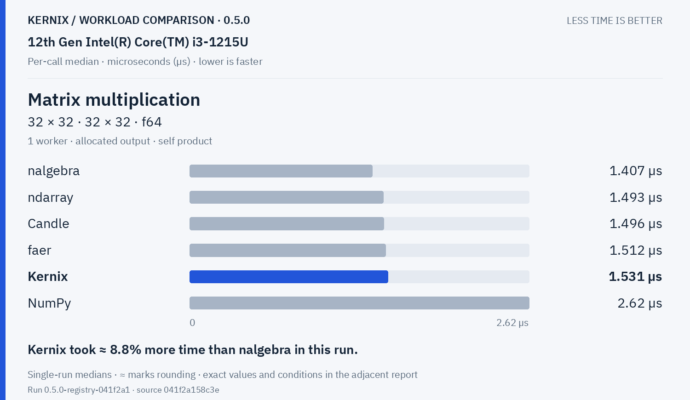
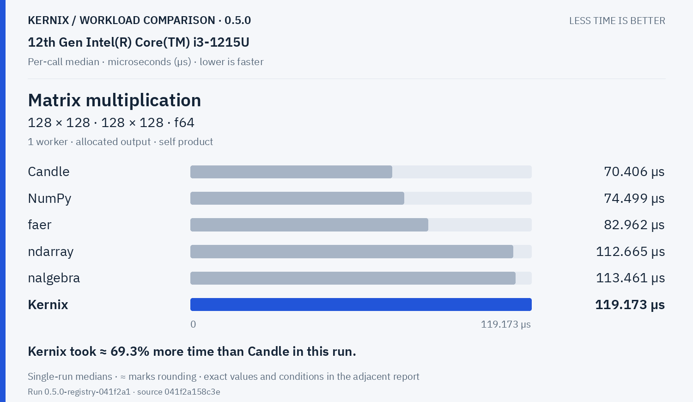
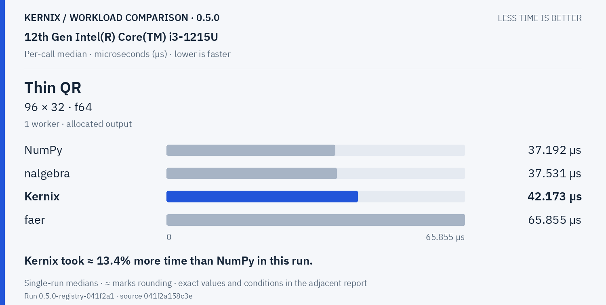
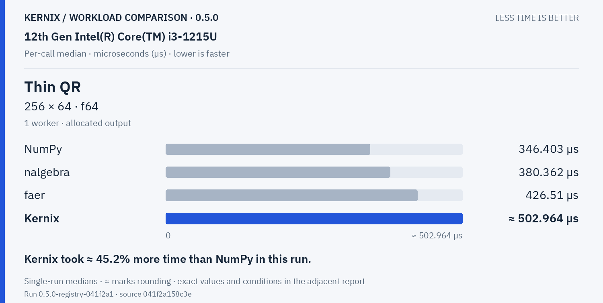
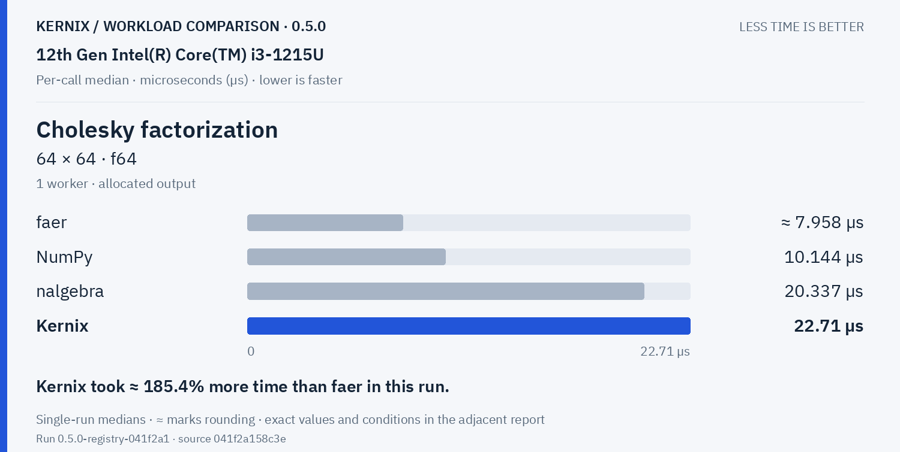
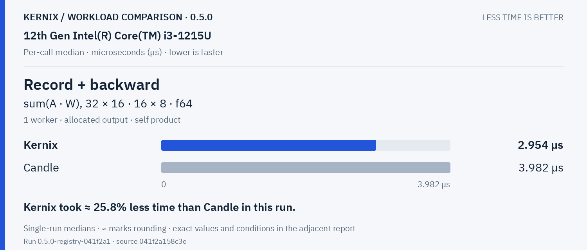
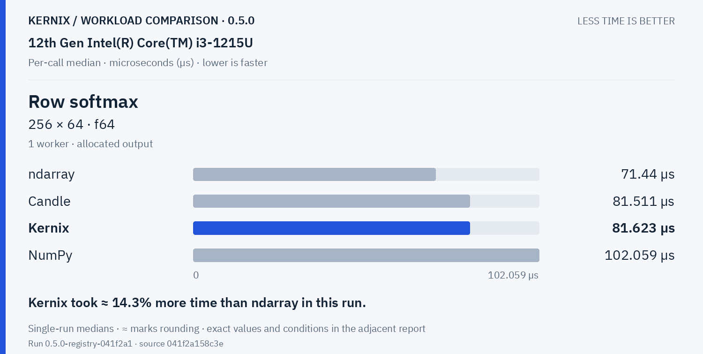
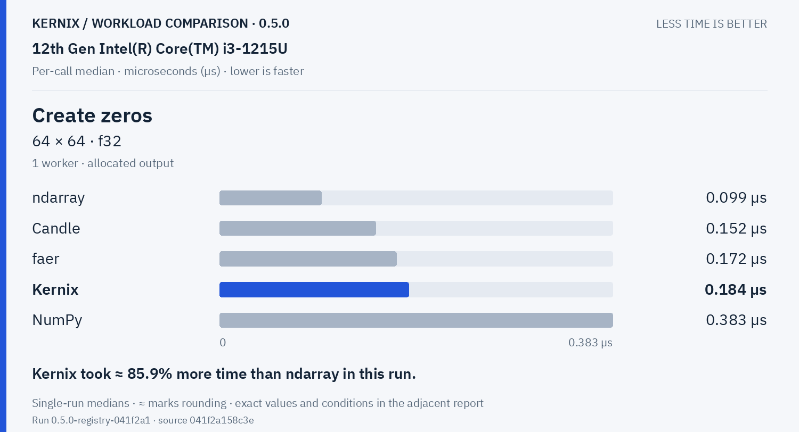
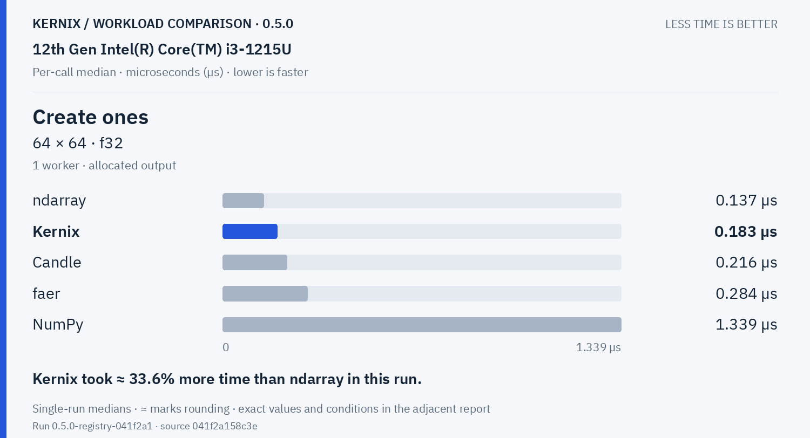

# Kernix 0.5.0 · performance brief

12th Gen Intel(R) Core(TM) i3-1215U / Linux

**Per-call median, microseconds per operation. Lower is faster. All recorded digits retained.**

9 workloads · 40 observations

No previous-version baseline attached. Sequential run changes are descriptive; paired process evidence is shown separately.

[Open the visual report](report.html) · [Vector PDF](latency.pdf) · [Raw measurements](raw.json)

## Charts by workload

**Shorter bars mean less time.** Blue is Kernix; grey is another library; teal is an explicitly selected Kernix backend. Entries are sorted by the recorded median, with a separate zero-based scale per chart. These point observations do not establish a statistical ranking.

Expand a group to see every chart here on GitHub. Click a chart to enlarge it. The exact table below keeps every source digit.

Matrix multiplication · 2 workloads

**Matrix multiplication · 32 × 32 · 32 × 32 · f64**

**Matrix multiplication · 128 × 128 · 128 × 128 · f64**

Decompositions & solvers · 3 workloads

**Thin QR · 96 × 32 · f64**

**Thin QR · 256 × 64 · f64**

**Cholesky factorization · 64 × 64 · f64**

Training & autodiff · 1 workloads

**Record + backward · sum(A · W), 32 × 16 · 16 × 8 · f64**

Statistics & activations · 1 workloads

**Row softmax · 256 × 64 · f64**

Tensor construction · 2 workloads

**Create zeros · 64 × 64 · f32**

**Create ones · 64 × 64 · f32**

## Exact latency table

All values below are microseconds per operation. **Lower is faster.** Missing entries were not measured.

| Workload | Kernix | ndarray | nalgebra | faer | Candle | NumPy |
|---|---:|---:|---:|---:|---:|---:|
| Matrix multiplication · 32 × 32 · 32 × 32 · f64 | 1.531 | 1.493 | **1.407** | 1.512 | 1.496 | 2.62 |
| Matrix multiplication · 128 × 128 · 128 × 128 · f64 | 119.173 | 112.665 | 113.461 | 82.962 | **70.406** | 74.499 |
| Thin QR · 96 × 32 · f64 | 42.173 | — | 37.531 | 65.855 | — | **37.192** |
| Thin QR · 256 × 64 · f64 | 502.96399999999994 | — | 380.362 | 426.51 | — | **346.403** |
| Cholesky factorization · 64 × 64 · f64 | 22.71 | — | 20.337 | **7.958000000000001** | — | 10.144 |
| Record + backward · sum(A · W), 32 × 16 · 16 × 8 · f64 | **2.954** | — | — | — | 3.982 | — |
| Row softmax · 256 × 64 · f64 | 81.623 | **71.44** | — | — | 81.511 | 102.059 |
| Create zeros · 64 × 64 · f32 | 0.184 | **0.099** | — | 0.172 | 0.152 | 0.383 |
| Create ones · 64 × 64 · f32 | 0.183 | **0.137** | — | 0.284 | 0.216 | 1.339 |

## Version comparison

0 of 9 workloads have paired evidence. Exploratory 95% intervals resample process pairs, not calls. No multiple-comparison adjustment.

| Workload | Current / baseline [95% interval] | Interpretation |
|---|---:|---|
| Matrix multiplication · 32 × 32 · 32 × 32 · f64 | — | No paired comparison |
| Matrix multiplication · 128 × 128 · 128 × 128 · f64 | — | No paired comparison |
| Thin QR · 96 × 32 · f64 | — | No paired comparison |
| Thin QR · 256 × 64 · f64 | — | No paired comparison |
| Cholesky factorization · 64 × 64 · f64 | — | No paired comparison |
| Record + backward · sum(A · W), 32 × 16 · 16 × 8 · f64 | — | No paired comparison |
| Row softmax · 256 × 64 · f64 | — | No paired comparison |
| Create zeros · 64 × 64 · f32 | — | No paired comparison |
| Create ones · 64 × 64 · f32 | — | No paired comparison |

## Method and provenance

CPU affinity pinned to logical CPU 0. Frequency and background load are uncontrolled.

Numbers retain source precision; recorded digits do not imply equivalent physical measurement accuracy. Lowest observed medians are bold only when peers were measured. No aggregate winner or universal ranking is inferred.

[Original report and commentary](original-report.txt) · [Raw measurements](raw.json)

Measured source `041f2a158c3e51340b5b9e6df6886fa52584f9b5`. Run `0.5.0-registry-041f2a1`. Rendering does not change measurements.
