# Kernix 0.5.0 · performance brief

12th Gen Intel(R) Core(TM) i3-1215U / Linux

**Batch-mean median, microseconds per operation. Lower is faster. All recorded digits retained.**

18 workloads · 53 observations

No previous-version baseline attached. Sequential run changes are descriptive; paired process evidence is shown separately.

[Interactive HTML (open locally)](report.html) · [Vector PDF](latency.pdf) · [Raw measurements](raw.json)

[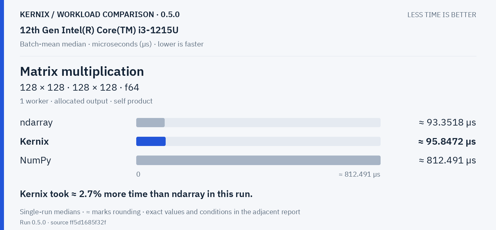](latency.pdf)

## Charts by workload

**Shorter bars mean less time.** Blue is Kernix; grey is another library; teal is an explicitly selected Kernix backend. Entries are sorted by the recorded median, with a separate zero-based scale per chart. These point observations do not establish a statistical ranking.

Expand a group to see every chart here on GitHub. Click a chart to enlarge it. The exact table below keeps every source digit.

Matrix multiplication · 2 workloads

**Matrix multiplication · 32 × 32 · 32 × 32 · f64**

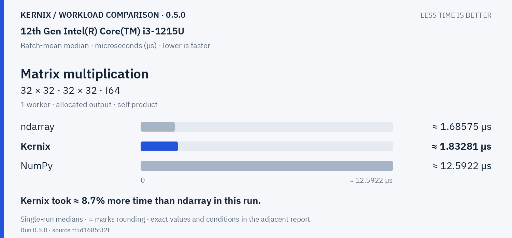

Kernix: **1.832807931969797 µs**. Kernix took ≈ 8.7% more time than ndarray in this run.

**Matrix multiplication · 128 × 128 · 128 × 128 · f64**

Kernix: **95.84716858237548 µs**. Kernix took ≈ 2.7% more time than ndarray in this run.

Explicit parallel execution · 2 workloads

**Matrix multiplication · reused output · 32 × 32 · 32 × 32 · f64**

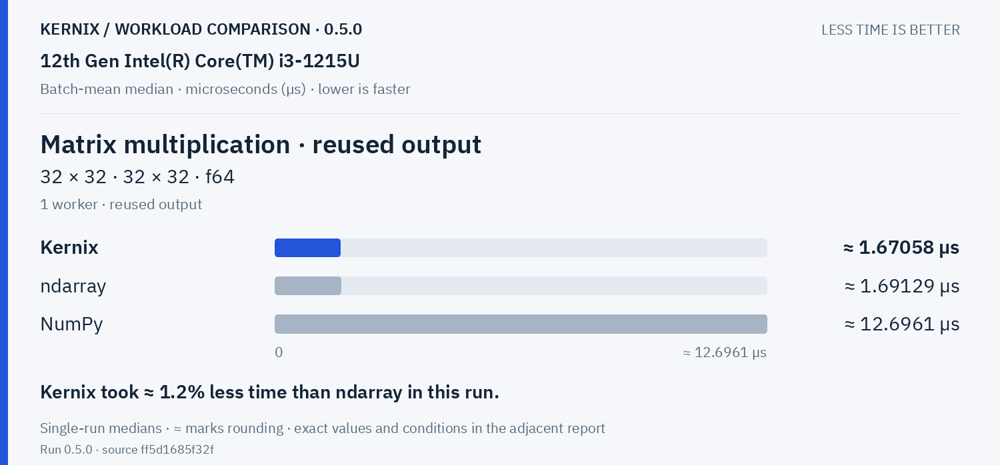

Kernix: **1.6705828265953892 µs**. Kernix took ≈ 1.2% less time than ndarray in this run.

**Matrix multiplication · reused output · 128 × 128 · 128 × 128 · f64**

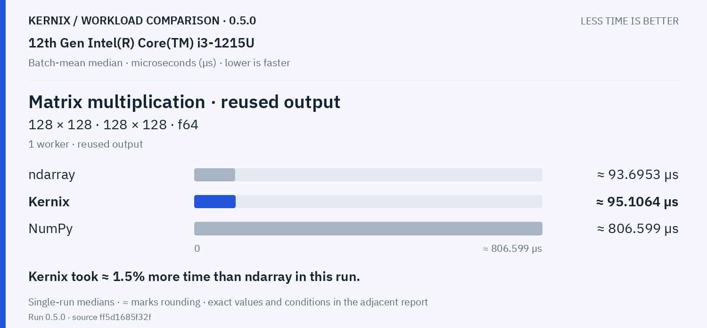

Kernix: **95.10636121673005 µs**. Kernix took ≈ 1.5% more time than ndarray in this run.

Decompositions & solvers · 6 workloads

**Cholesky factorization · 64 × 64 · f64**

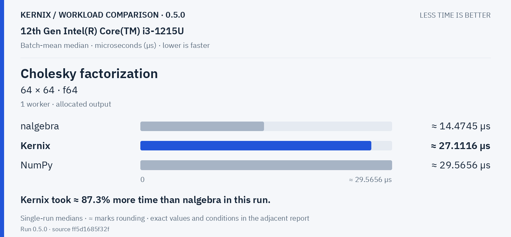

Kernix: **27.11161863488624 µs**. Kernix took ≈ 87.3% more time than nalgebra in this run.

**Linear system solve · 64 × 64 · f64**

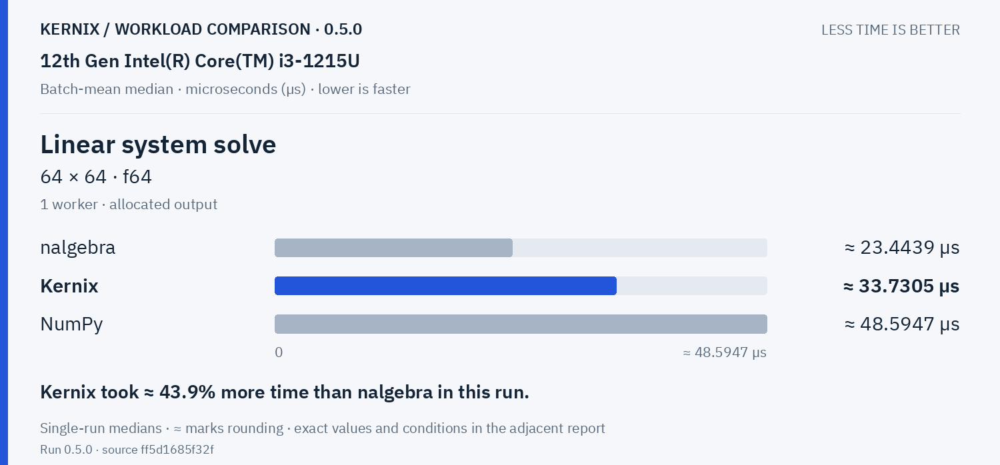

Kernix: **33.73046226415094 µs**. Kernix took ≈ 43.9% more time than nalgebra in this run.

**Thin QR · 8 × 4 · f64**

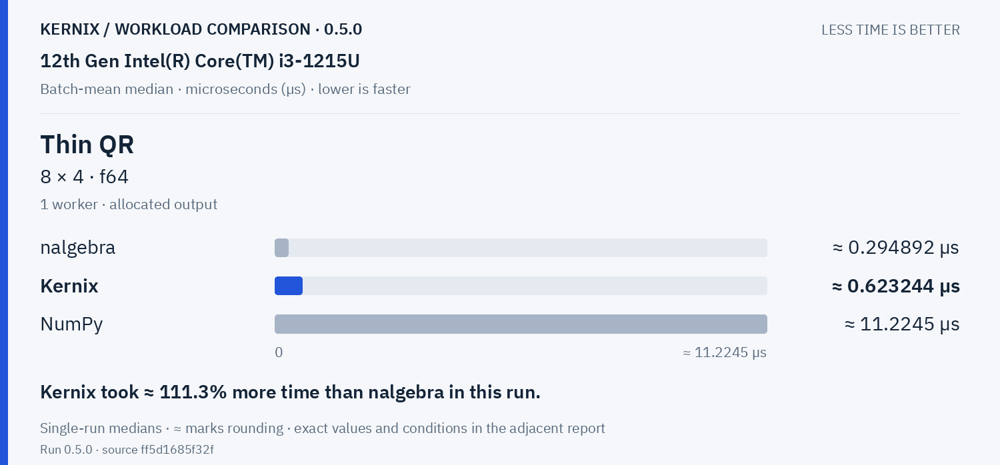

Kernix: **0.6232443098247451 µs**. Kernix took ≈ 111.3% more time than nalgebra in this run.

**Thin QR · 32 × 16 · f64**

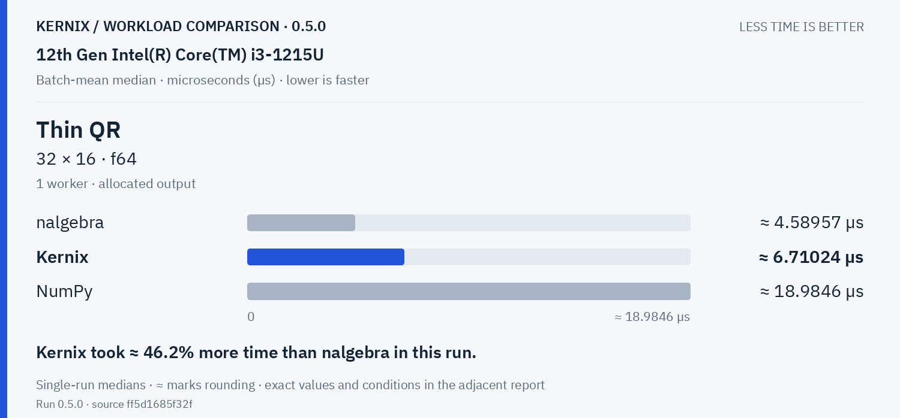

Kernix: **6.710243692968331 µs**. Kernix took ≈ 46.2% more time than nalgebra in this run.

**Thin QR · 96 × 32 · f64**

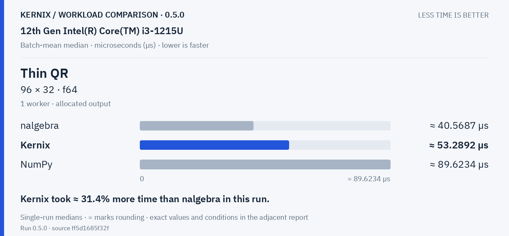

Kernix: **53.28924042553191 µs**. Kernix took ≈ 31.4% more time than nalgebra in this run.

**Thin QR · 256 × 64 · f64**

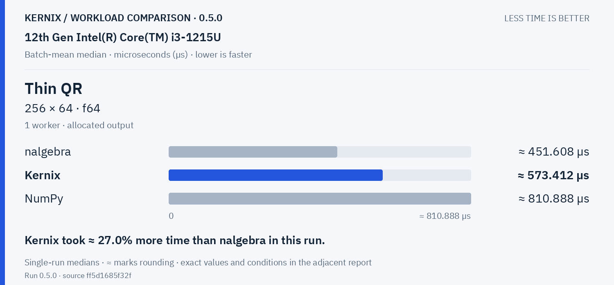

Kernix: **573.4124318181818 µs**. Kernix took ≈ 27.0% more time than nalgebra in this run.

Training & autodiff · 1 workloads

**Dense training step · 32 × 16 × 8 · f64**

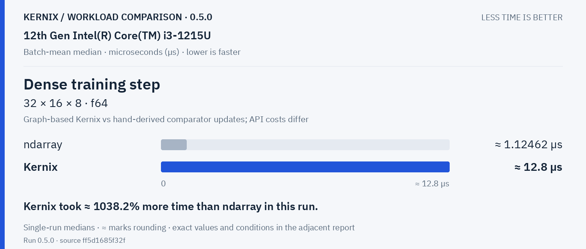

Kernix: **12.799961105424769 µs**. Kernix took ≈ 1038.2% more time than ndarray in this run.

Statistics & activations · 3 workloads

**Elementwise addition · 65,536 elements · f64**

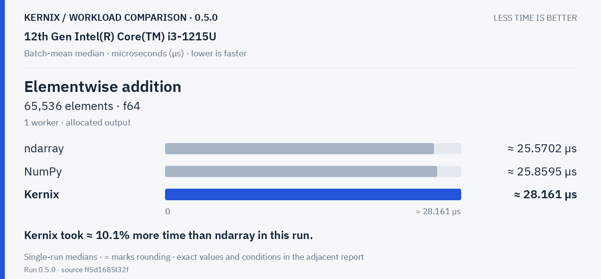

Kernix: **28.160966216216217 µs**. Kernix took ≈ 10.1% more time than ndarray in this run.

**Sum reduction · 65,536 elements · f64**

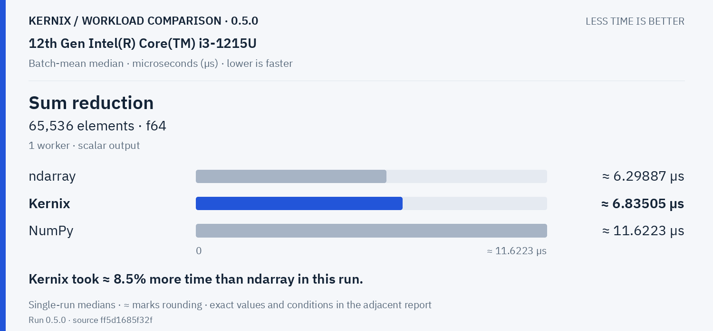

Kernix: **6.835045379989065 µs**. Kernix took ≈ 8.5% more time than ndarray in this run.

**Row softmax · 256 × 64 · f64**

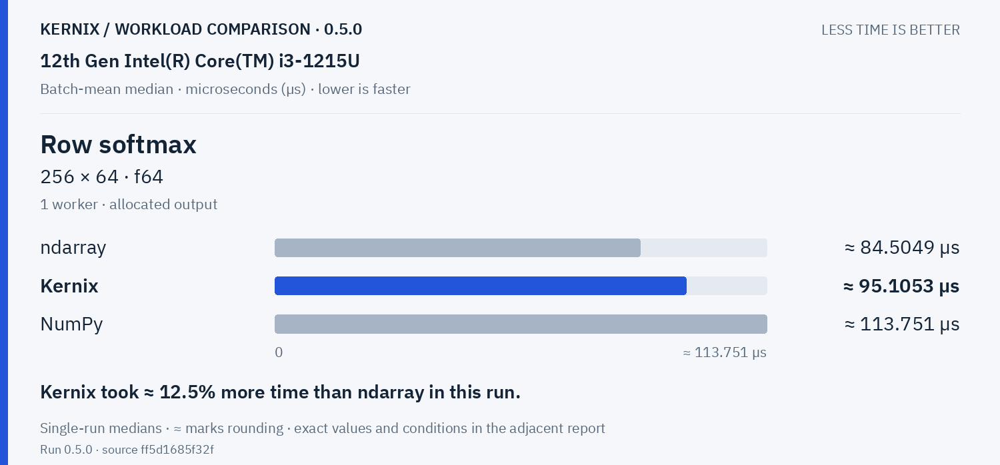

Kernix: **95.10527376425856 µs**. Kernix took ≈ 12.5% more time than ndarray in this run.

Tensor construction · 2 workloads

**Create filled tensor · 64 × 64 · f64**

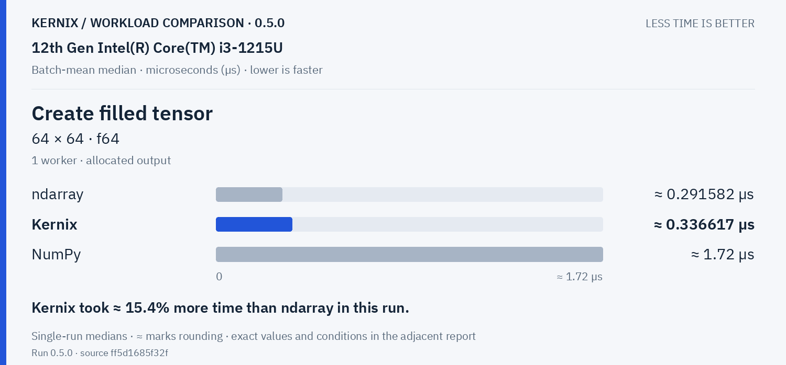

Kernix: **0.33661695996983934 µs**. Kernix took ≈ 15.4% more time than ndarray in this run.

**Create matrix · 3 × 3 · f64**

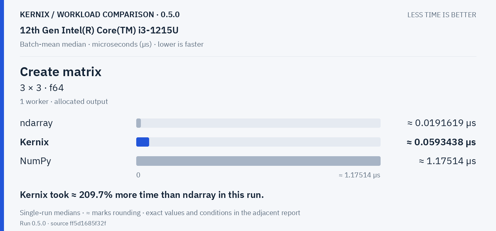

Kernix: **0.05934381104978933 µs**. Kernix took ≈ 209.7% more time than ndarray in this run.

Vision workloads · 2 workloads

**RGB resize &amp; normalization · 1920 × 1080 → 1 × 3 × 224 × 224 · u8 → f32**

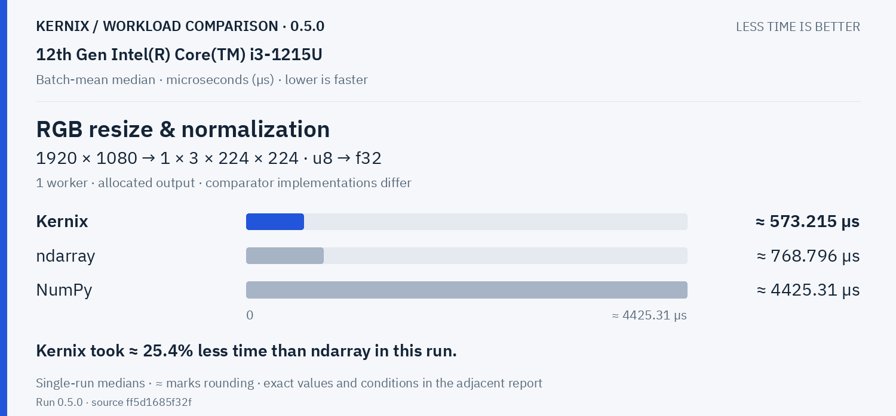

Kernix: **573.2151590909091 µs**. Kernix took ≈ 25.4% less time than ndarray in this run.

**2D convolution · 1 × 3 × 32 × 32 · 8 × 3 × 3 × 3 · f32**

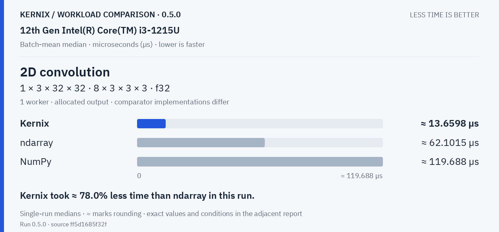

Kernix: **13.659844347351174 µs**. Kernix took ≈ 78.0% less time than ndarray in this run.

## Exact latency table

All values below are microseconds per operation. **Lower is faster.** Missing entries were not measured.

| Workload | Kernix | ndarray | nalgebra | NumPy |
|---|---:|---:|---:|---:|
| Matrix multiplication · 32 × 32 · 32 × 32 · f64 | 1.832807931969797 | **1.6857492414537119** | — | 12.592181772406848 |
| Matrix multiplication · 128 × 128 · 128 × 128 · f64 | 95.84716858237548 | **93.35180970149254** | — | 812.4912580645161 |
| Matrix multiplication · reused output · 32 × 32 · 32 × 32 · f64 | **1.6705828265953892** | 1.6912876276804438 | — | 12.696077664974619 |
| Matrix multiplication · reused output · 128 × 128 · 128 × 128 · f64 | 95.10636121673005 | **93.69525842696629** | — | 806.5990322580645 |
| Cholesky factorization · 64 × 64 · f64 | 27.11161863488624 | — | **14.474516203703704** | 29.565643026004727 |
| Linear system solve · 64 × 64 · f64 | 33.73046226415094 | — | **23.443933458294283** | 48.59465631067961 |
| Thin QR · 8 × 4 · f64 | 0.6232443098247451 | — | **0.29489248263090224** | 11.224477109515261 |
| Thin QR · 32 × 16 · f64 | 6.710243692968331 | — | **4.589567364170338** | 18.984610478359908 |
| Thin QR · 96 × 32 · f64 | 53.28924042553191 | — | **40.56870664505673** | 89.62341935483871 |
| Thin QR · 256 × 64 · f64 | 573.4124318181818 | — | **451.608125** | 810.8882580645161 |
| Dense training step · 32 × 16 × 8 · f64 | 12.799961105424769 | **1.1246242465137202** | — | — |
| Elementwise addition · 65,536 elements · f64 | 28.160966216216217 | **25.570189161554194** | — | 25.859510858324717 |
| Sum reduction · 65,536 elements · f64 | 6.835045379989065 | **6.298869992441421** | — | 11.622313197026022 |
| Row softmax · 256 × 64 · f64 | 95.10527376425856 | **84.50488175675676** | — | 113.75111363636363 |
| Create filled tensor · 64 × 64 · f64 | 0.33661695996983934 | **0.291582236995568** | — | 1.7200022702256467 |
| Create matrix · 3 × 3 · f64 | 0.05934381104978933 | **0.019161851430008017** | — | 1.175144394829612 |
| RGB resize & normalization · 1920 × 1080 → 1 × 3 × 224 × 224 · u8 → f32 | **573.2151590909091** | 768.7959393939395 | — | 4425.306333333333 |
| 2D convolution · 1 × 3 × 32 × 32 · 8 × 3 × 3 × 3 · f32 | **13.659844347351174** | 62.101503722084366 | — | 119.68759330143541 |

## Version comparison

0 of 18 workloads have paired evidence. Exploratory 95% intervals resample process pairs, not calls. No multiple-comparison adjustment.

| Workload | Current / baseline [95% interval] | Interpretation |
|---|---:|---|
| Matrix multiplication · 32 × 32 · 32 × 32 · f64 | — | No paired comparison |
| Matrix multiplication · 128 × 128 · 128 × 128 · f64 | — | No paired comparison |
| Matrix multiplication · reused output · 32 × 32 · 32 × 32 · f64 | — | No paired comparison |
| Matrix multiplication · reused output · 128 × 128 · 128 × 128 · f64 | — | No paired comparison |
| Cholesky factorization · 64 × 64 · f64 | — | No paired comparison |
| Linear system solve · 64 × 64 · f64 | — | No paired comparison |
| Thin QR · 8 × 4 · f64 | — | No paired comparison |
| Thin QR · 32 × 16 · f64 | — | No paired comparison |
| Thin QR · 96 × 32 · f64 | — | No paired comparison |
| Thin QR · 256 × 64 · f64 | — | No paired comparison |
| Dense training step · 32 × 16 × 8 · f64 | — | No paired comparison |
| Elementwise addition · 65,536 elements · f64 | — | No paired comparison |
| Sum reduction · 65,536 elements · f64 | — | No paired comparison |
| Row softmax · 256 × 64 · f64 | — | No paired comparison |
| Create filled tensor · 64 × 64 · f64 | — | No paired comparison |
| Create matrix · 3 × 3 · f64 | — | No paired comparison |
| RGB resize & normalization · 1920 × 1080 → 1 × 3 × 224 × 224 · u8 → f32 | — | No paired comparison |
| 2D convolution · 1 × 3 × 32 × 32 · 8 × 3 × 3 × 3 · f32 | — | No paired comparison |

## Historical statistic

These are medians of 15 warmed batch means, not per-call medians. The original p95 field is the maximum of those 15 batch means. No per-call p95/p99, accuracy or allocation probes are inferred.

## Method and provenance

CPU affinity pinned to logical CPU 0. Frequency and background load are uncontrolled.

Numbers retain source precision; recorded digits do not imply equivalent physical measurement accuracy. Lowest observed medians are bold only when peers were measured. No aggregate winner or universal ranking is inferred.

[Original report and commentary](original-report.txt) · [Raw measurements](raw.json)

Measured source `ff5d1685f32f64a5d843d02cef023758f40b0d37`. Run `0.5.0`. Rendering does not change measurements.
