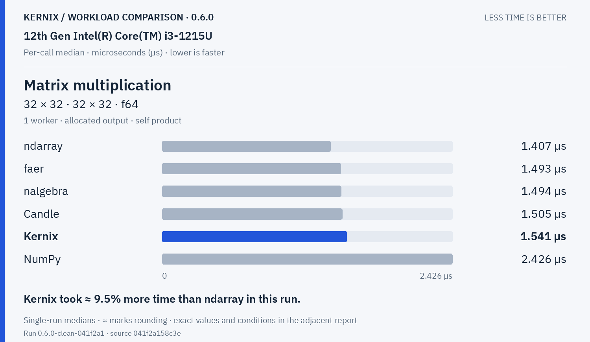
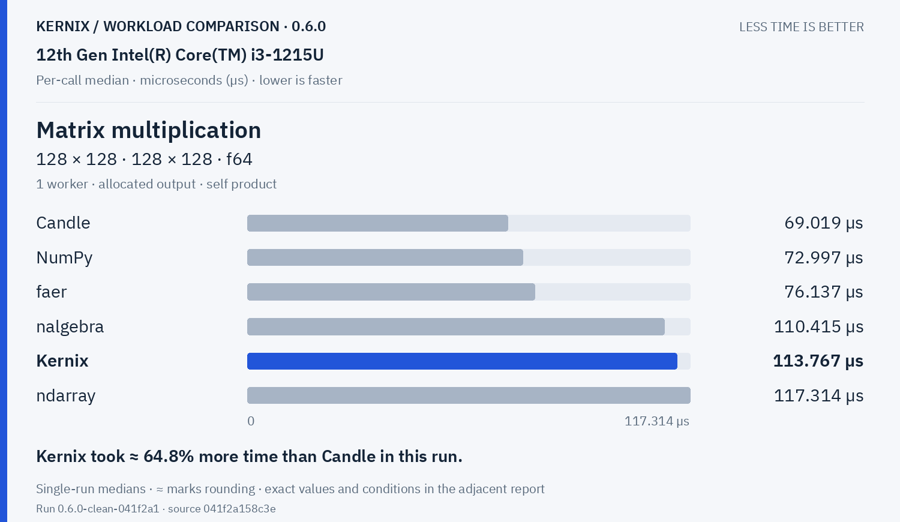
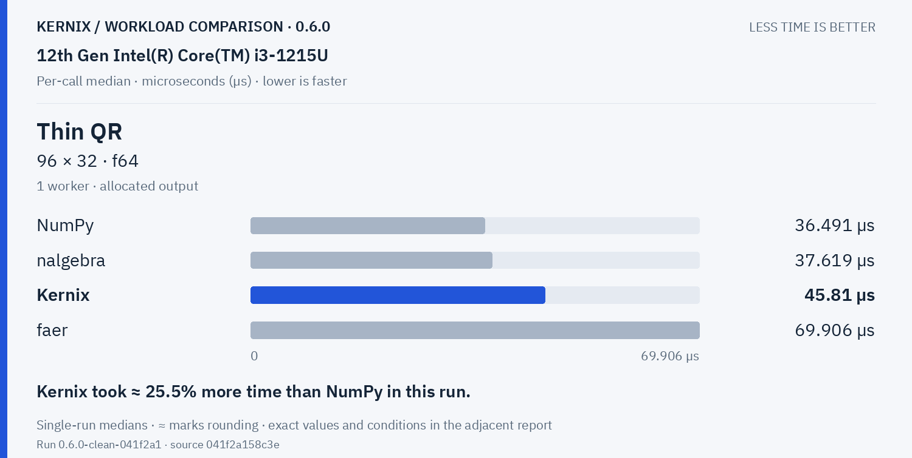
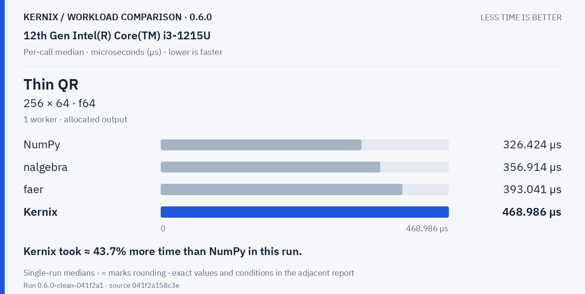
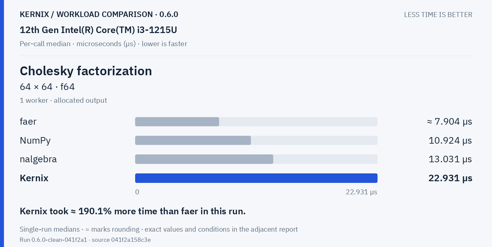
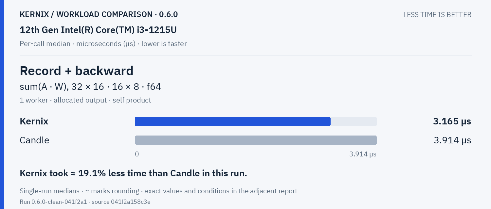
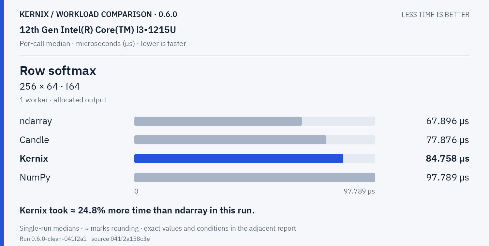
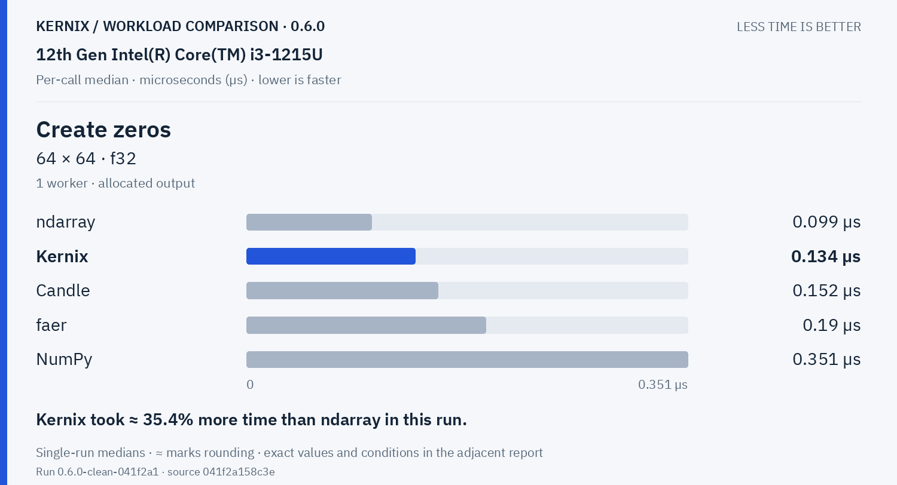
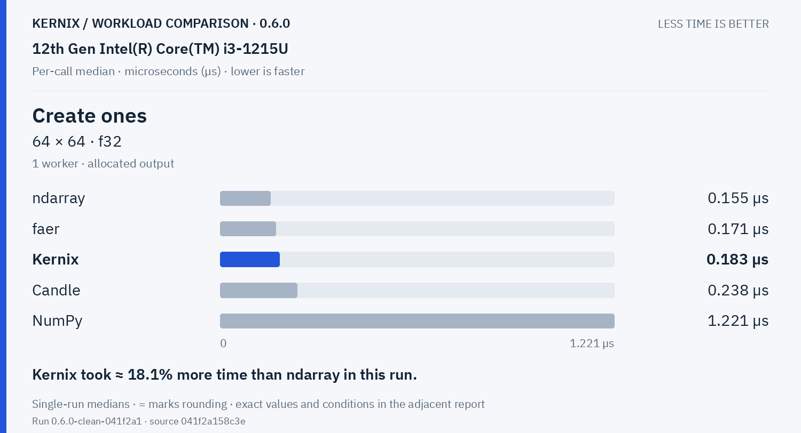

# Kernix 0.6.0 · performance brief

12th Gen Intel(R) Core(TM) i3-1215U / Linux

**Per-call median, microseconds per operation. Lower is faster. All recorded digits retained.**

9 workloads · 40 observations

No previous-version baseline attached. Sequential run changes are descriptive; paired process evidence is shown separately.

[Interactive HTML (open locally)](report.html) · [Vector PDF](latency.pdf) · [Raw measurements](raw.json)

## Charts by workload

**Shorter bars mean less time.** Blue is Kernix; grey is another library; teal is an explicitly selected Kernix backend. Entries are sorted by the recorded median, with a separate zero-based scale per chart. These point observations do not establish a statistical ranking.

Expand a group to see every chart here on GitHub. Click a chart to enlarge it. The exact table below keeps every source digit.

Matrix multiplication · 2 workloads

**Matrix multiplication · 32 × 32 · 32 × 32 · f64**

Kernix: **1.541 µs**. Kernix took ≈ 9.5% more time than ndarray in this run.

**Matrix multiplication · 128 × 128 · 128 × 128 · f64**

Kernix: **113.767 µs**. Kernix took ≈ 64.8% more time than Candle in this run.

Decompositions & solvers · 3 workloads

**Thin QR · 96 × 32 · f64**

Kernix: **45.81 µs**. Kernix took ≈ 25.5% more time than NumPy in this run.

**Thin QR · 256 × 64 · f64**

Kernix: **468.986 µs**. Kernix took ≈ 43.7% more time than NumPy in this run.

**Cholesky factorization · 64 × 64 · f64**

Kernix: **22.931 µs**. Kernix took ≈ 190.1% more time than faer in this run.

Training & autodiff · 1 workloads

**Record + backward · sum(A · W), 32 × 16 · 16 × 8 · f64**

Kernix: **3.165 µs**. Kernix took ≈ 19.1% less time than Candle in this run.

Statistics & activations · 1 workloads

**Row softmax · 256 × 64 · f64**

Kernix: **84.758 µs**. Kernix took ≈ 24.8% more time than ndarray in this run.

Tensor construction · 2 workloads

**Create zeros · 64 × 64 · f32**

Kernix: **0.134 µs**. Kernix took ≈ 35.4% more time than ndarray in this run.

**Create ones · 64 × 64 · f32**

Kernix: **0.183 µs**. Kernix took ≈ 18.1% more time than ndarray in this run.

## Exact latency table

All values below are microseconds per operation. **Lower is faster.** Missing entries were not measured.

| Workload | Kernix | ndarray | nalgebra | faer | Candle | NumPy |
|---|---:|---:|---:|---:|---:|---:|
| Matrix multiplication · 32 × 32 · 32 × 32 · f64 | 1.541 | **1.407** | 1.494 | 1.493 | 1.505 | 2.426 |
| Matrix multiplication · 128 × 128 · 128 × 128 · f64 | 113.767 | 117.314 | 110.415 | 76.137 | **69.019** | 72.997 |
| Thin QR · 96 × 32 · f64 | 45.81 | — | 37.619 | 69.906 | — | **36.491** |
| Thin QR · 256 × 64 · f64 | 468.986 | — | 356.914 | 393.041 | — | **326.424** |
| Cholesky factorization · 64 × 64 · f64 | 22.931 | — | 13.031 | **7.903999999999999** | — | 10.924 |
| Record + backward · sum(A · W), 32 × 16 · 16 × 8 · f64 | **3.165** | — | — | — | 3.914 | — |
| Row softmax · 256 × 64 · f64 | 84.758 | **67.896** | — | — | 77.876 | 97.789 |
| Create zeros · 64 × 64 · f32 | 0.134 | **0.099** | — | 0.19 | 0.152 | 0.351 |
| Create ones · 64 × 64 · f32 | 0.183 | **0.155** | — | 0.171 | 0.238 | 1.221 |

## Version comparison

0 of 9 workloads have paired evidence. Exploratory 95% intervals resample process pairs, not calls. No multiple-comparison adjustment.

| Workload | Current / baseline [95% interval] | Interpretation |
|---|---:|---|
| Matrix multiplication · 32 × 32 · 32 × 32 · f64 | — | No paired comparison |
| Matrix multiplication · 128 × 128 · 128 × 128 · f64 | — | No paired comparison |
| Thin QR · 96 × 32 · f64 | — | No paired comparison |
| Thin QR · 256 × 64 · f64 | — | No paired comparison |
| Cholesky factorization · 64 × 64 · f64 | — | No paired comparison |
| Record + backward · sum(A · W), 32 × 16 · 16 × 8 · f64 | — | No paired comparison |
| Row softmax · 256 × 64 · f64 | — | No paired comparison |
| Create zeros · 64 × 64 · f32 | — | No paired comparison |
| Create ones · 64 × 64 · f32 | — | No paired comparison |

## Method and provenance

CPU affinity pinned to logical CPU 0. Frequency and background load are uncontrolled.

Numbers retain source precision; recorded digits do not imply equivalent physical measurement accuracy. Lowest observed medians are bold only when peers were measured. No aggregate winner or universal ranking is inferred.

[Original report and commentary](original-report.txt) · [Raw measurements](raw.json)

Measured source `041f2a158c3e51340b5b9e6df6886fa52584f9b5`. Run `0.6.0-clean-041f2a1`. Rendering does not change measurements.
