# Kernix 0.6.0 · performance brief

12th Gen Intel(R) Core(TM) i3-1215U / Linux

**Per-call median, microseconds per operation. Lower is faster. All recorded digits retained.**

10 workloads · 43 observations

No previous-version baseline attached. Sequential run changes are descriptive; paired process evidence is shown separately.

[Interactive HTML (open locally)](report.html) · [Vector PDF](latency.pdf) · [Raw measurements](raw.json)

[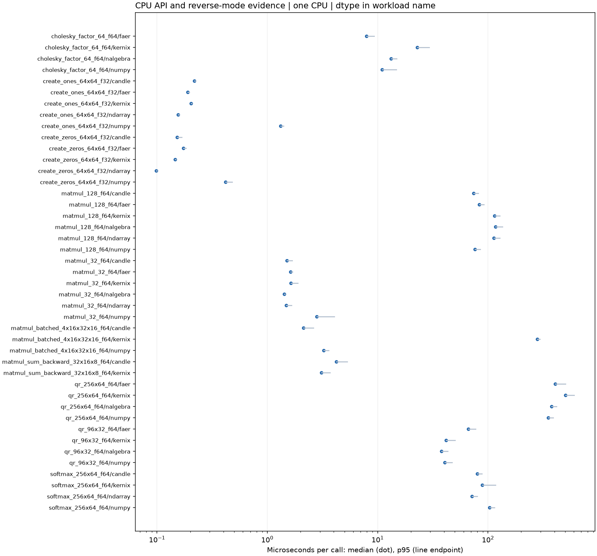](latency.pdf)

## Charts by workload

**Shorter bars mean less time.** Blue is Kernix; grey is a comparison implementation; teal is an explicitly selected Kernix backend. Entries are sorted by the recorded median, with a separate zero-based scale per chart. These point observations do not establish a statistical ranking.

Expand a group to see every chart here on GitHub. Click a chart to enlarge it. The exact table below keeps every source digit.

Matrix multiplication · 3 workloads

**Matrix multiplication · 32 × 32 · 32 × 32 · f64**

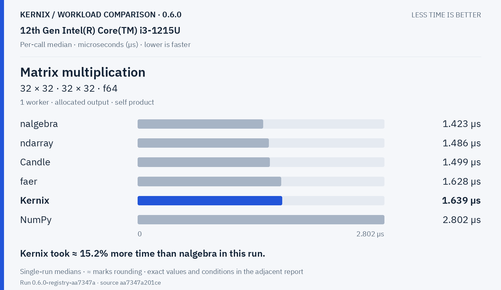

Kernix: **1.639 µs**. Kernix took ≈ 15.2% more time than nalgebra in this run.

**Matrix multiplication · 128 × 128 · 128 × 128 · f64**

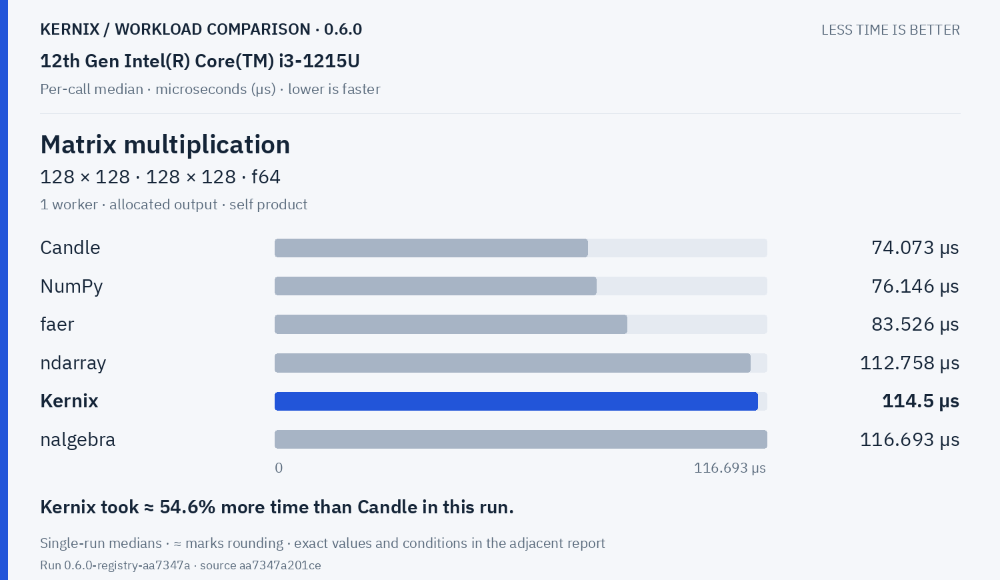

Kernix: **114.5 µs**. Kernix took ≈ 54.6% more time than Candle in this run.

**Batched multiplication · 4 × 16 × 32 · 1 × 32 × 16 · f64**

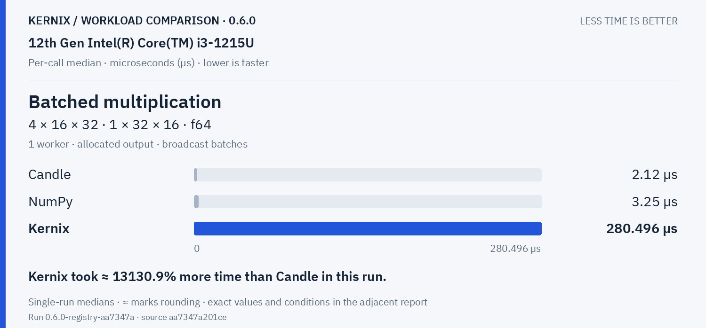

Kernix: **280.496 µs**. Kernix took ≈ 13130.9% more time than Candle in this run.

Decompositions & solvers · 3 workloads

**Thin QR · 96 × 32 · f64**

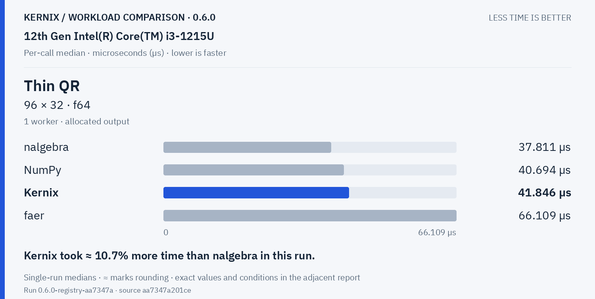

Kernix: **41.846 µs**. Kernix took ≈ 10.7% more time than nalgebra in this run.

**Thin QR · 256 × 64 · f64**

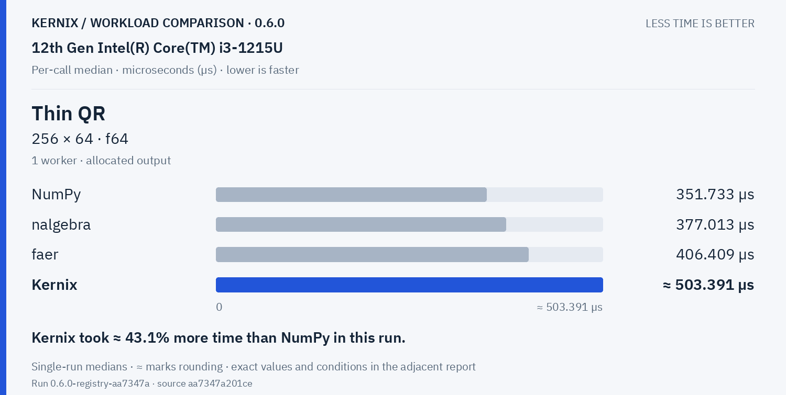

Kernix: **503.39099999999994 µs**. Kernix took ≈ 43.1% more time than NumPy in this run.

**Cholesky factorization · 64 × 64 · f64**

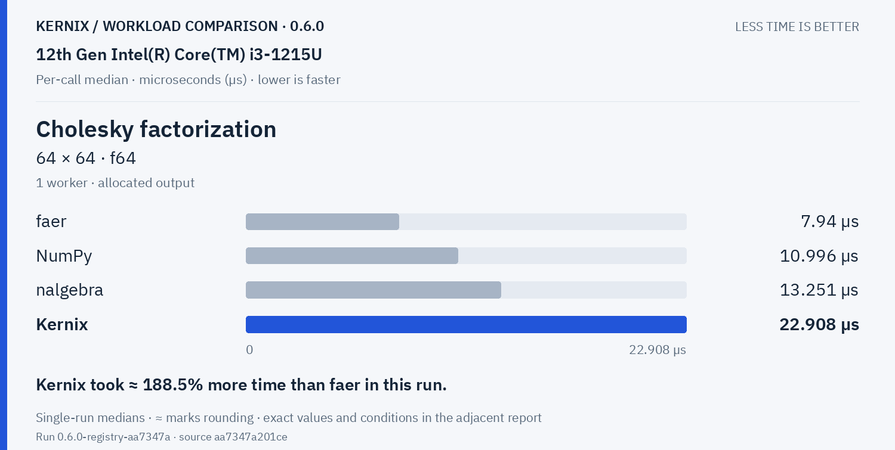

Kernix: **22.908 µs**. Kernix took ≈ 188.5% more time than faer in this run.

Training & autodiff · 1 workloads

**Record + backward · sum(A · W), 32 × 16 · 16 × 8 · f64**

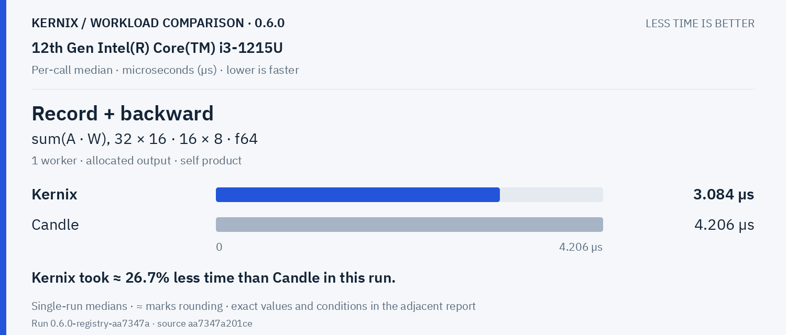

Kernix: **3.084 µs**. Kernix took ≈ 26.7% less time than Candle in this run.

Statistics & activations · 1 workloads

**Row softmax · 256 × 64 · f64**

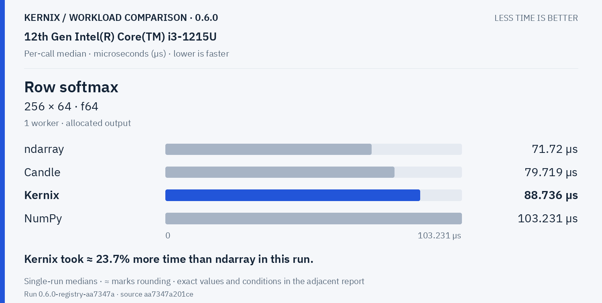

Kernix: **88.736 µs**. Kernix took ≈ 23.7% more time than ndarray in this run.

Tensor construction · 2 workloads

**Create zeros · 64 × 64 · f32**

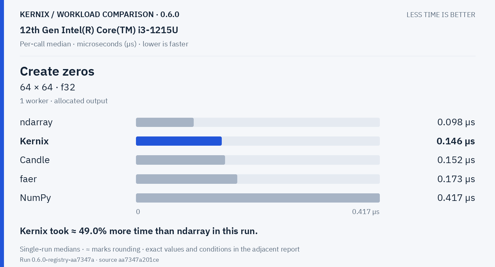

Kernix: **0.146 µs**. Kernix took ≈ 49.0% more time than ndarray in this run.

**Create ones · 64 × 64 · f32**

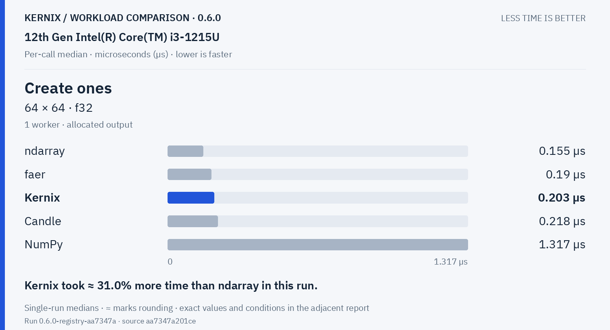

Kernix: **0.203 µs**. Kernix took ≈ 31.0% more time than ndarray in this run.

## Exact latency table

All values below are microseconds per operation. **Lower is faster.** Missing entries were not measured.

| Workload | Kernix | ndarray | nalgebra | faer | Candle | NumPy |
|---|---:|---:|---:|---:|---:|---:|
| Matrix multiplication · 32 × 32 · 32 × 32 · f64 | 1.639 | 1.486 | **1.423** | 1.628 | 1.499 | 2.802 |
| Matrix multiplication · 128 × 128 · 128 × 128 · f64 | 114.5 | 112.758 | 116.693 | 83.526 | **74.073** | 76.146 |
| Batched multiplication · 4 × 16 × 32 · 1 × 32 × 16 · f64 | 280.496 | — | — | — | **2.12** | 3.25 |
| Thin QR · 96 × 32 · f64 | 41.846 | — | **37.811** | 66.109 | — | 40.694 |
| Thin QR · 256 × 64 · f64 | 503.39099999999994 | — | 377.013 | 406.409 | — | **351.733** |
| Cholesky factorization · 64 × 64 · f64 | 22.908 | — | 13.251 | **7.94** | — | 10.996 |
| Record + backward · sum(A · W), 32 × 16 · 16 × 8 · f64 | **3.084** | — | — | — | 4.206 | — |
| Row softmax · 256 × 64 · f64 | 88.736 | **71.72** | — | — | 79.719 | 103.231 |
| Create zeros · 64 × 64 · f32 | 0.146 | **0.098** | — | 0.173 | 0.152 | 0.417 |
| Create ones · 64 × 64 · f32 | 0.203 | **0.155** | — | 0.19 | 0.218 | 1.317 |

## Version comparison

0 of 10 workloads have paired evidence. Exploratory 95% intervals resample process pairs, not calls. No multiple-comparison adjustment.

| Workload | Current / baseline [95% interval] | Interpretation |
|---|---:|---|
| Matrix multiplication · 32 × 32 · 32 × 32 · f64 | — | No paired comparison |
| Matrix multiplication · 128 × 128 · 128 × 128 · f64 | — | No paired comparison |
| Batched multiplication · 4 × 16 × 32 · 1 × 32 × 16 · f64 | — | No paired comparison |
| Thin QR · 96 × 32 · f64 | — | No paired comparison |
| Thin QR · 256 × 64 · f64 | — | No paired comparison |
| Cholesky factorization · 64 × 64 · f64 | — | No paired comparison |
| Record + backward · sum(A · W), 32 × 16 · 16 × 8 · f64 | — | No paired comparison |
| Row softmax · 256 × 64 · f64 | — | No paired comparison |
| Create zeros · 64 × 64 · f32 | — | No paired comparison |
| Create ones · 64 × 64 · f32 | — | No paired comparison |

## Method and provenance

CPU affinity pinned to logical CPU 0. Frequency and background load are uncontrolled.

Numbers retain source precision; recorded digits do not imply equivalent physical measurement accuracy. Lowest observed medians are bold only when peers were measured. No aggregate winner or universal ranking is inferred.

[Original report and commentary](original-report.txt) · [Raw measurements](raw.json)

Measured source `aa7347a201ce9294b02990b7598af146470bca65`. Run `0.6.0-registry-aa7347a`. Rendering does not change measurements.
