# Kernix 0.7.0 · performance brief

12th Gen Intel(R) Core(TM) i3-1215U / Linux

**Per-call median, microseconds per operation. Lower is faster. All recorded digits retained.**

14 workloads · 50 observations

No previous-version baseline attached. Sequential run changes are descriptive; paired process evidence is shown separately.

[Interactive HTML (open locally)](report.html) · [Vector PDF](latency.pdf) · [Raw measurements](raw.json)

[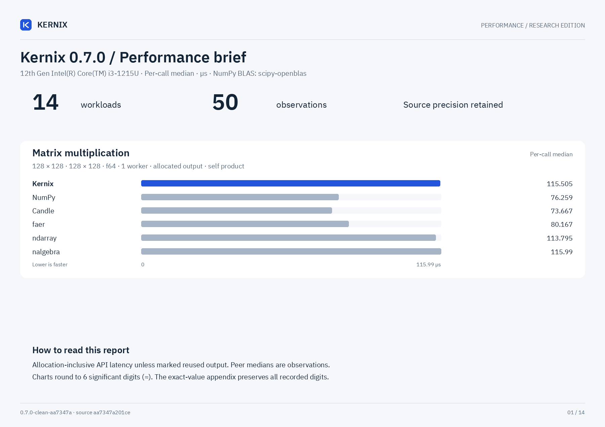](latency.pdf)

## Charts by workload

**Shorter bars mean less time.** Blue is Kernix; grey is a comparison implementation; teal is an explicitly selected Kernix backend. Entries are sorted by the recorded median, with a separate zero-based scale per chart. These point observations do not establish a statistical ranking.

Expand a group to see every chart here on GitHub. Click a chart to enlarge it. The exact table below keeps every source digit.

Matrix multiplication · 3 workloads

**Matrix multiplication · 32 × 32 · 32 × 32 · f64**

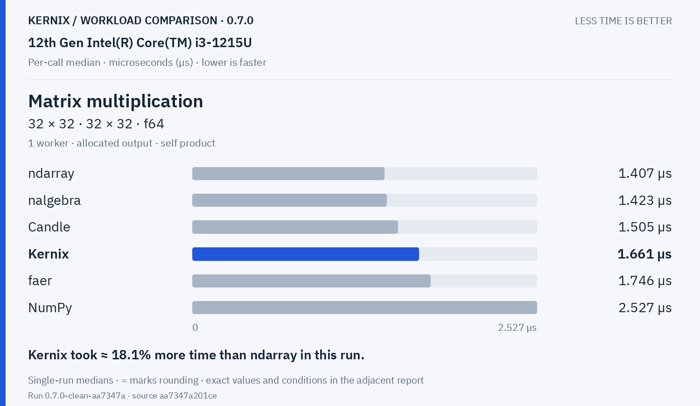

Kernix: **1.661 µs**. Kernix took ≈ 18.1% more time than ndarray in this run.

**Matrix multiplication · 128 × 128 · 128 × 128 · f64**

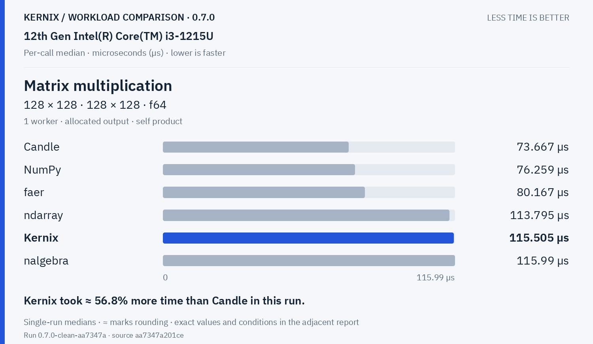

Kernix: **115.505 µs**. Kernix took ≈ 56.8% more time than Candle in this run.

**Batched multiplication · 4 × 16 × 32 · 1 × 32 × 16 · f64**

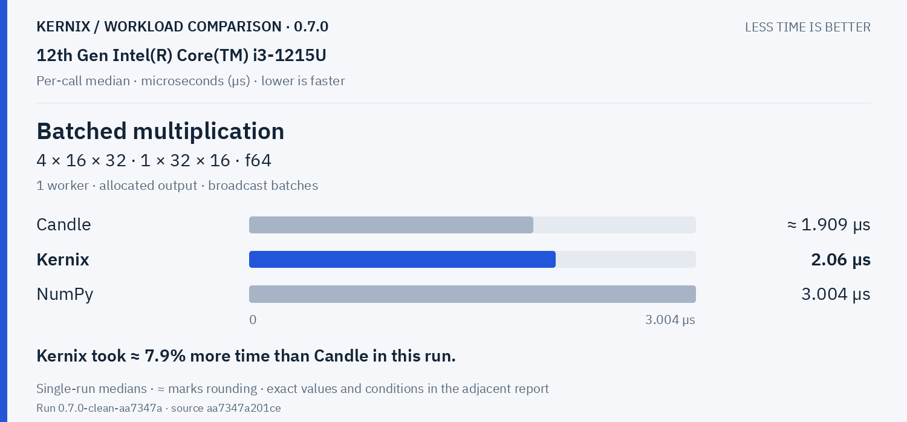

Kernix: **2.06 µs**. Kernix took ≈ 7.9% more time than Candle in this run.

Decompositions & solvers · 3 workloads

**Thin QR · 96 × 32 · f64**

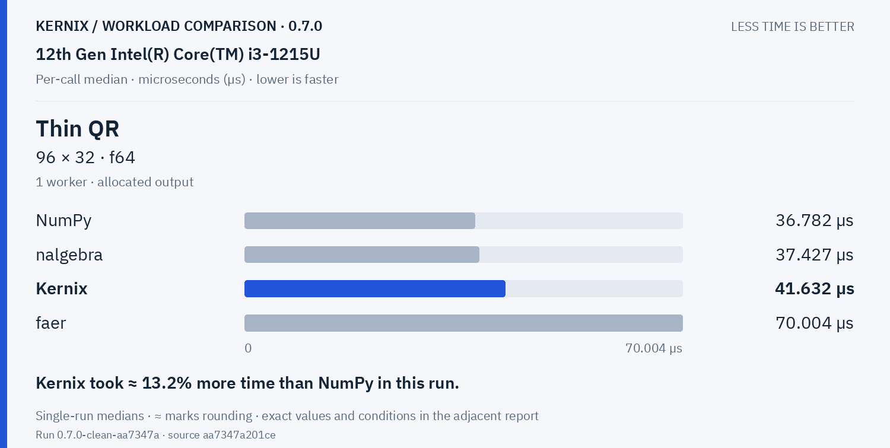

Kernix: **41.632 µs**. Kernix took ≈ 13.2% more time than NumPy in this run.

**Thin QR · 256 × 64 · f64**

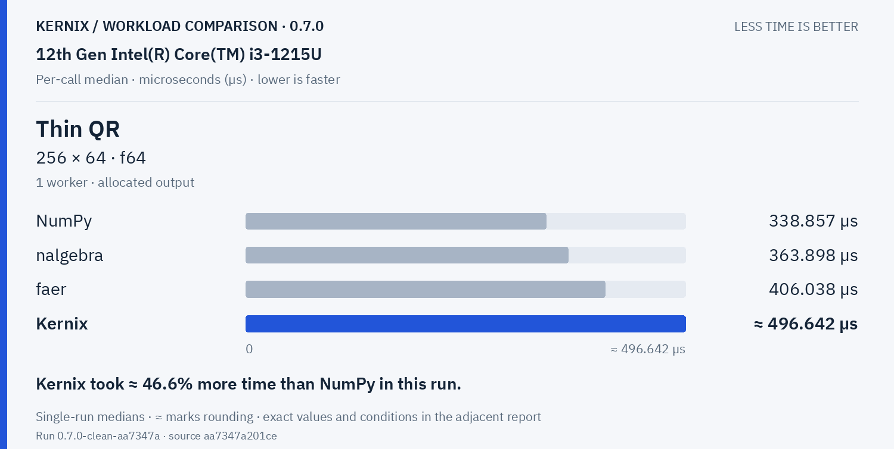

Kernix: **496.64200000000006 µs**. Kernix took ≈ 46.6% more time than NumPy in this run.

**Cholesky factorization · 64 × 64 · f64**

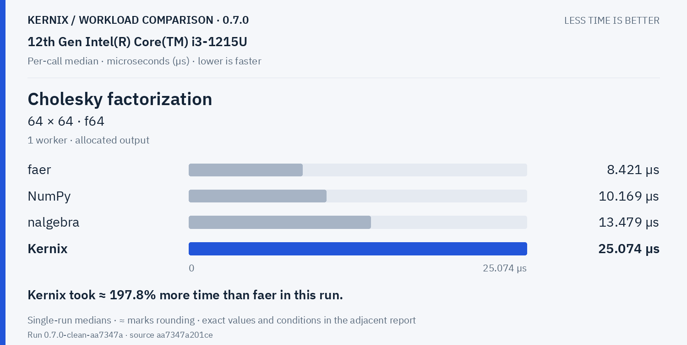

Kernix: **25.074 µs**. Kernix took ≈ 197.8% more time than faer in this run.

Training & autodiff · 5 workloads

**Record + backward · sum(A · W), 32 × 16 · 16 × 8 · f64**

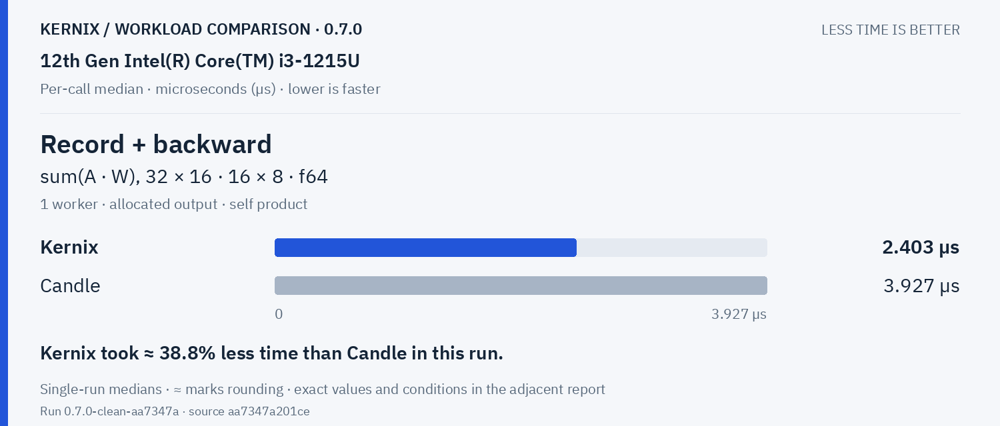

Kernix: **2.403 µs**. Kernix took ≈ 38.8% less time than Candle in this run.

**Model inference · batched normalized/sliced MLP · f64**

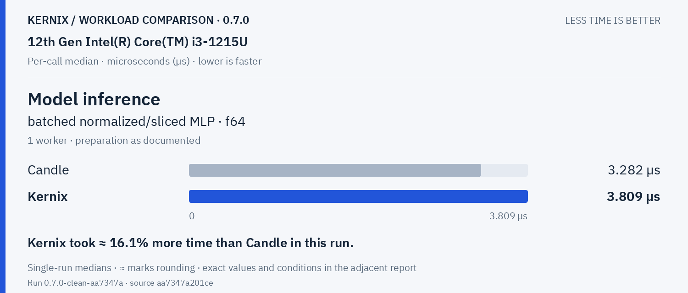

Kernix: **3.809 µs**. Kernix took ≈ 16.1% more time than Candle in this run.

**Model recording + forward · batched normalized/sliced MLP · f64**

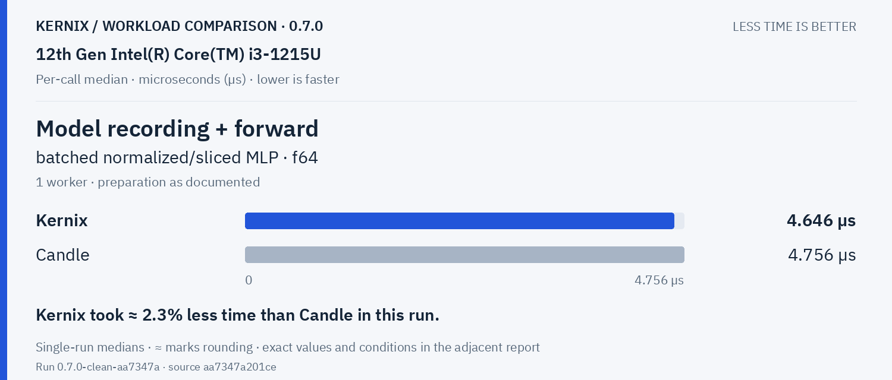

Kernix: **4.646 µs**. Kernix took ≈ 2.3% less time than Candle in this run.

**Model backward · prepared graph → fresh gradients · f64**

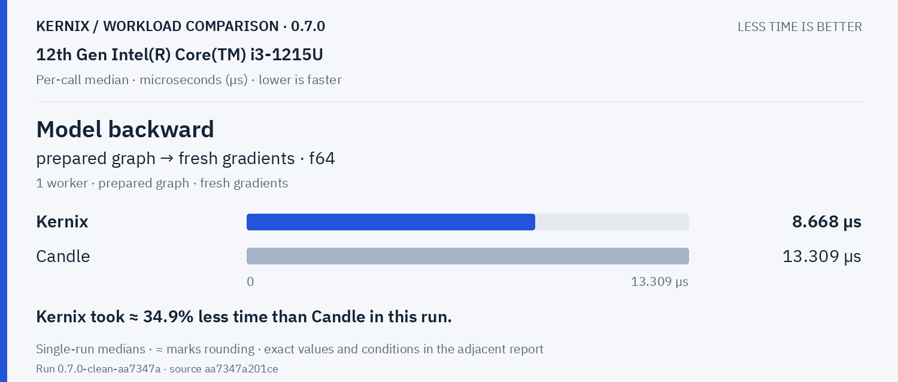

Kernix: **8.668 µs**. Kernix took ≈ 34.9% less time than Candle in this run.

**Parameter update · transactional SGD, fixed gradients · f64**

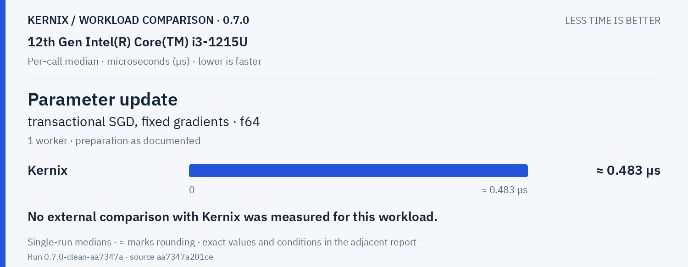

Kernix: **0.48299999999999994 µs**. No external comparison with Kernix was measured for this workload.

Statistics & activations · 1 workloads

**Row softmax · 256 × 64 · f64**

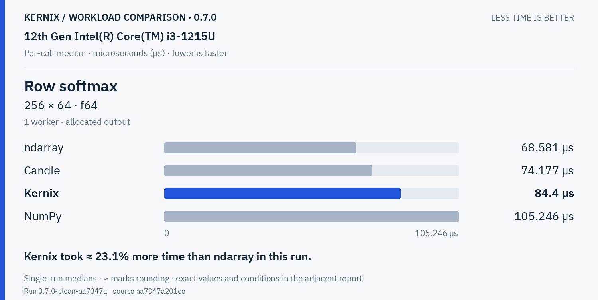

Kernix: **84.4 µs**. Kernix took ≈ 23.1% more time than ndarray in this run.

Tensor construction · 2 workloads

**Create zeros · 64 × 64 · f32**

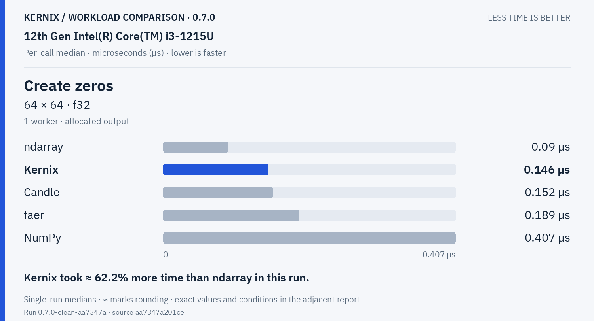

Kernix: **0.146 µs**. Kernix took ≈ 62.2% more time than ndarray in this run.

**Create ones · 64 × 64 · f32**

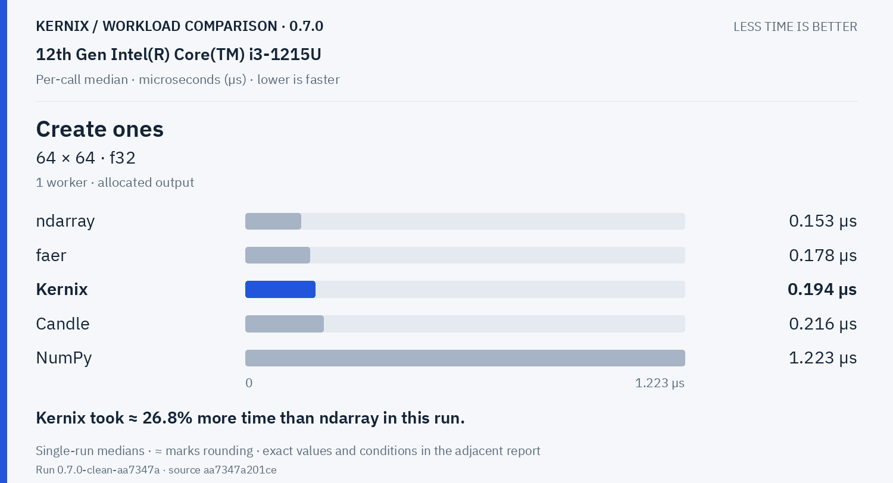

Kernix: **0.194 µs**. Kernix took ≈ 26.8% more time than ndarray in this run.

## Exact latency table

All values below are microseconds per operation. **Lower is faster.** Missing entries were not measured.

| Workload | Kernix | ndarray | nalgebra | faer | Candle | NumPy |
|---|---:|---:|---:|---:|---:|---:|
| Matrix multiplication · 32 × 32 · 32 × 32 · f64 | 1.661 | **1.407** | 1.423 | 1.746 | 1.505 | 2.527 |
| Matrix multiplication · 128 × 128 · 128 × 128 · f64 | 115.505 | 113.795 | 115.99 | 80.167 | **73.667** | 76.259 |
| Batched multiplication · 4 × 16 × 32 · 1 × 32 × 16 · f64 | 2.06 | — | — | — | **1.9089999999999998** | 3.004 |
| Thin QR · 96 × 32 · f64 | 41.632 | — | 37.427 | 70.004 | — | **36.782** |
| Thin QR · 256 × 64 · f64 | 496.64200000000006 | — | 363.898 | 406.038 | — | **338.857** |
| Cholesky factorization · 64 × 64 · f64 | 25.074 | — | 13.479 | **8.421** | — | 10.169 |
| Record + backward · sum(A · W), 32 × 16 · 16 × 8 · f64 | **2.403** | — | — | — | 3.927 | — |
| Model inference · batched normalized/sliced MLP · f64 | 3.809 | — | — | — | **3.282** | — |
| Model recording + forward · batched normalized/sliced MLP · f64 | **4.646** | — | — | — | 4.756 | — |
| Model backward · prepared graph → fresh gradients · f64 | **8.668** | — | — | — | 13.309 | — |
| Parameter update · transactional SGD, fixed gradients · f64 | 0.48299999999999994 | — | — | — | — | — |
| Row softmax · 256 × 64 · f64 | 84.4 | **68.581** | — | — | 74.177 | 105.246 |
| Create zeros · 64 × 64 · f32 | 0.146 | **0.09** | — | 0.189 | 0.152 | 0.407 |
| Create ones · 64 × 64 · f32 | 0.194 | **0.153** | — | 0.178 | 0.216 | 1.223 |

## Version comparison

0 of 14 workloads have paired evidence. Exploratory 95% intervals resample process pairs, not calls. No multiple-comparison adjustment.

| Workload | Current / baseline [95% interval] | Interpretation |
|---|---:|---|
| Matrix multiplication · 32 × 32 · 32 × 32 · f64 | — | No paired comparison |
| Matrix multiplication · 128 × 128 · 128 × 128 · f64 | — | No paired comparison |
| Batched multiplication · 4 × 16 × 32 · 1 × 32 × 16 · f64 | — | No paired comparison |
| Thin QR · 96 × 32 · f64 | — | No paired comparison |
| Thin QR · 256 × 64 · f64 | — | No paired comparison |
| Cholesky factorization · 64 × 64 · f64 | — | No paired comparison |
| Record + backward · sum(A · W), 32 × 16 · 16 × 8 · f64 | — | No paired comparison |
| Model inference · batched normalized/sliced MLP · f64 | — | No paired comparison |
| Model recording + forward · batched normalized/sliced MLP · f64 | — | No paired comparison |
| Model backward · prepared graph → fresh gradients · f64 | — | No paired comparison |
| Parameter update · transactional SGD, fixed gradients · f64 | — | No paired comparison |
| Row softmax · 256 × 64 · f64 | — | No paired comparison |
| Create zeros · 64 × 64 · f32 | — | No paired comparison |
| Create ones · 64 × 64 · f32 | — | No paired comparison |

## Method and provenance

CPU affinity pinned to logical CPU 0. Frequency and background load are uncontrolled.

Numbers retain source precision; recorded digits do not imply equivalent physical measurement accuracy. Lowest observed medians are bold only when peers were measured. No aggregate winner or universal ranking is inferred.

[Original report and commentary](original-report.txt) · [Raw measurements](raw.json)

Measured source `aa7347a201ce9294b02990b7598af146470bca65`. Run `0.7.0-clean-aa7347a`. Rendering does not change measurements.
