# Kernix 0.7.0 · performance brief

12th Gen Intel(R) Core(TM) i3-1215U / Linux

**Per-call median, microseconds per operation. Lower is faster. All recorded digits retained.**

14 workloads · 50 observations

No previous-version baseline attached. Sequential run changes are descriptive; paired process evidence is shown separately.

[Interactive HTML (open locally)](report.html) · [Vector PDF](latency.pdf) · [Raw measurements](raw.json)

## Charts by workload

**Shorter bars mean less time.** Blue is Kernix; grey is another library; teal is an explicitly selected Kernix backend. Entries are sorted by the recorded median, with a separate zero-based scale per chart. These point observations do not establish a statistical ranking.

Expand a group to see every chart here on GitHub. Click a chart to enlarge it. The exact table below keeps every source digit.

Matrix multiplication · 3 workloads

**Matrix multiplication · 32 × 32 · 32 × 32 · f64**

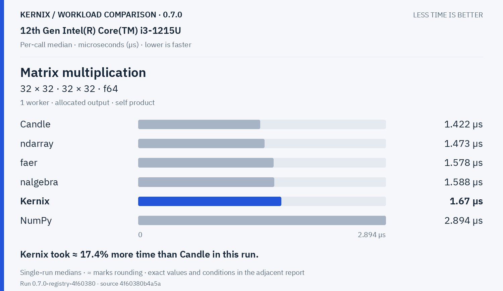

Kernix: **1.67 µs**. Kernix took ≈ 17.4% more time than Candle in this run.

**Matrix multiplication · 128 × 128 · 128 × 128 · f64**

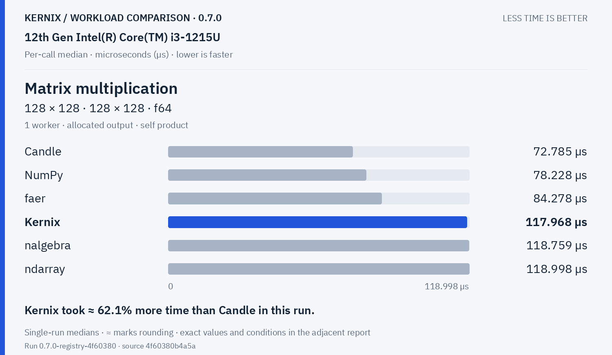

Kernix: **117.968 µs**. Kernix took ≈ 62.1% more time than Candle in this run.

**Batched multiplication · 4 × 16 × 32 · 1 × 32 × 16 · f64**

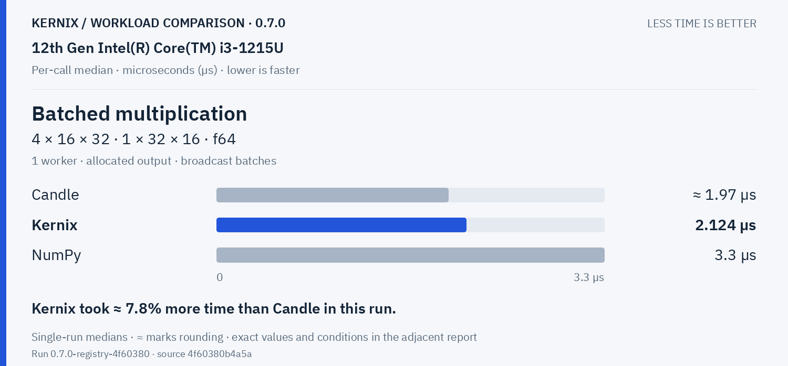

Kernix: **2.124 µs**. Kernix took ≈ 7.8% more time than Candle in this run.

Decompositions & solvers · 3 workloads

**Thin QR · 96 × 32 · f64**

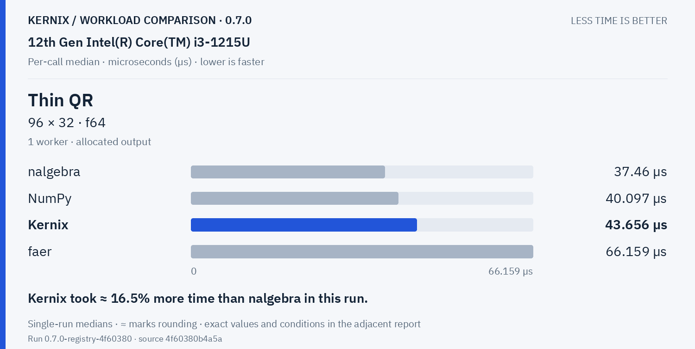

Kernix: **43.656 µs**. Kernix took ≈ 16.5% more time than nalgebra in this run.

**Thin QR · 256 × 64 · f64**

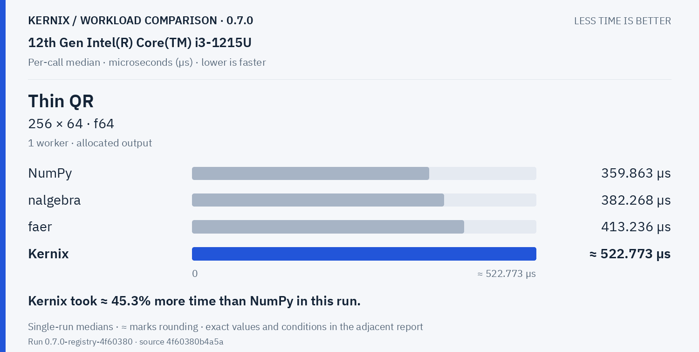

Kernix: **522.77300000000006 µs**. Kernix took ≈ 45.3% more time than NumPy in this run.

**Cholesky factorization · 64 × 64 · f64**

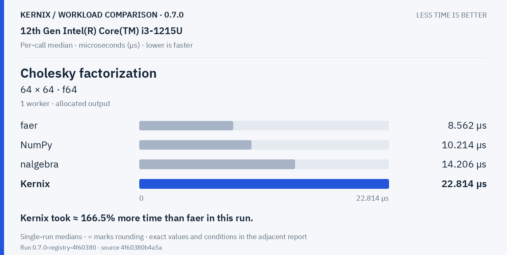

Kernix: **22.814 µs**. Kernix took ≈ 166.5% more time than faer in this run.

Training & autodiff · 5 workloads

**Record + backward · sum(A · W), 32 × 16 · 16 × 8 · f64**

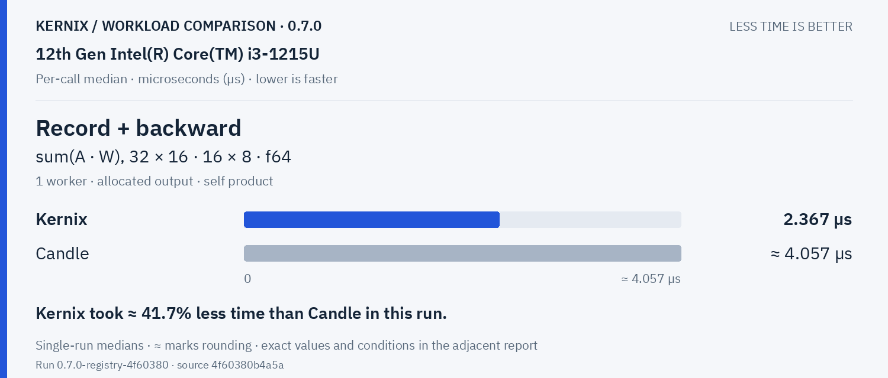

Kernix: **2.367 µs**. Kernix took ≈ 41.7% less time than Candle in this run.

**Model inference · batched normalized/sliced MLP · f64**

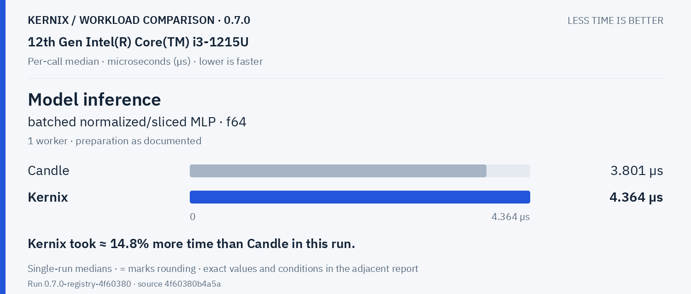

Kernix: **4.364 µs**. Kernix took ≈ 14.8% more time than Candle in this run.

**Model recording + forward · batched normalized/sliced MLP · f64**

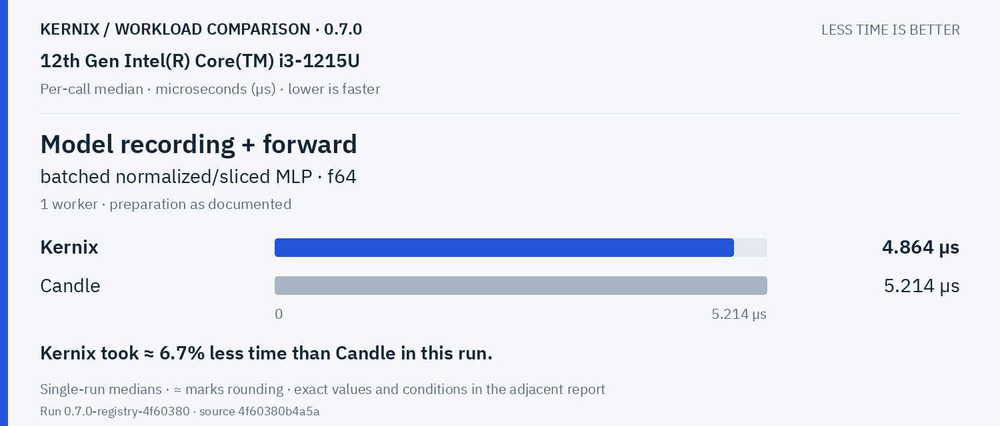

Kernix: **4.864 µs**. Kernix took ≈ 6.7% less time than Candle in this run.

**Model backward · prepared graph → fresh gradients · f64**

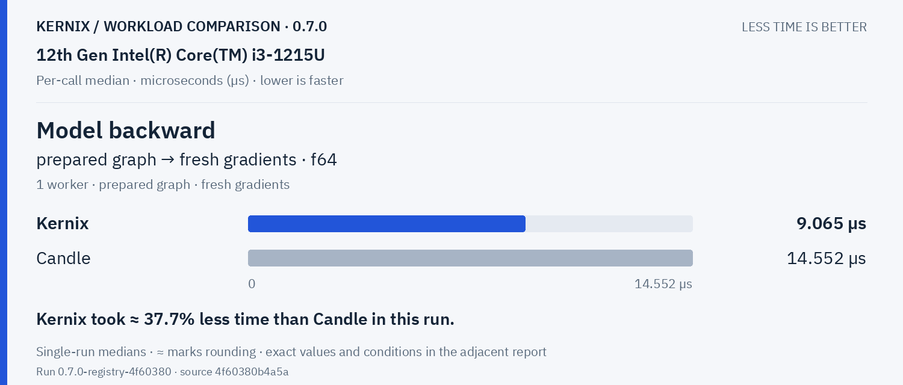

Kernix: **9.065 µs**. Kernix took ≈ 37.7% less time than Candle in this run.

**Parameter update · transactional SGD, fixed gradients · f64**

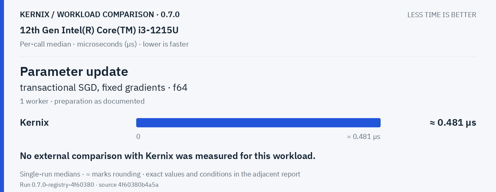

Kernix: **0.48100000000000006 µs**. No external comparison with Kernix was measured for this workload.

Statistics & activations · 1 workloads

**Row softmax · 256 × 64 · f64**

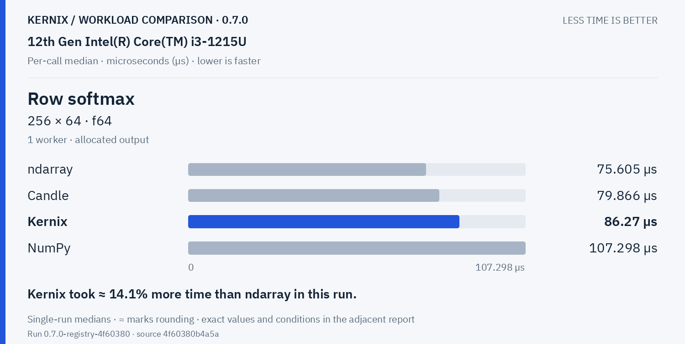

Kernix: **86.27 µs**. Kernix took ≈ 14.1% more time than ndarray in this run.

Tensor construction · 2 workloads

**Create zeros · 64 × 64 · f32**

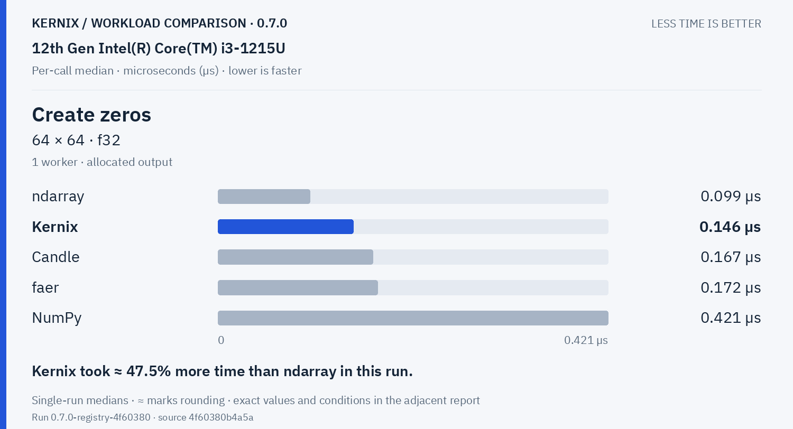

Kernix: **0.146 µs**. Kernix took ≈ 47.5% more time than ndarray in this run.

**Create ones · 64 × 64 · f32**

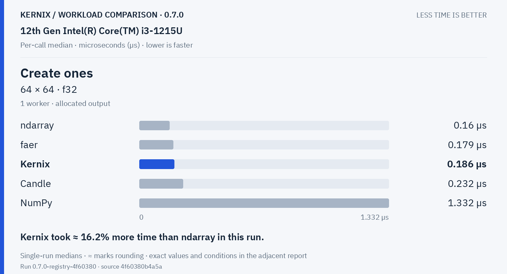

Kernix: **0.186 µs**. Kernix took ≈ 16.2% more time than ndarray in this run.

## Exact latency table

All values below are microseconds per operation. **Lower is faster.** Missing entries were not measured.

| Workload | Kernix | ndarray | nalgebra | faer | Candle | NumPy |
|---|---:|---:|---:|---:|---:|---:|
| Matrix multiplication · 32 × 32 · 32 × 32 · f64 | 1.67 | 1.473 | 1.588 | 1.578 | **1.422** | 2.894 |
| Matrix multiplication · 128 × 128 · 128 × 128 · f64 | 117.968 | 118.998 | 118.759 | 84.278 | **72.785** | 78.228 |
| Batched multiplication · 4 × 16 × 32 · 1 × 32 × 16 · f64 | 2.124 | — | — | — | **1.9700000000000002** | 3.3 |
| Thin QR · 96 × 32 · f64 | 43.656 | — | **37.46** | 66.159 | — | 40.097 |
| Thin QR · 256 × 64 · f64 | 522.77300000000006 | — | 382.268 | 413.236 | — | **359.863** |
| Cholesky factorization · 64 × 64 · f64 | 22.814 | — | 14.206 | **8.562** | — | 10.214 |
| Record + backward · sum(A · W), 32 × 16 · 16 × 8 · f64 | **2.367** | — | — | — | 4.0570000000000005 | — |
| Model inference · batched normalized/sliced MLP · f64 | 4.364 | — | — | — | **3.801** | — |
| Model recording + forward · batched normalized/sliced MLP · f64 | **4.864** | — | — | — | 5.214 | — |
| Model backward · prepared graph → fresh gradients · f64 | **9.065** | — | — | — | 14.552 | — |
| Parameter update · transactional SGD, fixed gradients · f64 | 0.48100000000000006 | — | — | — | — | — |
| Row softmax · 256 × 64 · f64 | 86.27 | **75.605** | — | — | 79.866 | 107.298 |
| Create zeros · 64 × 64 · f32 | 0.146 | **0.099** | — | 0.172 | 0.167 | 0.421 |
| Create ones · 64 × 64 · f32 | 0.186 | **0.16** | — | 0.179 | 0.232 | 1.332 |

## Version comparison

0 of 14 workloads have paired evidence. Exploratory 95% intervals resample process pairs, not calls. No multiple-comparison adjustment.

| Workload | Current / baseline [95% interval] | Interpretation |
|---|---:|---|
| Matrix multiplication · 32 × 32 · 32 × 32 · f64 | — | No paired comparison |
| Matrix multiplication · 128 × 128 · 128 × 128 · f64 | — | No paired comparison |
| Batched multiplication · 4 × 16 × 32 · 1 × 32 × 16 · f64 | — | No paired comparison |
| Thin QR · 96 × 32 · f64 | — | No paired comparison |
| Thin QR · 256 × 64 · f64 | — | No paired comparison |
| Cholesky factorization · 64 × 64 · f64 | — | No paired comparison |
| Record + backward · sum(A · W), 32 × 16 · 16 × 8 · f64 | — | No paired comparison |
| Model inference · batched normalized/sliced MLP · f64 | — | No paired comparison |
| Model recording + forward · batched normalized/sliced MLP · f64 | — | No paired comparison |
| Model backward · prepared graph → fresh gradients · f64 | — | No paired comparison |
| Parameter update · transactional SGD, fixed gradients · f64 | — | No paired comparison |
| Row softmax · 256 × 64 · f64 | — | No paired comparison |
| Create zeros · 64 × 64 · f32 | — | No paired comparison |
| Create ones · 64 × 64 · f32 | — | No paired comparison |

## Method and provenance

CPU affinity pinned to logical CPU 0. Frequency and background load are uncontrolled.

Numbers retain source precision; recorded digits do not imply equivalent physical measurement accuracy. Lowest observed medians are bold only when peers were measured. No aggregate winner or universal ranking is inferred.

[Original report and commentary](original-report.txt) · [Raw measurements](raw.json)

Measured source `4f60380b4a5ac07931347b4f9eba0ac696983f9a`. Run `0.7.0-registry-4f60380`. Rendering does not change measurements.
