# Kernix 0.7.1 · performance brief

12th Gen Intel(R) Core(TM) i3-1215U / Linux

**Per-call median, microseconds per operation. Lower is faster. All recorded digits retained.**

14 workloads · 50 observations

No previous-version baseline attached. Sequential run changes are descriptive; paired process evidence is shown separately.

[Interactive HTML (open locally)](report.html) · [Vector PDF](latency.pdf) · [Raw measurements](raw.json)

[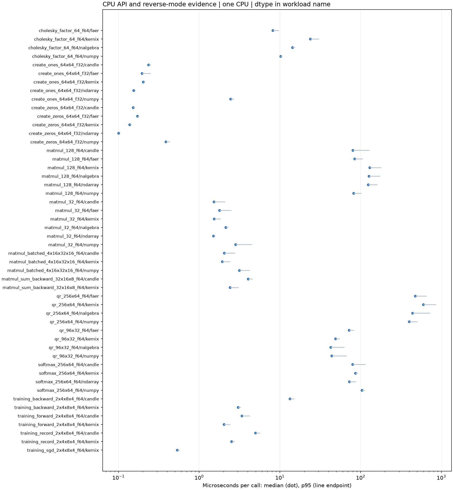](latency.pdf)

## Charts by workload

**Shorter bars mean less time.** Blue is Kernix; grey is a comparison implementation; teal is an explicitly selected Kernix backend. Entries are sorted by the recorded median, with a separate zero-based scale per chart. These point observations do not establish a statistical ranking.

Expand a group to see every chart here on GitHub. Click a chart to enlarge it. The exact table below keeps every source digit.

Matrix multiplication · 3 workloads

**Matrix multiplication · 32 × 32 · 32 × 32 · f64**

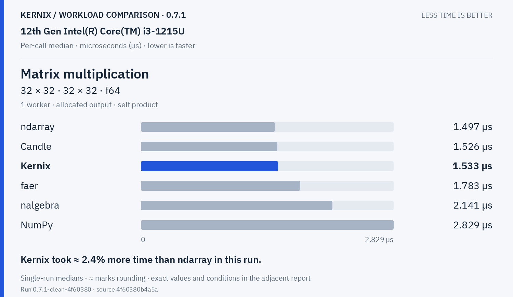

Kernix: **1.533 µs**. Kernix took ≈ 2.4% more time than ndarray in this run.

**Matrix multiplication · 128 × 128 · 128 × 128 · f64**

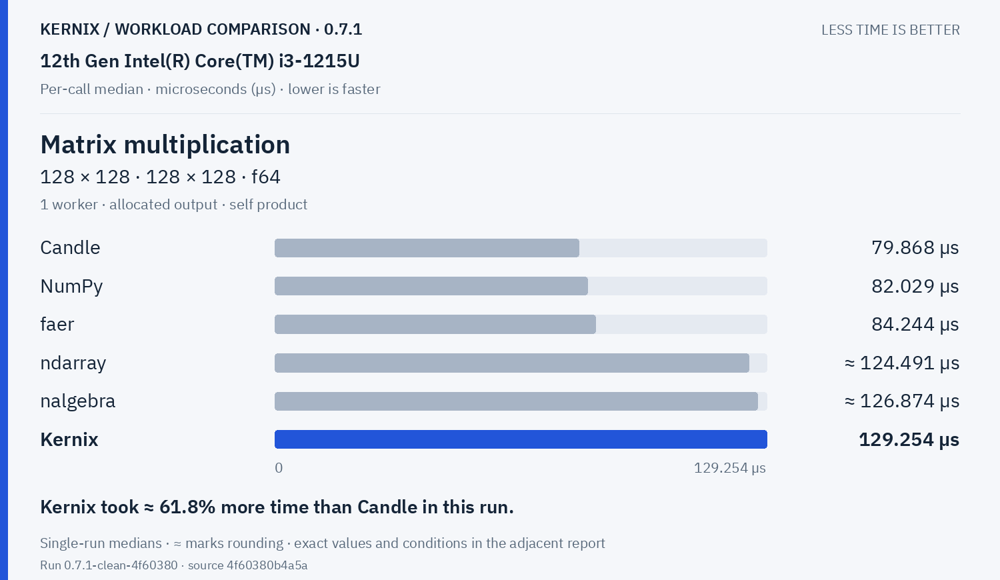

Kernix: **129.254 µs**. Kernix took ≈ 61.8% more time than Candle in this run.

**Batched multiplication · 4 × 16 × 32 · 1 × 32 × 16 · f64**

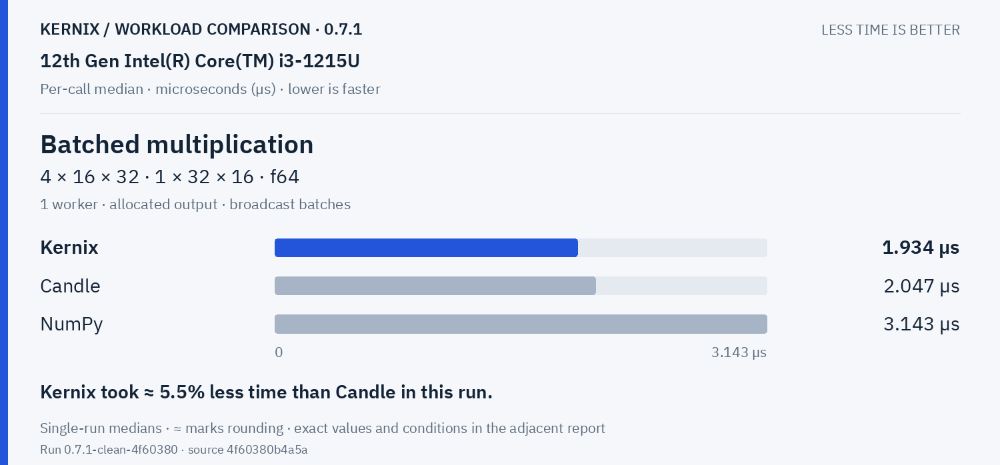

Kernix: **1.934 µs**. Kernix took ≈ 5.5% less time than Candle in this run.

Decompositions & solvers · 3 workloads

**Thin QR · 96 × 32 · f64**

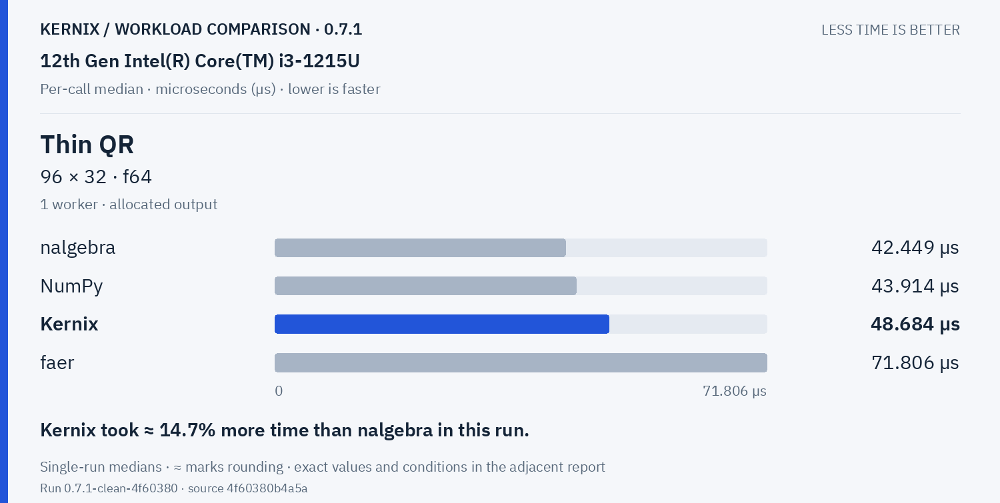

Kernix: **48.684 µs**. Kernix took ≈ 14.7% more time than nalgebra in this run.

**Thin QR · 256 × 64 · f64**

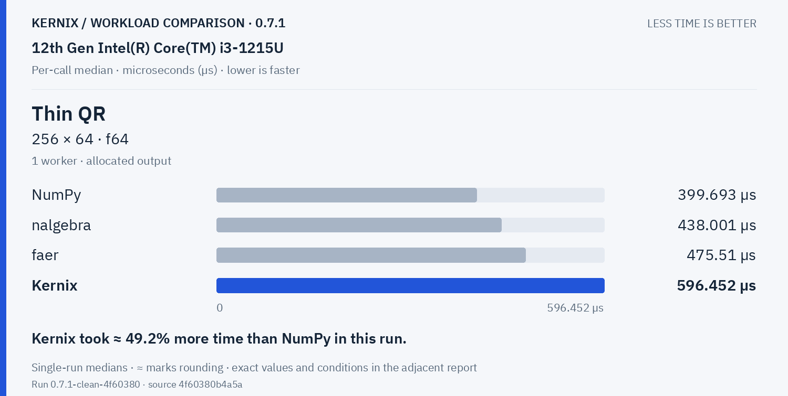

Kernix: **596.452 µs**. Kernix took ≈ 49.2% more time than NumPy in this run.

**Cholesky factorization · 64 × 64 · f64**

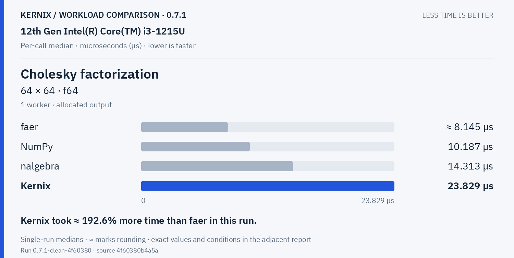

Kernix: **23.829 µs**. Kernix took ≈ 192.6% more time than faer in this run.

Training & autodiff · 5 workloads

**Record + backward · sum(A · W), 32 × 16 · 16 × 8 · f64**

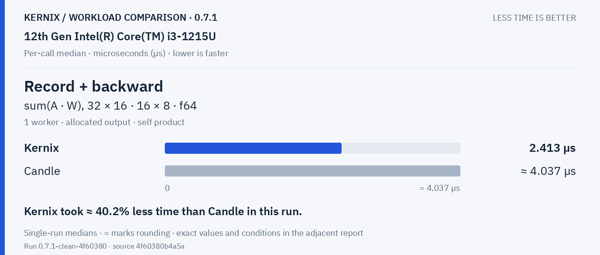

Kernix: **2.413 µs**. Kernix took ≈ 40.2% less time than Candle in this run.

**Model inference · batched normalized/sliced MLP · f64**

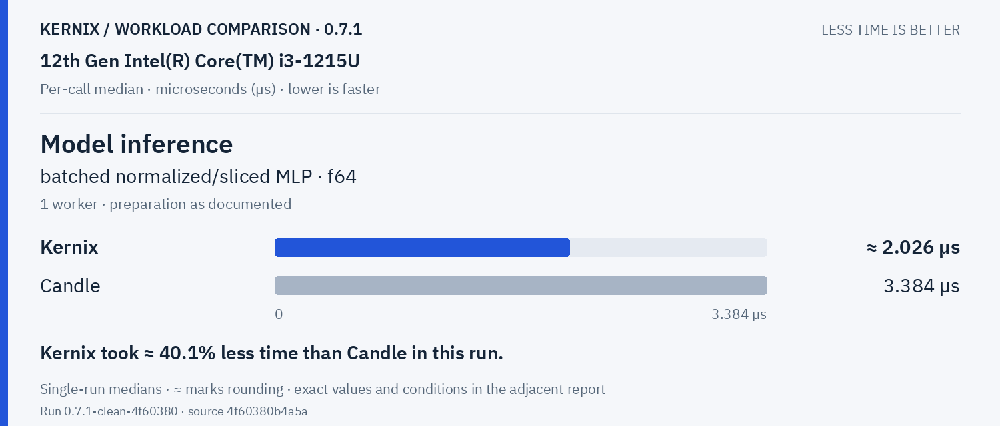

Kernix: **2.0260000000000002 µs**. Kernix took ≈ 40.1% less time than Candle in this run.

**Model recording + forward · batched normalized/sliced MLP · f64**

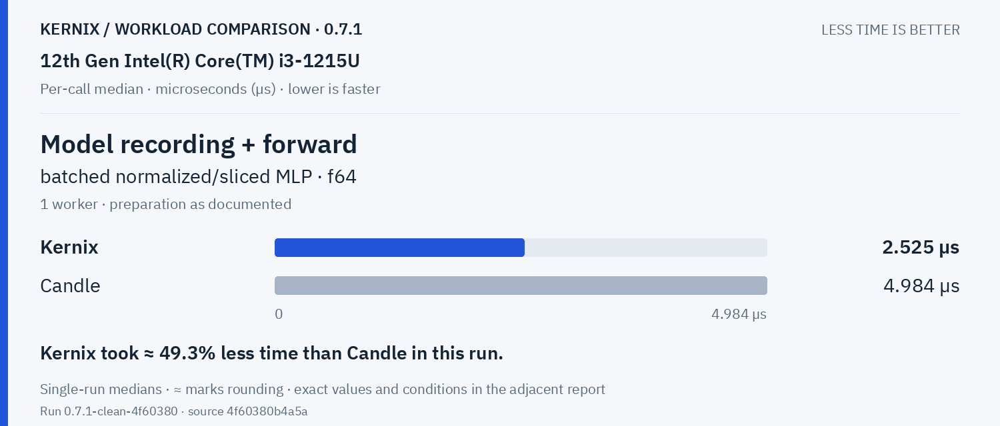

Kernix: **2.525 µs**. Kernix took ≈ 49.3% less time than Candle in this run.

**Model backward · prepared graph → fresh gradients · f64**

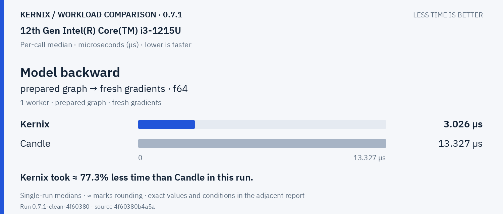

Kernix: **3.026 µs**. Kernix took ≈ 77.3% less time than Candle in this run.

**Parameter update · transactional SGD, fixed gradients · f64**

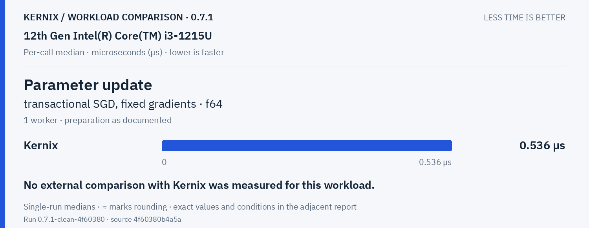

Kernix: **0.536 µs**. No external comparison with Kernix was measured for this workload.

Statistics & activations · 1 workloads

**Row softmax · 256 × 64 · f64**

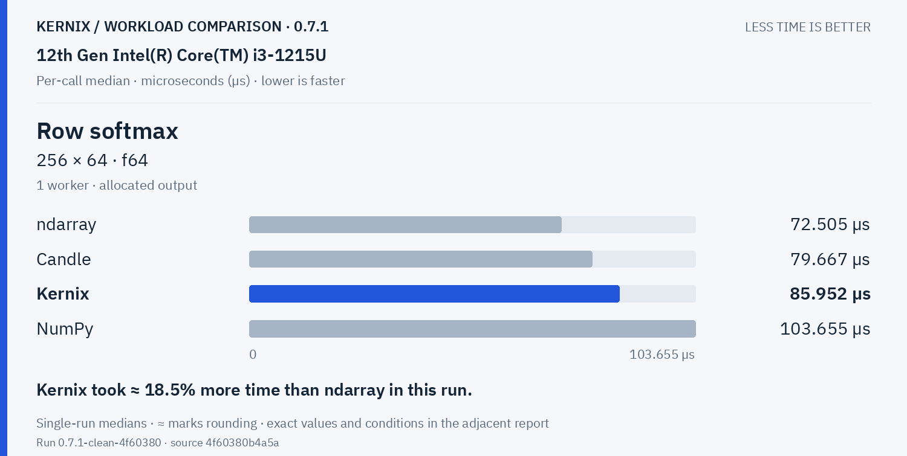

Kernix: **85.952 µs**. Kernix took ≈ 18.5% more time than ndarray in this run.

Tensor construction · 2 workloads

**Create zeros · 64 × 64 · f32**

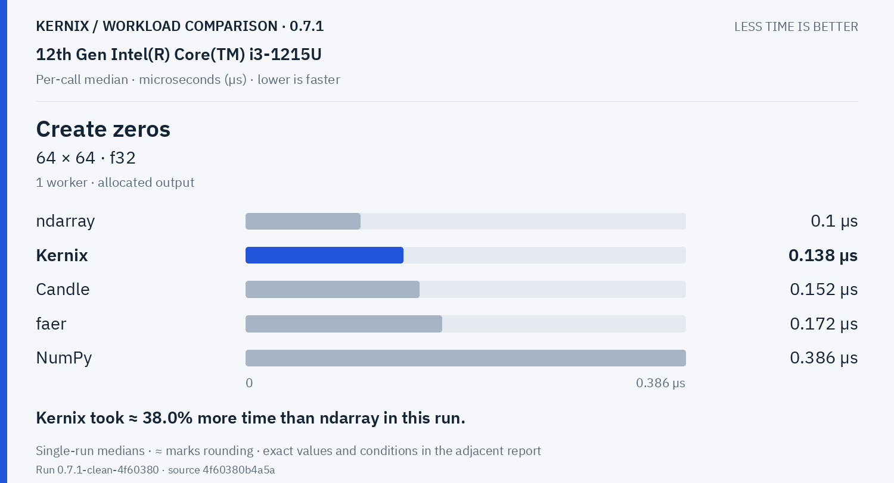

Kernix: **0.138 µs**. Kernix took ≈ 38.0% more time than ndarray in this run.

**Create ones · 64 × 64 · f32**

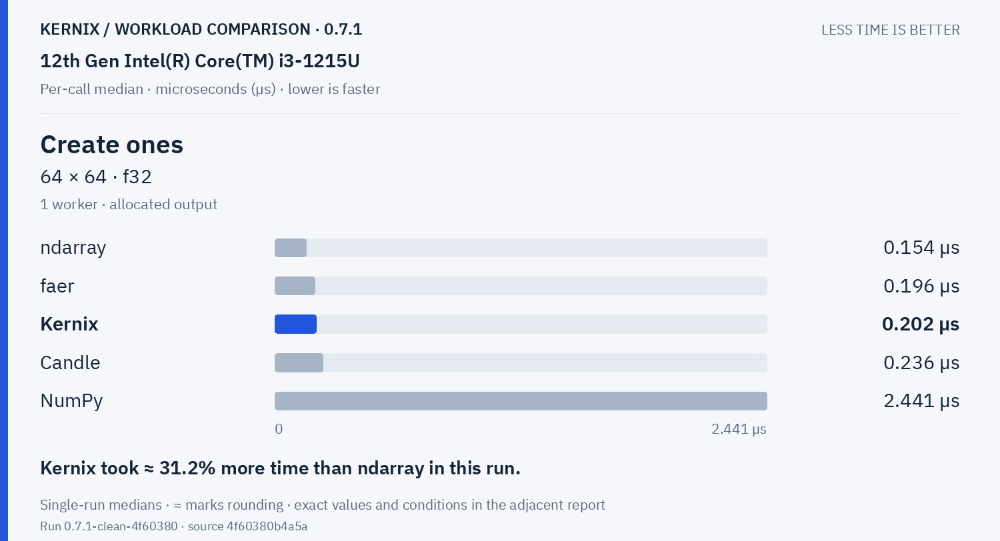

Kernix: **0.202 µs**. Kernix took ≈ 31.2% more time than ndarray in this run.

## Exact latency table

All values below are microseconds per operation. **Lower is faster.** Missing entries were not measured.

| Workload | Kernix | ndarray | nalgebra | faer | Candle | NumPy |
|---|---:|---:|---:|---:|---:|---:|
| Matrix multiplication · 32 × 32 · 32 × 32 · f64 | 1.533 | **1.497** | 2.141 | 1.783 | 1.526 | 2.829 |
| Matrix multiplication · 128 × 128 · 128 × 128 · f64 | 129.254 | 124.49100000000001 | 126.87399999999999 | 84.244 | **79.868** | 82.029 |
| Batched multiplication · 4 × 16 × 32 · 1 × 32 × 16 · f64 | **1.934** | — | — | — | 2.047 | 3.143 |
| Thin QR · 96 × 32 · f64 | 48.684 | — | **42.449** | 71.806 | — | 43.914 |
| Thin QR · 256 × 64 · f64 | 596.452 | — | 438.001 | 475.51 | — | **399.693** |
| Cholesky factorization · 64 × 64 · f64 | 23.829 | — | 14.313 | **8.145000000000001** | — | 10.187 |
| Record + backward · sum(A · W), 32 × 16 · 16 × 8 · f64 | **2.413** | — | — | — | 4.0369999999999995 | — |
| Model inference · batched normalized/sliced MLP · f64 | **2.0260000000000002** | — | — | — | 3.384 | — |
| Model recording + forward · batched normalized/sliced MLP · f64 | **2.525** | — | — | — | 4.984 | — |
| Model backward · prepared graph → fresh gradients · f64 | **3.026** | — | — | — | 13.327 | — |
| Parameter update · transactional SGD, fixed gradients · f64 | 0.536 | — | — | — | — | — |
| Row softmax · 256 × 64 · f64 | 85.952 | **72.505** | — | — | 79.667 | 103.655 |
| Create zeros · 64 × 64 · f32 | 0.138 | **0.1** | — | 0.172 | 0.152 | 0.386 |
| Create ones · 64 × 64 · f32 | 0.202 | **0.154** | — | 0.196 | 0.236 | 2.441 |

## Version comparison

0 of 14 workloads have paired evidence. Exploratory 95% intervals resample process pairs, not calls. No multiple-comparison adjustment.

| Workload | Current / baseline [95% interval] | Interpretation |
|---|---:|---|
| Matrix multiplication · 32 × 32 · 32 × 32 · f64 | — | No paired comparison |
| Matrix multiplication · 128 × 128 · 128 × 128 · f64 | — | No paired comparison |
| Batched multiplication · 4 × 16 × 32 · 1 × 32 × 16 · f64 | — | No paired comparison |
| Thin QR · 96 × 32 · f64 | — | No paired comparison |
| Thin QR · 256 × 64 · f64 | — | No paired comparison |
| Cholesky factorization · 64 × 64 · f64 | — | No paired comparison |
| Record + backward · sum(A · W), 32 × 16 · 16 × 8 · f64 | — | No paired comparison |
| Model inference · batched normalized/sliced MLP · f64 | — | No paired comparison |
| Model recording + forward · batched normalized/sliced MLP · f64 | — | No paired comparison |
| Model backward · prepared graph → fresh gradients · f64 | — | No paired comparison |
| Parameter update · transactional SGD, fixed gradients · f64 | — | No paired comparison |
| Row softmax · 256 × 64 · f64 | — | No paired comparison |
| Create zeros · 64 × 64 · f32 | — | No paired comparison |
| Create ones · 64 × 64 · f32 | — | No paired comparison |

## Method and provenance

CPU affinity pinned to logical CPU 0. Frequency and background load are uncontrolled.

Numbers retain source precision; recorded digits do not imply equivalent physical measurement accuracy. Lowest observed medians are bold only when peers were measured. No aggregate winner or universal ranking is inferred.

[Original report and commentary](original-report.txt) · [Raw measurements](raw.json)

Measured source `4f60380b4a5ac07931347b4f9eba0ac696983f9a`. Run `0.7.1-clean-4f60380`. Rendering does not change measurements.
