# Kernix 0.7.1 · performance brief

12th Gen Intel(R) Core(TM) i3-1215U / Linux

**Per-call median, microseconds per operation. Lower is faster. All recorded digits retained.**

16 workloads · 62 observations

No previous-version baseline attached. Sequential run changes are descriptive; paired process evidence is shown separately.

[Open the visual report](report.html) · [Vector PDF](latency.pdf) · [Raw measurements](raw.json)

[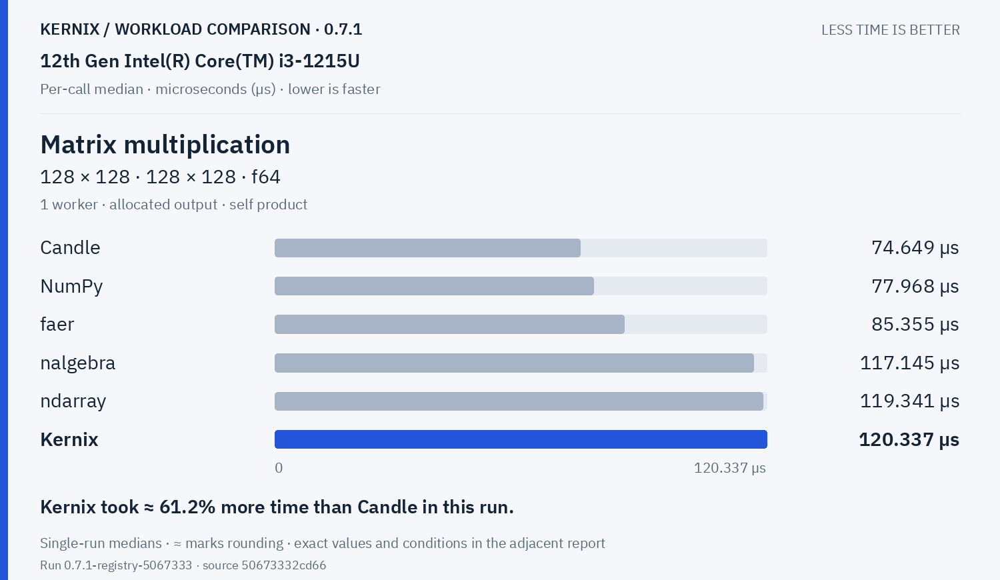](latency.pdf)

## Charts by workload

**Shorter bars mean less time.** Blue is Kernix; grey is another library; teal is an explicitly selected Kernix backend. Entries are sorted by the recorded median, with a separate zero-based scale per chart. These point observations do not establish a statistical ranking.

Expand a group to see every chart here on GitHub. Click a chart to enlarge it. The exact table below keeps every source digit.

Matrix multiplication · 5 workloads

**Matrix multiplication · 32 × 32 · 32 × 32 · f64**

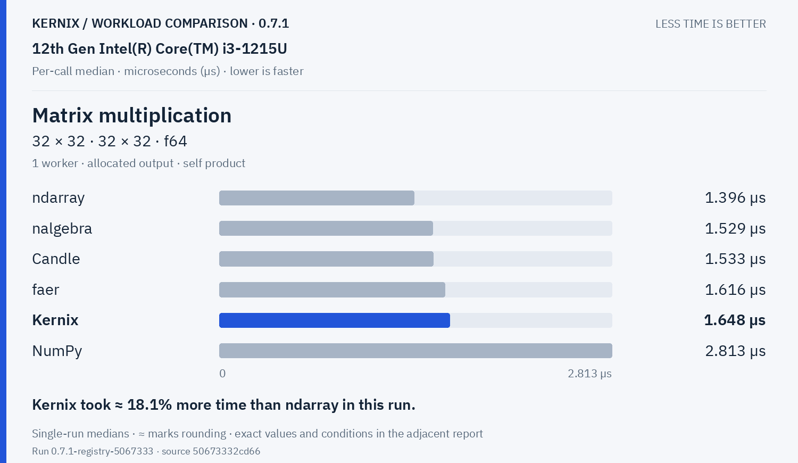

**Matrix multiplication · 64 × 64 · 64 × 64 · f64**

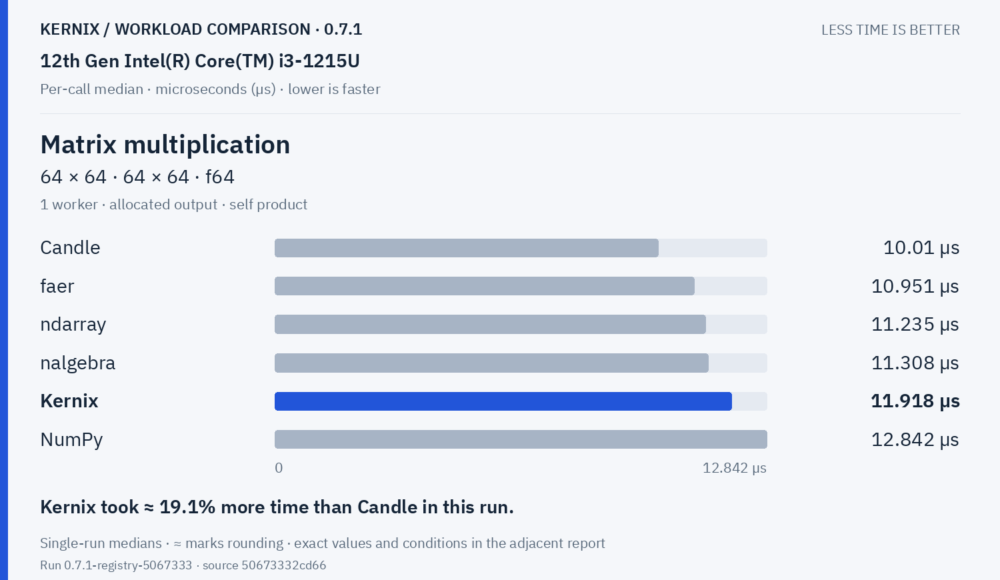

**Matrix multiplication · 128 × 128 · 128 × 128 · f64**

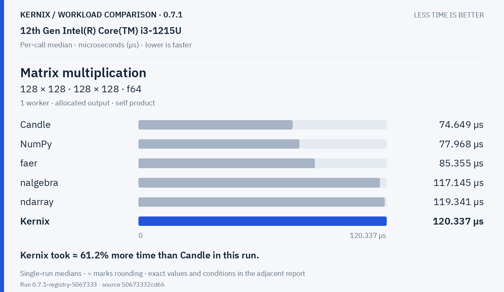

**Matrix multiplication · 256 × 256 · 256 × 256 · f64**

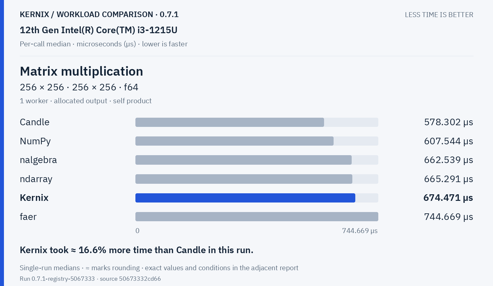

**Batched multiplication · 4 × 16 × 32 · 1 × 32 × 16 · f64**

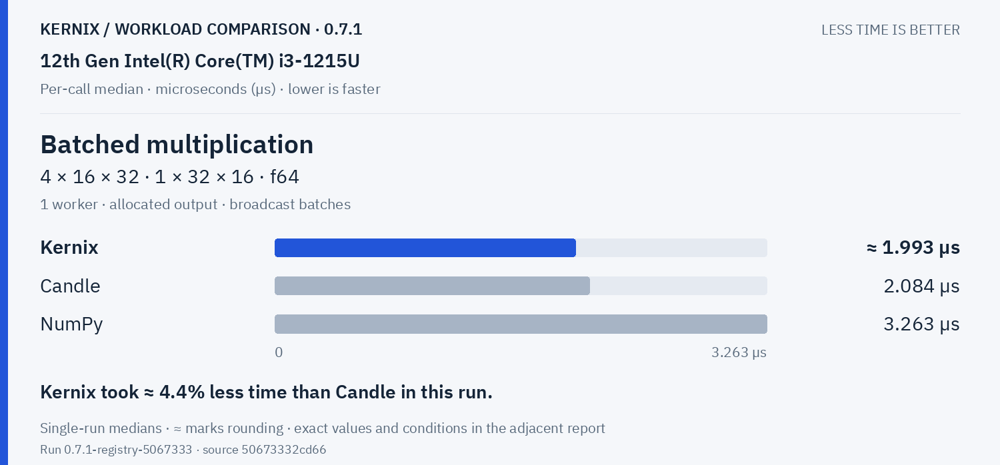

Decompositions & solvers · 3 workloads

**Thin QR · 96 × 32 · f64**

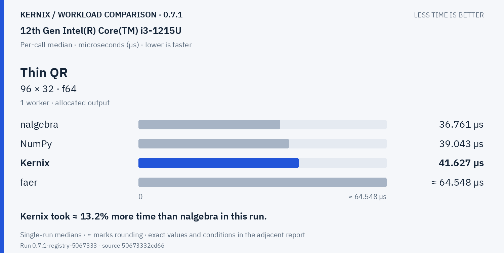

**Thin QR · 256 × 64 · f64**

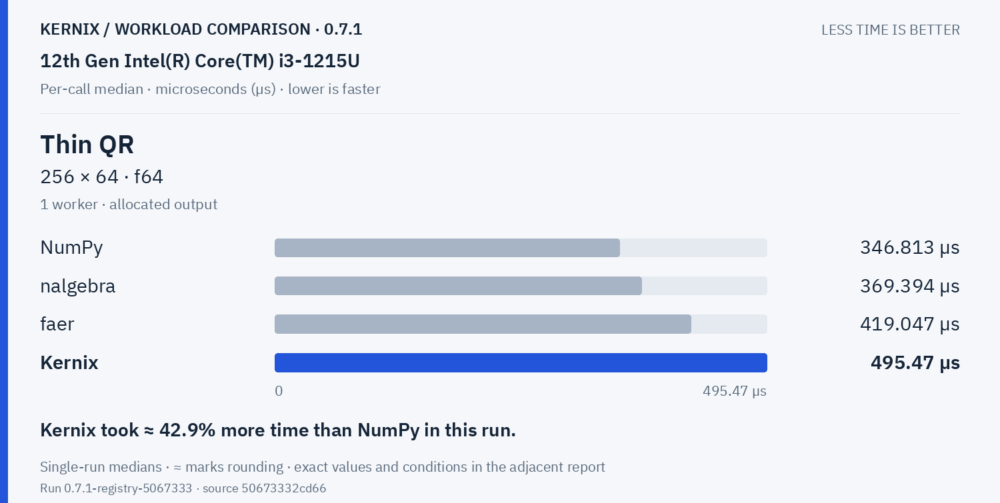

**Cholesky factorization · 64 × 64 · f64**

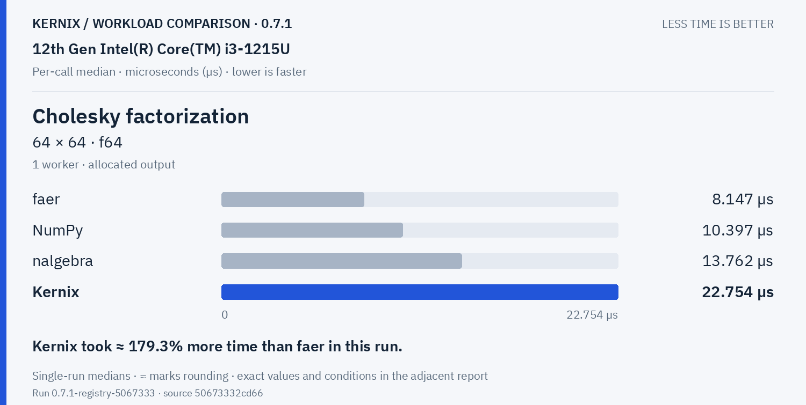

Training & autodiff · 5 workloads

**Record + backward · sum(A · W), 32 × 16 · 16 × 8 · f64**

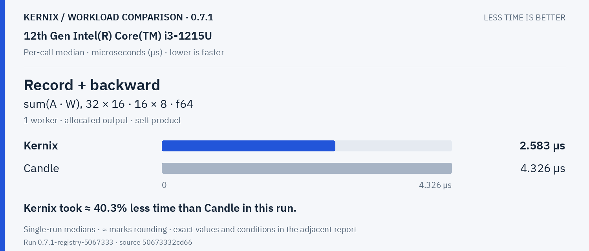

**Model inference · batched normalized/sliced MLP · f64**

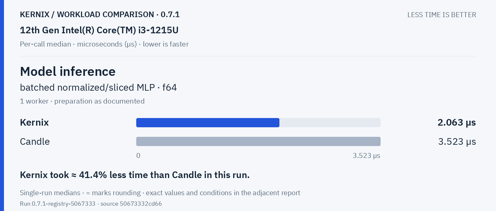

**Model recording + forward · batched normalized/sliced MLP · f64**

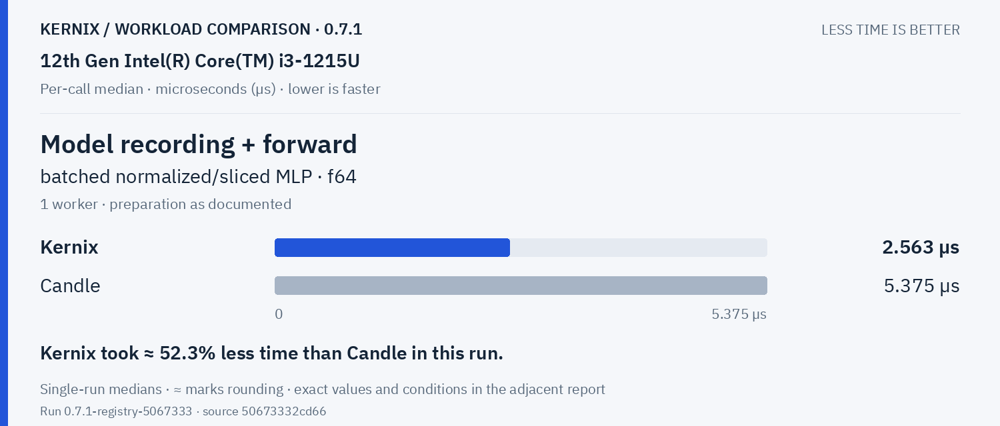

**Model backward · prepared graph → fresh gradients · f64**

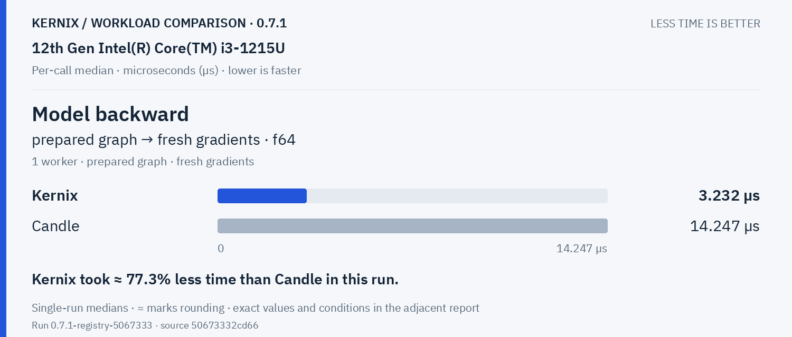

**Parameter update · transactional SGD, fixed gradients · f64**

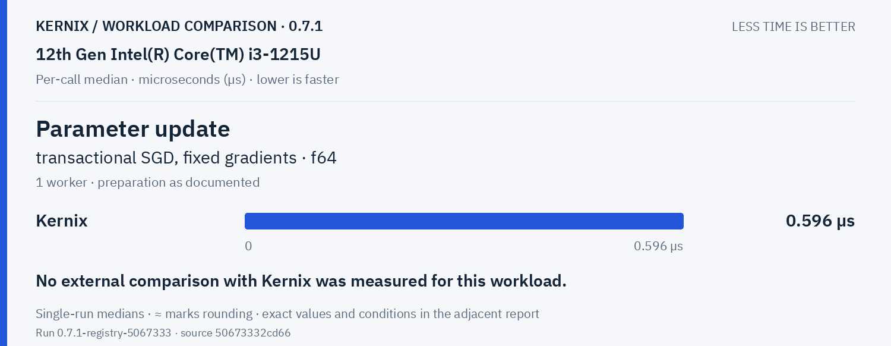

Statistics & activations · 1 workloads

**Row softmax · 256 × 64 · f64**

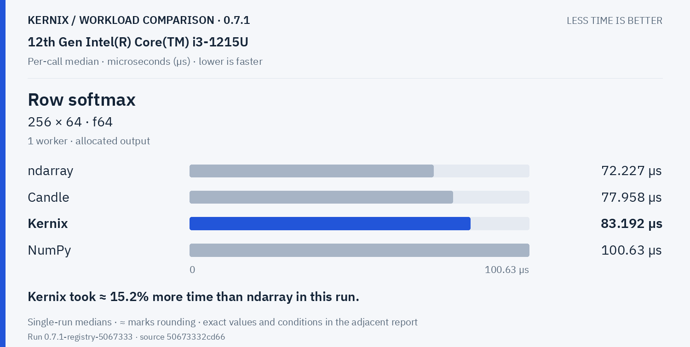

Tensor construction · 2 workloads

**Create zeros · 64 × 64 · f32**

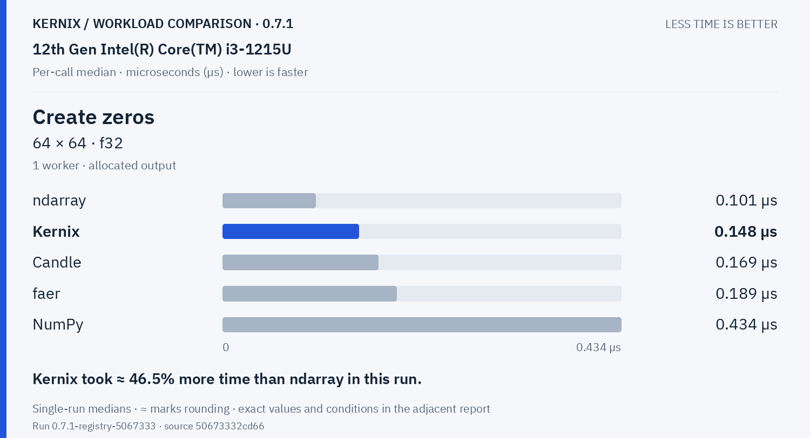

**Create ones · 64 × 64 · f32**

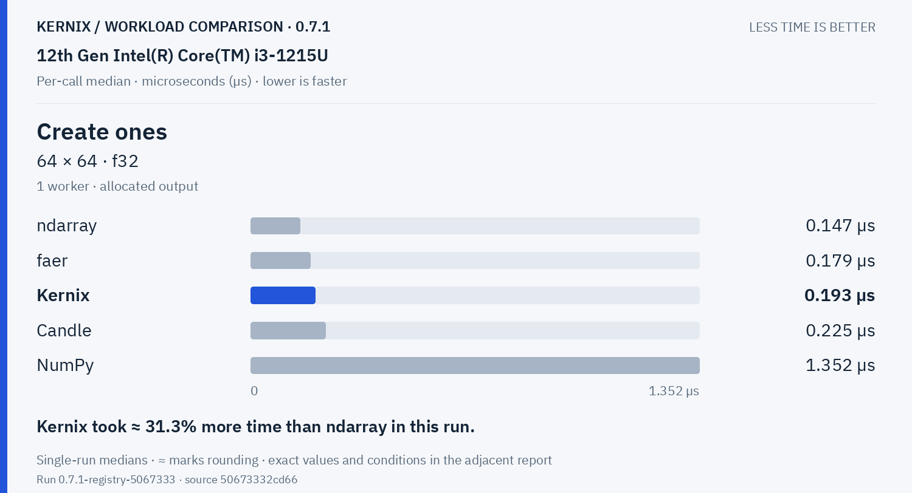

## Exact latency table

All values below are microseconds per operation. **Lower is faster.** Missing entries were not measured.

| Workload | Kernix | ndarray | nalgebra | faer | Candle | NumPy |
|---|---:|---:|---:|---:|---:|---:|
| Matrix multiplication · 32 × 32 · 32 × 32 · f64 | 1.648 | **1.396** | 1.529 | 1.616 | 1.533 | 2.813 |
| Matrix multiplication · 64 × 64 · 64 × 64 · f64 | 11.918 | 11.235 | 11.308 | 10.951 | **10.01** | 12.842 |
| Matrix multiplication · 128 × 128 · 128 × 128 · f64 | 120.337 | 119.341 | 117.145 | 85.355 | **74.649** | 77.968 |
| Matrix multiplication · 256 × 256 · 256 × 256 · f64 | 674.471 | 665.291 | 662.539 | 744.669 | **578.302** | 607.544 |
| Batched multiplication · 4 × 16 × 32 · 1 × 32 × 16 · f64 | **1.9929999999999998** | — | — | — | 2.084 | 3.263 |
| Thin QR · 96 × 32 · f64 | 41.627 | — | **36.761** | 64.54800000000001 | — | 39.043 |
| Thin QR · 256 × 64 · f64 | 495.47 | — | 369.394 | 419.047 | — | **346.813** |
| Cholesky factorization · 64 × 64 · f64 | 22.754 | — | 13.762 | **8.147** | — | 10.397 |
| Record + backward · sum(A · W), 32 × 16 · 16 × 8 · f64 | **2.583** | — | — | — | 4.326 | — |
| Model inference · batched normalized/sliced MLP · f64 | **2.063** | — | — | — | 3.523 | — |
| Model recording + forward · batched normalized/sliced MLP · f64 | **2.563** | — | — | — | 5.375 | — |
| Model backward · prepared graph → fresh gradients · f64 | **3.232** | — | — | — | 14.247 | — |
| Parameter update · transactional SGD, fixed gradients · f64 | 0.596 | — | — | — | — | — |
| Row softmax · 256 × 64 · f64 | 83.192 | **72.227** | — | — | 77.958 | 100.63 |
| Create zeros · 64 × 64 · f32 | 0.148 | **0.101** | — | 0.189 | 0.169 | 0.434 |
| Create ones · 64 × 64 · f32 | 0.193 | **0.147** | — | 0.179 | 0.225 | 1.352 |

## Version comparison

0 of 16 workloads have paired evidence. Exploratory 95% intervals resample process pairs, not calls. No multiple-comparison adjustment.

| Workload | Current / baseline [95% interval] | Interpretation |
|---|---:|---|
| Matrix multiplication · 32 × 32 · 32 × 32 · f64 | — | No paired comparison |
| Matrix multiplication · 64 × 64 · 64 × 64 · f64 | — | No paired comparison |
| Matrix multiplication · 128 × 128 · 128 × 128 · f64 | — | No paired comparison |
| Matrix multiplication · 256 × 256 · 256 × 256 · f64 | — | No paired comparison |
| Batched multiplication · 4 × 16 × 32 · 1 × 32 × 16 · f64 | — | No paired comparison |
| Thin QR · 96 × 32 · f64 | — | No paired comparison |
| Thin QR · 256 × 64 · f64 | — | No paired comparison |
| Cholesky factorization · 64 × 64 · f64 | — | No paired comparison |
| Record + backward · sum(A · W), 32 × 16 · 16 × 8 · f64 | — | No paired comparison |
| Model inference · batched normalized/sliced MLP · f64 | — | No paired comparison |
| Model recording + forward · batched normalized/sliced MLP · f64 | — | No paired comparison |
| Model backward · prepared graph → fresh gradients · f64 | — | No paired comparison |
| Parameter update · transactional SGD, fixed gradients · f64 | — | No paired comparison |
| Row softmax · 256 × 64 · f64 | — | No paired comparison |
| Create zeros · 64 × 64 · f32 | — | No paired comparison |
| Create ones · 64 × 64 · f32 | — | No paired comparison |

## Method and provenance

CPU affinity pinned to logical CPU 0. Frequency and background load are uncontrolled.

Numbers retain source precision; recorded digits do not imply equivalent physical measurement accuracy. Lowest observed medians are bold only when peers were measured. No aggregate winner or universal ranking is inferred.

[Original report and commentary](original-report.txt) · [Raw measurements](raw.json)

Measured source `50673332cd664b98fad90a24febce1fd8d6395b0`. Run `0.7.1-registry-5067333`. Rendering does not change measurements.
