# Kernix 0.7.2 · performance brief

12th Gen Intel(R) Core(TM) i3-1215U / Linux

**Per-call median, microseconds per operation. Lower is faster. All recorded digits retained.**

19 workloads · 80 observations

No previous-version baseline attached. Sequential run changes are descriptive; paired process evidence is shown separately.

[Interactive HTML (open locally)](report.html) · [Vector PDF](latency.pdf) · [Raw measurements](raw.json)

## Charts by workload

**Shorter bars mean less time.** Blue is Kernix; grey is another library; teal is an explicitly selected Kernix backend. Entries are sorted by the recorded median, with a separate zero-based scale per chart. These point observations do not establish a statistical ranking.

Expand a group to see every chart here on GitHub. Click a chart to enlarge it. The exact table below keeps every source digit.

Matrix multiplication · 8 workloads

**Matrix multiplication · 32 × 32 · 32 × 32 · f64**

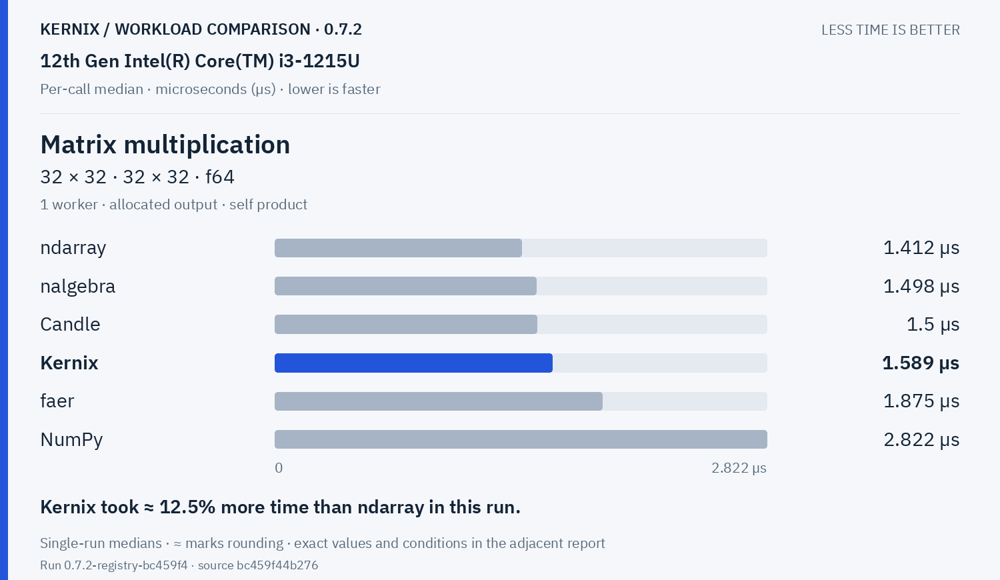

Kernix: **1.589 µs**. Kernix took ≈ 12.5% more time than ndarray in this run.

**Matrix multiplication · 64 × 64 · 64 × 64 · f64**

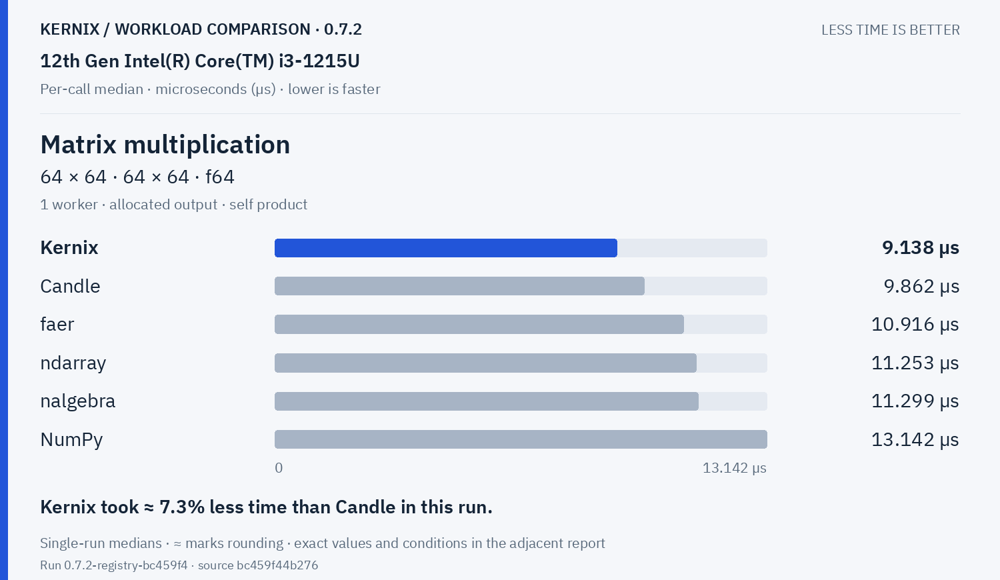

Kernix: **9.138 µs**. Kernix took ≈ 7.3% less time than Candle in this run.

**Matrix multiplication · 128 × 128 · 128 × 128 · f64**

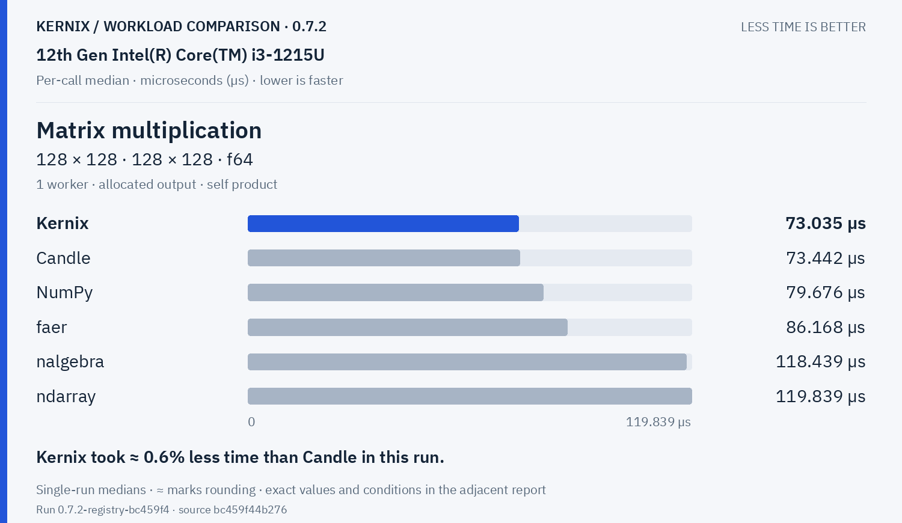

Kernix: **73.035 µs**. Kernix took ≈ 0.6% less time than Candle in this run.

**Matrix multiplication · 256 × 256 · 256 × 256 · f64**

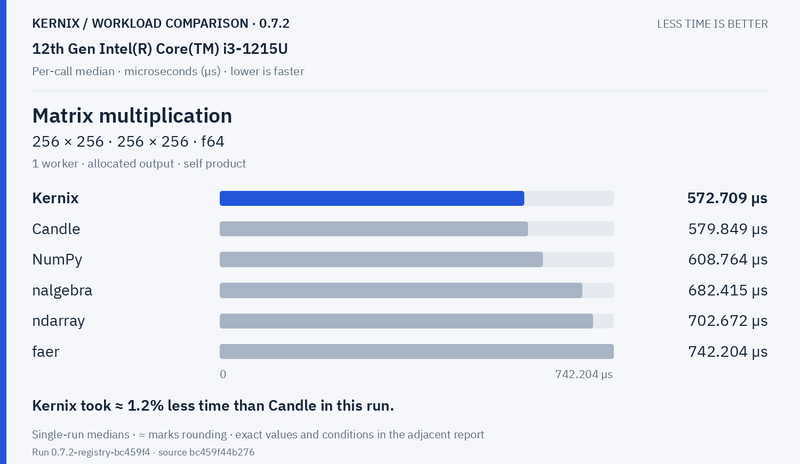

Kernix: **572.709 µs**. Kernix took ≈ 1.2% less time than Candle in this run.

**Matrix multiplication · 64 × 64 · 64 × 64 · f32**

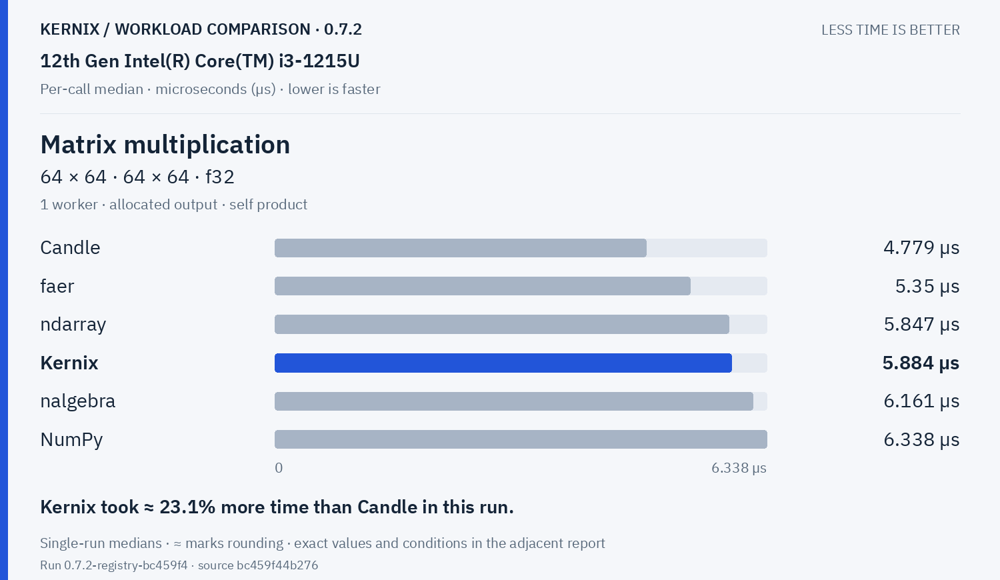

Kernix: **5.884 µs**. Kernix took ≈ 23.1% more time than Candle in this run.

**Matrix multiplication · 128 × 128 · 128 × 128 · f32**

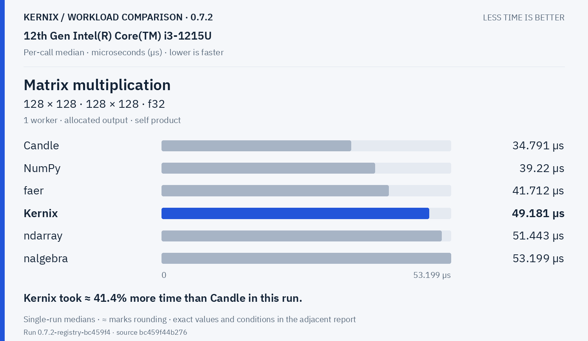

Kernix: **49.181 µs**. Kernix took ≈ 41.4% more time than Candle in this run.

**Matrix multiplication · 256 × 256 · 256 × 256 · f32**

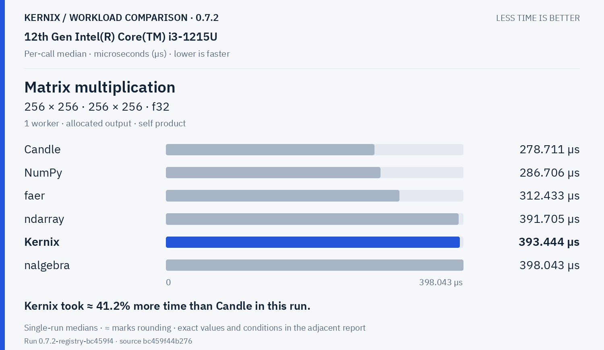

Kernix: **393.444 µs**. Kernix took ≈ 41.2% more time than Candle in this run.

**Batched multiplication · 4 × 16 × 32 · 1 × 32 × 16 · f64**

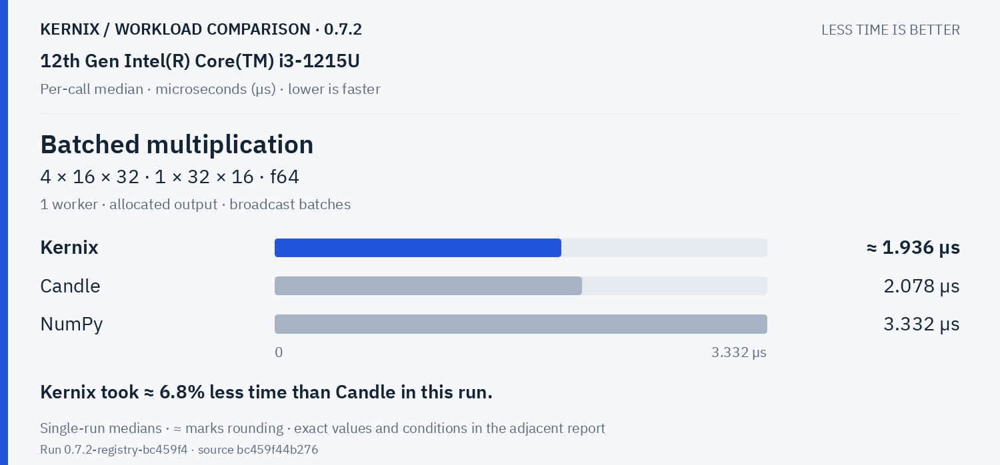

Kernix: **1.9360000000000002 µs**. Kernix took ≈ 6.8% less time than Candle in this run.

Decompositions & solvers · 3 workloads

**Thin QR · 96 × 32 · f64**

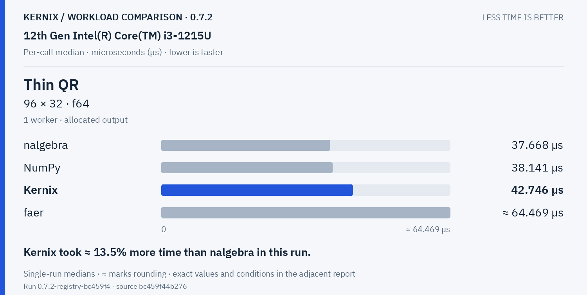

Kernix: **42.746 µs**. Kernix took ≈ 13.5% more time than nalgebra in this run.

**Thin QR · 256 × 64 · f64**

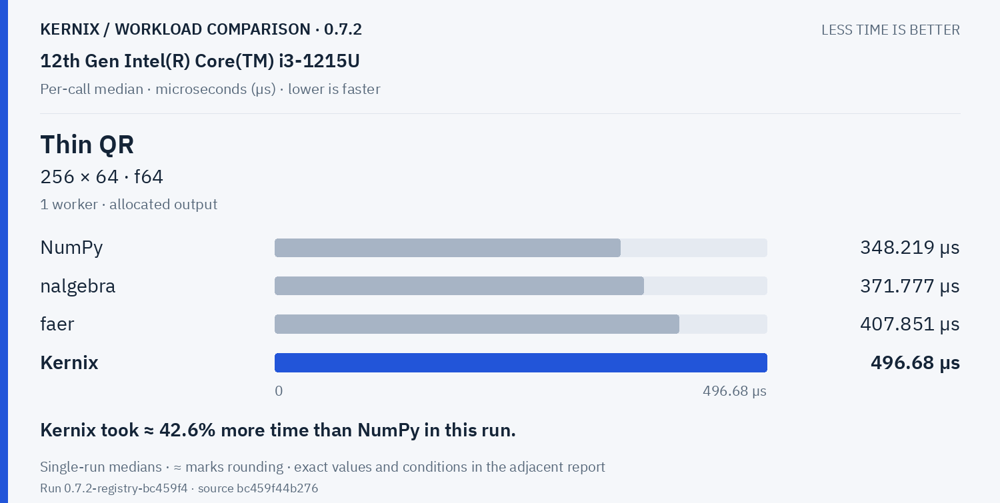

Kernix: **496.68 µs**. Kernix took ≈ 42.6% more time than NumPy in this run.

**Cholesky factorization · 64 × 64 · f64**

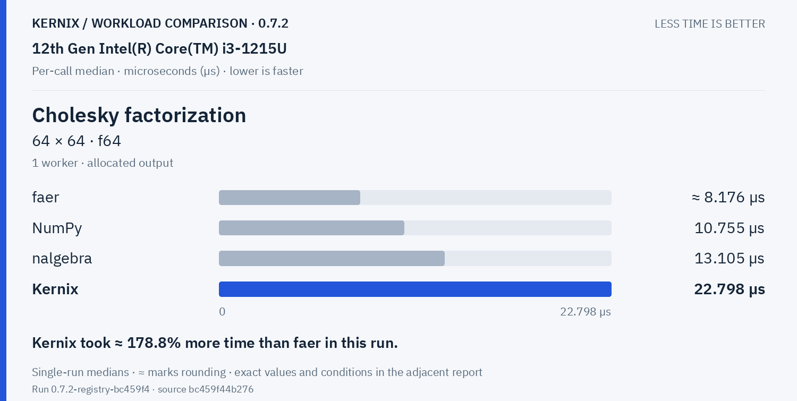

Kernix: **22.798 µs**. Kernix took ≈ 178.8% more time than faer in this run.

Training & autodiff · 5 workloads

**Record + backward · sum(A · W), 32 × 16 · 16 × 8 · f64**

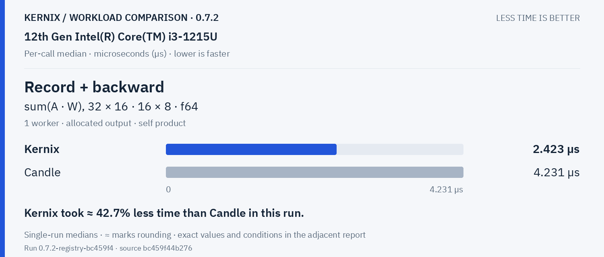

Kernix: **2.423 µs**. Kernix took ≈ 42.7% less time than Candle in this run.

**Model inference · batched normalized/sliced MLP · f64**

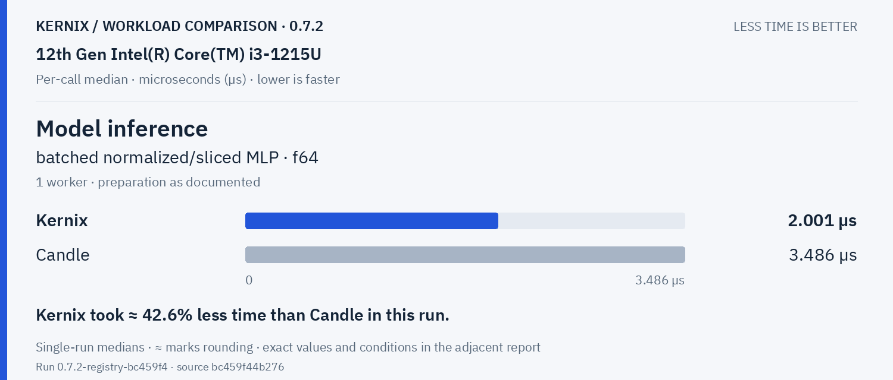

Kernix: **2.001 µs**. Kernix took ≈ 42.6% less time than Candle in this run.

**Model recording + forward · batched normalized/sliced MLP · f64**

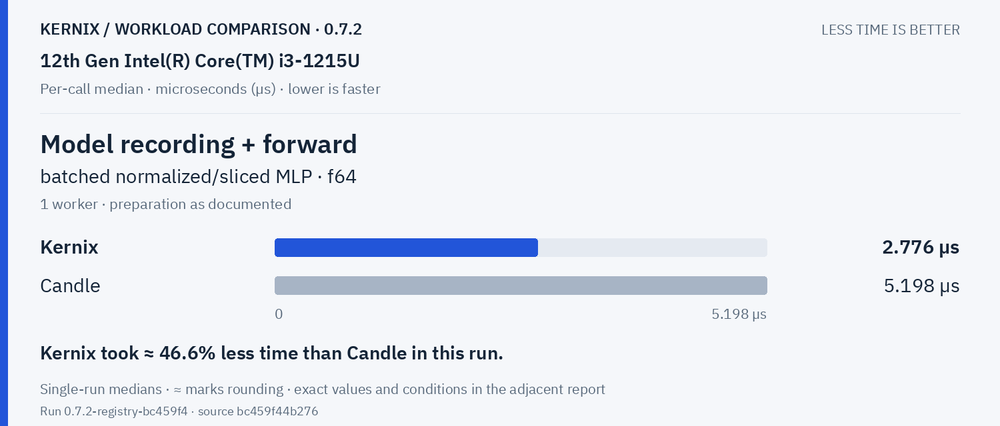

Kernix: **2.776 µs**. Kernix took ≈ 46.6% less time than Candle in this run.

**Model backward · prepared graph → fresh gradients · f64**

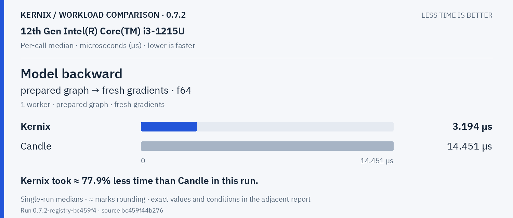

Kernix: **3.194 µs**. Kernix took ≈ 77.9% less time than Candle in this run.

**Parameter update · transactional SGD, fixed gradients · f64**

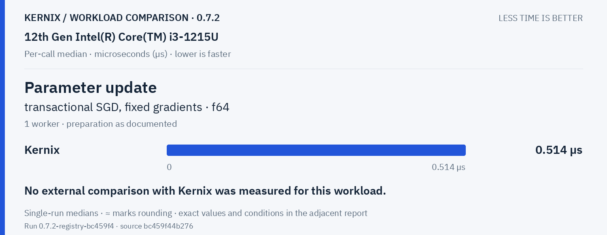

Kernix: **0.514 µs**. No external comparison with Kernix was measured for this workload.

Statistics & activations · 1 workloads

**Row softmax · 256 × 64 · f64**

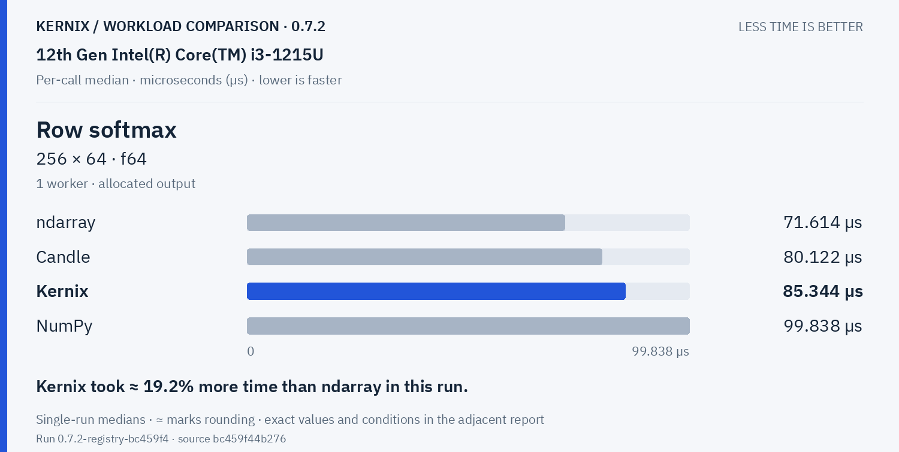

Kernix: **85.344 µs**. Kernix took ≈ 19.2% more time than ndarray in this run.

Tensor construction · 2 workloads

**Create zeros · 64 × 64 · f32**

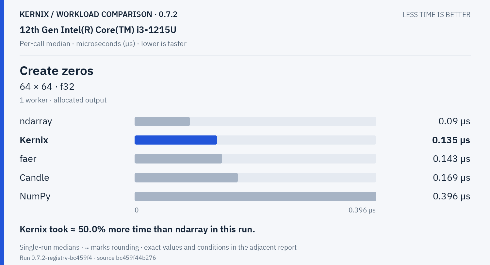

Kernix: **0.135 µs**. Kernix took ≈ 50.0% more time than ndarray in this run.

**Create ones · 64 × 64 · f32**

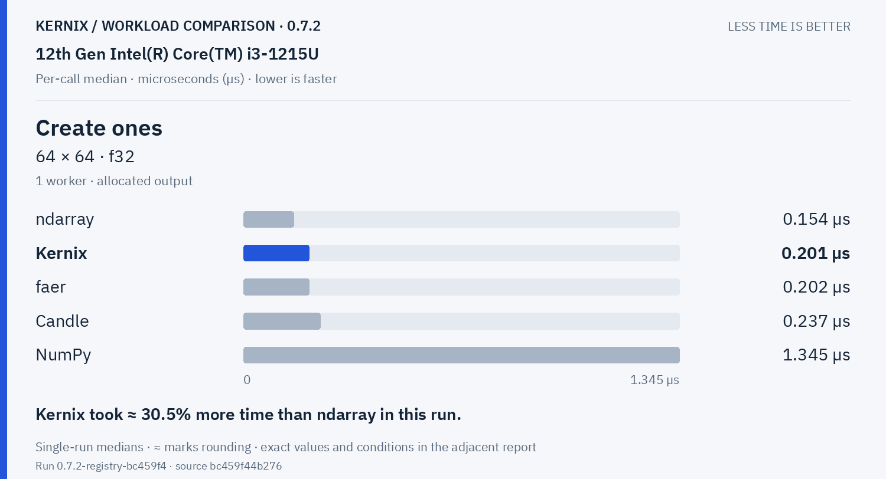

Kernix: **0.201 µs**. Kernix took ≈ 30.5% more time than ndarray in this run.

## Exact latency table

All values below are microseconds per operation. **Lower is faster.** Missing entries were not measured.

| Workload | Kernix | ndarray | nalgebra | faer | Candle | NumPy |
|---|---:|---:|---:|---:|---:|---:|
| Matrix multiplication · 32 × 32 · 32 × 32 · f64 | 1.589 | **1.412** | 1.498 | 1.875 | 1.5 | 2.822 |
| Matrix multiplication · 64 × 64 · 64 × 64 · f64 | **9.138** | 11.253 | 11.299 | 10.916 | 9.862 | 13.142 |
| Matrix multiplication · 128 × 128 · 128 × 128 · f64 | **73.035** | 119.839 | 118.439 | 86.168 | 73.442 | 79.676 |
| Matrix multiplication · 256 × 256 · 256 × 256 · f64 | **572.709** | 702.672 | 682.415 | 742.204 | 579.849 | 608.764 |
| Matrix multiplication · 64 × 64 · 64 × 64 · f32 | 5.884 | 5.847 | 6.161 | 5.35 | **4.779** | 6.338 |
| Matrix multiplication · 128 × 128 · 128 × 128 · f32 | 49.181 | 51.443 | 53.199 | 41.712 | **34.791** | 39.22 |
| Matrix multiplication · 256 × 256 · 256 × 256 · f32 | 393.444 | 391.705 | 398.043 | 312.433 | **278.711** | 286.706 |
| Batched multiplication · 4 × 16 × 32 · 1 × 32 × 16 · f64 | **1.9360000000000002** | — | — | — | 2.078 | 3.332 |
| Thin QR · 96 × 32 · f64 | 42.746 | — | **37.668** | 64.46899999999999 | — | 38.141 |
| Thin QR · 256 × 64 · f64 | 496.68 | — | 371.777 | 407.851 | — | **348.219** |
| Cholesky factorization · 64 × 64 · f64 | 22.798 | — | 13.105 | **8.175999999999999** | — | 10.755 |
| Record + backward · sum(A · W), 32 × 16 · 16 × 8 · f64 | **2.423** | — | — | — | 4.231 | — |
| Model inference · batched normalized/sliced MLP · f64 | **2.001** | — | — | — | 3.486 | — |
| Model recording + forward · batched normalized/sliced MLP · f64 | **2.776** | — | — | — | 5.198 | — |
| Model backward · prepared graph → fresh gradients · f64 | **3.194** | — | — | — | 14.451 | — |
| Parameter update · transactional SGD, fixed gradients · f64 | 0.514 | — | — | — | — | — |
| Row softmax · 256 × 64 · f64 | 85.344 | **71.614** | — | — | 80.122 | 99.838 |
| Create zeros · 64 × 64 · f32 | 0.135 | **0.09** | — | 0.143 | 0.169 | 0.396 |
| Create ones · 64 × 64 · f32 | 0.201 | **0.154** | — | 0.202 | 0.237 | 1.345 |

## Version comparison

0 of 19 workloads have paired evidence. Exploratory 95% intervals resample process pairs, not calls. No multiple-comparison adjustment.

| Workload | Current / baseline [95% interval] | Interpretation |
|---|---:|---|
| Matrix multiplication · 32 × 32 · 32 × 32 · f64 | — | No paired comparison |
| Matrix multiplication · 64 × 64 · 64 × 64 · f64 | — | No paired comparison |
| Matrix multiplication · 128 × 128 · 128 × 128 · f64 | — | No paired comparison |
| Matrix multiplication · 256 × 256 · 256 × 256 · f64 | — | No paired comparison |
| Matrix multiplication · 64 × 64 · 64 × 64 · f32 | — | No paired comparison |
| Matrix multiplication · 128 × 128 · 128 × 128 · f32 | — | No paired comparison |
| Matrix multiplication · 256 × 256 · 256 × 256 · f32 | — | No paired comparison |
| Batched multiplication · 4 × 16 × 32 · 1 × 32 × 16 · f64 | — | No paired comparison |
| Thin QR · 96 × 32 · f64 | — | No paired comparison |
| Thin QR · 256 × 64 · f64 | — | No paired comparison |
| Cholesky factorization · 64 × 64 · f64 | — | No paired comparison |
| Record + backward · sum(A · W), 32 × 16 · 16 × 8 · f64 | — | No paired comparison |
| Model inference · batched normalized/sliced MLP · f64 | — | No paired comparison |
| Model recording + forward · batched normalized/sliced MLP · f64 | — | No paired comparison |
| Model backward · prepared graph → fresh gradients · f64 | — | No paired comparison |
| Parameter update · transactional SGD, fixed gradients · f64 | — | No paired comparison |
| Row softmax · 256 × 64 · f64 | — | No paired comparison |
| Create zeros · 64 × 64 · f32 | — | No paired comparison |
| Create ones · 64 × 64 · f32 | — | No paired comparison |

## Method and provenance

CPU affinity pinned to logical CPU 0. Frequency and background load are uncontrolled.

Numbers retain source precision; recorded digits do not imply equivalent physical measurement accuracy. Lowest observed medians are bold only when peers were measured. No aggregate winner or universal ranking is inferred.

[Original report and commentary](original-report.txt) · [Raw measurements](raw.json)

Measured source `bc459f44b276e86275cc4e431e4946443aefb15f`. Run `0.7.2-registry-bc459f4`. Rendering does not change measurements.
