# Kernix 0.7.3 · performance brief

12th Gen Intel(R) Core(TM) i3-1215U / Linux

**Per-call median, microseconds per operation. Lower is faster. All recorded digits retained.**

19 workloads · 80 observations

No previous-version baseline attached. Sequential run changes are descriptive; paired process evidence is shown separately.

[Open the visual report](report.html) · [Vector PDF](latency.pdf) · [Raw measurements](raw.json)

[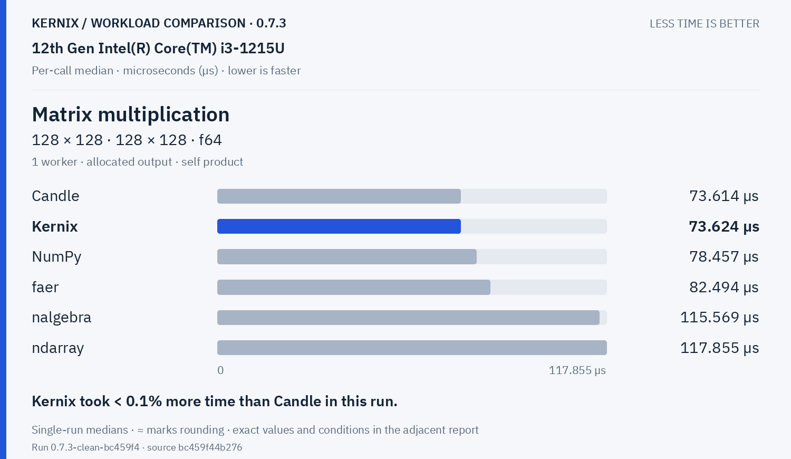](latency.pdf)

## Charts by workload

**Shorter bars mean less time.** Blue is Kernix; grey is another library; teal is an explicitly selected Kernix backend. Entries are sorted by the recorded median, with a separate zero-based scale per chart. These point observations do not establish a statistical ranking.

Expand a group to see every chart here on GitHub. Click a chart to enlarge it. The exact table below keeps every source digit.

Matrix multiplication · 8 workloads

**Matrix multiplication · 32 × 32 · 32 × 32 · f64**

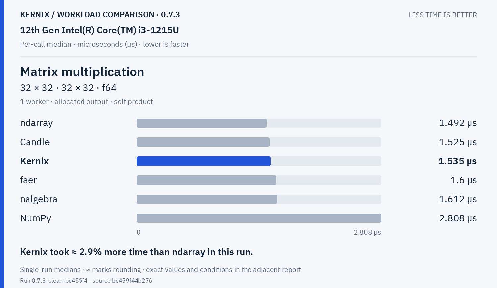

**Matrix multiplication · 64 × 64 · 64 × 64 · f64**

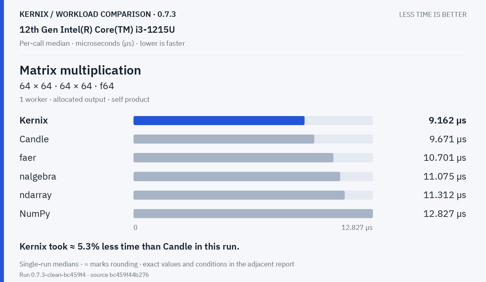

**Matrix multiplication · 128 × 128 · 128 × 128 · f64**

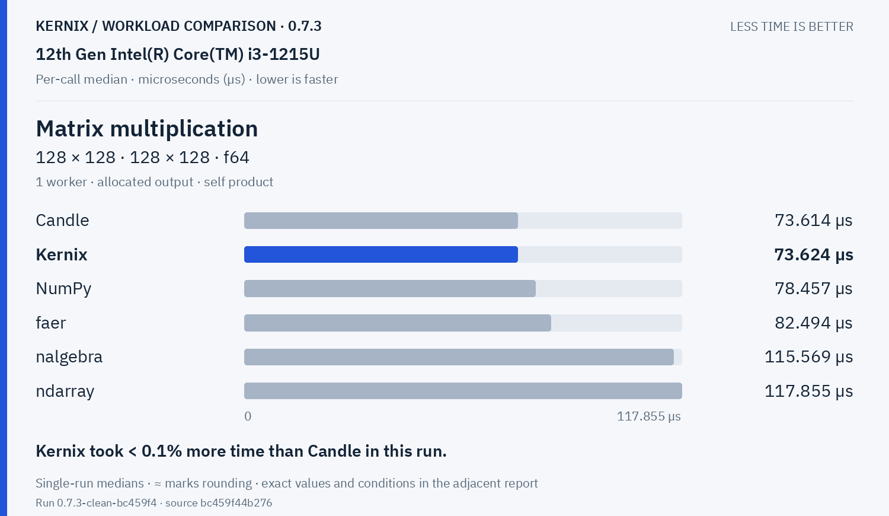

**Matrix multiplication · 256 × 256 · 256 × 256 · f64**

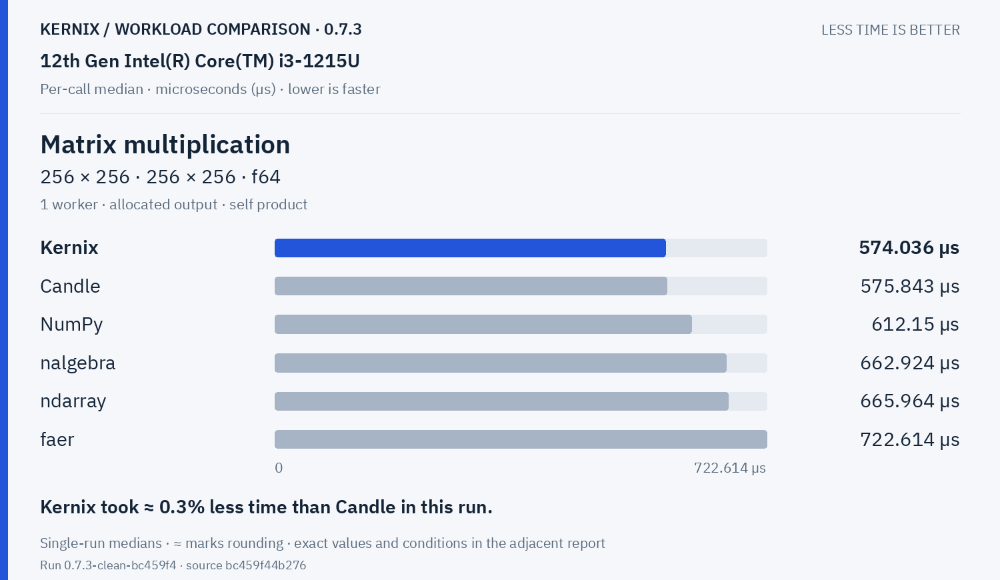

**Matrix multiplication · 64 × 64 · 64 × 64 · f32**

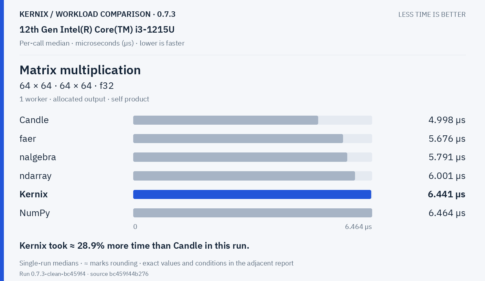

**Matrix multiplication · 128 × 128 · 128 × 128 · f32**

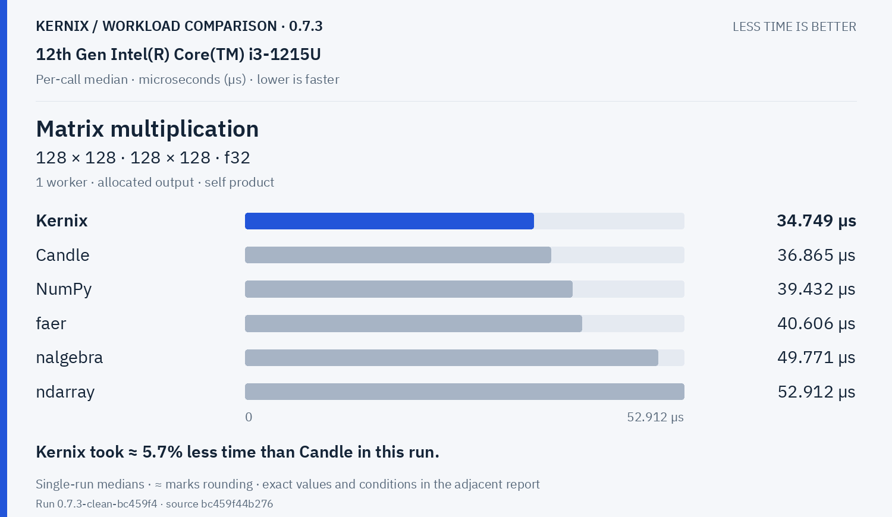

**Matrix multiplication · 256 × 256 · 256 × 256 · f32**

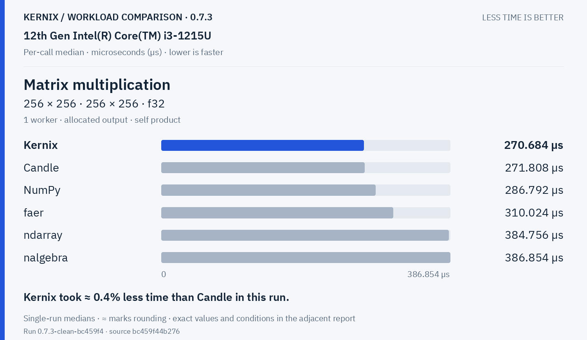

**Batched multiplication · 4 × 16 × 32 · 1 × 32 × 16 · f64**

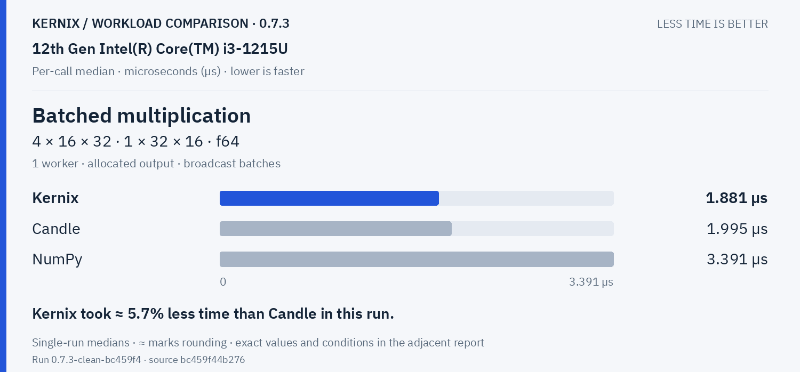

Decompositions & solvers · 3 workloads

**Thin QR · 96 × 32 · f64**

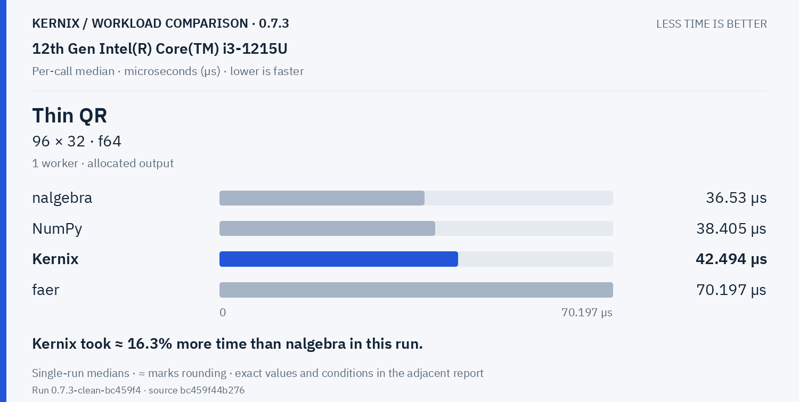

**Thin QR · 256 × 64 · f64**

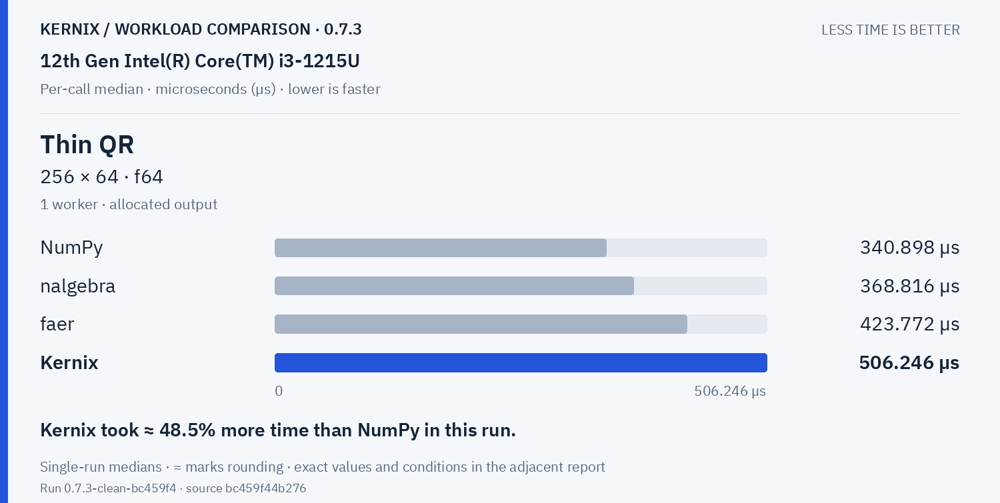

**Cholesky factorization · 64 × 64 · f64**

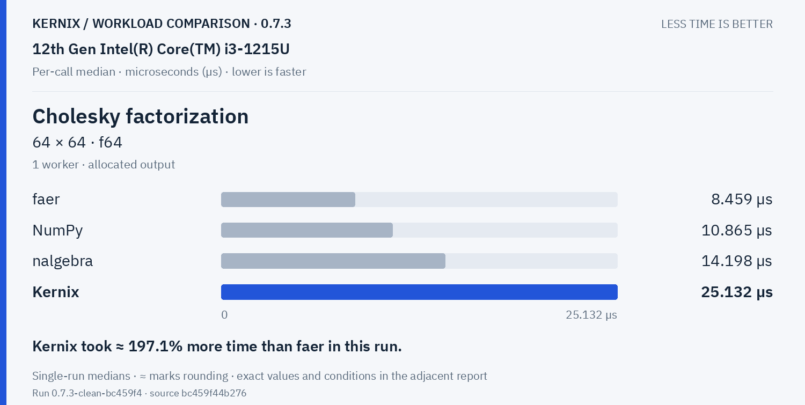

Training & autodiff · 5 workloads

**Record + backward · sum(A · W), 32 × 16 · 16 × 8 · f64**

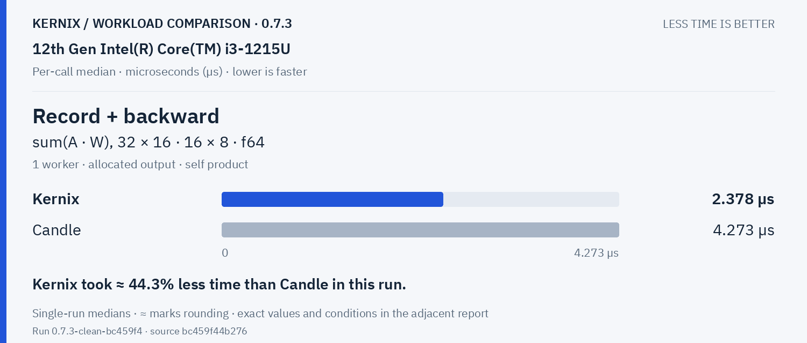

**Model inference · batched normalized/sliced MLP · f64**

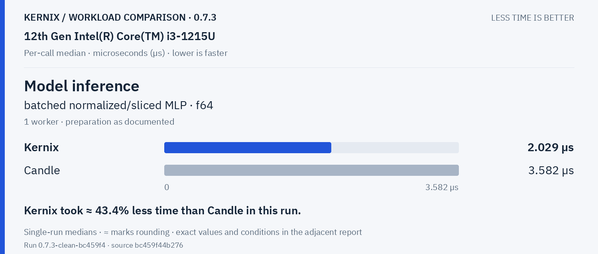

**Model recording + forward · batched normalized/sliced MLP · f64**

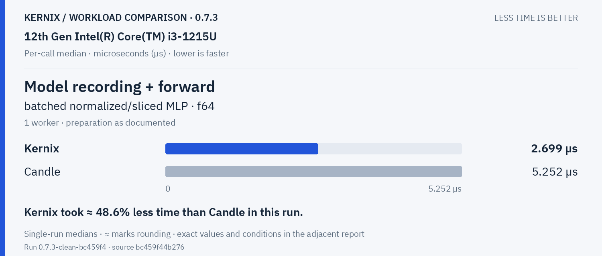

**Model backward · prepared graph → fresh gradients · f64**

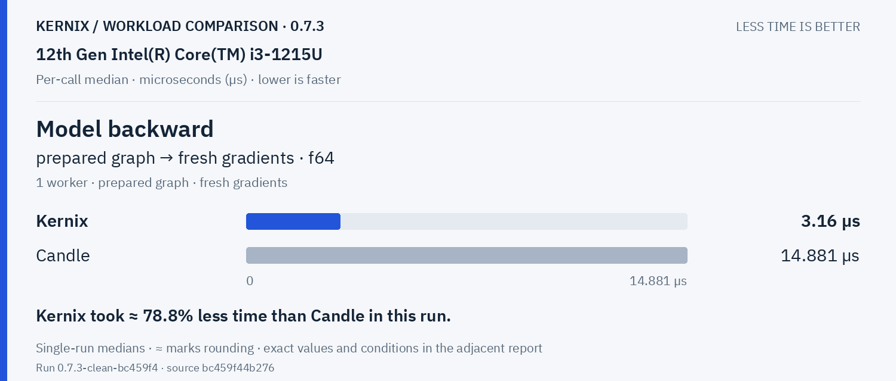

**Parameter update · transactional SGD, fixed gradients · f64**

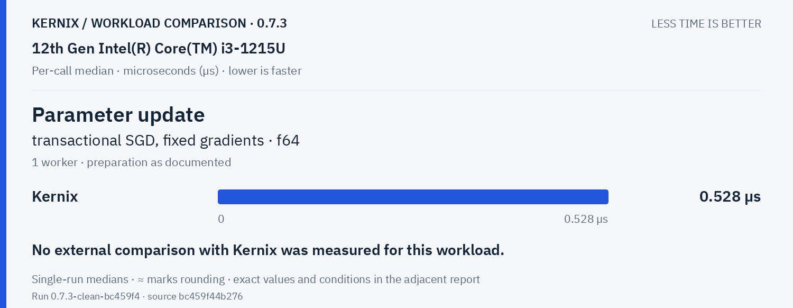

Statistics & activations · 1 workloads

**Row softmax · 256 × 64 · f64**

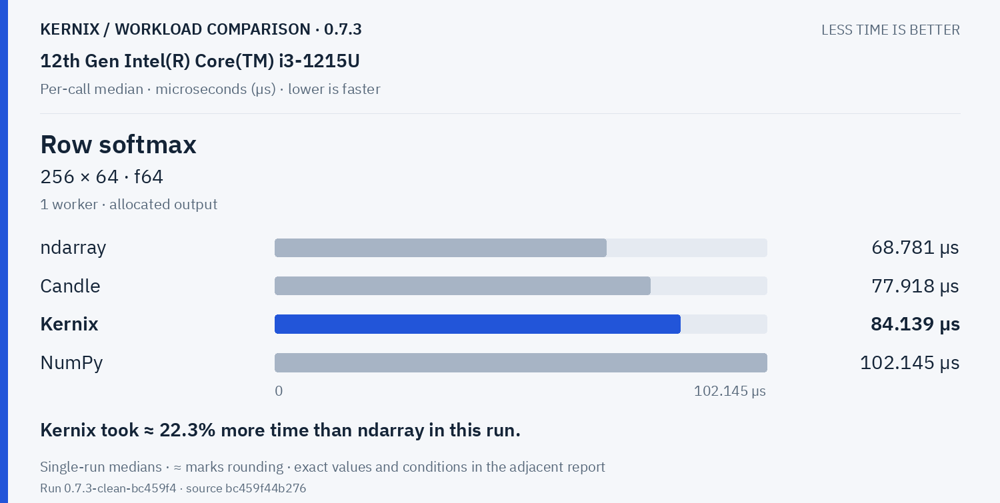

Tensor construction · 2 workloads

**Create zeros · 64 × 64 · f32**

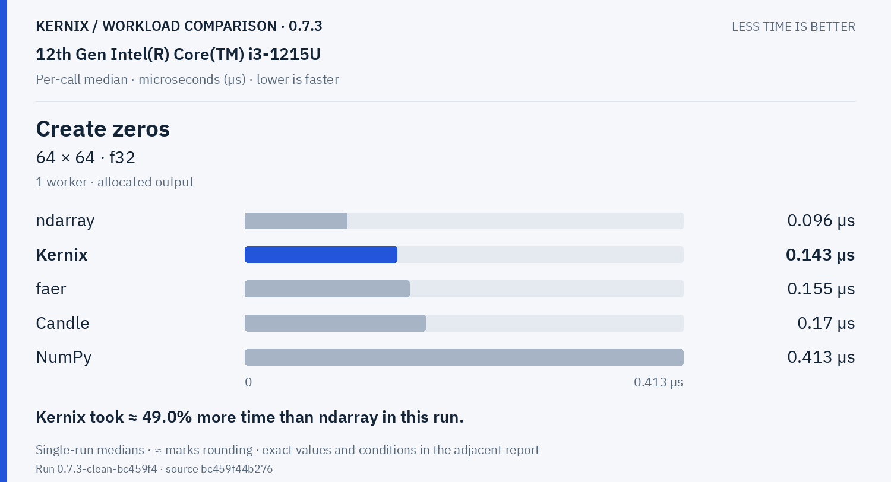

**Create ones · 64 × 64 · f32**

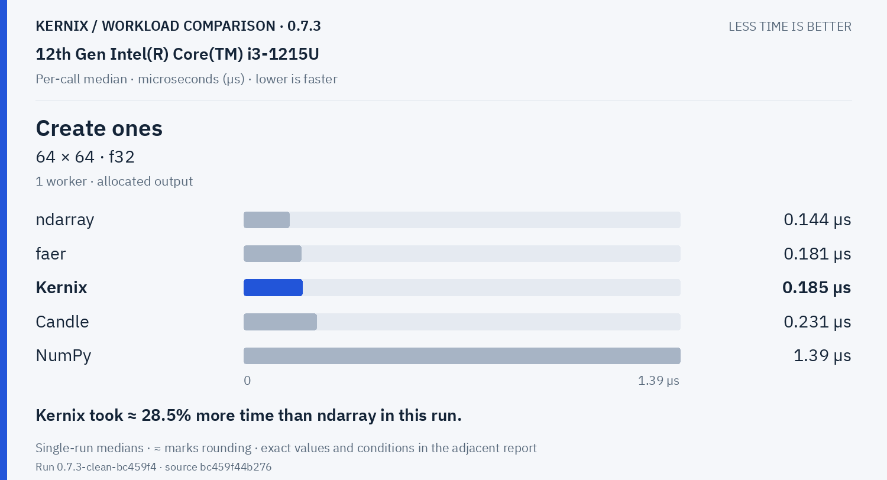

## Exact latency table

All values below are microseconds per operation. **Lower is faster.** Missing entries were not measured.

| Workload | Kernix | ndarray | nalgebra | faer | Candle | NumPy |
|---|---:|---:|---:|---:|---:|---:|
| Matrix multiplication · 32 × 32 · 32 × 32 · f64 | 1.535 | **1.492** | 1.612 | 1.6 | 1.525 | 2.808 |
| Matrix multiplication · 64 × 64 · 64 × 64 · f64 | **9.162** | 11.312 | 11.075 | 10.701 | 9.671 | 12.827 |
| Matrix multiplication · 128 × 128 · 128 × 128 · f64 | 73.624 | 117.855 | 115.569 | 82.494 | **73.614** | 78.457 |
| Matrix multiplication · 256 × 256 · 256 × 256 · f64 | **574.036** | 665.964 | 662.924 | 722.614 | 575.843 | 612.15 |
| Matrix multiplication · 64 × 64 · 64 × 64 · f32 | 6.441 | 6.001 | 5.791 | 5.676 | **4.998** | 6.464 |
| Matrix multiplication · 128 × 128 · 128 × 128 · f32 | **34.749** | 52.912 | 49.771 | 40.606 | 36.865 | 39.432 |
| Matrix multiplication · 256 × 256 · 256 × 256 · f32 | **270.684** | 384.756 | 386.854 | 310.024 | 271.808 | 286.792 |
| Batched multiplication · 4 × 16 × 32 · 1 × 32 × 16 · f64 | **1.881** | — | — | — | 1.995 | 3.391 |
| Thin QR · 96 × 32 · f64 | 42.494 | — | **36.53** | 70.197 | — | 38.405 |
| Thin QR · 256 × 64 · f64 | 506.246 | — | 368.816 | 423.772 | — | **340.898** |
| Cholesky factorization · 64 × 64 · f64 | 25.132 | — | 14.198 | **8.459** | — | 10.865 |
| Record + backward · sum(A · W), 32 × 16 · 16 × 8 · f64 | **2.378** | — | — | — | 4.273 | — |
| Model inference · batched normalized/sliced MLP · f64 | **2.029** | — | — | — | 3.582 | — |
| Model recording + forward · batched normalized/sliced MLP · f64 | **2.699** | — | — | — | 5.252 | — |
| Model backward · prepared graph → fresh gradients · f64 | **3.16** | — | — | — | 14.881 | — |
| Parameter update · transactional SGD, fixed gradients · f64 | 0.528 | — | — | — | — | — |
| Row softmax · 256 × 64 · f64 | 84.139 | **68.781** | — | — | 77.918 | 102.145 |
| Create zeros · 64 × 64 · f32 | 0.143 | **0.096** | — | 0.155 | 0.17 | 0.413 |
| Create ones · 64 × 64 · f32 | 0.185 | **0.144** | — | 0.181 | 0.231 | 1.39 |

## Version comparison

0 of 19 workloads have paired evidence. Exploratory 95% intervals resample process pairs, not calls. No multiple-comparison adjustment.

| Workload | Current / baseline [95% interval] | Interpretation |
|---|---:|---|
| Matrix multiplication · 32 × 32 · 32 × 32 · f64 | — | No paired comparison |
| Matrix multiplication · 64 × 64 · 64 × 64 · f64 | — | No paired comparison |
| Matrix multiplication · 128 × 128 · 128 × 128 · f64 | — | No paired comparison |
| Matrix multiplication · 256 × 256 · 256 × 256 · f64 | — | No paired comparison |
| Matrix multiplication · 64 × 64 · 64 × 64 · f32 | — | No paired comparison |
| Matrix multiplication · 128 × 128 · 128 × 128 · f32 | — | No paired comparison |
| Matrix multiplication · 256 × 256 · 256 × 256 · f32 | — | No paired comparison |
| Batched multiplication · 4 × 16 × 32 · 1 × 32 × 16 · f64 | — | No paired comparison |
| Thin QR · 96 × 32 · f64 | — | No paired comparison |
| Thin QR · 256 × 64 · f64 | — | No paired comparison |
| Cholesky factorization · 64 × 64 · f64 | — | No paired comparison |
| Record + backward · sum(A · W), 32 × 16 · 16 × 8 · f64 | — | No paired comparison |
| Model inference · batched normalized/sliced MLP · f64 | — | No paired comparison |
| Model recording + forward · batched normalized/sliced MLP · f64 | — | No paired comparison |
| Model backward · prepared graph → fresh gradients · f64 | — | No paired comparison |
| Parameter update · transactional SGD, fixed gradients · f64 | — | No paired comparison |
| Row softmax · 256 × 64 · f64 | — | No paired comparison |
| Create zeros · 64 × 64 · f32 | — | No paired comparison |
| Create ones · 64 × 64 · f32 | — | No paired comparison |

## Method and provenance

CPU affinity pinned to logical CPU 0. Frequency and background load are uncontrolled.

Numbers retain source precision; recorded digits do not imply equivalent physical measurement accuracy. Lowest observed medians are bold only when peers were measured. No aggregate winner or universal ranking is inferred.

[Original report and commentary](original-report.txt) · [Raw measurements](raw.json)

Measured source `bc459f44b276e86275cc4e431e4946443aefb15f`. Run `0.7.3-clean-bc459f4`. Rendering does not change measurements.
