# Kernix 0.7.3 · performance brief

12th Gen Intel(R) Core(TM) i3-1215U / Linux

**Per-call median, microseconds per operation. Lower is faster. All recorded digits retained.**

21 workloads · 88 observations

No previous-version baseline attached. Sequential run changes are descriptive; paired process evidence is shown separately.

[Open the visual report](report.html) · [Vector PDF](latency.pdf) · [Raw measurements](raw.json)

[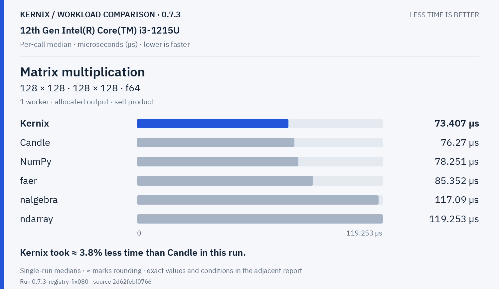](latency.pdf)

## Charts by workload

**Shorter bars mean less time.** Blue is Kernix; grey is another library; teal is an explicitly selected Kernix backend. Entries are sorted by the recorded median, with a separate zero-based scale per chart. These point observations do not establish a statistical ranking.

Expand a group to see every chart here on GitHub. Click a chart to enlarge it. The exact table below keeps every source digit.

Matrix multiplication · 8 workloads

**Matrix multiplication · 32 × 32 · 32 × 32 · f64**

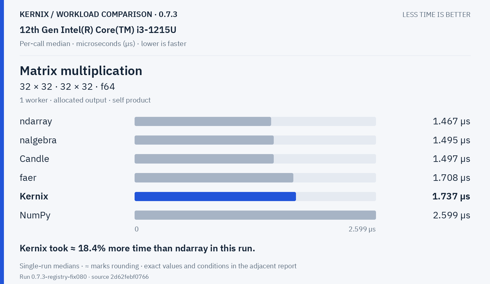

**Matrix multiplication · 64 × 64 · 64 × 64 · f64**

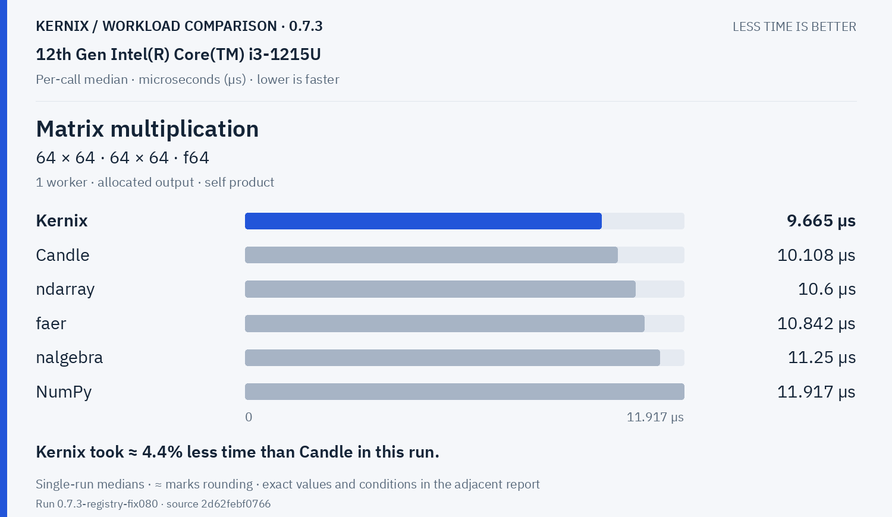

**Matrix multiplication · 128 × 128 · 128 × 128 · f64**

**Matrix multiplication · 256 × 256 · 256 × 256 · f64**

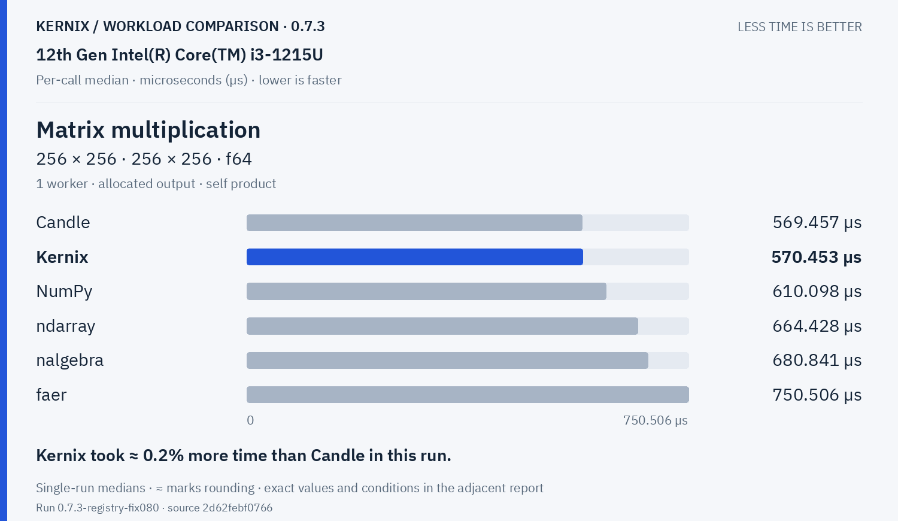

**Matrix multiplication · 64 × 64 · 64 × 64 · f32**

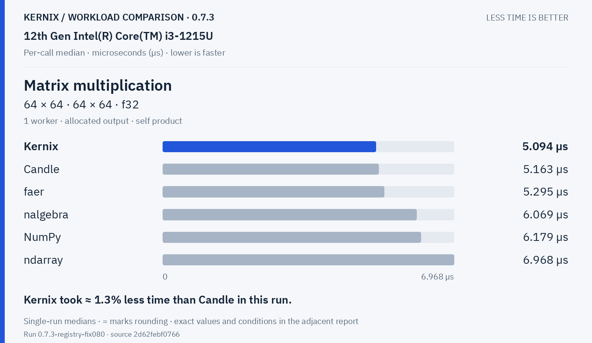

**Matrix multiplication · 128 × 128 · 128 × 128 · f32**

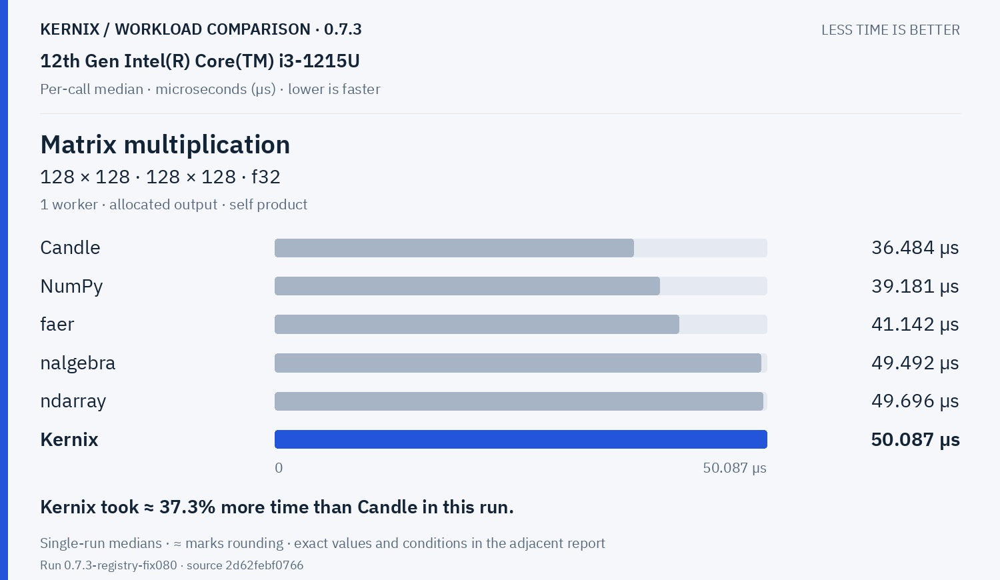

**Matrix multiplication · 256 × 256 · 256 × 256 · f32**

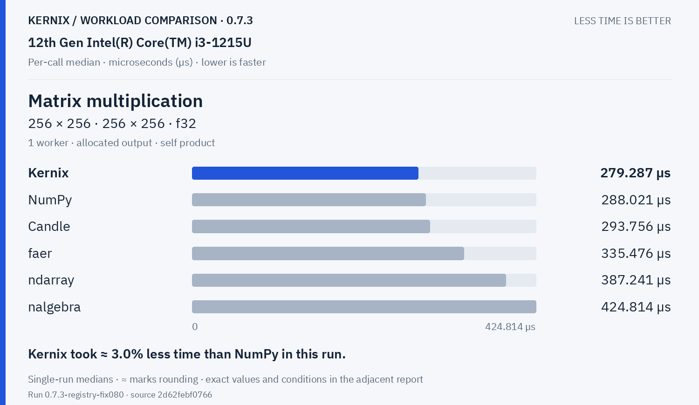

**Batched multiplication · 4 × 16 × 32 · 1 × 32 × 16 · f64**

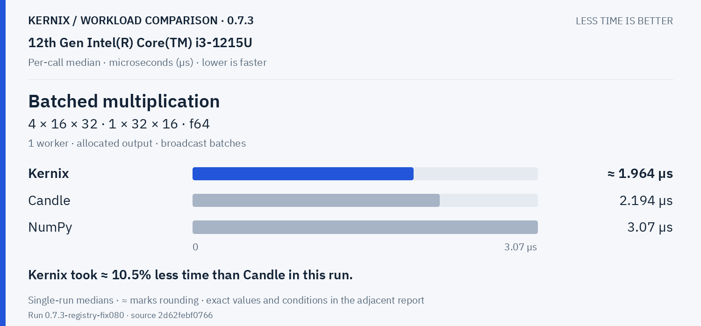

Decompositions & solvers · 5 workloads

**Thin QR · 96 × 32 · f64**

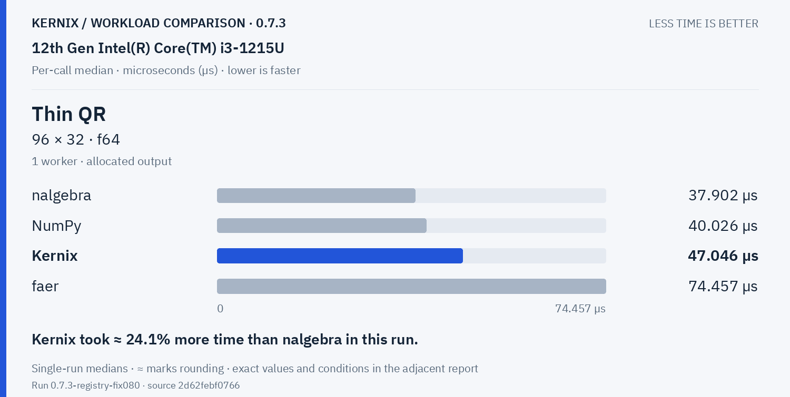

**Thin QR · 256 × 64 · f64**

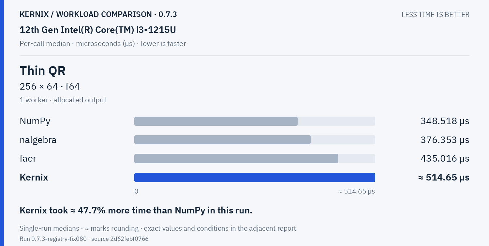

**Cholesky factorization · 64 × 64 · f64**

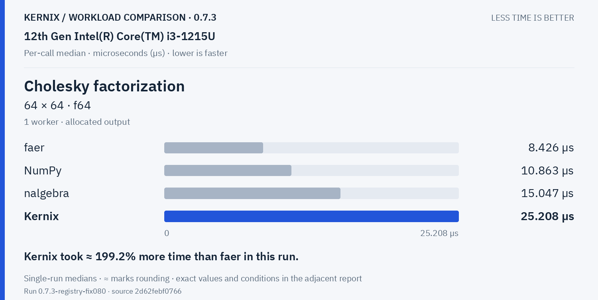

**Cholesky factorization · 128 × 128 · f64**

**Cholesky factorization · 256 × 256 · f64**

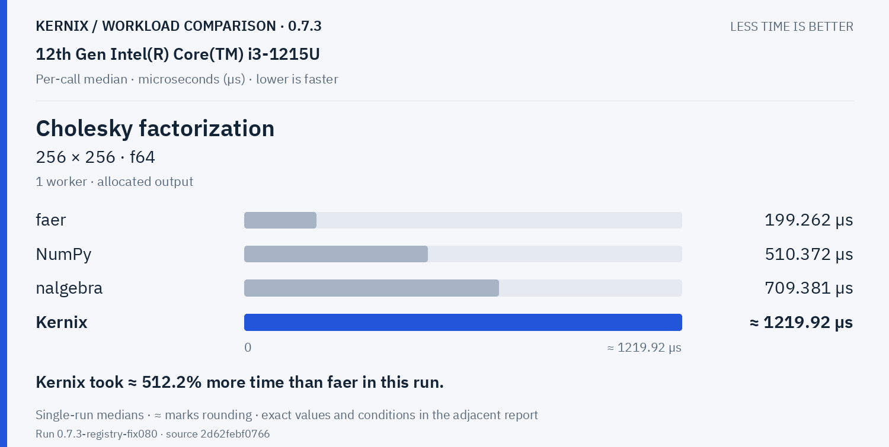

Training & autodiff · 5 workloads

**Record + backward · sum(A · W), 32 × 16 · 16 × 8 · f64**

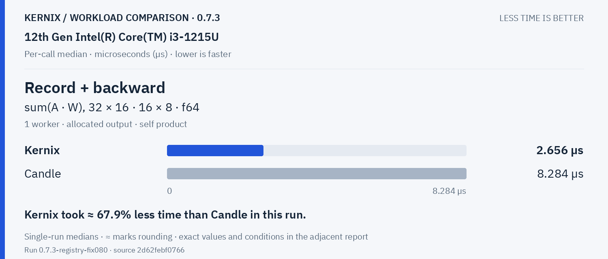

**Model inference · batched normalized/sliced MLP · f64**

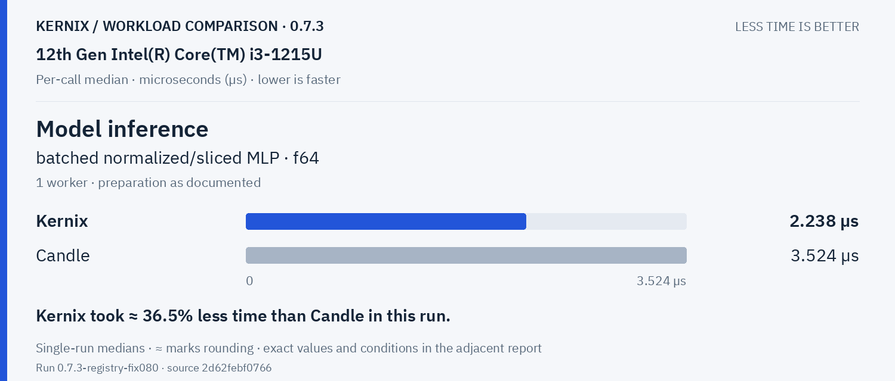

**Model recording + forward · batched normalized/sliced MLP · f64**

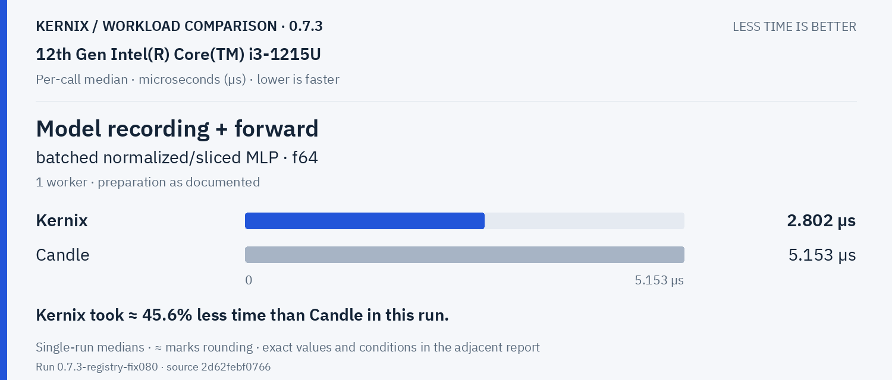

**Model backward · prepared graph → fresh gradients · f64**

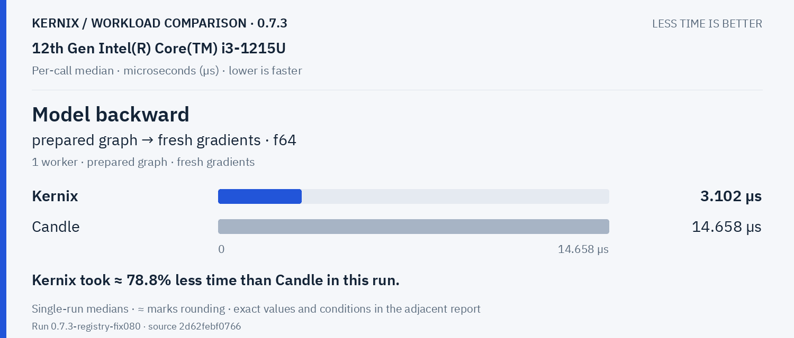

**Parameter update · transactional SGD, fixed gradients · f64**

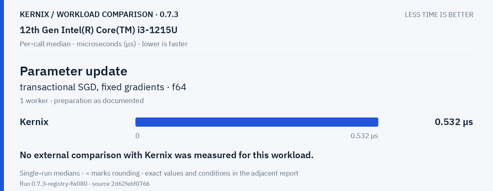

Statistics & activations · 1 workloads

**Row softmax · 256 × 64 · f64**

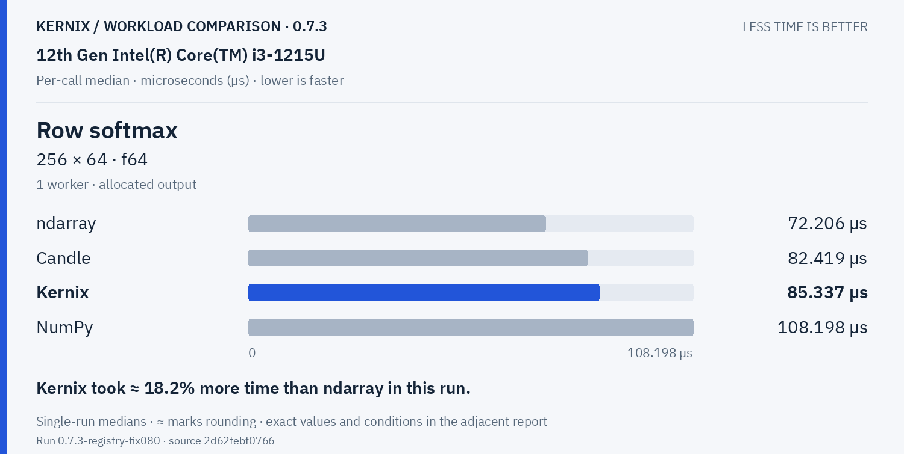

Tensor construction · 2 workloads

**Create zeros · 64 × 64 · f32**

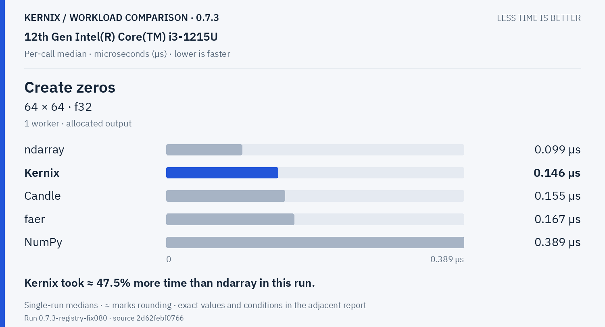

**Create ones · 64 × 64 · f32**

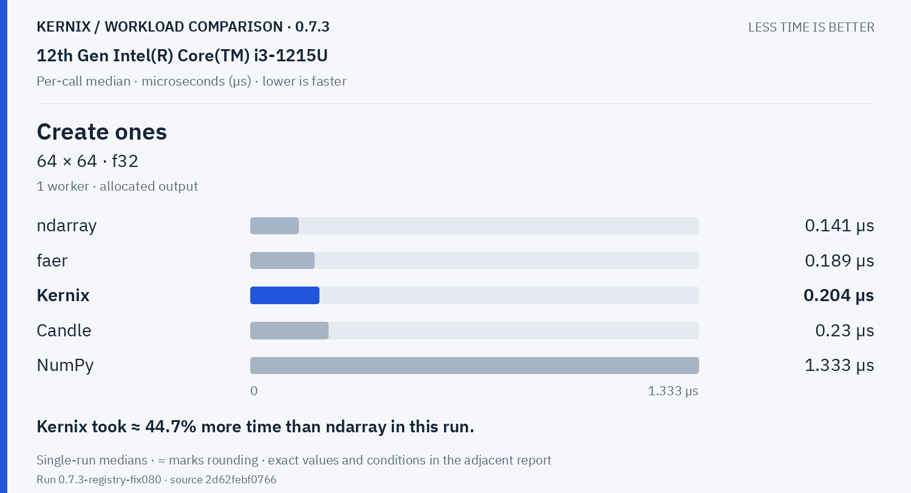

## Exact latency table

All values below are microseconds per operation. **Lower is faster.** Missing entries were not measured.

| Workload | Kernix | ndarray | nalgebra | faer | Candle | NumPy |
|---|---:|---:|---:|---:|---:|---:|
| Matrix multiplication · 32 × 32 · 32 × 32 · f64 | 1.737 | **1.467** | 1.495 | 1.708 | 1.497 | 2.599 |
| Matrix multiplication · 64 × 64 · 64 × 64 · f64 | **9.665** | 10.6 | 11.25 | 10.842 | 10.108 | 11.917 |
| Matrix multiplication · 128 × 128 · 128 × 128 · f64 | **73.407** | 119.253 | 117.09 | 85.352 | 76.27 | 78.251 |
| Matrix multiplication · 256 × 256 · 256 × 256 · f64 | 570.453 | 664.428 | 680.841 | 750.506 | **569.457** | 610.098 |
| Matrix multiplication · 64 × 64 · 64 × 64 · f32 | **5.094** | 6.968 | 6.069 | 5.295 | 5.163 | 6.179 |
| Matrix multiplication · 128 × 128 · 128 × 128 · f32 | 50.087 | 49.696 | 49.492 | 41.142 | **36.484** | 39.181 |
| Matrix multiplication · 256 × 256 · 256 × 256 · f32 | **279.287** | 387.241 | 424.814 | 335.476 | 293.756 | 288.021 |
| Batched multiplication · 4 × 16 × 32 · 1 × 32 × 16 · f64 | **1.9640000000000002** | — | — | — | 2.194 | 3.07 |
| Thin QR · 96 × 32 · f64 | 47.046 | — | **37.902** | 74.457 | — | 40.026 |
| Thin QR · 256 × 64 · f64 | 514.64999999999994 | — | 376.353 | 435.016 | — | **348.518** |
| Cholesky factorization · 64 × 64 · f64 | 25.208 | — | 15.047 | **8.426** | — | 10.863 |
| Cholesky factorization · 128 × 128 · f64 | 168.412 | — | 104.188 | **39.41** | — | 73.713 |
| Cholesky factorization · 256 × 256 · f64 | 1219.916 | — | 709.381 | **199.262** | — | 510.372 |
| Record + backward · sum(A · W), 32 × 16 · 16 × 8 · f64 | **2.656** | — | — | — | 8.284 | — |
| Model inference · batched normalized/sliced MLP · f64 | **2.238** | — | — | — | 3.524 | — |
| Model recording + forward · batched normalized/sliced MLP · f64 | **2.802** | — | — | — | 5.153 | — |
| Model backward · prepared graph → fresh gradients · f64 | **3.102** | — | — | — | 14.658 | — |
| Parameter update · transactional SGD, fixed gradients · f64 | 0.532 | — | — | — | — | — |
| Row softmax · 256 × 64 · f64 | 85.337 | **72.206** | — | — | 82.419 | 108.198 |
| Create zeros · 64 × 64 · f32 | 0.146 | **0.099** | — | 0.167 | 0.155 | 0.389 |
| Create ones · 64 × 64 · f32 | 0.204 | **0.141** | — | 0.189 | 0.23 | 1.333 |

## Version comparison

0 of 21 workloads have paired evidence. Exploratory 95% intervals resample process pairs, not calls. No multiple-comparison adjustment.

| Workload | Current / baseline [95% interval] | Interpretation |
|---|---:|---|
| Matrix multiplication · 32 × 32 · 32 × 32 · f64 | — | No paired comparison |
| Matrix multiplication · 64 × 64 · 64 × 64 · f64 | — | No paired comparison |
| Matrix multiplication · 128 × 128 · 128 × 128 · f64 | — | No paired comparison |
| Matrix multiplication · 256 × 256 · 256 × 256 · f64 | — | No paired comparison |
| Matrix multiplication · 64 × 64 · 64 × 64 · f32 | — | No paired comparison |
| Matrix multiplication · 128 × 128 · 128 × 128 · f32 | — | No paired comparison |
| Matrix multiplication · 256 × 256 · 256 × 256 · f32 | — | No paired comparison |
| Batched multiplication · 4 × 16 × 32 · 1 × 32 × 16 · f64 | — | No paired comparison |
| Thin QR · 96 × 32 · f64 | — | No paired comparison |
| Thin QR · 256 × 64 · f64 | — | No paired comparison |
| Cholesky factorization · 64 × 64 · f64 | — | No paired comparison |
| Cholesky factorization · 128 × 128 · f64 | — | No paired comparison |
| Cholesky factorization · 256 × 256 · f64 | — | No paired comparison |
| Record + backward · sum(A · W), 32 × 16 · 16 × 8 · f64 | — | No paired comparison |
| Model inference · batched normalized/sliced MLP · f64 | — | No paired comparison |
| Model recording + forward · batched normalized/sliced MLP · f64 | — | No paired comparison |
| Model backward · prepared graph → fresh gradients · f64 | — | No paired comparison |
| Parameter update · transactional SGD, fixed gradients · f64 | — | No paired comparison |
| Row softmax · 256 × 64 · f64 | — | No paired comparison |
| Create zeros · 64 × 64 · f32 | — | No paired comparison |
| Create ones · 64 × 64 · f32 | — | No paired comparison |

## Method and provenance

CPU affinity pinned to logical CPU 0. Frequency and background load are uncontrolled.

Numbers retain source precision; recorded digits do not imply equivalent physical measurement accuracy. Lowest observed medians are bold only when peers were measured. No aggregate winner or universal ranking is inferred.

[Original report and commentary](original-report.txt) · [Raw measurements](raw.json)

Measured source `2d62febf07666079a81043b287fe67cdadd2429e`. Run `0.7.3-registry-fix080`. Rendering does not change measurements.
