# Kernix 0.8.0 · performance brief

12th Gen Intel(R) Core(TM) i3-1215U / Linux

**Per-call median, microseconds per operation. Lower is faster. All recorded digits retained.**

21 workloads · 88 observations

Baseline: 0.7.3-registry-fix080. Sequential run changes are descriptive; paired process evidence is shown separately.

[Interactive HTML (open locally)](report.html) · [Vector PDF](latency.pdf) · [Raw measurements](raw.json)

[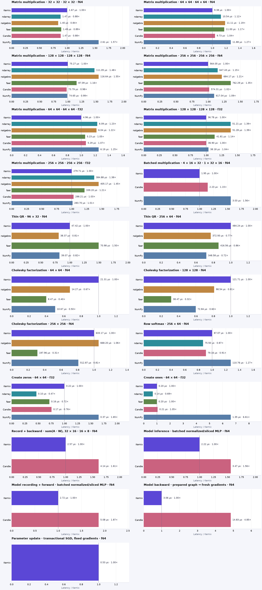](latency.pdf)

## Charts by workload

**Shorter bars mean less time.** Blue is Kernix; grey is another library; teal is an explicitly selected Kernix backend. Entries are sorted by the recorded median, with a separate zero-based scale per chart. These point observations do not establish a statistical ranking.

Expand a group to see every chart here on GitHub. Click a chart to enlarge it. The exact table below keeps every source digit.

Matrix multiplication · 8 workloads

**Matrix multiplication · 32 × 32 · 32 × 32 · f64**

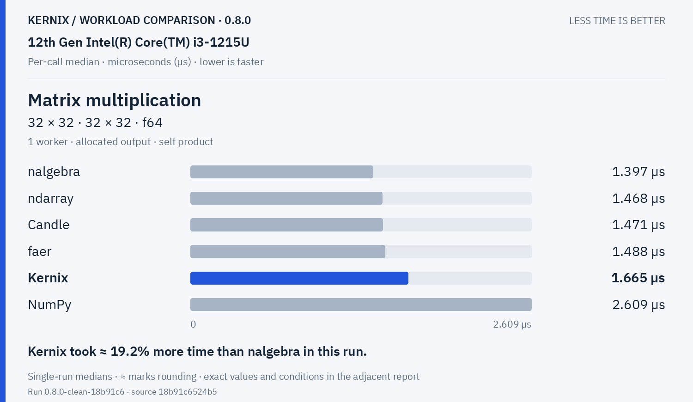

Kernix: **1.665 µs**. Kernix took ≈ 19.2% more time than nalgebra in this run.

**Matrix multiplication · 64 × 64 · 64 × 64 · f64**

Kernix: **9.375 µs**. Kernix took ≈ 3.6% less time than Candle in this run.

**Matrix multiplication · 128 × 128 · 128 × 128 · f64**

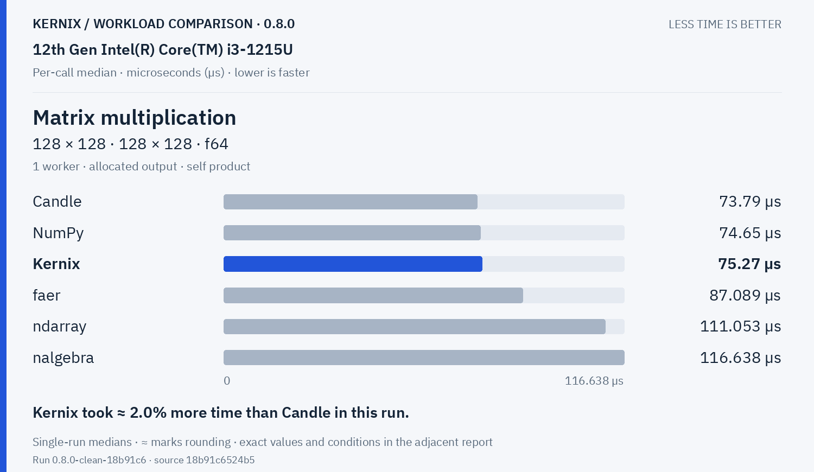

Kernix: **75.27 µs**. Kernix took ≈ 2.0% more time than Candle in this run.

**Matrix multiplication · 256 × 256 · 256 × 256 · f64**

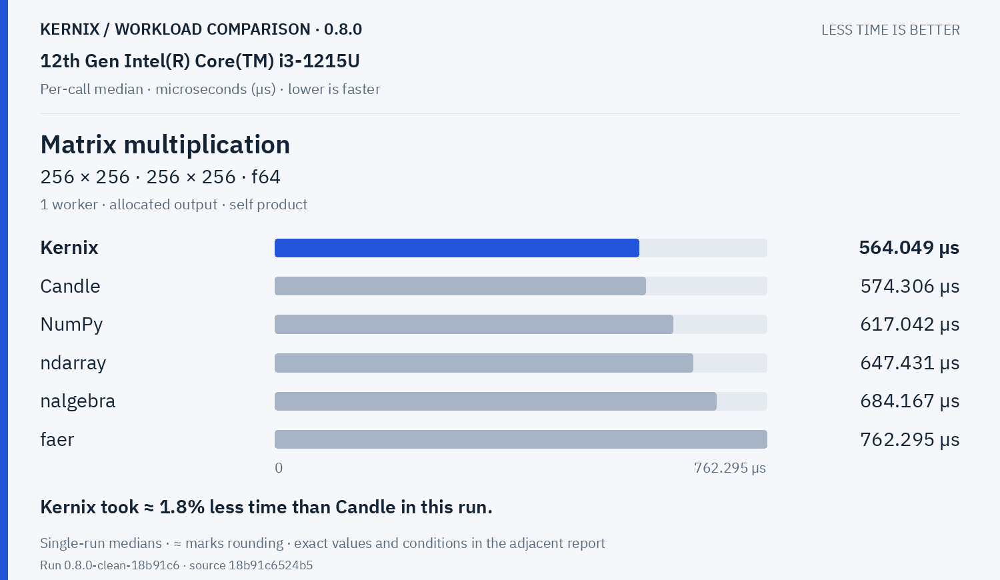

Kernix: **564.049 µs**. Kernix took ≈ 1.8% less time than Candle in this run.

**Matrix multiplication · 64 × 64 · 64 × 64 · f32**

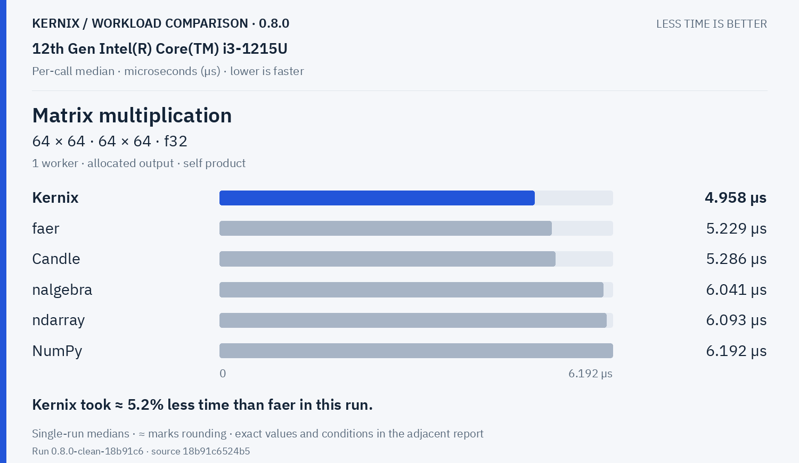

Kernix: **4.958 µs**. Kernix took ≈ 5.2% less time than faer in this run.

**Matrix multiplication · 128 × 128 · 128 × 128 · f32**

Kernix: **36.784 µs**. Kernix took ≈ 0.3% less time than Candle in this run.

**Matrix multiplication · 256 × 256 · 256 × 256 · f32**

Kernix: **279.714 µs**. Kernix took ≈ 1.4% less time than NumPy in this run.

**Batched multiplication · 4 × 16 × 32 · 1 × 32 × 16 · f64**

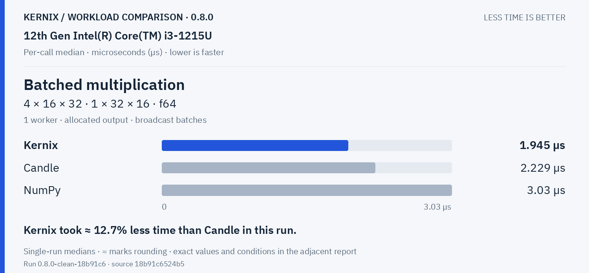

Kernix: **1.945 µs**. Kernix took ≈ 12.7% less time than Candle in this run.

Decompositions & solvers · 5 workloads

**Thin QR · 96 × 32 · f64**

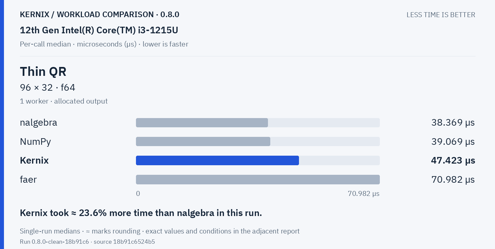

Kernix: **47.423 µs**. Kernix took ≈ 23.6% more time than nalgebra in this run.

**Thin QR · 256 × 64 · f64**

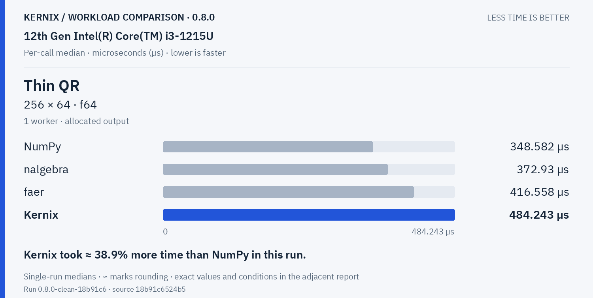

Kernix: **484.243 µs**. Kernix took ≈ 38.9% more time than NumPy in this run.

**Cholesky factorization · 64 × 64 · f64**

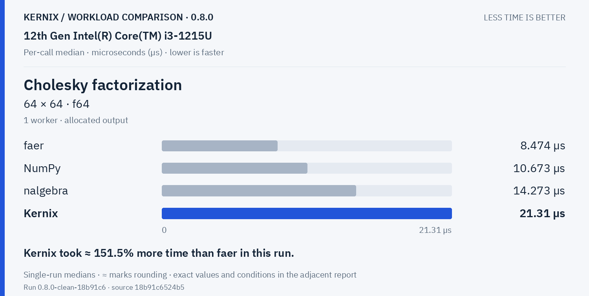

Kernix: **21.31 µs**. Kernix took ≈ 151.5% more time than faer in this run.

**Cholesky factorization · 128 × 128 · f64**

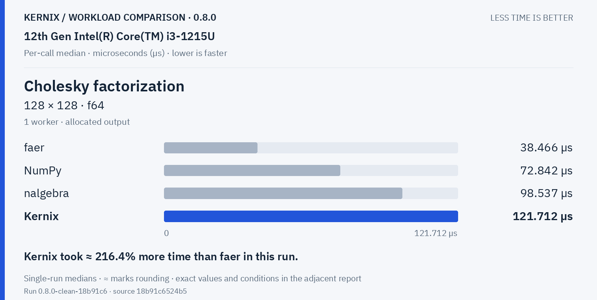

Kernix: **121.712 µs**. Kernix took ≈ 216.4% more time than faer in this run.

**Cholesky factorization · 256 × 256 · f64**

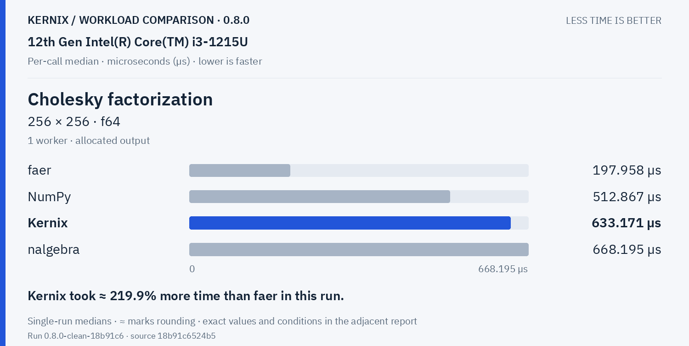

Kernix: **633.171 µs**. Kernix took ≈ 219.9% more time than faer in this run.

Training & autodiff · 5 workloads

**Record + backward · sum(A · W), 32 × 16 · 16 × 8 · f64**

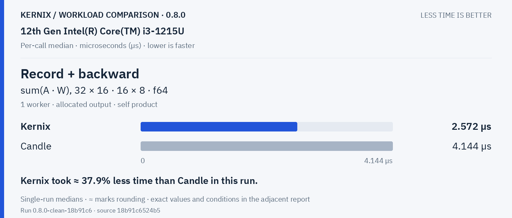

Kernix: **2.572 µs**. Kernix took ≈ 37.9% less time than Candle in this run.

**Model inference · batched normalized/sliced MLP · f64**

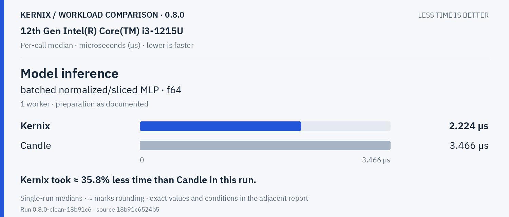

Kernix: **2.224 µs**. Kernix took ≈ 35.8% less time than Candle in this run.

**Model recording + forward · batched normalized/sliced MLP · f64**

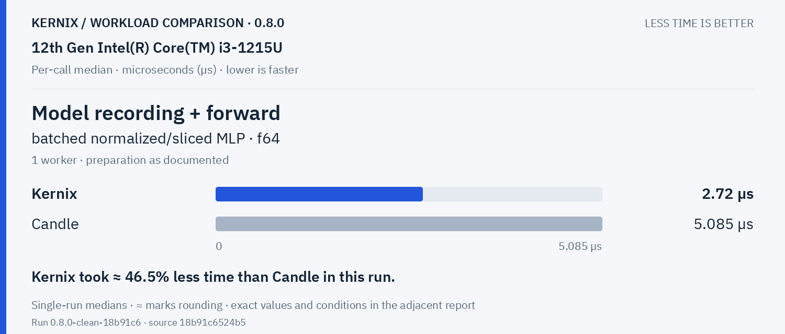

Kernix: **2.72 µs**. Kernix took ≈ 46.5% less time than Candle in this run.

**Model backward · prepared graph → fresh gradients · f64**

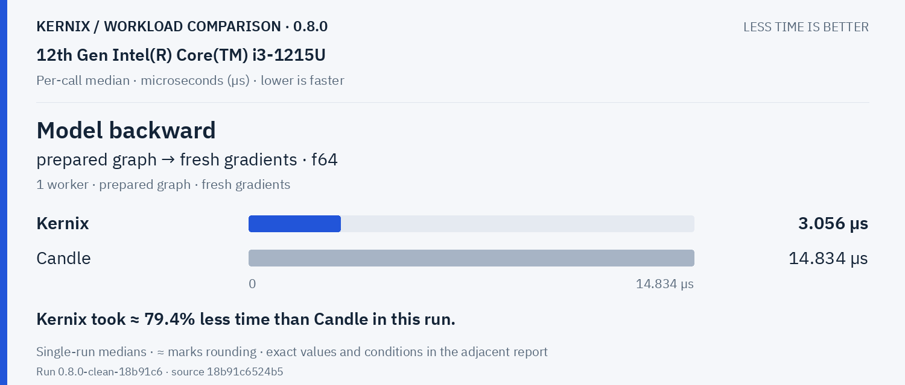

Kernix: **3.056 µs**. Kernix took ≈ 79.4% less time than Candle in this run.

**Parameter update · transactional SGD, fixed gradients · f64**

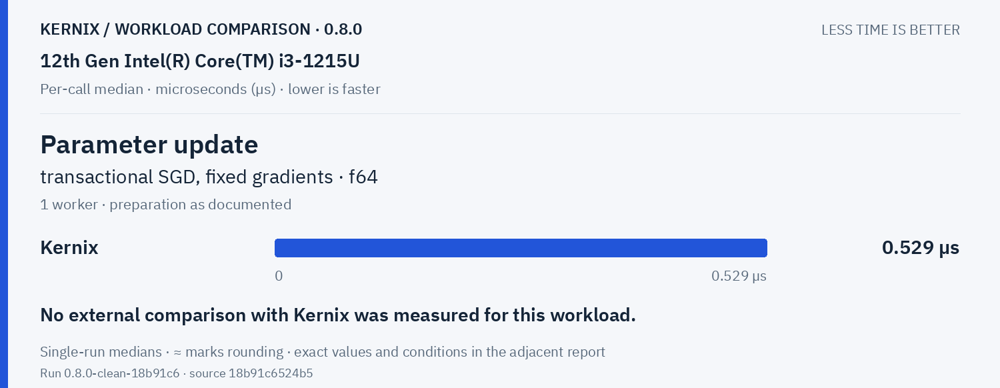

Kernix: **0.529 µs**. No external comparison with Kernix was measured for this workload.

Statistics & activations · 1 workloads

**Row softmax · 256 × 64 · f64**

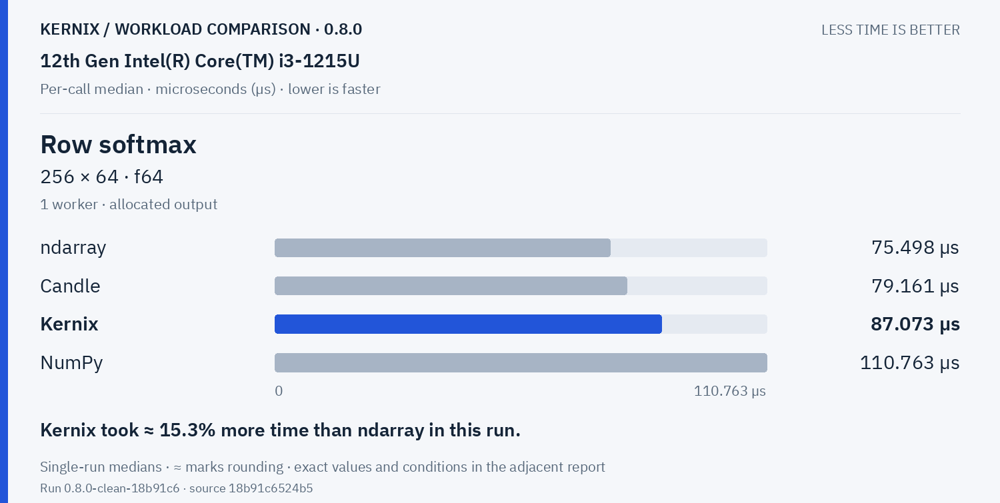

Kernix: **87.073 µs**. Kernix took ≈ 15.3% more time than ndarray in this run.

Tensor construction · 2 workloads

**Create zeros · 64 × 64 · f32**

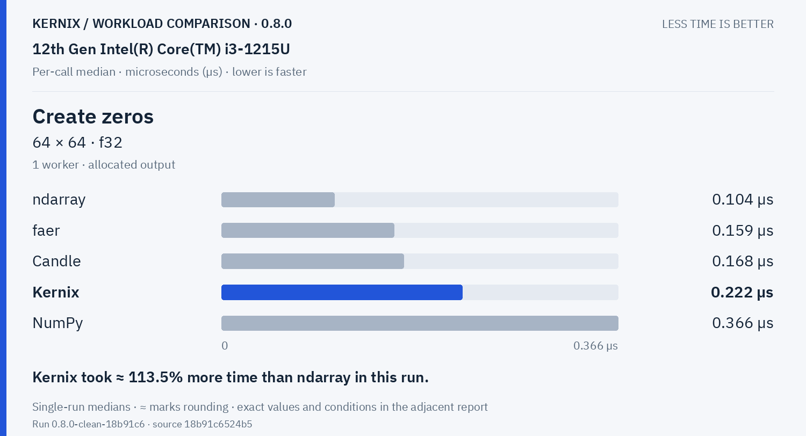

Kernix: **0.222 µs**. Kernix took ≈ 113.5% more time than ndarray in this run.

**Create ones · 64 × 64 · f32**

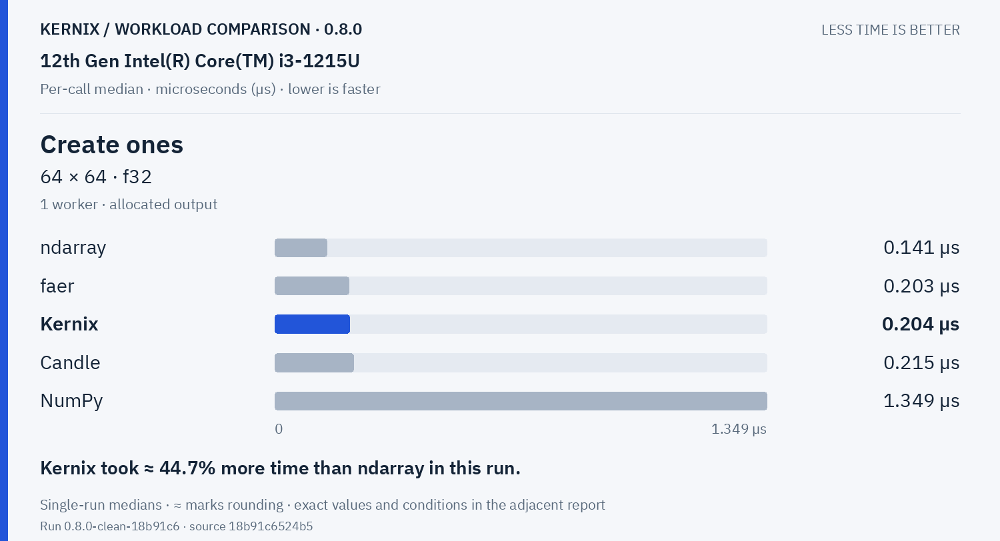

Kernix: **0.204 µs**. Kernix took ≈ 44.7% more time than ndarray in this run.

## Exact latency table

All values below are microseconds per operation. **Lower is faster.** Missing entries were not measured.

| Workload | Kernix | ndarray | nalgebra | faer | Candle | NumPy | Sequential run change |
|---|---:|---:|---:|---:|---:|---:|---:|
| Matrix multiplication · 32 × 32 · 32 × 32 · f64 | 1.665 | 1.468 | **1.397** | 1.488 | 1.471 | 2.609 | -4.1% |
| Matrix multiplication · 64 × 64 · 64 × 64 · f64 | **9.375** | 10.54 | 11.111 | 11 | 9.73 | 11.883 | -3.0% |
| Matrix multiplication · 128 × 128 · 128 × 128 · f64 | 75.27 | 111.053 | 116.638 | 87.089 | **73.79** | 74.65 | +2.5% |
| Matrix multiplication · 256 × 256 · 256 × 256 · f64 | **564.049** | 647.431 | 684.167 | 762.295 | 574.306 | 617.042 | -1.1% |
| Matrix multiplication · 64 × 64 · 64 × 64 · f32 | **4.958** | 6.093 | 6.041 | 5.229 | 5.286 | 6.192 | -2.7% |
| Matrix multiplication · 128 × 128 · 128 × 128 · f32 | **36.784** | 51.21 | 51.276 | 41.806 | 36.9 | 38.176 | -26.6% |
| Matrix multiplication · 256 × 256 · 256 × 256 · f32 | **279.714** | 384.878 | 405.165 | 339.198 | 288.207 | 283.696 | +0.2% |
| Batched multiplication · 4 × 16 × 32 · 1 × 32 × 16 · f64 | **1.945** | — | — | — | 2.229 | 3.03 | -1.0% |
| Thin QR · 96 × 32 · f64 | 47.423 | — | **38.369** | 70.982 | — | 39.069 | +0.8% |
| Thin QR · 256 × 64 · f64 | 484.243 | — | 372.93 | 416.558 | — | **348.582** | -5.9% |
| Cholesky factorization · 64 × 64 · f64 | 21.31 | — | 14.273 | **8.474** | — | 10.673 | -15.5% |
| Cholesky factorization · 128 × 128 · f64 | 121.712 | — | 98.537 | **38.466** | — | 72.842 | -27.7% |
| Cholesky factorization · 256 × 256 · f64 | 633.171 | — | 668.195 | **197.958** | — | 512.867 | -48.1% |
| Record + backward · sum(A · W), 32 × 16 · 16 × 8 · f64 | **2.572** | — | — | — | 4.144 | — | -3.2% |
| Model inference · batched normalized/sliced MLP · f64 | **2.224** | — | — | — | 3.466 | — | -0.6% |
| Model recording + forward · batched normalized/sliced MLP · f64 | **2.72** | — | — | — | 5.085 | — | -2.9% |
| Model backward · prepared graph → fresh gradients · f64 | **3.056** | — | — | — | 14.834 | — | -1.5% |
| Parameter update · transactional SGD, fixed gradients · f64 | 0.529 | — | — | — | — | — | -0.6% |
| Row softmax · 256 × 64 · f64 | 87.073 | **75.498** | — | — | 79.161 | 110.763 | +2.0% |
| Create zeros · 64 × 64 · f32 | 0.222 | **0.104** | — | 0.159 | 0.168 | 0.366 | +52.1% |
| Create ones · 64 × 64 · f32 | 0.204 | **0.141** | — | 0.203 | 0.215 | 1.349 | +0.0% |

## Version comparison

7 of 21 workloads have paired evidence. Exploratory 95% intervals resample process pairs, not calls. No multiple-comparison adjustment.

### Version changes at a glance

The vertical line marks unchanged time. Left is faster; right is slower. Ranges are exploratory 95% intervals over fresh-process pairs. An interval crossing the line leaves direction unclear.

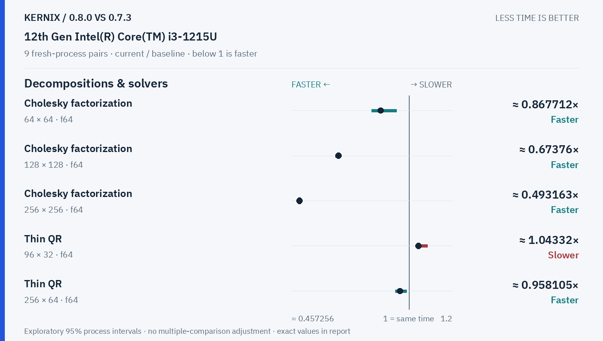

| Workload | Current / baseline [95% interval] | Interpretation |
|---|---:|---|
| Matrix multiplication · 32 × 32 · 32 × 32 · f64 | — | No paired comparison |
| Matrix multiplication · 64 × 64 · 64 × 64 · f64 | — | No paired comparison |
| Matrix multiplication · 128 × 128 · 128 × 128 · f64 | 1.0148811150587593× [1.0060131963811985, 1.0317538528920642] | Observed time increase |
| Matrix multiplication · 256 × 256 · 256 × 256 · f64 | — | No paired comparison |
| Matrix multiplication · 64 × 64 · 64 × 64 · f32 | — | No paired comparison |
| Matrix multiplication · 128 × 128 · 128 × 128 · f32 | 0.9939454550368949× [0.9249689243870831, 1.0027472527472527] | Timing direction unclear |
| Matrix multiplication · 256 × 256 · 256 × 256 · f32 | — | No paired comparison |
| Batched multiplication · 4 × 16 × 32 · 1 × 32 × 16 · f64 | — | No paired comparison |
| Thin QR · 96 × 32 · f64 | 1.0433176701999782× [1.036087431693989, 1.0842891742448475] | Observed time increase |
| Thin QR · 256 × 64 · f64 | 0.9581048304614215× [0.9368562130504658, 0.9876960858970454] | Observed time reduction |
| Cholesky factorization · 64 × 64 · f64 | 0.8677118475888073× [0.826547772693496, 0.9410034528326016] | Observed time reduction |
| Cholesky factorization · 128 × 128 · f64 | 0.6737598467695953× [0.6587561862739252, 0.6826653795859267] | Observed time reduction |
| Cholesky factorization · 256 × 256 · f64 | 0.49316287663357755× [0.4813219013084302, 0.5031802131103422] | Observed time reduction |
| Record + backward · sum(A · W), 32 × 16 · 16 × 8 · f64 | — | No paired comparison |
| Model inference · batched normalized/sliced MLP · f64 | — | No paired comparison |
| Model recording + forward · batched normalized/sliced MLP · f64 | — | No paired comparison |
| Model backward · prepared graph → fresh gradients · f64 | — | No paired comparison |
| Parameter update · transactional SGD, fixed gradients · f64 | — | No paired comparison |
| Row softmax · 256 × 64 · f64 | — | No paired comparison |
| Create zeros · 64 × 64 · f32 | — | No paired comparison |
| Create ones · 64 × 64 · f32 | — | No paired comparison |

## Method and provenance

CPU affinity pinned to logical CPU 0. Frequency and background load are uncontrolled.

Numbers retain source precision; recorded digits do not imply equivalent physical measurement accuracy. Lowest observed medians are bold only when peers were measured. No aggregate winner or universal ranking is inferred.

[Original report and commentary](original-report.txt) · [Raw measurements](raw.json)

Measured source `18b91c6524b593c802cf03d93a1611c322f7d878`. Run `0.8.0-clean-18b91c6`. Rendering does not change measurements.
