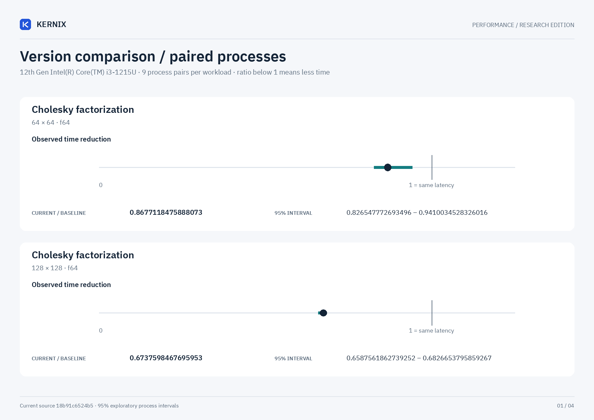
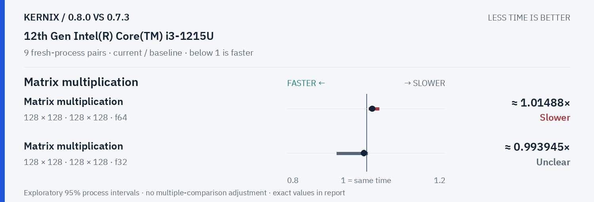

# Kernix 0.8.0 · paired process comparison

9 fresh-process pairs per workload. Ratios below 1 mean less time.

[Interactive HTML (open locally)](report.html) · [Vector PDF](latency.pdf) · [Original process evidence](paired.json)

### Version changes at a glance

The vertical line marks unchanged time. Left is faster; right is slower. Ranges are exploratory 95% intervals over fresh-process pairs. An interval crossing the line leaves direction unclear.

## Exact process ratios

| Workload | Current / baseline [95% interval] | Interpretation |
|---|---:|---|
| Cholesky factorization · 64 × 64 · f64 | 0.8677118475888073× [0.826547772693496, 0.9410034528326016] | Observed time reduction |
| Cholesky factorization · 128 × 128 · f64 | 0.6737598467695953× [0.6587561862739252, 0.6826653795859267] | Observed time reduction |
| Cholesky factorization · 256 × 256 · f64 | 0.49316287663357755× [0.4813219013084302, 0.5031802131103422] | Observed time reduction |
| Thin QR · 96 × 32 · f64 | 1.0433176701999782× [1.036087431693989, 1.0842891742448475] | Observed time increase |
| Thin QR · 256 × 64 · f64 | 0.9581048304614215× [0.9368562130504658, 0.9876960858970454] | Observed time reduction |
| Matrix multiplication · 128 × 128 · 128 × 128 · f64 | 1.0148811150587593× [1.0060131963811985, 1.0317538528920642] | Observed time increase |
| Matrix multiplication · 128 × 128 · 128 × 128 · f32 | 0.9939454550368949× [0.9249689243870831, 1.0027472527472527] | Timing direction unclear |

## Method

95% percentile bootstrap over paired process blocks; 10000 resamples; exploratory, no multiple-comparison adjustment

Current `0.8.0-clean-18b91c6`; baseline `0.7.3-registry-fix080`. All source ratio digits, paired observations and process ordering are preserved. No absolute peer latencies are inferred.
