# Kernix 0.8.0 · performance brief

12th Gen Intel(R) Core(TM) i3-1215U / Linux

**Per-call median, microseconds per operation. Lower is faster. All recorded digits retained.**

21 workloads · 88 observations

No previous-version baseline attached. Sequential run changes are descriptive; paired process evidence is shown separately.

[Interactive HTML (open locally)](report.html) · [Vector PDF](latency.pdf) · [Raw measurements](raw.json)

[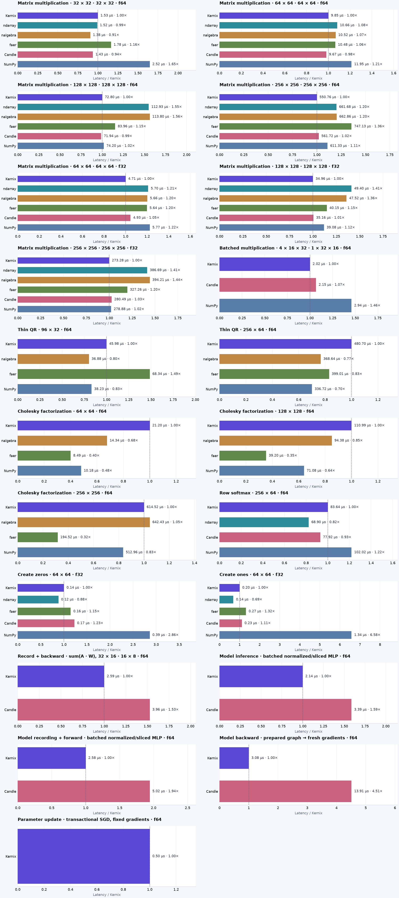](latency.pdf)

## Charts by workload

**Shorter bars mean less time.** Blue is Kernix; grey is another library; teal is an explicitly selected Kernix backend. Entries are sorted by the recorded median, with a separate zero-based scale per chart. These point observations do not establish a statistical ranking.

Expand a group to see every chart here on GitHub. Click a chart to enlarge it. The exact table below keeps every source digit.

Matrix multiplication · 8 workloads

**Matrix multiplication · 32 × 32 · 32 × 32 · f64**

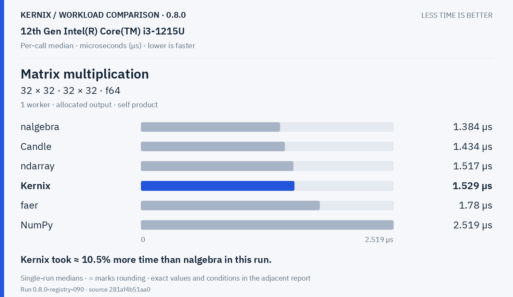

Kernix: **1.529 µs**. Kernix took ≈ 10.5% more time than nalgebra in this run.

**Matrix multiplication · 64 × 64 · 64 × 64 · f64**

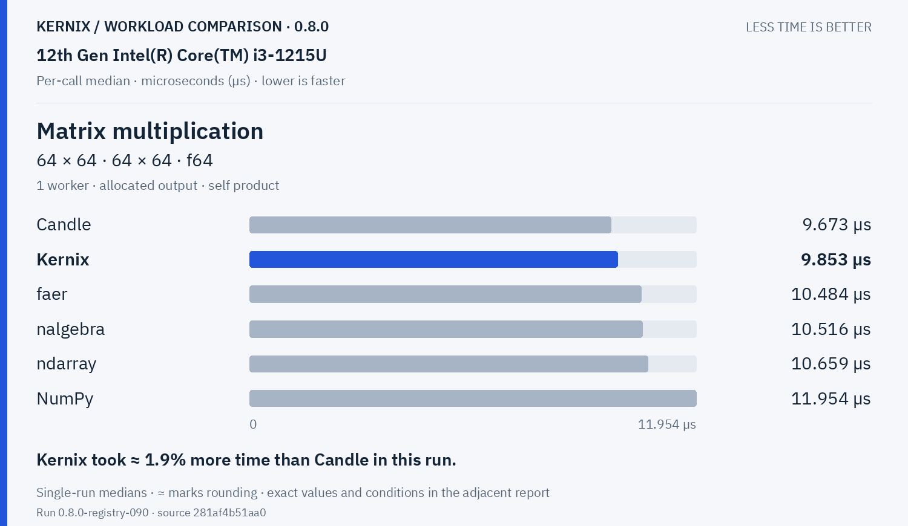

Kernix: **9.853 µs**. Kernix took ≈ 1.9% more time than Candle in this run.

**Matrix multiplication · 128 × 128 · 128 × 128 · f64**

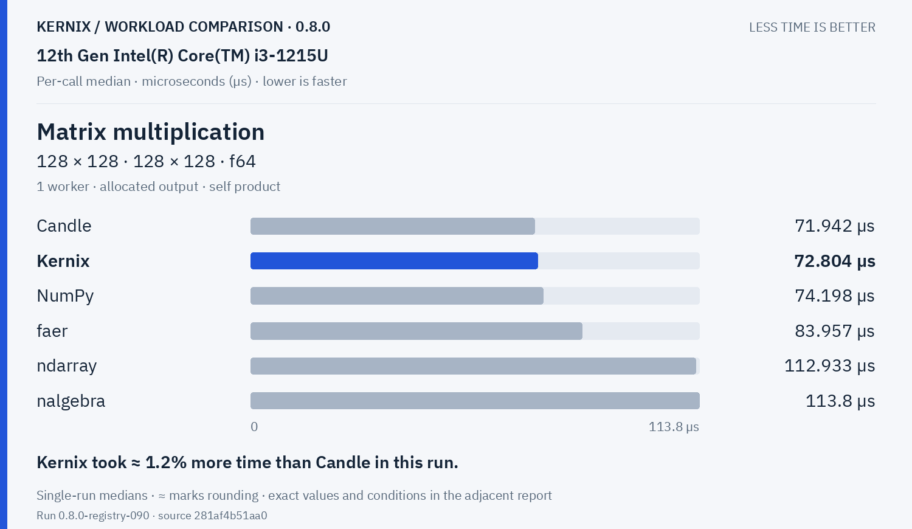

Kernix: **72.804 µs**. Kernix took ≈ 1.2% more time than Candle in this run.

**Matrix multiplication · 256 × 256 · 256 × 256 · f64**

Kernix: **550.76 µs**. Kernix took ≈ 2.0% less time than Candle in this run.

**Matrix multiplication · 64 × 64 · 64 × 64 · f32**

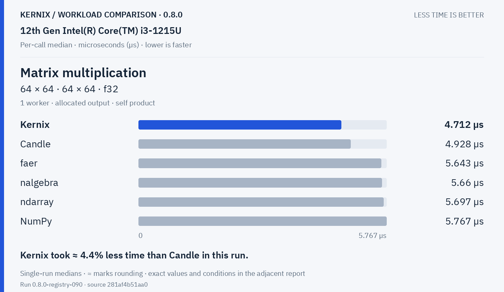

Kernix: **4.712 µs**. Kernix took ≈ 4.4% less time than Candle in this run.

**Matrix multiplication · 128 × 128 · 128 × 128 · f32**

Kernix: **34.962 µs**. Kernix took ≈ 0.6% less time than Candle in this run.

**Matrix multiplication · 256 × 256 · 256 × 256 · f32**

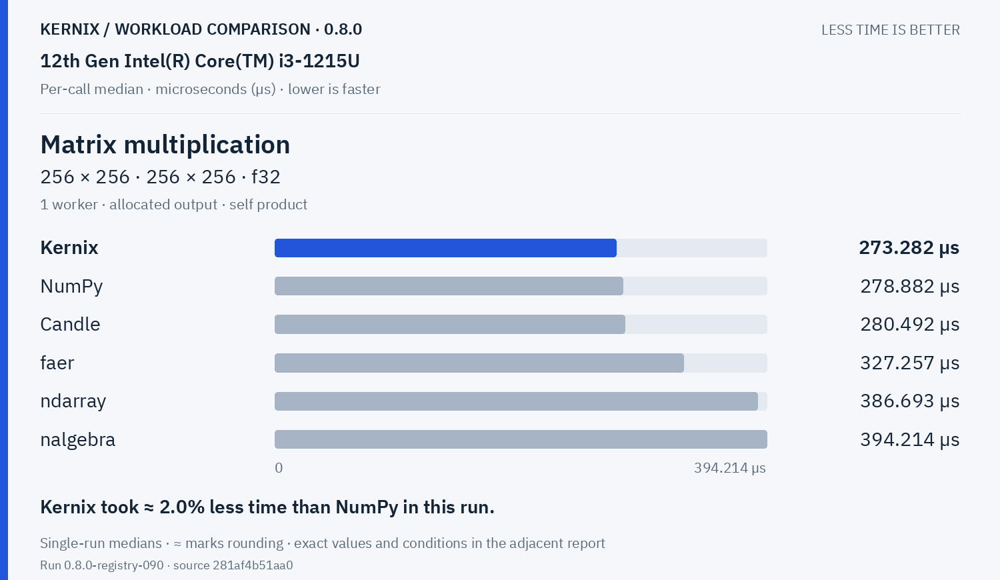

Kernix: **273.282 µs**. Kernix took ≈ 2.0% less time than NumPy in this run.

**Batched multiplication · 4 × 16 × 32 · 1 × 32 × 16 · f64**

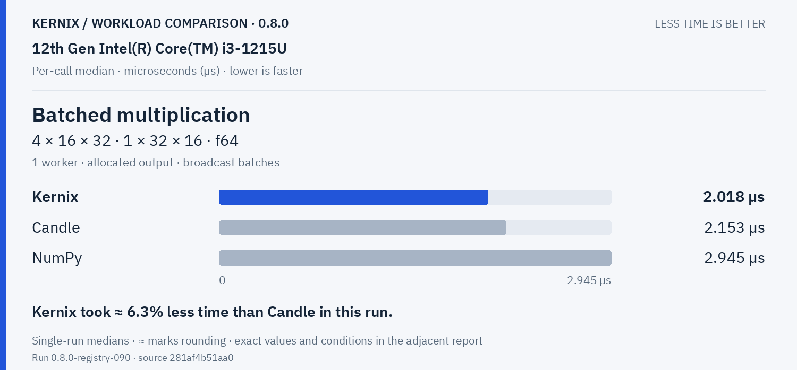

Kernix: **2.018 µs**. Kernix took ≈ 6.3% less time than Candle in this run.

Decompositions & solvers · 5 workloads

**Thin QR · 96 × 32 · f64**

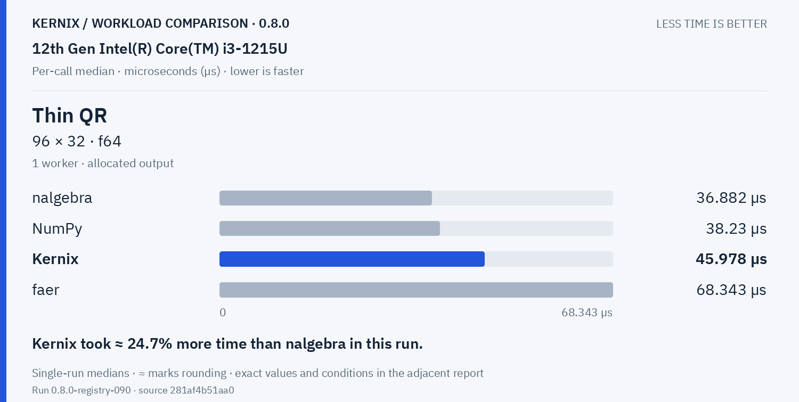

Kernix: **45.978 µs**. Kernix took ≈ 24.7% more time than nalgebra in this run.

**Thin QR · 256 × 64 · f64**

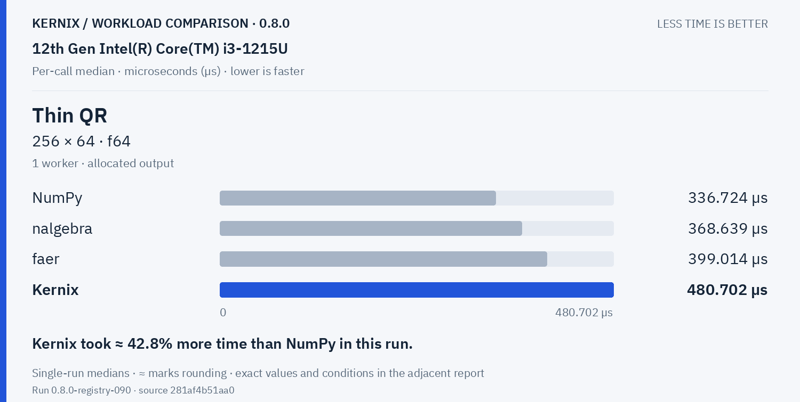

Kernix: **480.702 µs**. Kernix took ≈ 42.8% more time than NumPy in this run.

**Cholesky factorization · 64 × 64 · f64**

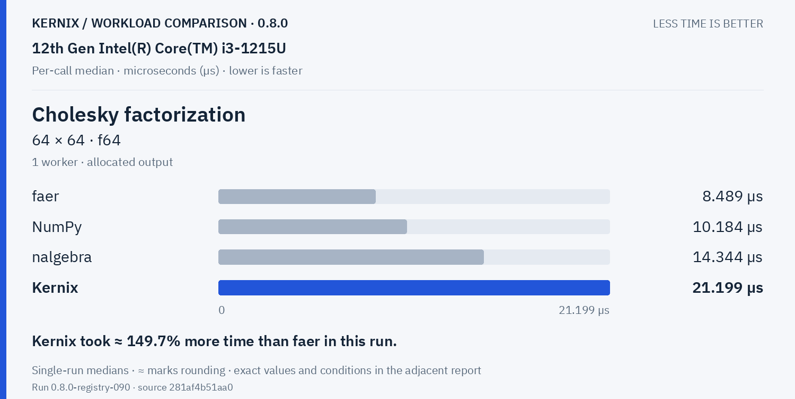

Kernix: **21.199 µs**. Kernix took ≈ 149.7% more time than faer in this run.

**Cholesky factorization · 128 × 128 · f64**

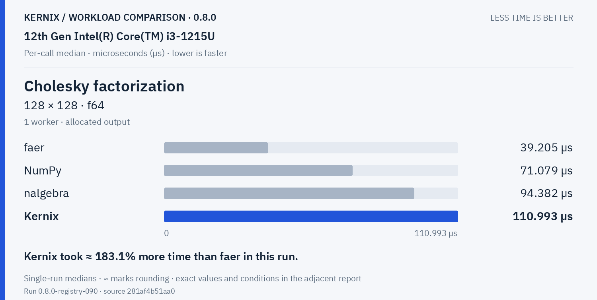

Kernix: **110.993 µs**. Kernix took ≈ 183.1% more time than faer in this run.

**Cholesky factorization · 256 × 256 · f64**

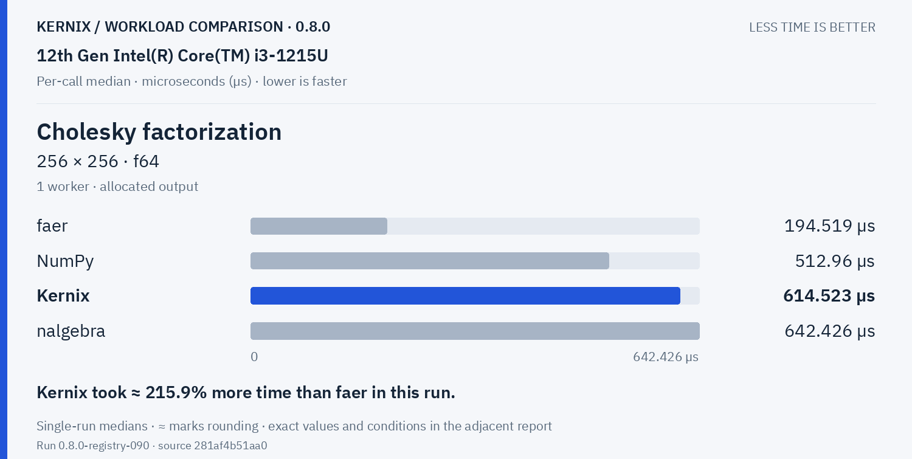

Kernix: **614.523 µs**. Kernix took ≈ 215.9% more time than faer in this run.

Training & autodiff · 5 workloads

**Record + backward · sum(A · W), 32 × 16 · 16 × 8 · f64**

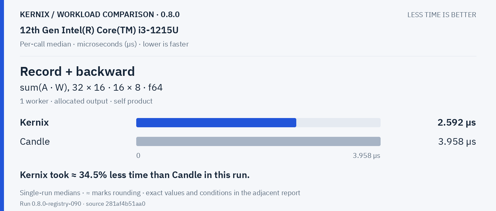

Kernix: **2.592 µs**. Kernix took ≈ 34.5% less time than Candle in this run.

**Model inference · batched normalized/sliced MLP · f64**

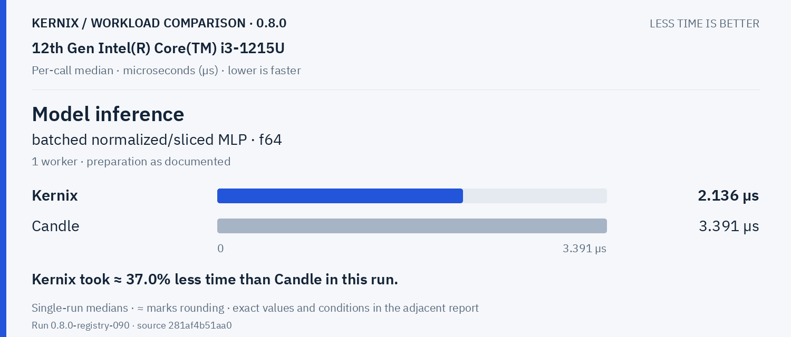

Kernix: **2.136 µs**. Kernix took ≈ 37.0% less time than Candle in this run.

**Model recording + forward · batched normalized/sliced MLP · f64**

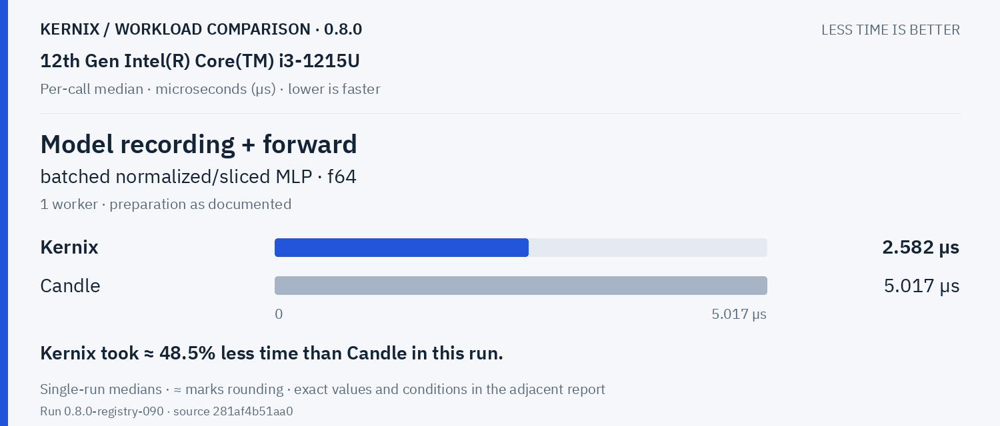

Kernix: **2.582 µs**. Kernix took ≈ 48.5% less time than Candle in this run.

**Model backward · prepared graph → fresh gradients · f64**

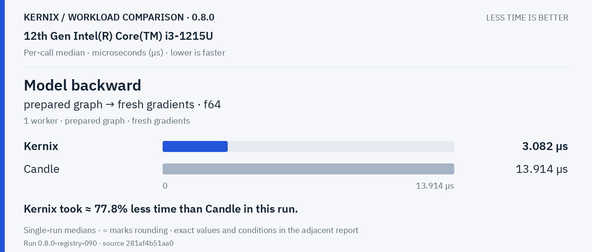

Kernix: **3.082 µs**. Kernix took ≈ 77.8% less time than Candle in this run.

**Parameter update · transactional SGD, fixed gradients · f64**

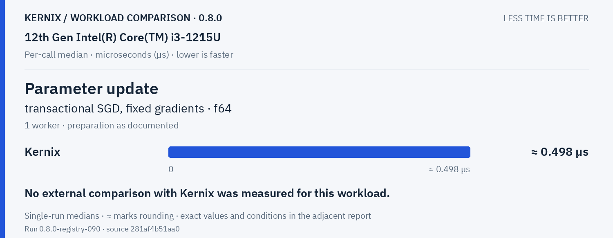

Kernix: **0.49800000000000006 µs**. No external comparison with Kernix was measured for this workload.

Statistics & activations · 1 workloads

**Row softmax · 256 × 64 · f64**

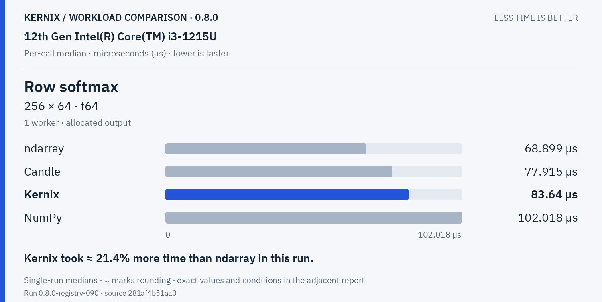

Kernix: **83.64 µs**. Kernix took ≈ 21.4% more time than ndarray in this run.

Tensor construction · 2 workloads

**Create zeros · 64 × 64 · f32**

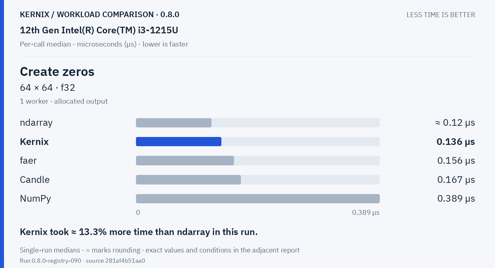

Kernix: **0.136 µs**. Kernix took ≈ 13.3% more time than ndarray in this run.

**Create ones · 64 × 64 · f32**

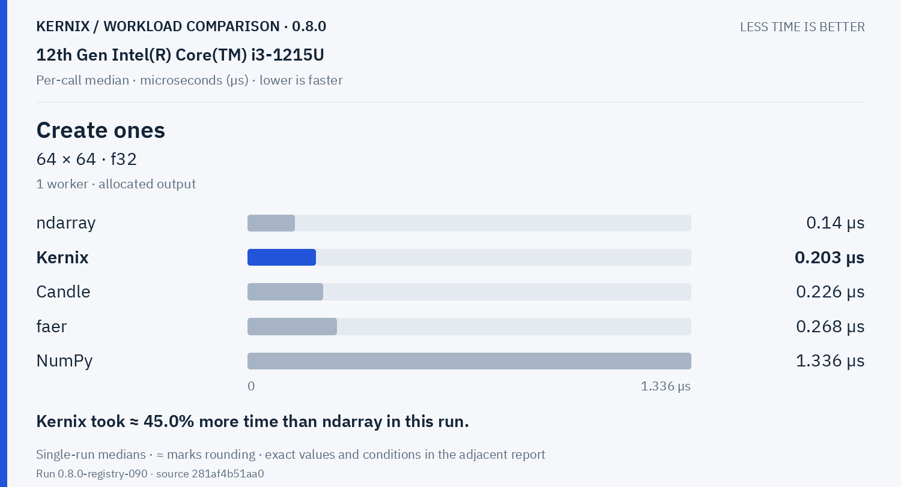

Kernix: **0.203 µs**. Kernix took ≈ 45.0% more time than ndarray in this run.

## Exact latency table

All values below are microseconds per operation. **Lower is faster.** Missing entries were not measured.

| Workload | Kernix | ndarray | nalgebra | faer | Candle | NumPy |
|---|---:|---:|---:|---:|---:|---:|
| Matrix multiplication · 32 × 32 · 32 × 32 · f64 | 1.529 | 1.517 | **1.384** | 1.78 | 1.434 | 2.519 |
| Matrix multiplication · 64 × 64 · 64 × 64 · f64 | 9.853 | 10.659 | 10.516 | 10.484 | **9.673** | 11.954 |
| Matrix multiplication · 128 × 128 · 128 × 128 · f64 | 72.804 | 112.933 | 113.8 | 83.957 | **71.942** | 74.198 |
| Matrix multiplication · 256 × 256 · 256 × 256 · f64 | **550.76** | 661.684 | 662.855 | 747.131 | 561.715 | 611.331 |
| Matrix multiplication · 64 × 64 · 64 × 64 · f32 | **4.712** | 5.697 | 5.66 | 5.643 | 4.928 | 5.767 |
| Matrix multiplication · 128 × 128 · 128 × 128 · f32 | **34.962** | 49.395 | 47.523 | 40.147 | 35.161 | 39.079 |
| Matrix multiplication · 256 × 256 · 256 × 256 · f32 | **273.282** | 386.693 | 394.214 | 327.257 | 280.492 | 278.882 |
| Batched multiplication · 4 × 16 × 32 · 1 × 32 × 16 · f64 | **2.018** | — | — | — | 2.153 | 2.945 |
| Thin QR · 96 × 32 · f64 | 45.978 | — | **36.882** | 68.343 | — | 38.23 |
| Thin QR · 256 × 64 · f64 | 480.702 | — | 368.639 | 399.014 | — | **336.724** |
| Cholesky factorization · 64 × 64 · f64 | 21.199 | — | 14.344 | **8.489** | — | 10.184 |
| Cholesky factorization · 128 × 128 · f64 | 110.993 | — | 94.382 | **39.205** | — | 71.079 |
| Cholesky factorization · 256 × 256 · f64 | 614.523 | — | 642.426 | **194.519** | — | 512.96 |
| Record + backward · sum(A · W), 32 × 16 · 16 × 8 · f64 | **2.592** | — | — | — | 3.958 | — |
| Model inference · batched normalized/sliced MLP · f64 | **2.136** | — | — | — | 3.391 | — |
| Model recording + forward · batched normalized/sliced MLP · f64 | **2.582** | — | — | — | 5.017 | — |
| Model backward · prepared graph → fresh gradients · f64 | **3.082** | — | — | — | 13.914 | — |
| Parameter update · transactional SGD, fixed gradients · f64 | 0.49800000000000006 | — | — | — | — | — |
| Row softmax · 256 × 64 · f64 | 83.64 | **68.899** | — | — | 77.915 | 102.018 |
| Create zeros · 64 × 64 · f32 | 0.136 | **0.11999999999999999** | — | 0.156 | 0.167 | 0.389 |
| Create ones · 64 × 64 · f32 | 0.203 | **0.14** | — | 0.268 | 0.226 | 1.336 |

## Version comparison

0 of 21 workloads have paired evidence. Exploratory 95% intervals resample process pairs, not calls. No multiple-comparison adjustment.

| Workload | Current / baseline [95% interval] | Interpretation |
|---|---:|---|
| Matrix multiplication · 32 × 32 · 32 × 32 · f64 | — | No paired comparison |
| Matrix multiplication · 64 × 64 · 64 × 64 · f64 | — | No paired comparison |
| Matrix multiplication · 128 × 128 · 128 × 128 · f64 | — | No paired comparison |
| Matrix multiplication · 256 × 256 · 256 × 256 · f64 | — | No paired comparison |
| Matrix multiplication · 64 × 64 · 64 × 64 · f32 | — | No paired comparison |
| Matrix multiplication · 128 × 128 · 128 × 128 · f32 | — | No paired comparison |
| Matrix multiplication · 256 × 256 · 256 × 256 · f32 | — | No paired comparison |
| Batched multiplication · 4 × 16 × 32 · 1 × 32 × 16 · f64 | — | No paired comparison |
| Thin QR · 96 × 32 · f64 | — | No paired comparison |
| Thin QR · 256 × 64 · f64 | — | No paired comparison |
| Cholesky factorization · 64 × 64 · f64 | — | No paired comparison |
| Cholesky factorization · 128 × 128 · f64 | — | No paired comparison |
| Cholesky factorization · 256 × 256 · f64 | — | No paired comparison |
| Record + backward · sum(A · W), 32 × 16 · 16 × 8 · f64 | — | No paired comparison |
| Model inference · batched normalized/sliced MLP · f64 | — | No paired comparison |
| Model recording + forward · batched normalized/sliced MLP · f64 | — | No paired comparison |
| Model backward · prepared graph → fresh gradients · f64 | — | No paired comparison |
| Parameter update · transactional SGD, fixed gradients · f64 | — | No paired comparison |
| Row softmax · 256 × 64 · f64 | — | No paired comparison |
| Create zeros · 64 × 64 · f32 | — | No paired comparison |
| Create ones · 64 × 64 · f32 | — | No paired comparison |

## Method and provenance

CPU affinity pinned to logical CPU 0. Frequency and background load are uncontrolled.

Numbers retain source precision; recorded digits do not imply equivalent physical measurement accuracy. Lowest observed medians are bold only when peers were measured. No aggregate winner or universal ranking is inferred.

[Original report and commentary](original-report.txt) · [Raw measurements](raw.json)

Measured source `281af4b51aa0fe6f354770c2d4f3d18544586377`. Run `0.8.0-registry-090`. Rendering does not change measurements.
