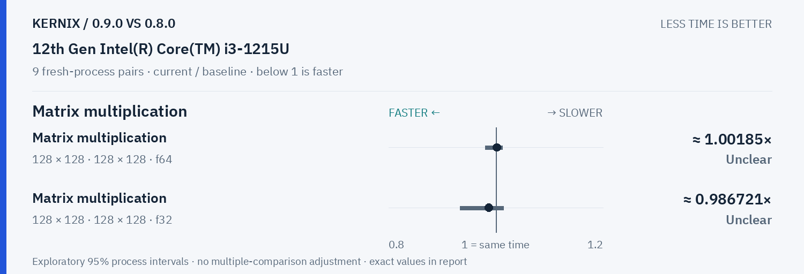

# Kernix 0.9.0 · paired process comparison

9 fresh-process pairs per workload. Ratios below 1 mean less time.

[Open visual comparison](report.html) · [Vector PDF](latency.pdf) · [Original process evidence](paired.json)

### Version changes at a glance

The vertical line marks unchanged time. Left is faster; right is slower. Ranges are exploratory 95% intervals over fresh-process pairs. An interval crossing the line leaves direction unclear.

## Exact process ratios

| Workload | Current / baseline [95% interval] | Interpretation |
|---|---:|---|
| Cholesky factorization · 64 × 64 · f64 | 0.9773944919635305× [0.9235327313769752, 1.0403771163433535] | Timing direction unclear |
| Cholesky factorization · 128 × 128 · f64 | 0.9789425417092872× [0.9268104333538715, 1.018511826247222] | Timing direction unclear |
| Cholesky factorization · 256 × 256 · f64 | 1.0069935500152878× [0.9932964002130146, 1.025894234196159] | Timing direction unclear |
| Thin QR · 96 × 32 · f64 | 1.0491846686820097× [0.9656443002198263, 1.0593508293468055] | Timing direction unclear |
| Thin QR · 256 × 64 · f64 | 1.020154379165327× [0.9954990521073648, 1.0457764236184073] | Timing direction unclear |
| Matrix multiplication · 128 × 128 · 128 × 128 · f64 | 1.0018462734428142× [0.9800260353103897, 1.0123633757391148] | Timing direction unclear |
| Matrix multiplication · 128 × 128 · 128 × 128 · f32 | 0.9867207984437114× [0.9328305380091483, 1.0138829376981746] | Timing direction unclear |

## Method

95% percentile bootstrap over paired process blocks; 10000 resamples; exploratory, no multiple-comparison adjustment

Current `0.9.0-final`; baseline `0.8.0-registry-090`. All source ratio digits, paired observations and process ordering are preserved. No absolute peer latencies are inferred.
