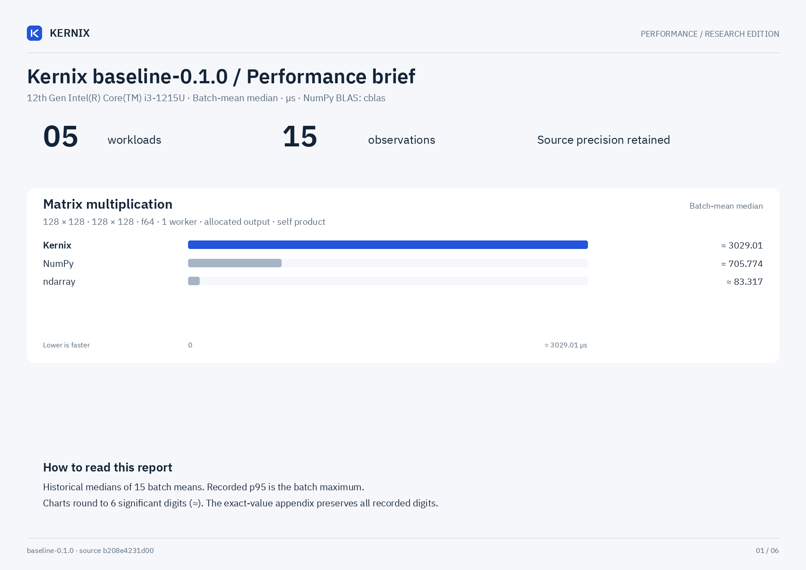

# Kernix baseline-0.1.0 · performance brief

12th Gen Intel(R) Core(TM) i3-1215U / Linux

**Batch-mean median, microseconds per operation. Lower is faster. All recorded digits retained.**

5 workloads · 15 observations

No previous-version baseline attached. Sequential run changes are descriptive; paired process evidence is shown separately.

[Open the visual report](report.html) · [Vector PDF](latency.pdf) · [Raw measurements](raw.json)

| Workload | Kernix | ndarray | NumPy |
|---|---:|---:|---:|
| Matrix multiplication · 32 × 32 · 32 × 32 · f64 | 32.012596670934698 | **1.502201405996515** | 11.043529801324503 |
| Matrix multiplication · 128 × 128 · 128 × 128 · f64 | 3029.011111111111 | **83.31696677740864** | 705.7743333333334 |
| Elementwise addition · 65,536 elements · f64 | 23.401578110383536 | **21.198666101694915** | 23.480653521126762 |
| Sum reduction · 65,536 elements · f64 | 31.027383374689827 | **5.697730856882406** | 10.183508957654723 |
| Row softmax · 256 × 64 · f64 | 397.7875396825397 | **67.23014516129032** | 94.60170943396227 |

## Version comparison

0 of 5 workloads have paired evidence. Exploratory 95% intervals resample process pairs, not calls. No multiple-comparison adjustment.

| Workload | Current / baseline [95% interval] | Interpretation |
|---|---:|---|
| Matrix multiplication · 32 × 32 · 32 × 32 · f64 | — | No paired comparison |
| Matrix multiplication · 128 × 128 · 128 × 128 · f64 | — | No paired comparison |
| Elementwise addition · 65,536 elements · f64 | — | No paired comparison |
| Sum reduction · 65,536 elements · f64 | — | No paired comparison |
| Row softmax · 256 × 64 · f64 | — | No paired comparison |

## Historical statistic

These are medians of 15 warmed batch means, not per-call medians. The original p95 field is the maximum of those 15 batch means. No per-call p95/p99, accuracy or allocation probes are inferred.

## Method and provenance

CPU affinity was not pinned. Frequency and background load are uncontrolled.

Numbers retain source precision; recorded digits do not imply equivalent physical measurement accuracy. Lowest observed medians are bold only when peers were measured. No aggregate winner or universal ranking is inferred.

[Original report and commentary](original-report.txt) · [Raw measurements](raw.json)

Measured source `b208e4231d00635eb4abb5c1647222f5779c43a9`. Run `baseline-0.1.0`. Rendering does not change measurements.
