# Kernix 0.10.0 · performance brief

Apple M1 (Virtual) / macOS

**Per-call median, microseconds per operation. Lower is faster. All recorded digits retained.**

34 workloads · 116 observations

No previous-version baseline attached. Sequential run changes are descriptive; paired process evidence is shown separately.

[Interactive HTML (open locally)](report.html) · [Vector PDF](latency.pdf) · [Raw measurements](raw.json)

[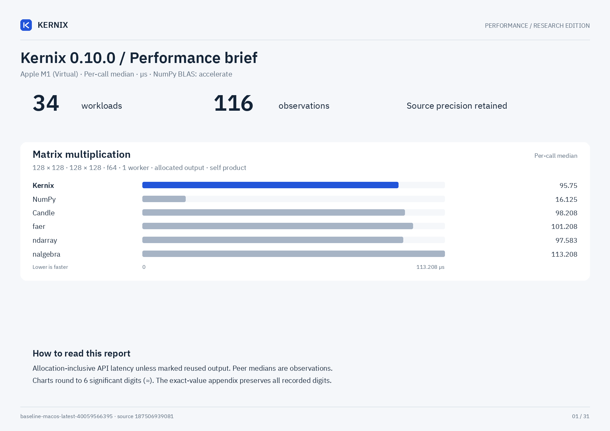](latency.pdf)

## Charts by workload

**Shorter bars mean less time.** Blue is Kernix; grey is another library; teal is an explicitly selected Kernix backend. Entries are sorted by the recorded median, with a separate zero-based scale per chart. These point observations do not establish a statistical ranking.

Expand a group to see every chart here on GitHub. Click a chart to enlarge it. The exact table below keeps every source digit.

Matrix multiplication · 10 workloads

**Independent matrix operands · 128 × 128 · 128 × 128 · f64**

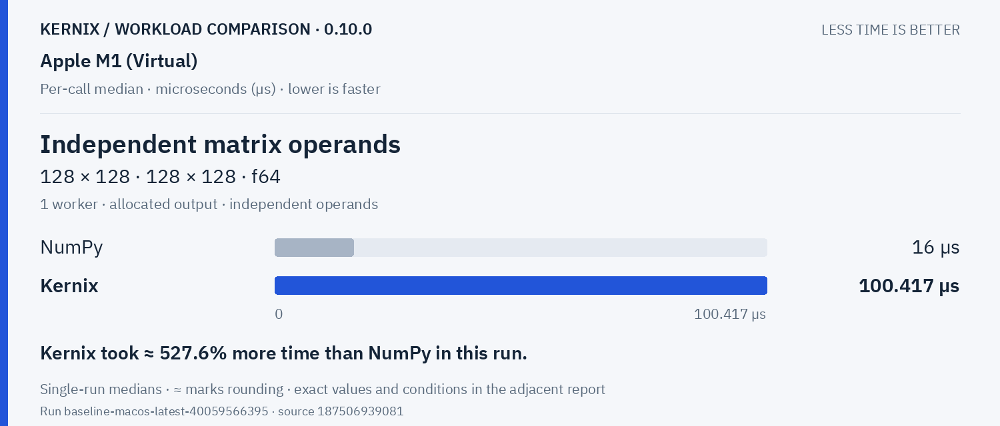

Kernix: **100.417 µs**. Kernix took ≈ 527.6% more time than NumPy in this run.

**Independent matrix operands · 128 × 128 · 128 × 128 · f32**

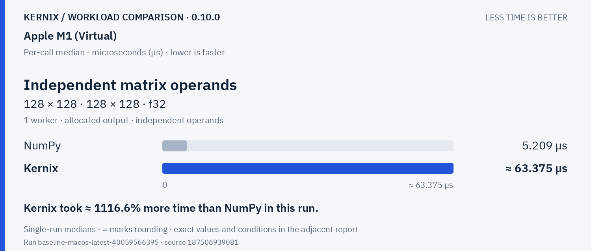

Kernix: **63.37499999999999 µs**. Kernix took ≈ 1116.6% more time than NumPy in this run.

**Matrix multiplication · 32 × 32 · 32 × 32 · f64**

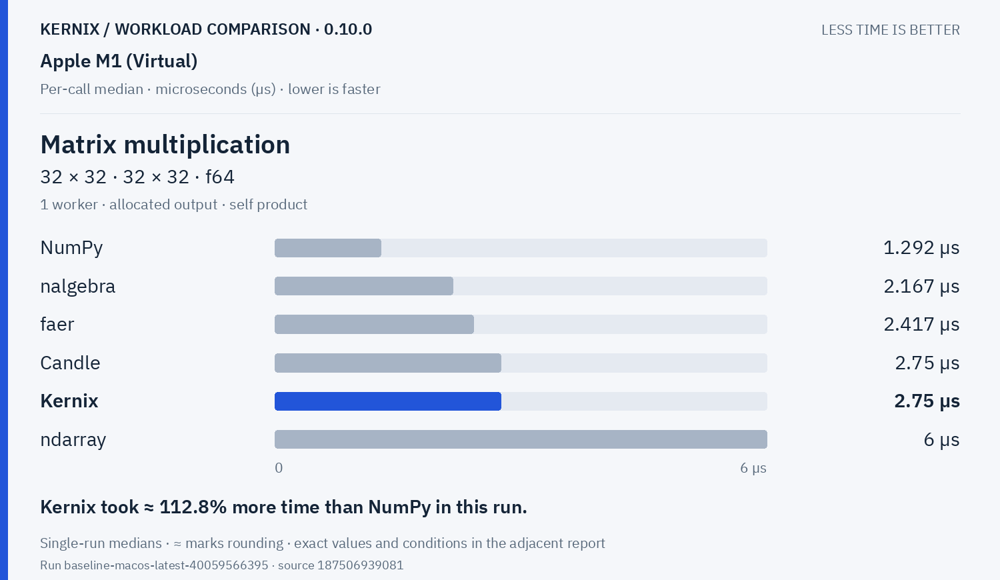

Kernix: **2.75 µs**. Kernix took ≈ 112.8% more time than NumPy in this run.

**Matrix multiplication · 64 × 64 · 64 × 64 · f64**

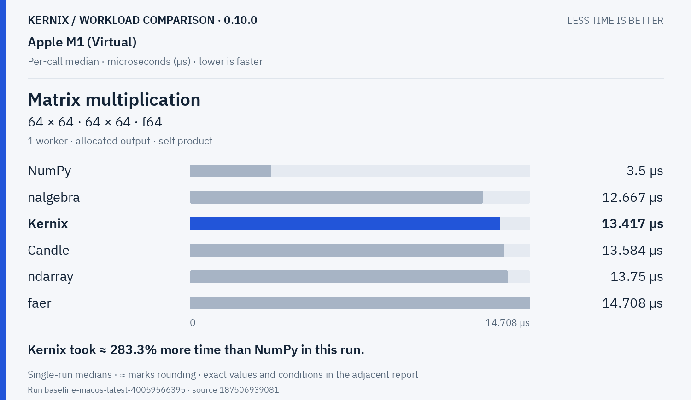

Kernix: **13.417 µs**. Kernix took ≈ 283.3% more time than NumPy in this run.

**Matrix multiplication · 128 × 128 · 128 × 128 · f64**

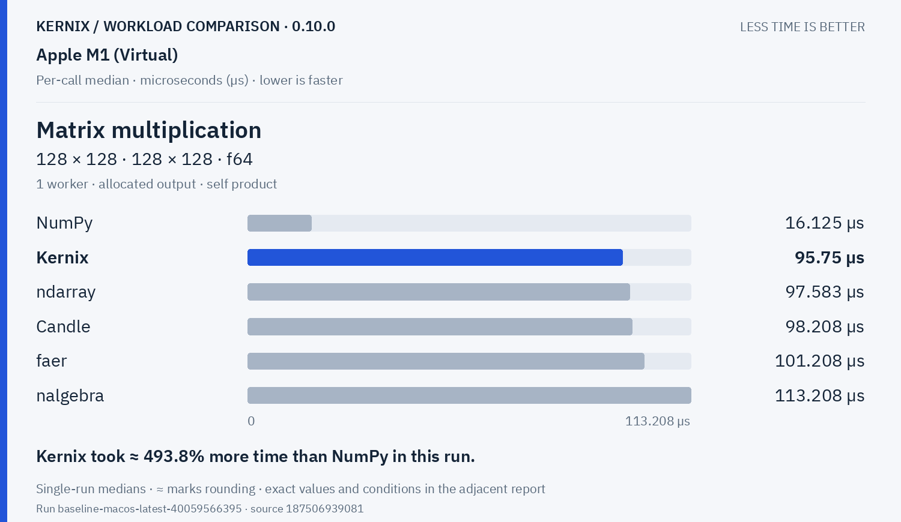

Kernix: **95.75 µs**. Kernix took ≈ 493.8% more time than NumPy in this run.

**Matrix multiplication · 256 × 256 · 256 × 256 · f64**

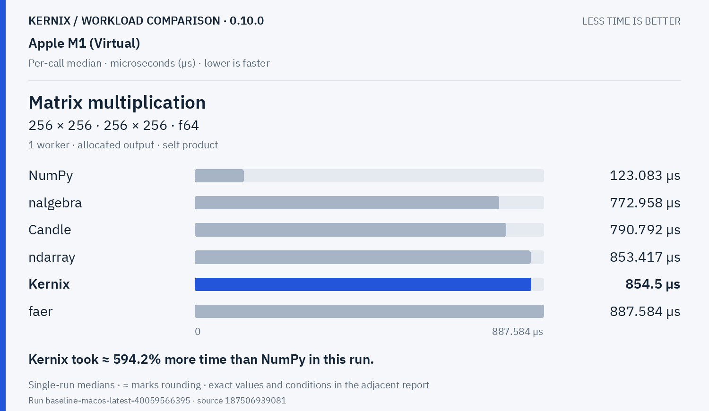

Kernix: **854.5 µs**. Kernix took ≈ 594.2% more time than NumPy in this run.

**Matrix multiplication · 64 × 64 · 64 × 64 · f32**

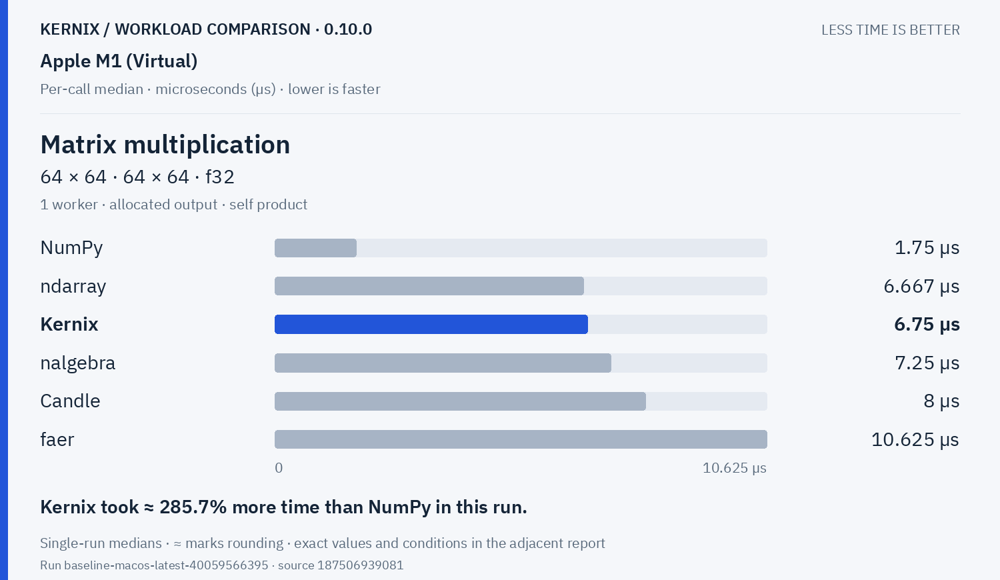

Kernix: **6.75 µs**. Kernix took ≈ 285.7% more time than NumPy in this run.

**Matrix multiplication · 128 × 128 · 128 × 128 · f32**

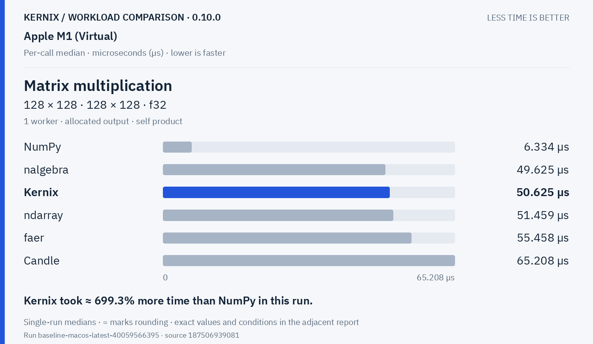

Kernix: **50.625 µs**. Kernix took ≈ 699.3% more time than NumPy in this run.

**Matrix multiplication · 256 × 256 · 256 × 256 · f32**

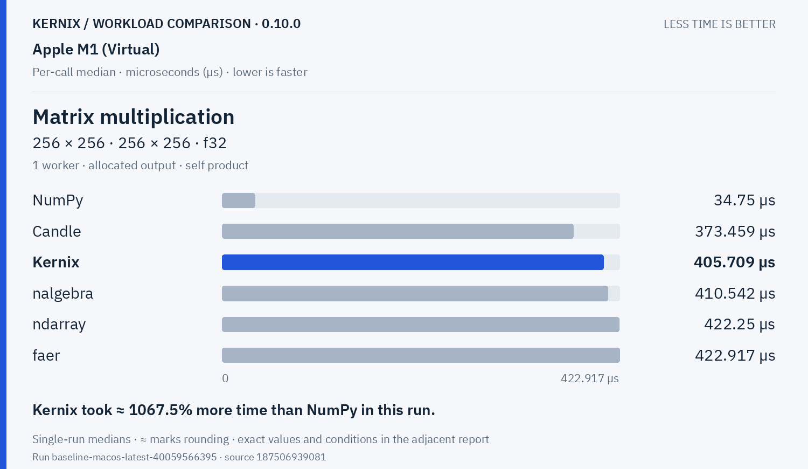

Kernix: **405.709 µs**. Kernix took ≈ 1067.5% more time than NumPy in this run.

**Batched multiplication · 4 × 16 × 32 · 1 × 32 × 16 · f64**

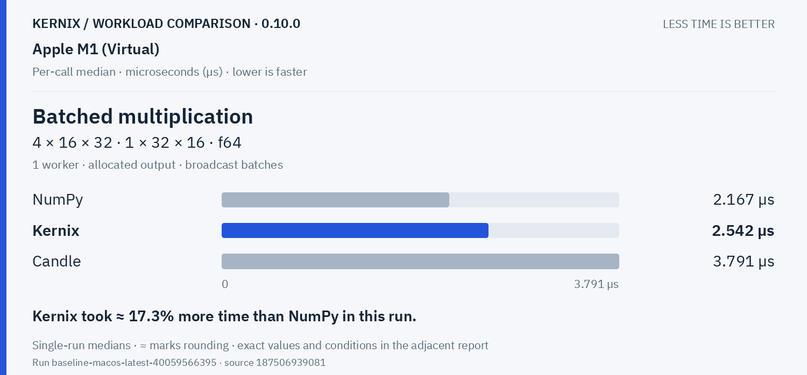

Kernix: **2.542 µs**. Kernix took ≈ 17.3% more time than NumPy in this run.

Explicit parallel execution · 4 workloads

**Matmul · 2 workers · reused output · 64 × 64 · 64 × 64 · f64**

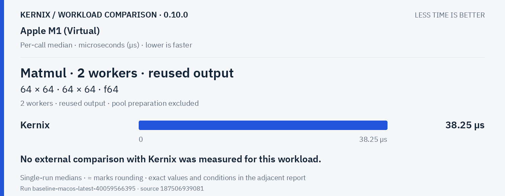

Kernix: **38.25 µs**. No external comparison with Kernix was measured for this workload.

**Matmul · 2 workers · reused output · 128 × 128 · 128 × 128 · f64**

Kernix: **141.291 µs**. No external comparison with Kernix was measured for this workload.

**Matmul · 2 workers · reused output · 256 × 256 · 256 × 256 · f64**

Kernix: **454.917 µs**. No external comparison with Kernix was measured for this workload.

**Matmul · 2 workers · reused output · 128 × 128 · 128 × 128 · f32**

Kernix: **52.375 µs**. No external comparison with Kernix was measured for this workload.

Decompositions & solvers · 10 workloads

**Cholesky factorization · 512 × 512 · f64**

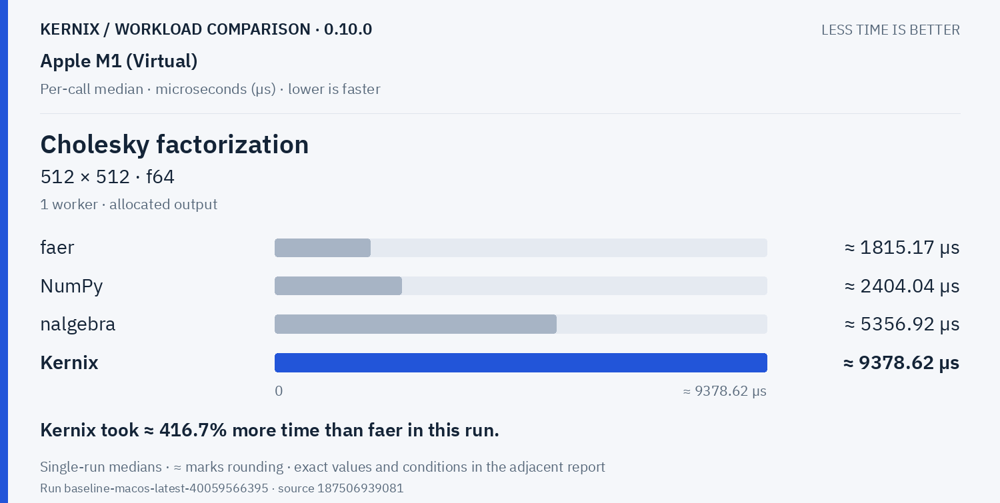

Kernix: **9378.625 µs**. Kernix took ≈ 416.7% more time than faer in this run.

**Column-pivoted QR · 96 × 32 · f64**

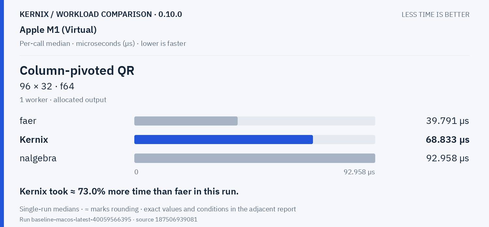

Kernix: **68.833 µs**. Kernix took ≈ 73.0% more time than faer in this run.

**Column-pivoted QR · 256 × 64 · f64**

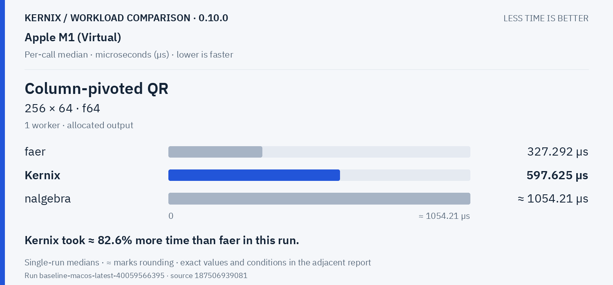

Kernix: **597.625 µs**. Kernix took ≈ 82.6% more time than faer in this run.

**Minimum-norm least squares · 64 × 32, rank 16, 4 RHS · f64**

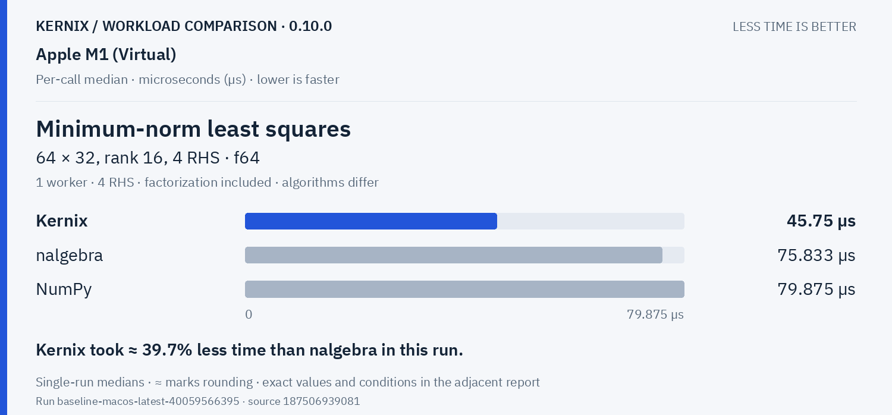

Kernix: **45.75 µs**. Kernix took ≈ 39.7% less time than nalgebra in this run.

**Minimum-norm least squares · 32 × 64, rank 32, 4 RHS · f64**

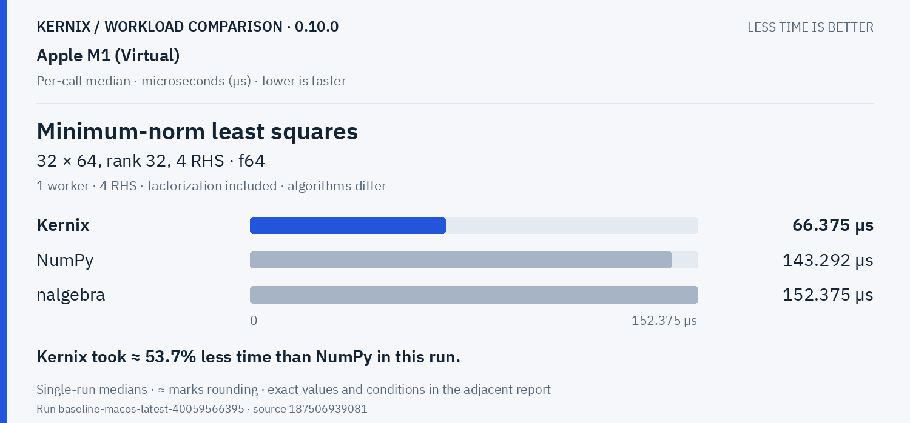

Kernix: **66.375 µs**. Kernix took ≈ 53.7% less time than NumPy in this run.

**Thin QR · 96 × 32 · f64**

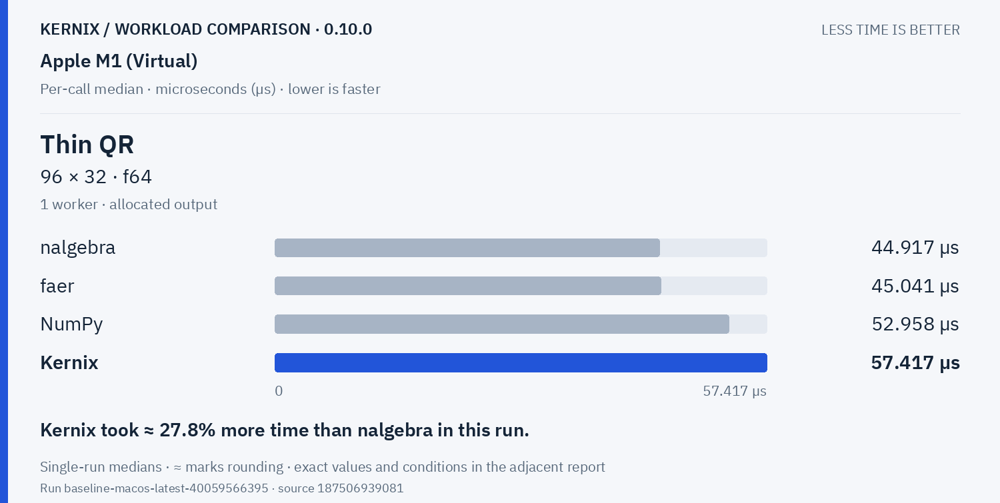

Kernix: **57.417 µs**. Kernix took ≈ 27.8% more time than nalgebra in this run.

**Thin QR · 256 × 64 · f64**

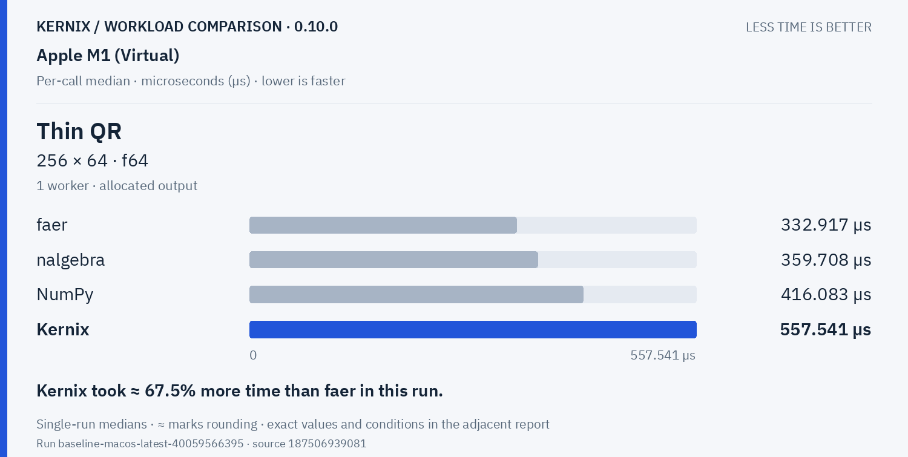

Kernix: **557.541 µs**. Kernix took ≈ 67.5% more time than faer in this run.

**Cholesky factorization · 64 × 64 · f64**

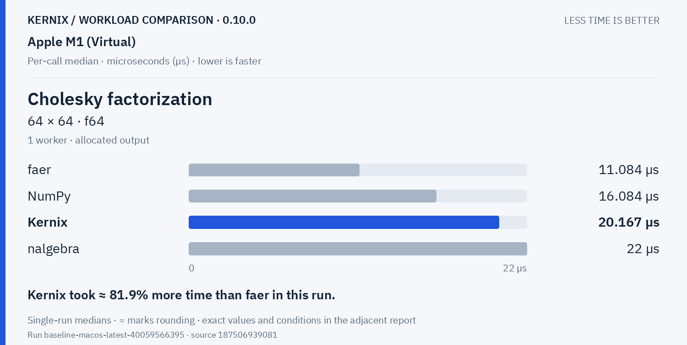

Kernix: **20.167 µs**. Kernix took ≈ 81.9% more time than faer in this run.

**Cholesky factorization · 128 × 128 · f64**

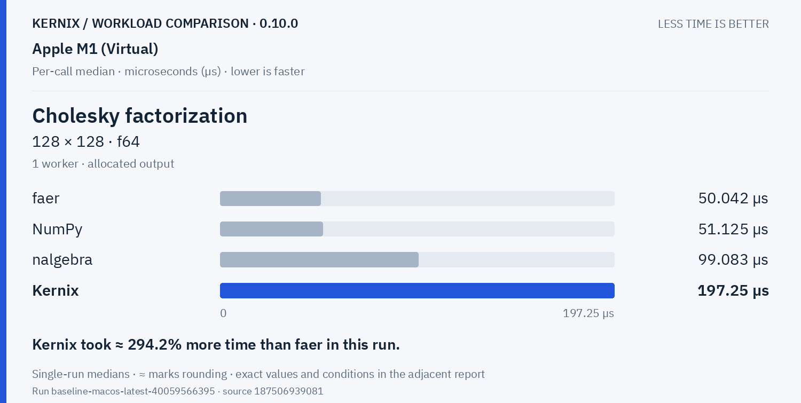

Kernix: **197.25 µs**. Kernix took ≈ 294.2% more time than faer in this run.

**Cholesky factorization · 256 × 256 · f64**

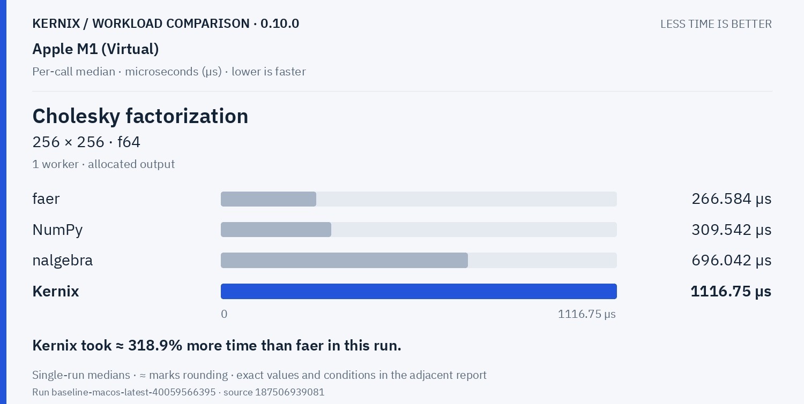

Kernix: **1116.75 µs**. Kernix took ≈ 318.9% more time than faer in this run.

Training & autodiff · 6 workloads

**Shared-variable backward · sum(X * X), 64 × 32; prepared graph · f64**

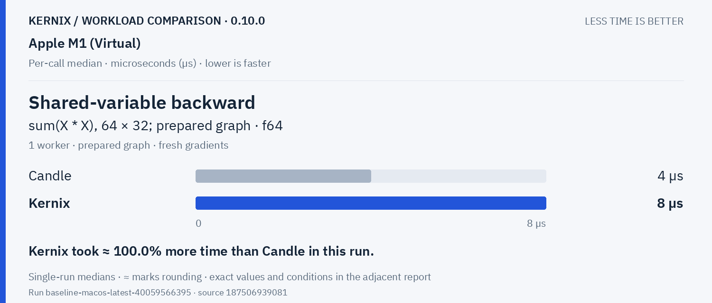

Kernix: **8 µs**. Kernix took ≈ 100.0% more time than Candle in this run.

**Record + backward · sum(A · W), 32 × 16 · 16 × 8 · f64**

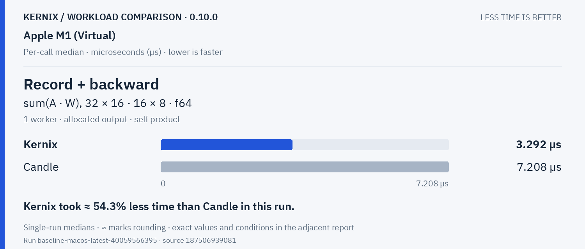

Kernix: **3.292 µs**. Kernix took ≈ 54.3% less time than Candle in this run.

**Model inference · batched normalized/sliced MLP · f64**

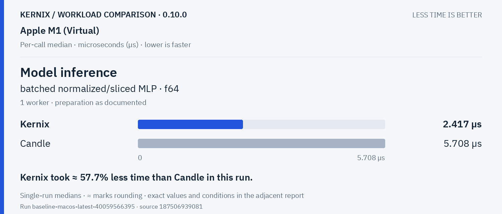

Kernix: **2.417 µs**. Kernix took ≈ 57.7% less time than Candle in this run.

**Model recording + forward · batched normalized/sliced MLP · f64**

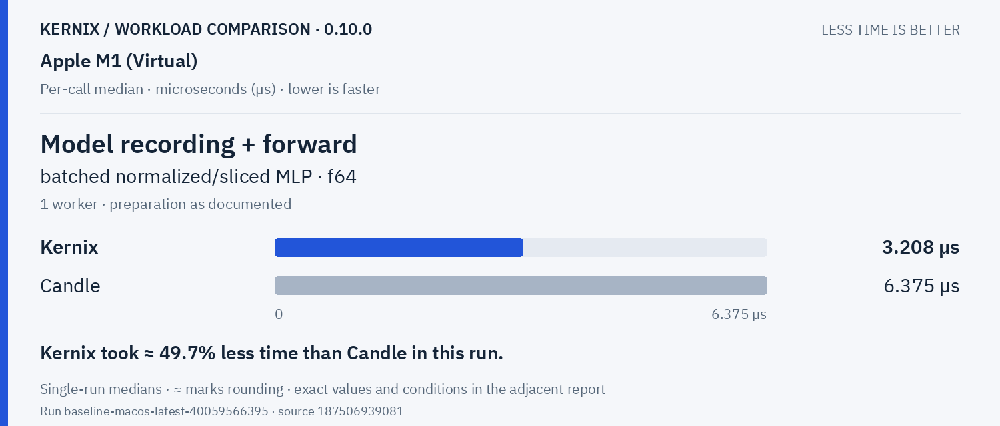

Kernix: **3.208 µs**. Kernix took ≈ 49.7% less time than Candle in this run.

**Model backward · prepared graph → fresh gradients · f64**

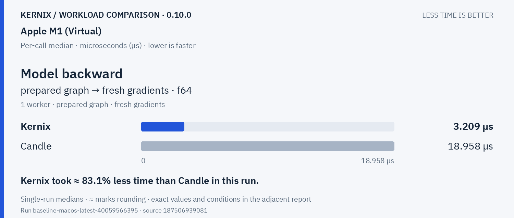

Kernix: **3.209 µs**. Kernix took ≈ 83.1% less time than Candle in this run.

**Parameter update · transactional SGD, fixed gradients · f64**

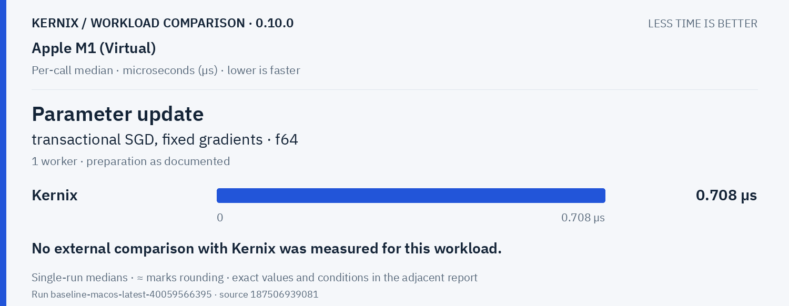

Kernix: **0.708 µs**. No external comparison with Kernix was measured for this workload.

Tensor contractions · 1 workloads

**Coalesced tensor contraction · 16 × 32 × 8 · 32 × 8 × 16 · f64**

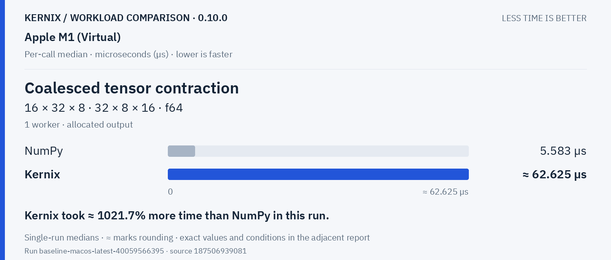

Kernix: **62.62500000000001 µs**. Kernix took ≈ 1021.7% more time than NumPy in this run.

Statistics & activations · 1 workloads

**Row softmax · 256 × 64 · f64**

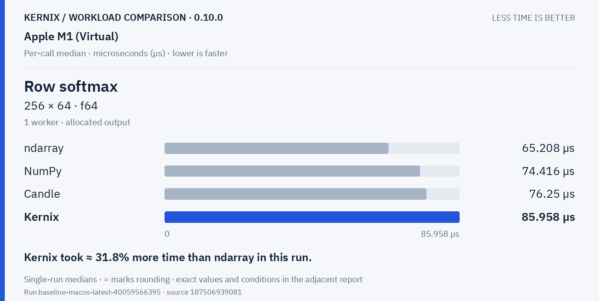

Kernix: **85.958 µs**. Kernix took ≈ 31.8% more time than ndarray in this run.

Tensor construction · 2 workloads

**Create zeros · 64 × 64 · f32**

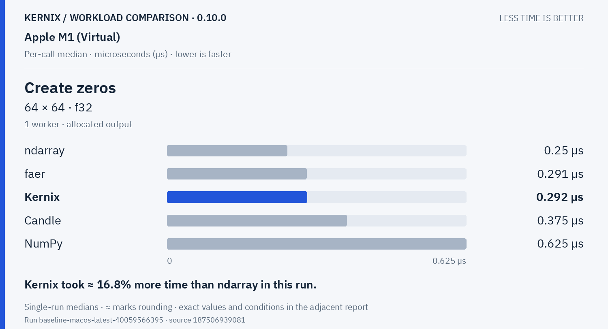

Kernix: **0.292 µs**. Kernix took ≈ 16.8% more time than ndarray in this run.

**Create ones · 64 × 64 · f32**

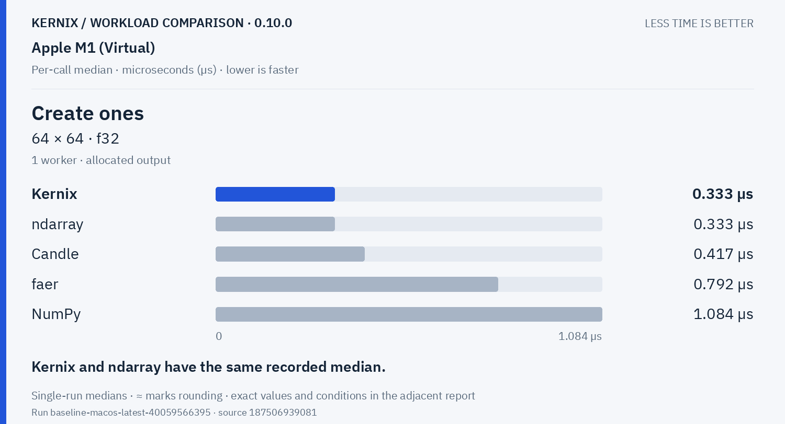

Kernix: **0.333 µs**. Kernix and ndarray have the same recorded median.

## Exact latency table

All values below are microseconds per operation. **Lower is faster.** Missing entries were not measured.

| Workload | Kernix | ndarray | nalgebra | faer | Candle | NumPy |
|---|---:|---:|---:|---:|---:|---:|
| Independent matrix operands · 128 × 128 · 128 × 128 · f64 | 100.417 | — | — | — | — | **16** |
| Independent matrix operands · 128 × 128 · 128 × 128 · f32 | 63.37499999999999 | — | — | — | — | **5.209** |
| Matrix multiplication · 32 × 32 · 32 × 32 · f64 | 2.75 | 6 | 2.167 | 2.417 | 2.75 | **1.292** |
| Matrix multiplication · 64 × 64 · 64 × 64 · f64 | 13.417 | 13.75 | 12.667 | 14.708 | 13.584 | **3.5** |
| Matrix multiplication · 128 × 128 · 128 × 128 · f64 | 95.75 | 97.583 | 113.208 | 101.208 | 98.208 | **16.125** |
| Matrix multiplication · 256 × 256 · 256 × 256 · f64 | 854.5 | 853.417 | 772.958 | 887.584 | 790.792 | **123.083** |
| Matrix multiplication · 64 × 64 · 64 × 64 · f32 | 6.75 | 6.667 | 7.25 | 10.625 | 8 | **1.75** |
| Matrix multiplication · 128 × 128 · 128 × 128 · f32 | 50.625 | 51.459 | 49.625 | 55.458 | 65.208 | **6.334** |
| Matrix multiplication · 256 × 256 · 256 × 256 · f32 | 405.709 | 422.25 | 410.542 | 422.917 | 373.459 | **34.75** |
| Batched multiplication · 4 × 16 × 32 · 1 × 32 × 16 · f64 | 2.542 | — | — | — | 3.791 | **2.167** |
| Matmul · 2 workers · reused output · 64 × 64 · 64 × 64 · f64 | 38.25 | — | — | — | — | — |
| Matmul · 2 workers · reused output · 128 × 128 · 128 × 128 · f64 | 141.291 | — | — | — | — | — |
| Matmul · 2 workers · reused output · 256 × 256 · 256 × 256 · f64 | 454.917 | — | — | — | — | — |
| Matmul · 2 workers · reused output · 128 × 128 · 128 × 128 · f32 | 52.375 | — | — | — | — | — |
| Cholesky factorization · 512 × 512 · f64 | 9378.625 | — | 5356.917 | **1815.166** | — | 2404.042 |
| Column-pivoted QR · 96 × 32 · f64 | 68.833 | — | 92.958 | **39.791** | — | — |
| Column-pivoted QR · 256 × 64 · f64 | 597.625 | — | 1054.208 | **327.292** | — | — |
| Minimum-norm least squares · 64 × 32, rank 16, 4 RHS · f64 | **45.75** | — | 75.833 | — | — | 79.875 |
| Minimum-norm least squares · 32 × 64, rank 32, 4 RHS · f64 | **66.375** | — | 152.375 | — | — | 143.292 |
| Thin QR · 96 × 32 · f64 | 57.417 | — | **44.917** | 45.041 | — | 52.958 |
| Thin QR · 256 × 64 · f64 | 557.541 | — | 359.708 | **332.917** | — | 416.083 |
| Cholesky factorization · 64 × 64 · f64 | 20.167 | — | 22 | **11.084** | — | 16.084 |
| Cholesky factorization · 128 × 128 · f64 | 197.25 | — | 99.083 | **50.042** | — | 51.125 |
| Cholesky factorization · 256 × 256 · f64 | 1116.75 | — | 696.042 | **266.584** | — | 309.542 |
| Shared-variable backward · sum(X * X), 64 × 32; prepared graph · f64 | 8 | — | — | — | **4** | — |
| Record + backward · sum(A · W), 32 × 16 · 16 × 8 · f64 | **3.292** | — | — | — | 7.208 | — |
| Model inference · batched normalized/sliced MLP · f64 | **2.417** | — | — | — | 5.708 | — |
| Model recording + forward · batched normalized/sliced MLP · f64 | **3.208** | — | — | — | 6.375 | — |
| Model backward · prepared graph → fresh gradients · f64 | **3.209** | — | — | — | 18.958 | — |
| Parameter update · transactional SGD, fixed gradients · f64 | 0.708 | — | — | — | — | — |
| Coalesced tensor contraction · 16 × 32 × 8 · 32 × 8 × 16 · f64 | 62.62500000000001 | — | — | — | — | **5.583** |
| Row softmax · 256 × 64 · f64 | 85.958 | **65.208** | — | — | 76.25 | 74.416 |
| Create zeros · 64 × 64 · f32 | 0.292 | **0.25** | — | 0.291 | 0.375 | 0.625 |
| Create ones · 64 × 64 · f32 | **0.333** | **0.333** | — | 0.792 | 0.417 | 1.084 |

## Version comparison

0 of 34 workloads have paired evidence. Exploratory 95% intervals resample process pairs, not calls. No multiple-comparison adjustment.

| Workload | Current / baseline [95% interval] | Interpretation |
|---|---:|---|
| Independent matrix operands · 128 × 128 · 128 × 128 · f64 | — | No paired comparison |
| Independent matrix operands · 128 × 128 · 128 × 128 · f32 | — | No paired comparison |
| Matrix multiplication · 32 × 32 · 32 × 32 · f64 | — | No paired comparison |
| Matrix multiplication · 64 × 64 · 64 × 64 · f64 | — | No paired comparison |
| Matrix multiplication · 128 × 128 · 128 × 128 · f64 | — | No paired comparison |
| Matrix multiplication · 256 × 256 · 256 × 256 · f64 | — | No paired comparison |
| Matrix multiplication · 64 × 64 · 64 × 64 · f32 | — | No paired comparison |
| Matrix multiplication · 128 × 128 · 128 × 128 · f32 | — | No paired comparison |
| Matrix multiplication · 256 × 256 · 256 × 256 · f32 | — | No paired comparison |
| Batched multiplication · 4 × 16 × 32 · 1 × 32 × 16 · f64 | — | No paired comparison |
| Matmul · 2 workers · reused output · 64 × 64 · 64 × 64 · f64 | — | No paired comparison |
| Matmul · 2 workers · reused output · 128 × 128 · 128 × 128 · f64 | — | No paired comparison |
| Matmul · 2 workers · reused output · 256 × 256 · 256 × 256 · f64 | — | No paired comparison |
| Matmul · 2 workers · reused output · 128 × 128 · 128 × 128 · f32 | — | No paired comparison |
| Cholesky factorization · 512 × 512 · f64 | — | No paired comparison |
| Column-pivoted QR · 96 × 32 · f64 | — | No paired comparison |
| Column-pivoted QR · 256 × 64 · f64 | — | No paired comparison |
| Minimum-norm least squares · 64 × 32, rank 16, 4 RHS · f64 | — | No paired comparison |
| Minimum-norm least squares · 32 × 64, rank 32, 4 RHS · f64 | — | No paired comparison |
| Thin QR · 96 × 32 · f64 | — | No paired comparison |
| Thin QR · 256 × 64 · f64 | — | No paired comparison |
| Cholesky factorization · 64 × 64 · f64 | — | No paired comparison |
| Cholesky factorization · 128 × 128 · f64 | — | No paired comparison |
| Cholesky factorization · 256 × 256 · f64 | — | No paired comparison |
| Shared-variable backward · sum(X * X), 64 × 32; prepared graph · f64 | — | No paired comparison |
| Record + backward · sum(A · W), 32 × 16 · 16 × 8 · f64 | — | No paired comparison |
| Model inference · batched normalized/sliced MLP · f64 | — | No paired comparison |
| Model recording + forward · batched normalized/sliced MLP · f64 | — | No paired comparison |
| Model backward · prepared graph → fresh gradients · f64 | — | No paired comparison |
| Parameter update · transactional SGD, fixed gradients · f64 | — | No paired comparison |
| Coalesced tensor contraction · 16 × 32 × 8 · 32 × 8 × 16 · f64 | — | No paired comparison |
| Row softmax · 256 × 64 · f64 | — | No paired comparison |
| Create zeros · 64 × 64 · f32 | — | No paired comparison |
| Create ones · 64 × 64 · f32 | — | No paired comparison |

## Method and provenance

CPU affinity was not pinned. Frequency and background load are uncontrolled.

Minimum-norm rows use pivoted QR plus scaled implicit RZ in Kernix; NumPy native lstsq; nalgebra native SVD/solve. Algorithm costs and rank policies differ. See original method for thresholds.

Numbers retain source precision; recorded digits do not imply equivalent physical measurement accuracy. Lowest observed medians are bold only when peers were measured. No aggregate winner or universal ranking is inferred.

[Original report and commentary](original-report.txt) · [Raw measurements](raw.json)

Measured source `18750693908110110d85d02d0f11af8d58bfae8b`. Run `baseline-macos-latest-40059566395`. Rendering does not change measurements.
