# Kernix 0.11.0 · performance brief

Apple M1 (Virtual) / macOS

**Per-call median, microseconds per operation. Lower is faster. All recorded digits retained.**

35 workloads · 123 observations

No previous-version baseline attached. Sequential run changes are descriptive; paired process evidence is shown separately.

[Interactive HTML (open locally)](report.html) · [Vector PDF](latency.pdf) · [Raw measurements](raw.json)

[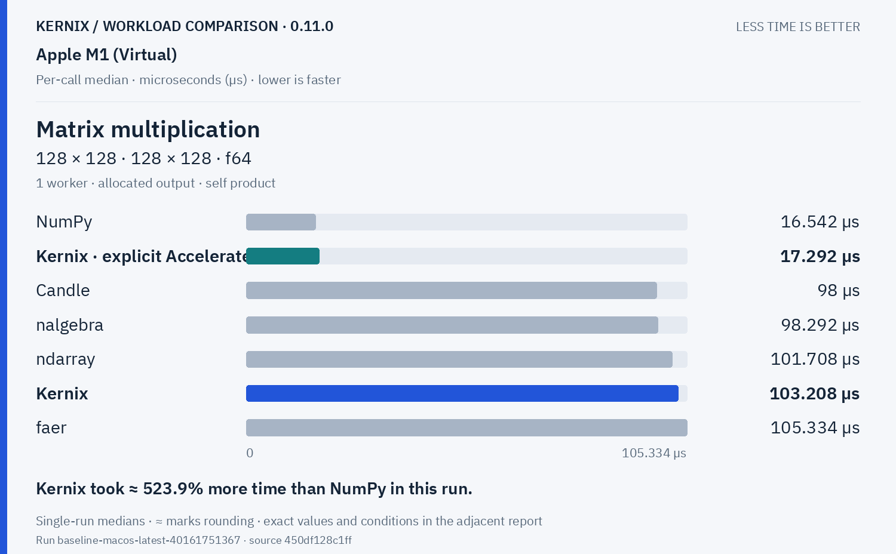](latency.pdf)

## Charts by workload

**Shorter bars mean less time.** Blue is Kernix; grey is another library; teal is an explicitly selected Kernix backend. Entries are sorted by the recorded median, with a separate zero-based scale per chart. These point observations do not establish a statistical ranking.

Expand a group to see every chart here on GitHub. Click a chart to enlarge it. The exact table below keeps every source digit.

Matrix multiplication · 11 workloads

**Independent matrix operands · 128 × 128 · 128 × 128 · f64**

Kernix: **103.5 µs**. Kernix took ≈ 500.0% more time than NumPy in this run.

**Independent matrix operands · 128 × 128 · 128 × 128 · f32**

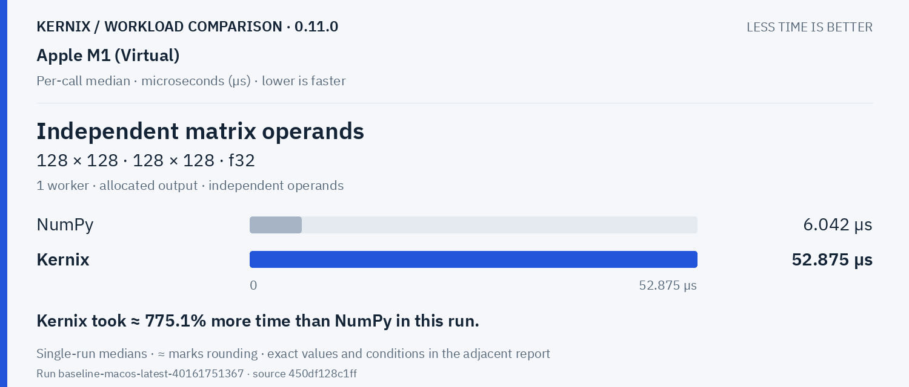

Kernix: **52.875 µs**. Kernix took ≈ 775.1% more time than NumPy in this run.

**Matrix multiplication · 32 × 32 · 32 × 32 · f64**

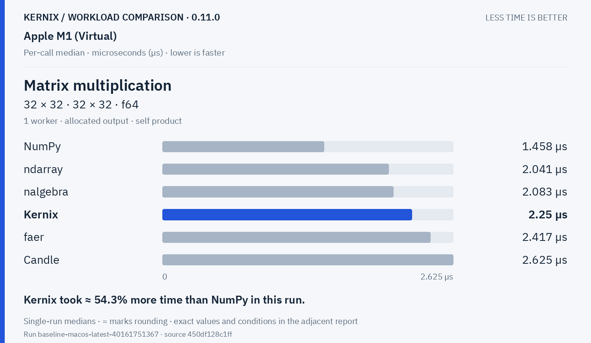

Kernix: **2.25 µs**. Kernix took ≈ 54.3% more time than NumPy in this run.

**Matrix multiplication · 64 × 64 · 64 × 64 · f64**

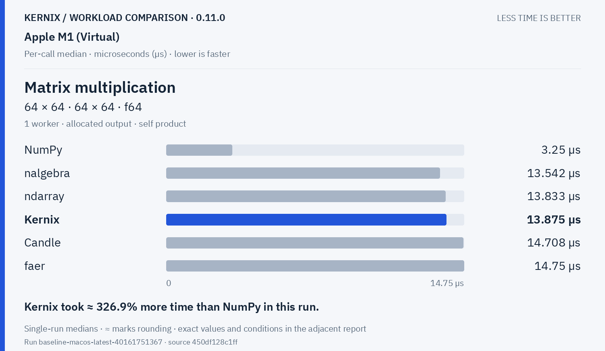

Kernix: **13.875 µs**. Kernix took ≈ 326.9% more time than NumPy in this run.

**Matrix multiplication · 128 × 128 · 128 × 128 · f64**

Kernix: **103.208 µs**. Kernix took ≈ 523.9% more time than NumPy in this run.

**Matrix multiplication · 256 × 256 · 256 × 256 · f64**

Kernix: **809.5 µs**. Kernix took ≈ 648.4% more time than NumPy in this run.

**Matrix multiplication · 64 × 64 · 64 × 64 · f32**

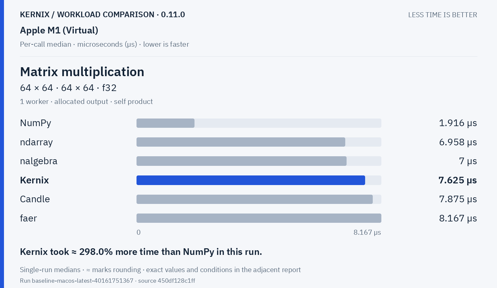

Kernix: **7.625 µs**. Kernix took ≈ 298.0% more time than NumPy in this run.

**Matrix multiplication · 128 × 128 · 128 × 128 · f32**

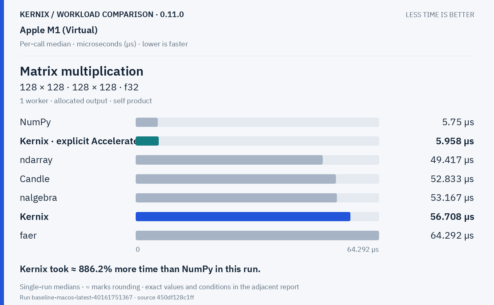

Kernix: **56.708 µs**. Kernix took ≈ 886.2% more time than NumPy in this run.

**Matrix multiplication · 256 × 256 · 256 × 256 · f32**

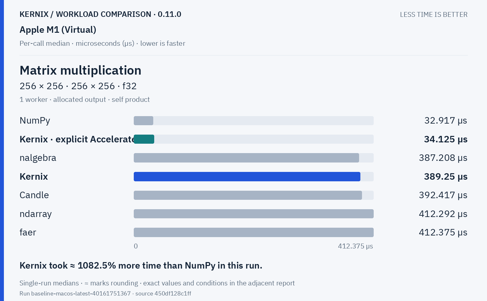

Kernix: **389.25 µs**. Kernix took ≈ 1082.5% more time than NumPy in this run.

**Batched multiplication · 4 × 16 × 32 · 1 × 32 × 16 · f64**

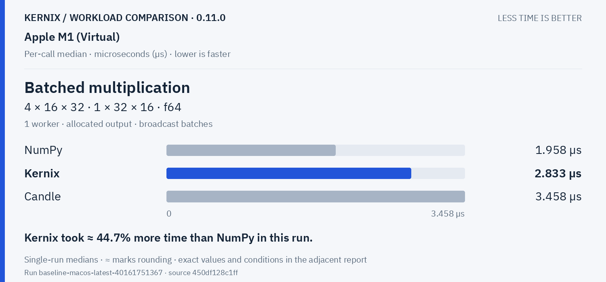

Kernix: **2.833 µs**. Kernix took ≈ 44.7% more time than NumPy in this run.

**Batched multiplication · 4 × 16 × 32 · 1 × 32 × 16 · f32**

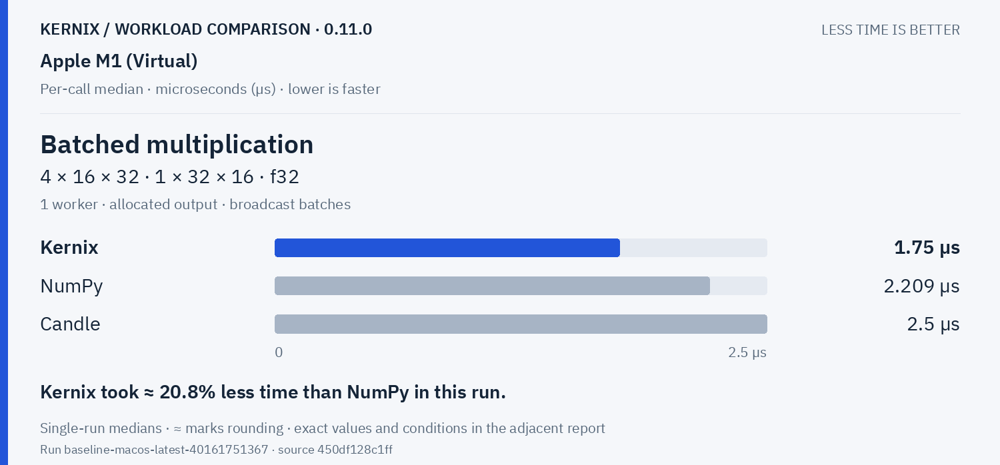

Kernix: **1.75 µs**. Kernix took ≈ 20.8% less time than NumPy in this run.

Explicit parallel execution · 4 workloads

**Matmul · 2 workers · reused output · 64 × 64 · 64 × 64 · f64**

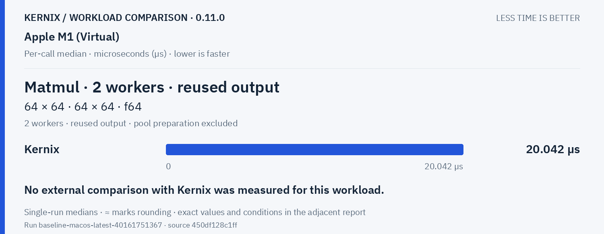

Kernix: **20.042 µs**. No external comparison with Kernix was measured for this workload.

**Matmul · 2 workers · reused output · 128 × 128 · 128 × 128 · f64**

Kernix: **69.125 µs**. No external comparison with Kernix was measured for this workload.

**Matmul · 2 workers · reused output · 256 × 256 · 256 × 256 · f64**

Kernix: **420.083 µs**. No external comparison with Kernix was measured for this workload.

**Matmul · 2 workers · reused output · 128 × 128 · 128 × 128 · f32**

Kernix: **45 µs**. No external comparison with Kernix was measured for this workload.

Decompositions & solvers · 10 workloads

**Cholesky factorization · 512 × 512 · f64**

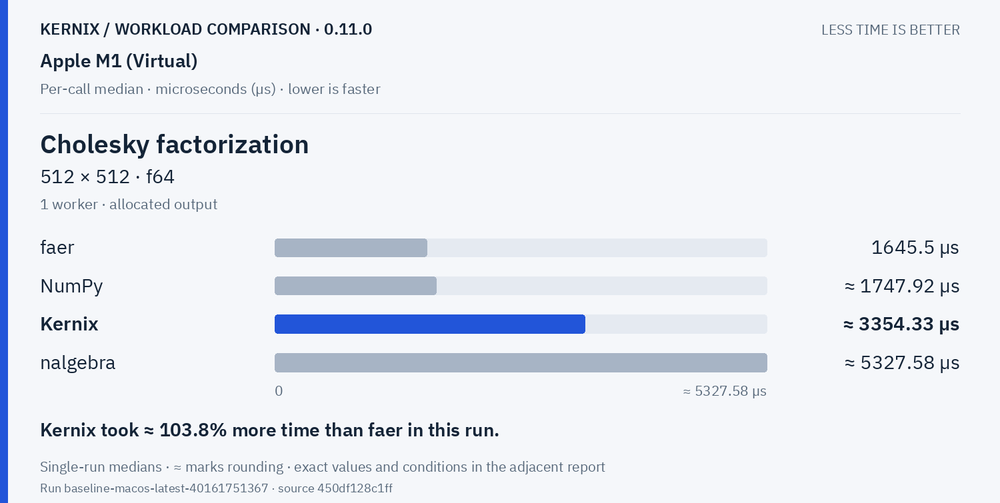

Kernix: **3354.333 µs**. Kernix took ≈ 103.8% more time than faer in this run.

**Column-pivoted QR · 96 × 32 · f64**

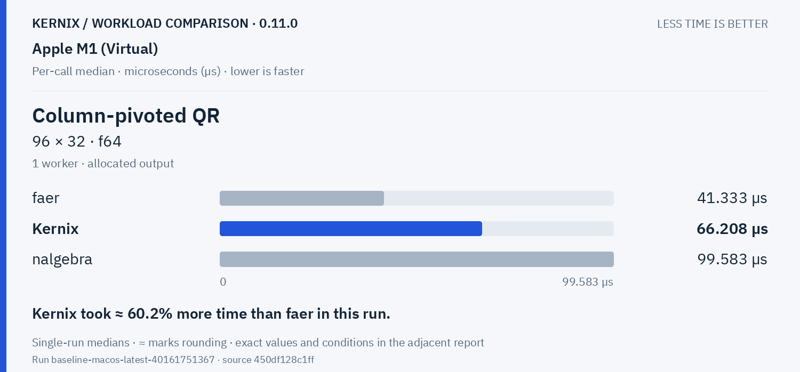

Kernix: **66.208 µs**. Kernix took ≈ 60.2% more time than faer in this run.

**Column-pivoted QR · 256 × 64 · f64**

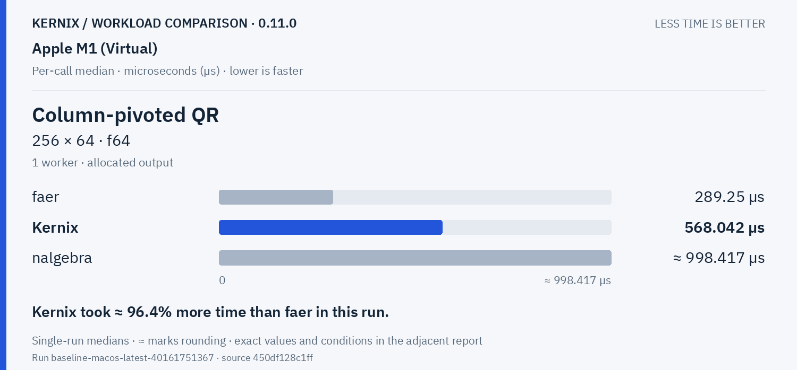

Kernix: **568.042 µs**. Kernix took ≈ 96.4% more time than faer in this run.

**Minimum-norm least squares · 64 × 32, rank 16, 4 RHS · f64**

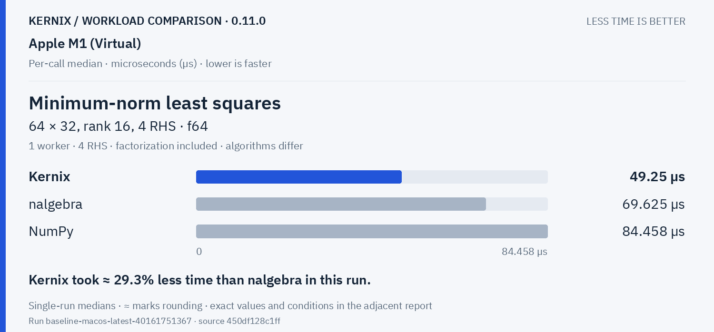

Kernix: **49.25 µs**. Kernix took ≈ 29.3% less time than nalgebra in this run.

**Minimum-norm least squares · 32 × 64, rank 32, 4 RHS · f64**

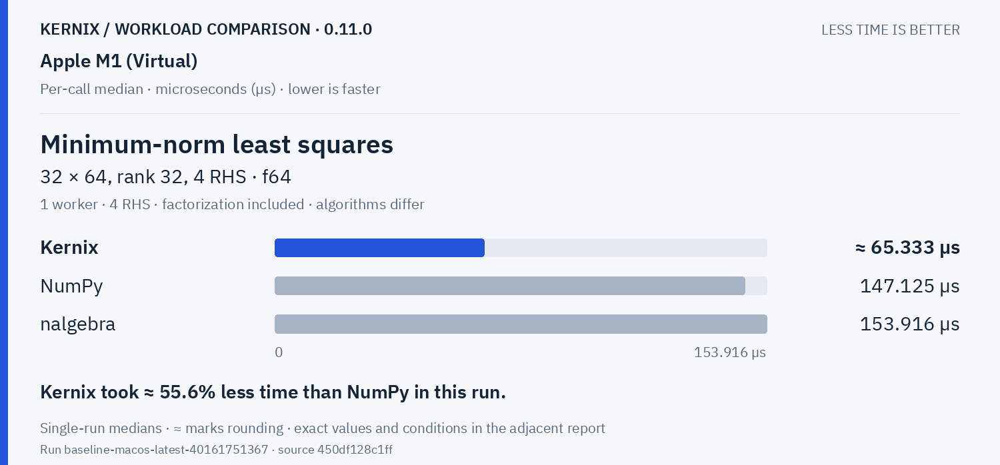

Kernix: **65.33300000000001 µs**. Kernix took ≈ 55.6% less time than NumPy in this run.

**Thin QR · 96 × 32 · f64**

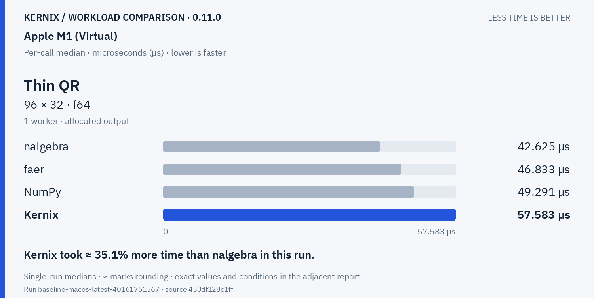

Kernix: **57.583 µs**. Kernix took ≈ 35.1% more time than nalgebra in this run.

**Thin QR · 256 × 64 · f64**

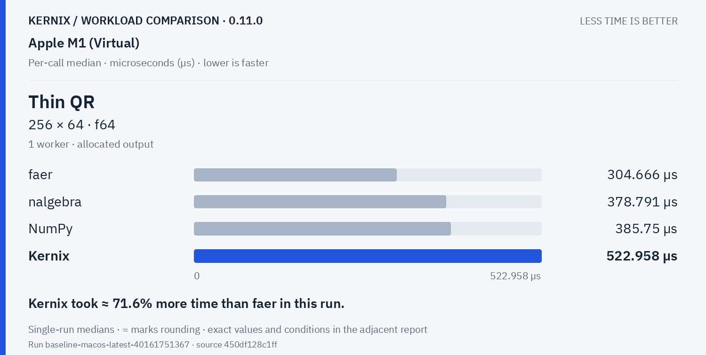

Kernix: **522.958 µs**. Kernix took ≈ 71.6% more time than faer in this run.

**Cholesky factorization · 64 × 64 · f64**

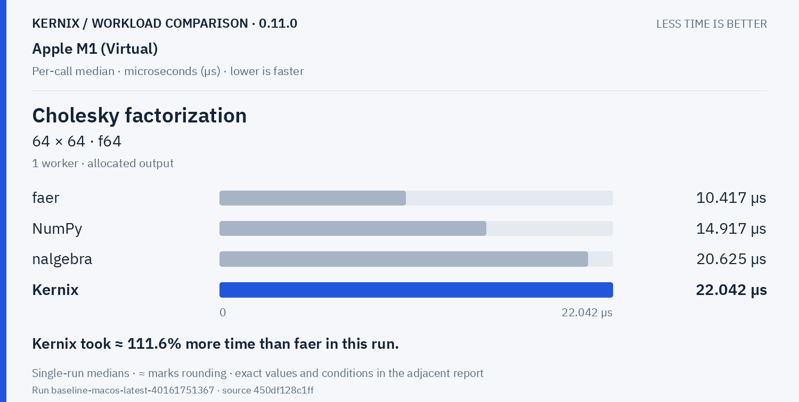

Kernix: **22.042 µs**. Kernix took ≈ 111.6% more time than faer in this run.

**Cholesky factorization · 128 × 128 · f64**

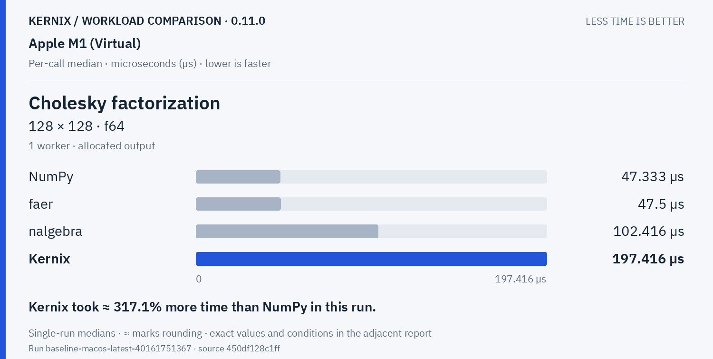

Kernix: **197.416 µs**. Kernix took ≈ 317.1% more time than NumPy in this run.

**Cholesky factorization · 256 × 256 · f64**

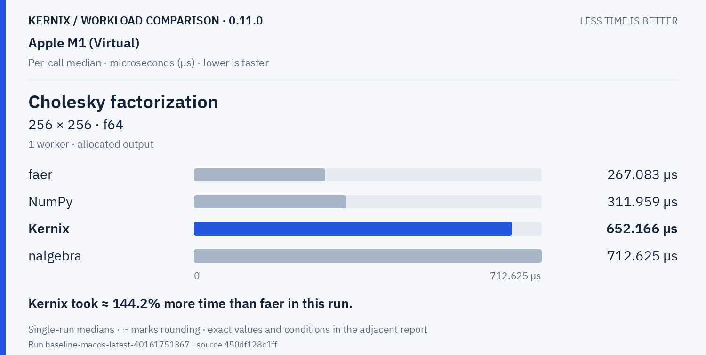

Kernix: **652.166 µs**. Kernix took ≈ 144.2% more time than faer in this run.

Training & autodiff · 6 workloads

**Shared-variable backward · sum(X * X), 64 × 32; prepared graph · f64**

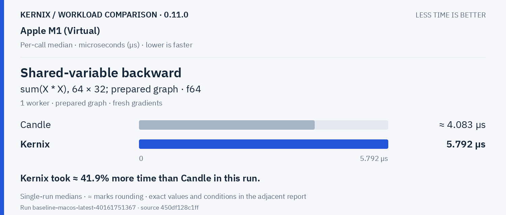

Kernix: **5.792 µs**. Kernix took ≈ 41.9% more time than Candle in this run.

**Record + backward · sum(A · W), 32 × 16 · 16 × 8 · f64**

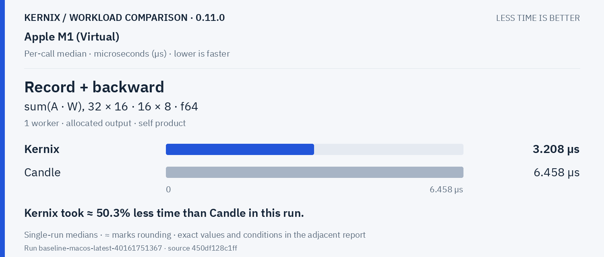

Kernix: **3.208 µs**. Kernix took ≈ 50.3% less time than Candle in this run.

**Model inference · batched normalized/sliced MLP · f64**

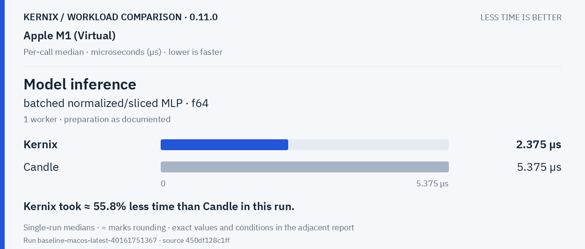

Kernix: **2.375 µs**. Kernix took ≈ 55.8% less time than Candle in this run.

**Model recording + forward · batched normalized/sliced MLP · f64**

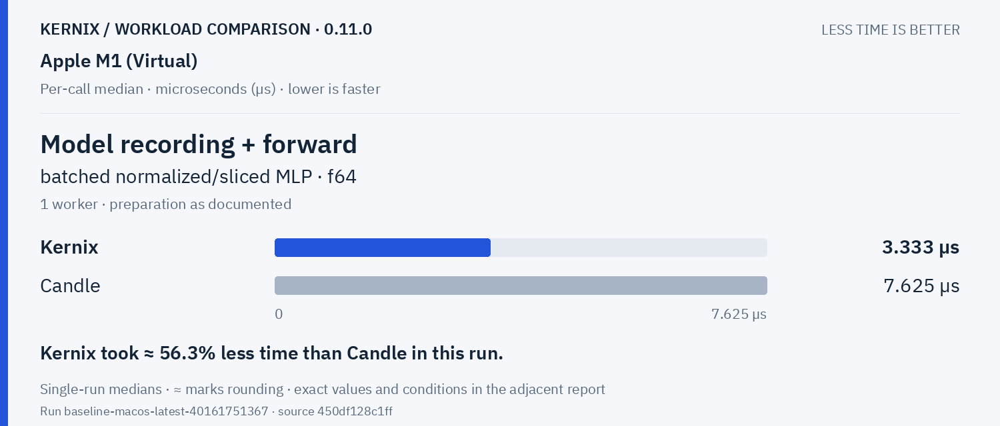

Kernix: **3.333 µs**. Kernix took ≈ 56.3% less time than Candle in this run.

**Model backward · prepared graph → fresh gradients · f64**

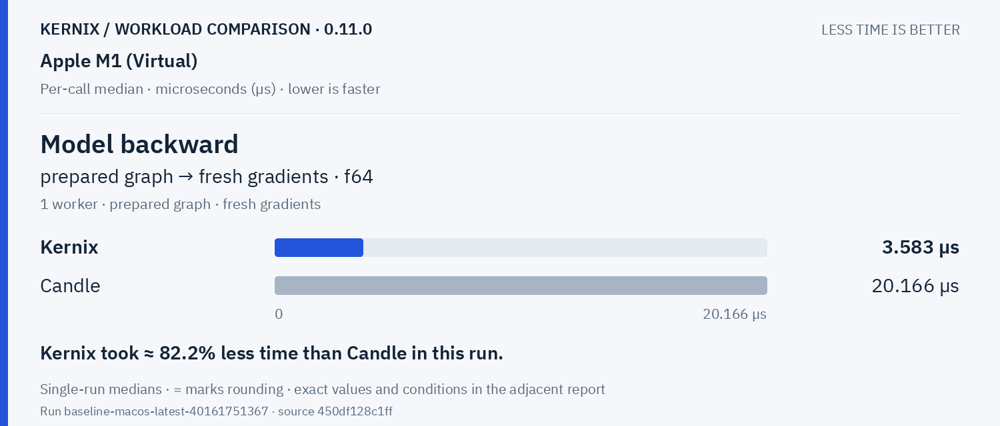

Kernix: **3.583 µs**. Kernix took ≈ 82.2% less time than Candle in this run.

**Parameter update · transactional SGD, fixed gradients · f64**

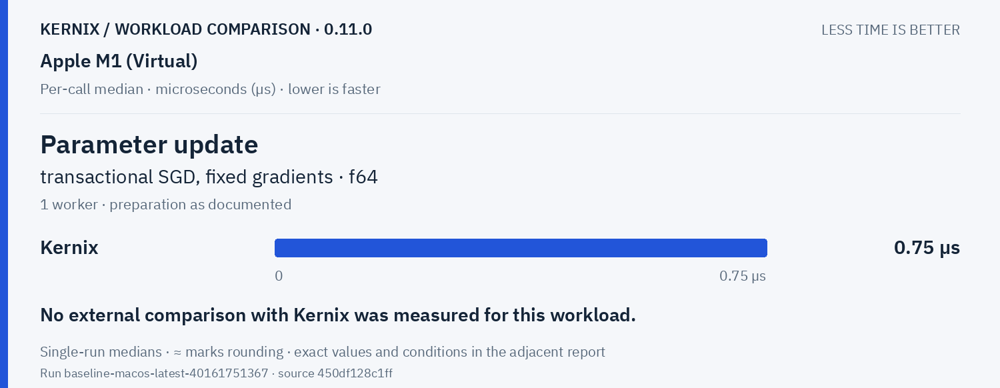

Kernix: **0.75 µs**. No external comparison with Kernix was measured for this workload.

Tensor contractions · 1 workloads

**Coalesced tensor contraction · 16 × 32 × 8 · 32 × 8 × 16 · f64**

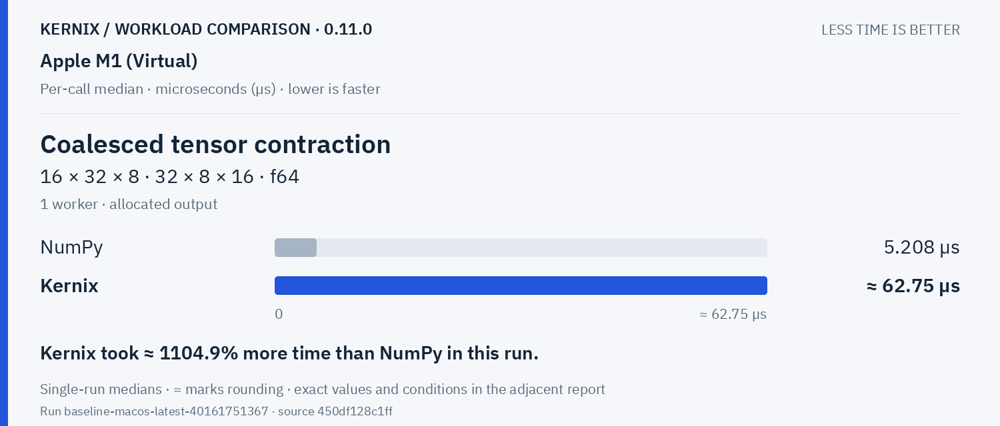

Kernix: **62.74999999999999 µs**. Kernix took ≈ 1104.9% more time than NumPy in this run.

Statistics & activations · 1 workloads

**Row softmax · 256 × 64 · f64**

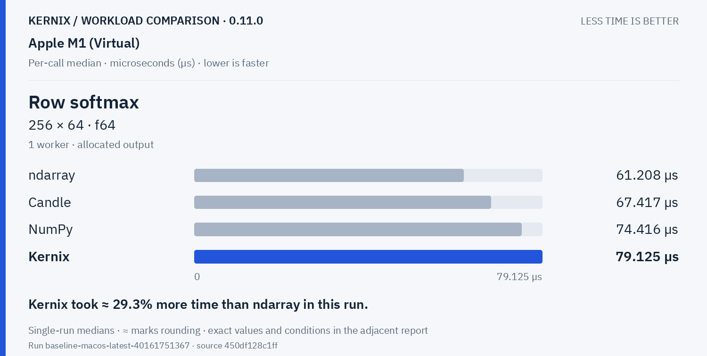

Kernix: **79.125 µs**. Kernix took ≈ 29.3% more time than ndarray in this run.

Tensor construction · 2 workloads

**Create zeros · 64 × 64 · f32**

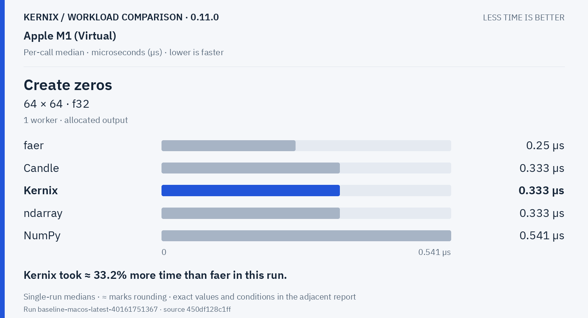

Kernix: **0.333 µs**. Kernix took ≈ 33.2% more time than faer in this run.

**Create ones · 64 × 64 · f32**

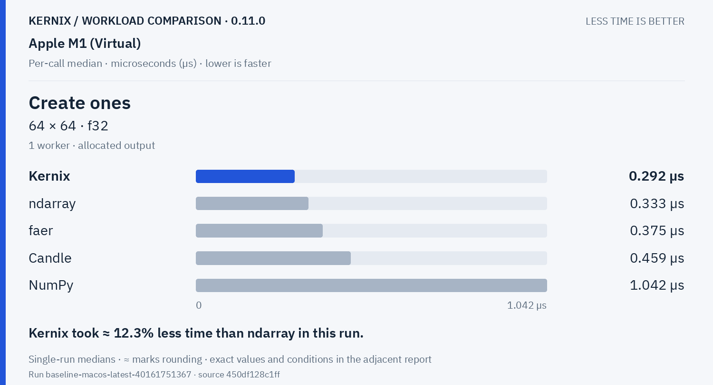

Kernix: **0.292 µs**. Kernix took ≈ 12.3% less time than ndarray in this run.

## Exact latency table

All values below are microseconds per operation. **Lower is faster.** Missing entries were not measured.

| Workload | Kernix | Kernix · explicit Accelerate | ndarray | nalgebra | faer | Candle | NumPy |
|---|---:|---:|---:|---:|---:|---:|---:|
| Independent matrix operands · 128 × 128 · 128 × 128 · f64 | 103.5 | — | — | — | — | — | **17.25** |
| Independent matrix operands · 128 × 128 · 128 × 128 · f32 | 52.875 | — | — | — | — | — | **6.042** |
| Matrix multiplication · 32 × 32 · 32 × 32 · f64 | 2.25 | — | 2.041 | 2.083 | 2.417 | 2.625 | **1.458** |
| Matrix multiplication · 64 × 64 · 64 × 64 · f64 | 13.875 | — | 13.833 | 13.542 | 14.75 | 14.708 | **3.25** |
| Matrix multiplication · 128 × 128 · 128 × 128 · f64 | 103.208 | 17.292 | 101.708 | 98.292 | 105.334 | 98 | **16.542** |
| Matrix multiplication · 256 × 256 · 256 × 256 · f64 | 809.5 | 121.792 | 789.083 | 778.167 | 812.416 | 792 | **108.167** |
| Matrix multiplication · 64 × 64 · 64 × 64 · f32 | 7.625 | — | 6.958 | 7 | 8.167 | 7.875 | **1.916** |
| Matrix multiplication · 128 × 128 · 128 × 128 · f32 | 56.708 | 5.958 | 49.417 | 53.167 | 64.292 | 52.833 | **5.75** |
| Matrix multiplication · 256 × 256 · 256 × 256 · f32 | 389.25 | 34.125 | 412.292 | 387.208 | 412.375 | 392.417 | **32.917** |
| Batched multiplication · 4 × 16 × 32 · 1 × 32 × 16 · f64 | 2.833 | — | — | — | — | 3.458 | **1.958** |
| Batched multiplication · 4 × 16 × 32 · 1 × 32 × 16 · f32 | **1.75** | — | — | — | — | 2.5 | 2.209 |
| Matmul · 2 workers · reused output · 64 × 64 · 64 × 64 · f64 | 20.042 | — | — | — | — | — | — |
| Matmul · 2 workers · reused output · 128 × 128 · 128 × 128 · f64 | 69.125 | — | — | — | — | — | — |
| Matmul · 2 workers · reused output · 256 × 256 · 256 × 256 · f64 | 420.083 | — | — | — | — | — | — |
| Matmul · 2 workers · reused output · 128 × 128 · 128 × 128 · f32 | 45 | — | — | — | — | — | — |
| Cholesky factorization · 512 × 512 · f64 | 3354.333 | — | — | 5327.584 | **1645.5** | — | 1747.916 |
| Column-pivoted QR · 96 × 32 · f64 | 66.208 | — | — | 99.583 | **41.333** | — | — |
| Column-pivoted QR · 256 × 64 · f64 | 568.042 | — | — | 998.4169999999999 | **289.25** | — | — |
| Minimum-norm least squares · 64 × 32, rank 16, 4 RHS · f64 | **49.25** | — | — | 69.625 | — | — | 84.458 |
| Minimum-norm least squares · 32 × 64, rank 32, 4 RHS · f64 | **65.33300000000001** | — | — | 153.916 | — | — | 147.125 |
| Thin QR · 96 × 32 · f64 | 57.583 | — | — | **42.625** | 46.833 | — | 49.291 |
| Thin QR · 256 × 64 · f64 | 522.958 | — | — | 378.791 | **304.666** | — | 385.75 |
| Cholesky factorization · 64 × 64 · f64 | 22.042 | — | — | 20.625 | **10.417** | — | 14.917 |
| Cholesky factorization · 128 × 128 · f64 | 197.416 | — | — | 102.416 | 47.5 | — | **47.333** |
| Cholesky factorization · 256 × 256 · f64 | 652.166 | — | — | 712.625 | **267.083** | — | 311.959 |
| Shared-variable backward · sum(X * X), 64 × 32; prepared graph · f64 | 5.792 | — | — | — | — | **4.0829999999999995** | — |
| Record + backward · sum(A · W), 32 × 16 · 16 × 8 · f64 | **3.208** | — | — | — | — | 6.458 | — |
| Model inference · batched normalized/sliced MLP · f64 | **2.375** | — | — | — | — | 5.375 | — |
| Model recording + forward · batched normalized/sliced MLP · f64 | **3.333** | — | — | — | — | 7.625 | — |
| Model backward · prepared graph → fresh gradients · f64 | **3.583** | — | — | — | — | 20.166 | — |
| Parameter update · transactional SGD, fixed gradients · f64 | 0.75 | — | — | — | — | — | — |
| Coalesced tensor contraction · 16 × 32 × 8 · 32 × 8 × 16 · f64 | 62.74999999999999 | — | — | — | — | — | **5.208** |
| Row softmax · 256 × 64 · f64 | 79.125 | — | **61.208** | — | — | 67.417 | 74.416 |
| Create zeros · 64 × 64 · f32 | 0.333 | — | 0.333 | — | **0.25** | 0.333 | 0.541 |
| Create ones · 64 × 64 · f32 | **0.292** | — | 0.333 | — | 0.375 | 0.459 | 1.042 |

## Version comparison

0 of 35 workloads have paired evidence. Exploratory 95% intervals resample process pairs, not calls. No multiple-comparison adjustment.

| Workload | Current / baseline [95% interval] | Interpretation |
|---|---:|---|
| Independent matrix operands · 128 × 128 · 128 × 128 · f64 | — | No paired comparison |
| Independent matrix operands · 128 × 128 · 128 × 128 · f32 | — | No paired comparison |
| Matrix multiplication · 32 × 32 · 32 × 32 · f64 | — | No paired comparison |
| Matrix multiplication · 64 × 64 · 64 × 64 · f64 | — | No paired comparison |
| Matrix multiplication · 128 × 128 · 128 × 128 · f64 | — | No paired comparison |
| Matrix multiplication · 256 × 256 · 256 × 256 · f64 | — | No paired comparison |
| Matrix multiplication · 64 × 64 · 64 × 64 · f32 | — | No paired comparison |
| Matrix multiplication · 128 × 128 · 128 × 128 · f32 | — | No paired comparison |
| Matrix multiplication · 256 × 256 · 256 × 256 · f32 | — | No paired comparison |
| Batched multiplication · 4 × 16 × 32 · 1 × 32 × 16 · f64 | — | No paired comparison |
| Batched multiplication · 4 × 16 × 32 · 1 × 32 × 16 · f32 | — | No paired comparison |
| Matmul · 2 workers · reused output · 64 × 64 · 64 × 64 · f64 | — | No paired comparison |
| Matmul · 2 workers · reused output · 128 × 128 · 128 × 128 · f64 | — | No paired comparison |
| Matmul · 2 workers · reused output · 256 × 256 · 256 × 256 · f64 | — | No paired comparison |
| Matmul · 2 workers · reused output · 128 × 128 · 128 × 128 · f32 | — | No paired comparison |
| Cholesky factorization · 512 × 512 · f64 | — | No paired comparison |
| Column-pivoted QR · 96 × 32 · f64 | — | No paired comparison |
| Column-pivoted QR · 256 × 64 · f64 | — | No paired comparison |
| Minimum-norm least squares · 64 × 32, rank 16, 4 RHS · f64 | — | No paired comparison |
| Minimum-norm least squares · 32 × 64, rank 32, 4 RHS · f64 | — | No paired comparison |
| Thin QR · 96 × 32 · f64 | — | No paired comparison |
| Thin QR · 256 × 64 · f64 | — | No paired comparison |
| Cholesky factorization · 64 × 64 · f64 | — | No paired comparison |
| Cholesky factorization · 128 × 128 · f64 | — | No paired comparison |
| Cholesky factorization · 256 × 256 · f64 | — | No paired comparison |
| Shared-variable backward · sum(X * X), 64 × 32; prepared graph · f64 | — | No paired comparison |
| Record + backward · sum(A · W), 32 × 16 · 16 × 8 · f64 | — | No paired comparison |
| Model inference · batched normalized/sliced MLP · f64 | — | No paired comparison |
| Model recording + forward · batched normalized/sliced MLP · f64 | — | No paired comparison |
| Model backward · prepared graph → fresh gradients · f64 | — | No paired comparison |
| Parameter update · transactional SGD, fixed gradients · f64 | — | No paired comparison |
| Coalesced tensor contraction · 16 × 32 × 8 · 32 × 8 × 16 · f64 | — | No paired comparison |
| Row softmax · 256 × 64 · f64 | — | No paired comparison |
| Create zeros · 64 × 64 · f32 | — | No paired comparison |
| Create ones · 64 × 64 · f32 | — | No paired comparison |

## Method and provenance

CPU affinity was not pinned. Frequency and background load are uncontrolled.

Minimum-norm rows use pivoted QR plus scaled implicit RZ in Kernix; NumPy native lstsq; nalgebra native SVD/solve. Algorithm costs and rank policies differ. See original method for thresholds.

Numbers retain source precision; recorded digits do not imply equivalent physical measurement accuracy. Lowest observed medians are bold only when peers were measured. No aggregate winner or universal ranking is inferred.

[Original report and commentary](original-report.txt) · [Raw measurements](raw.json)

Measured source `450df128c1ffb55a9a861230edb6b9a5ac3ef5b4`. Run `baseline-macos-latest-40161751367`. Rendering does not change measurements.
