# Kernix 0.11.0 · performance brief

Neoverse-N2 / Linux

**Per-call median, microseconds per operation. Lower is faster. All recorded digits retained.**

35 workloads · 119 observations

No previous-version baseline attached. Sequential run changes are descriptive; paired process evidence is shown separately.

[Interactive HTML (open locally)](report.html) · [Vector PDF](latency.pdf) · [Raw measurements](raw.json)

[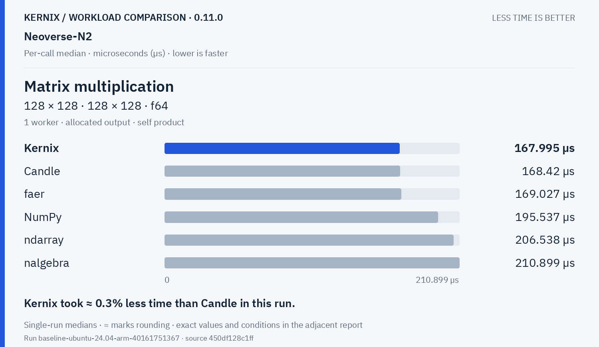](latency.pdf)

## Charts by workload

**Shorter bars mean less time.** Blue is Kernix; grey is another library; teal is an explicitly selected Kernix backend. Entries are sorted by the recorded median, with a separate zero-based scale per chart. These point observations do not establish a statistical ranking.

Expand a group to see every chart here on GitHub. Click a chart to enlarge it. The exact table below keeps every source digit.

Matrix multiplication · 11 workloads

**Independent matrix operands · 128 × 128 · 128 × 128 · f64**

Kernix: **168.795 µs**. Kernix took ≈ 14.0% less time than NumPy in this run.

**Independent matrix operands · 128 × 128 · 128 × 128 · f32**

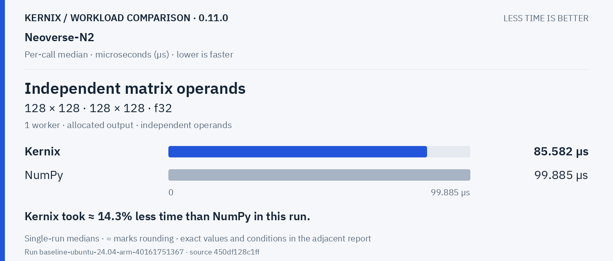

Kernix: **85.582 µs**. Kernix took ≈ 14.3% less time than NumPy in this run.

**Matrix multiplication · 32 × 32 · 32 × 32 · f64**

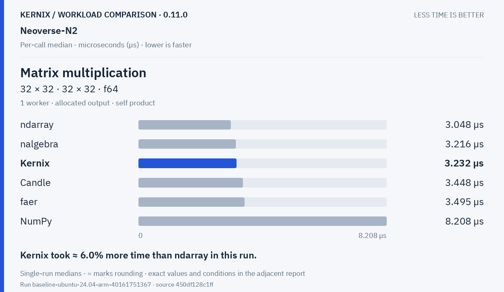

Kernix: **3.232 µs**. Kernix took ≈ 6.0% more time than ndarray in this run.

**Matrix multiplication · 64 × 64 · 64 × 64 · f64**

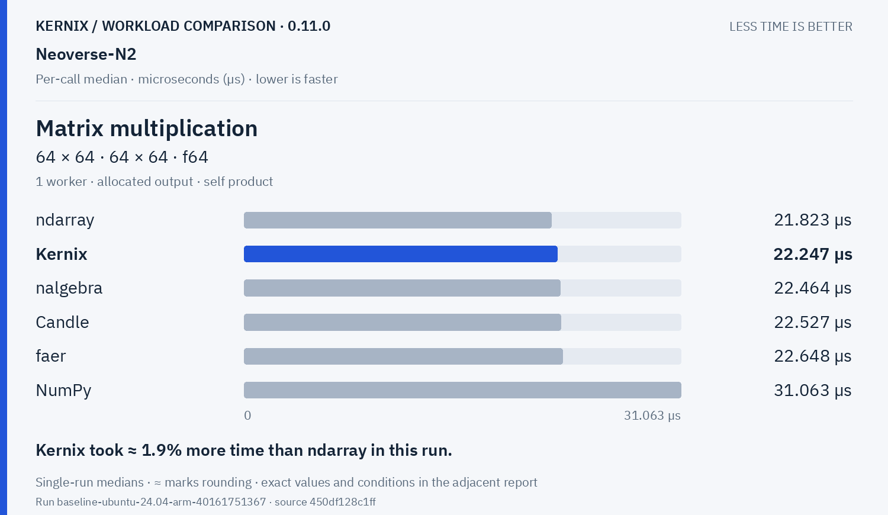

Kernix: **22.247 µs**. Kernix took ≈ 1.9% more time than ndarray in this run.

**Matrix multiplication · 128 × 128 · 128 × 128 · f64**

Kernix: **167.995 µs**. Kernix took ≈ 0.3% less time than Candle in this run.

**Matrix multiplication · 256 × 256 · 256 × 256 · f64**

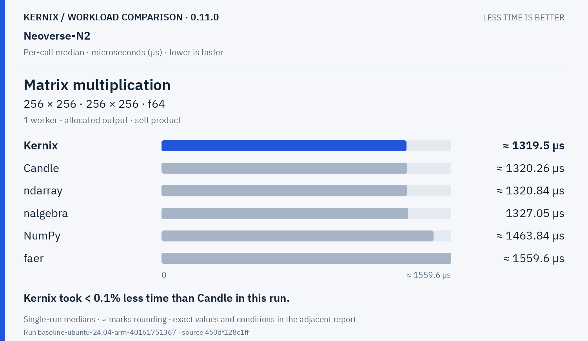

Kernix: **1319.501 µs**. Kernix took &lt; 0.1% less time than Candle in this run.

**Matrix multiplication · 64 × 64 · 64 × 64 · f32**

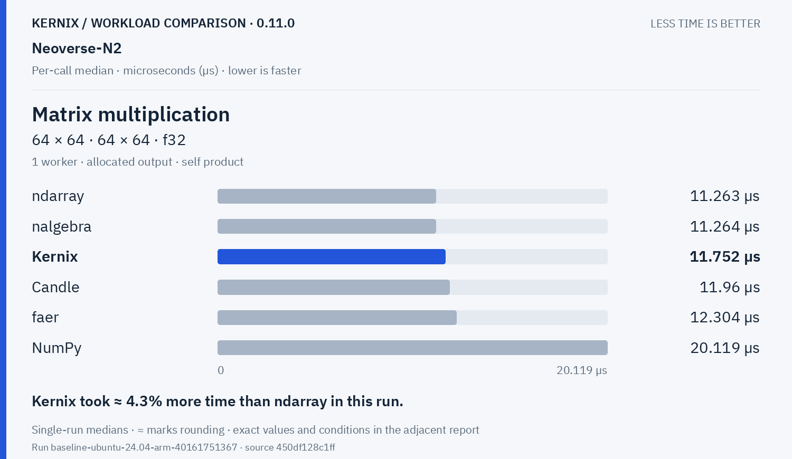

Kernix: **11.752 µs**. Kernix took ≈ 4.3% more time than ndarray in this run.

**Matrix multiplication · 128 × 128 · 128 × 128 · f32**

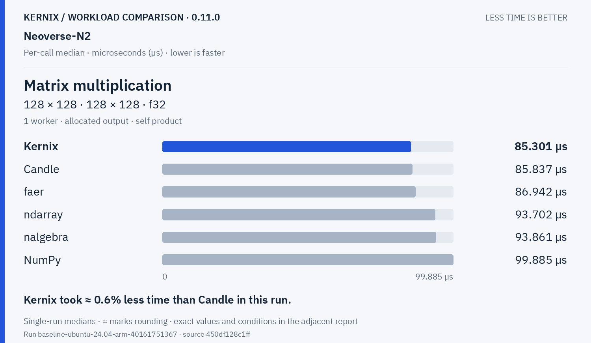

Kernix: **85.301 µs**. Kernix took ≈ 0.6% less time than Candle in this run.

**Matrix multiplication · 256 × 256 · 256 × 256 · f32**

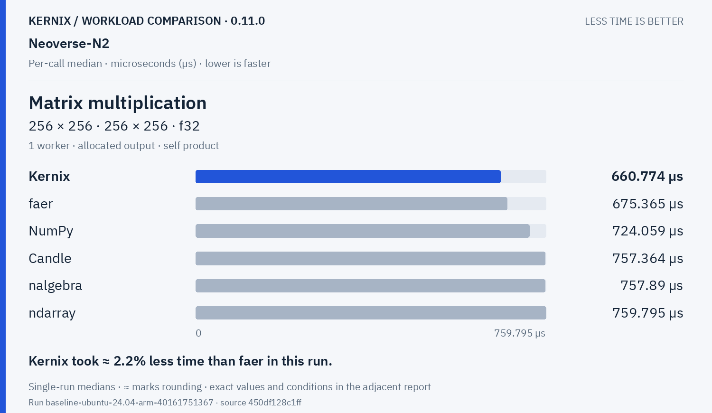

Kernix: **660.774 µs**. Kernix took ≈ 2.2% less time than faer in this run.

**Batched multiplication · 4 × 16 × 32 · 1 × 32 × 16 · f64**

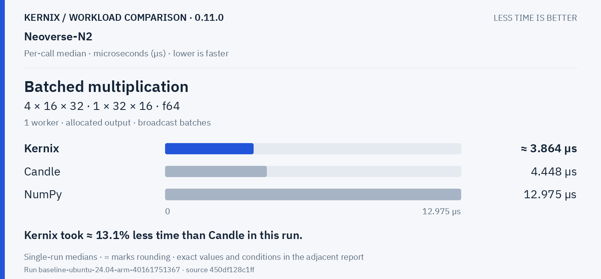

Kernix: **3.8639999999999995 µs**. Kernix took ≈ 13.1% less time than Candle in this run.

**Batched multiplication · 4 × 16 × 32 · 1 × 32 × 16 · f32**

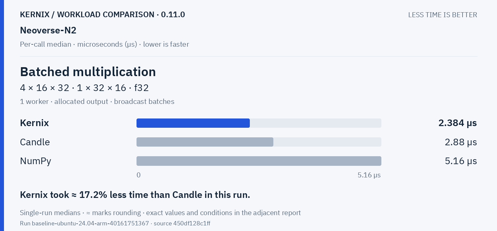

Kernix: **2.384 µs**. Kernix took ≈ 17.2% less time than Candle in this run.

Explicit parallel execution · 4 workloads

**Matmul · 2 workers · reused output · 64 × 64 · 64 × 64 · f64**

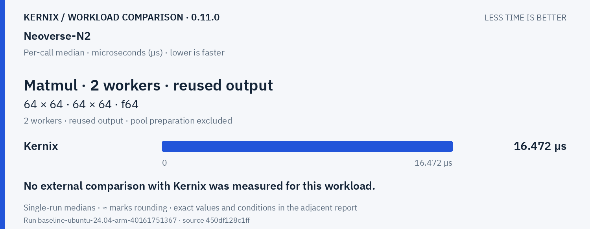

Kernix: **16.472 µs**. No external comparison with Kernix was measured for this workload.

**Matmul · 2 workers · reused output · 128 × 128 · 128 × 128 · f64**

Kernix: **92.141 µs**. No external comparison with Kernix was measured for this workload.

**Matmul · 2 workers · reused output · 256 × 256 · 256 × 256 · f64**

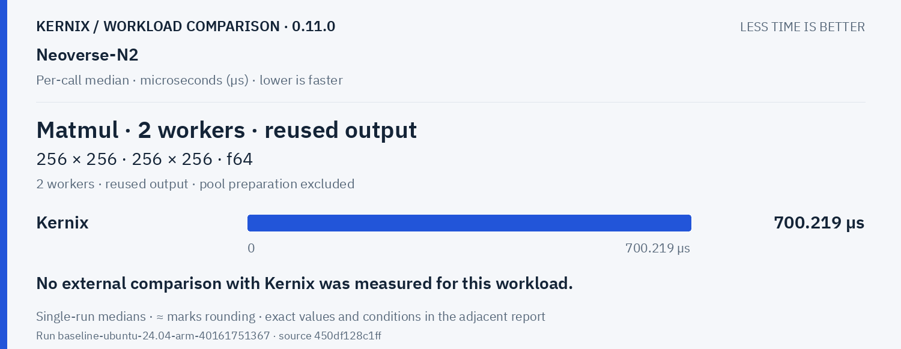

Kernix: **700.219 µs**. No external comparison with Kernix was measured for this workload.

**Matmul · 2 workers · reused output · 128 × 128 · 128 × 128 · f32**

Kernix: **48.895 µs**. No external comparison with Kernix was measured for this workload.

Decompositions & solvers · 10 workloads

**Cholesky factorization · 512 × 512 · f64**

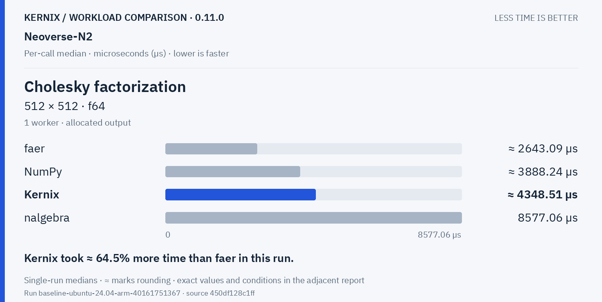

Kernix: **4348.512 µs**. Kernix took ≈ 64.5% more time than faer in this run.

**Column-pivoted QR · 96 × 32 · f64**

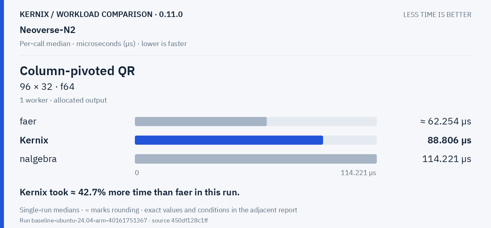

Kernix: **88.806 µs**. Kernix took ≈ 42.7% more time than faer in this run.

**Column-pivoted QR · 256 × 64 · f64**

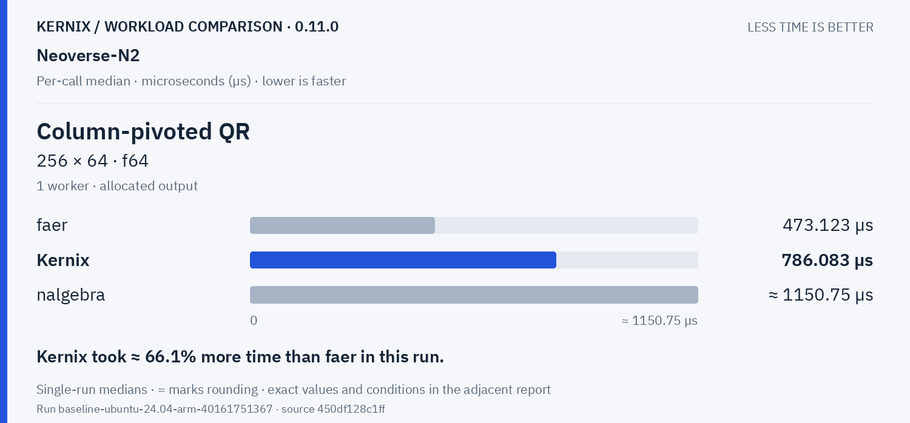

Kernix: **786.083 µs**. Kernix took ≈ 66.1% more time than faer in this run.

**Minimum-norm least squares · 64 × 32, rank 16, 4 RHS · f64**

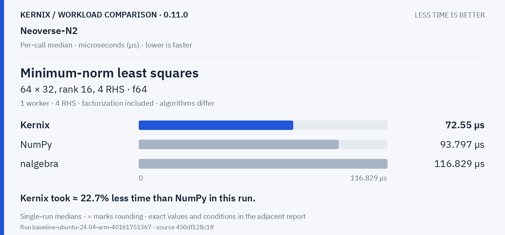

Kernix: **72.55 µs**. Kernix took ≈ 22.7% less time than NumPy in this run.

**Minimum-norm least squares · 32 × 64, rank 32, 4 RHS · f64**

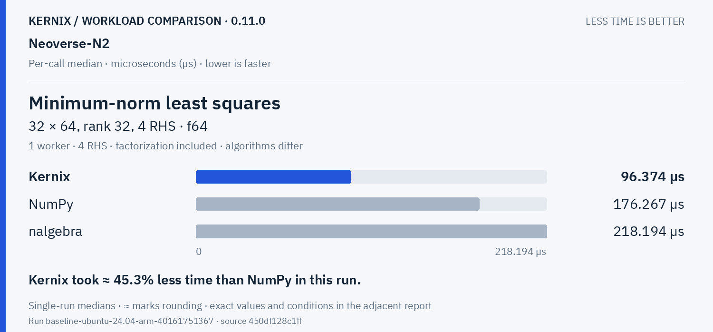

Kernix: **96.374 µs**. Kernix took ≈ 45.3% less time than NumPy in this run.

**Thin QR · 96 × 32 · f64**

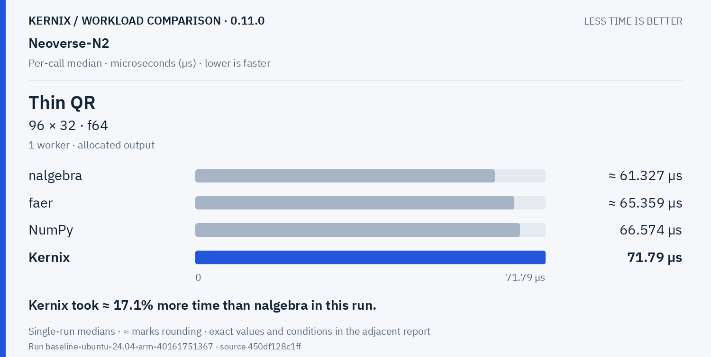

Kernix: **71.79 µs**. Kernix took ≈ 17.1% more time than nalgebra in this run.

**Thin QR · 256 × 64 · f64**

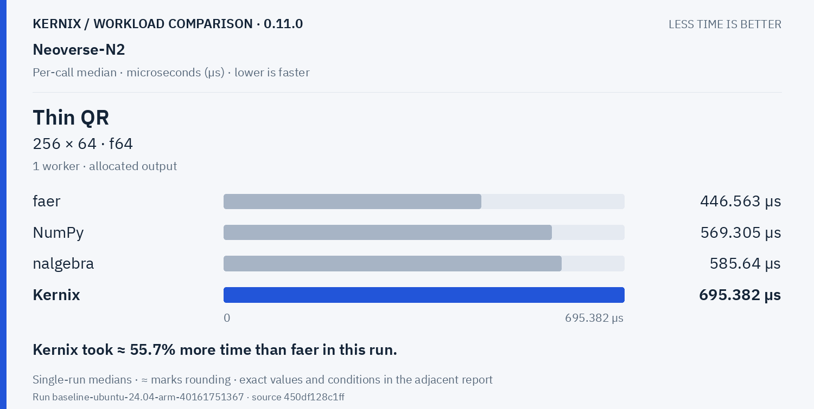

Kernix: **695.382 µs**. Kernix took ≈ 55.7% more time than faer in this run.

**Cholesky factorization · 64 × 64 · f64**

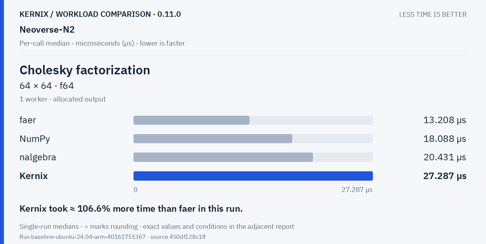

Kernix: **27.287 µs**. Kernix took ≈ 106.6% more time than faer in this run.

**Cholesky factorization · 128 × 128 · f64**

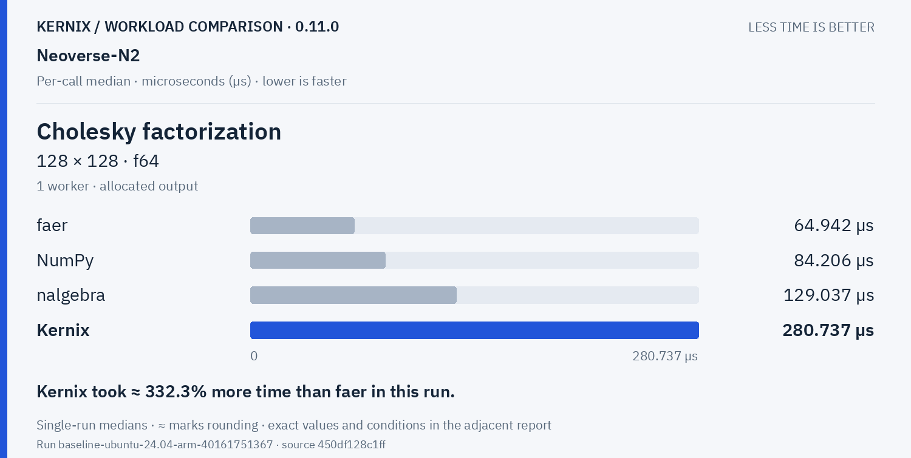

Kernix: **280.737 µs**. Kernix took ≈ 332.3% more time than faer in this run.

**Cholesky factorization · 256 × 256 · f64**

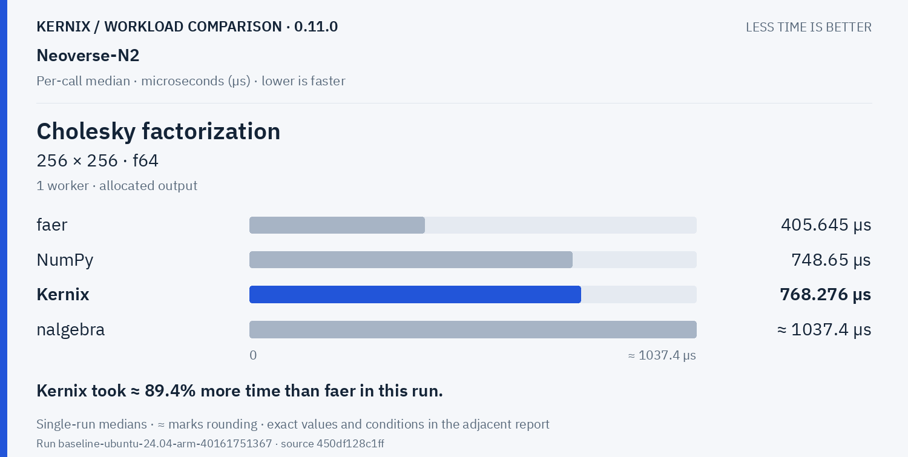

Kernix: **768.276 µs**. Kernix took ≈ 89.4% more time than faer in this run.

Training & autodiff · 6 workloads

**Shared-variable backward · sum(X * X), 64 × 32; prepared graph · f64**

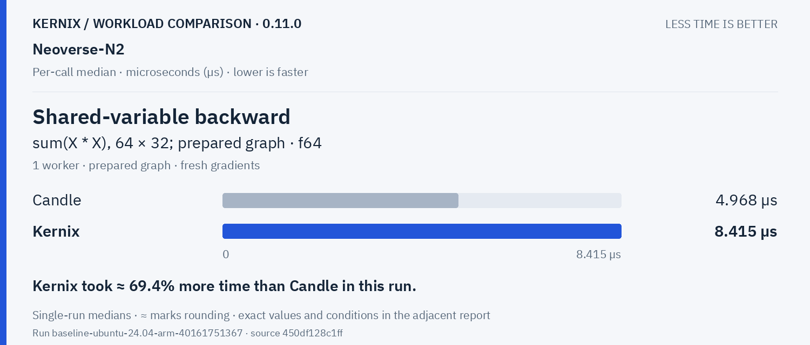

Kernix: **8.415 µs**. Kernix took ≈ 69.4% more time than Candle in this run.

**Record + backward · sum(A · W), 32 × 16 · 16 × 8 · f64**

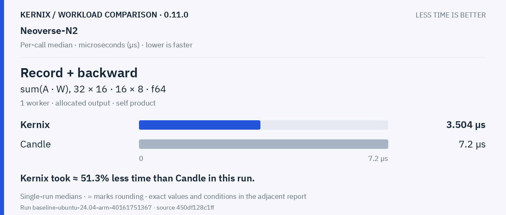

Kernix: **3.504 µs**. Kernix took ≈ 51.3% less time than Candle in this run.

**Model inference · batched normalized/sliced MLP · f64**

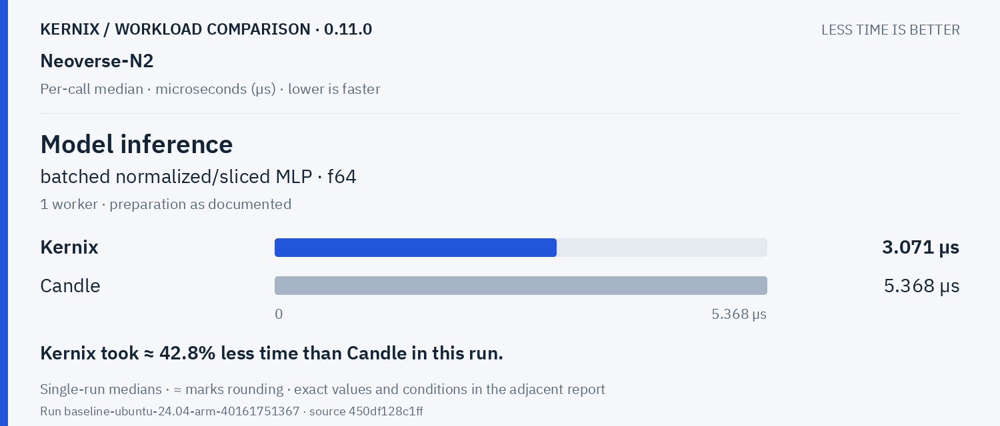

Kernix: **3.071 µs**. Kernix took ≈ 42.8% less time than Candle in this run.

**Model recording + forward · batched normalized/sliced MLP · f64**

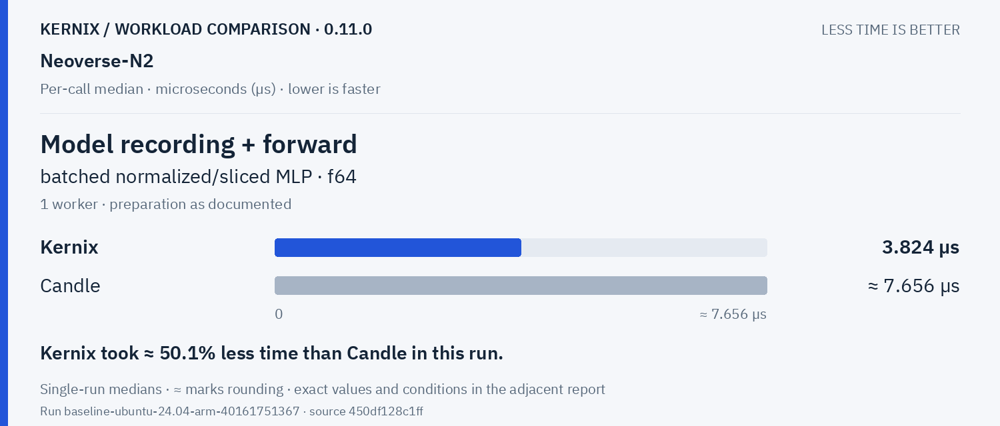

Kernix: **3.824 µs**. Kernix took ≈ 50.1% less time than Candle in this run.

**Model backward · prepared graph → fresh gradients · f64**

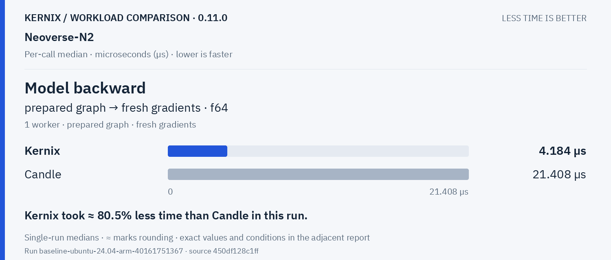

Kernix: **4.184 µs**. Kernix took ≈ 80.5% less time than Candle in this run.

**Parameter update · transactional SGD, fixed gradients · f64**

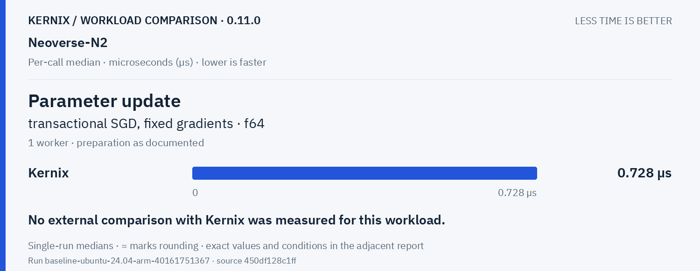

Kernix: **0.728 µs**. No external comparison with Kernix was measured for this workload.

Tensor contractions · 1 workloads

**Coalesced tensor contraction · 16 × 32 × 8 · 32 × 8 × 16 · f64**

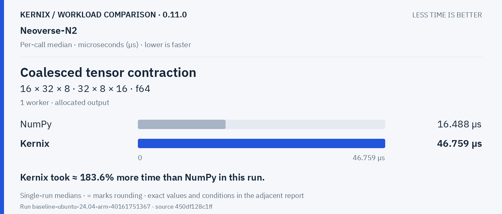

Kernix: **46.759 µs**. Kernix took ≈ 183.6% more time than NumPy in this run.

Statistics & activations · 1 workloads

**Row softmax · 256 × 64 · f64**

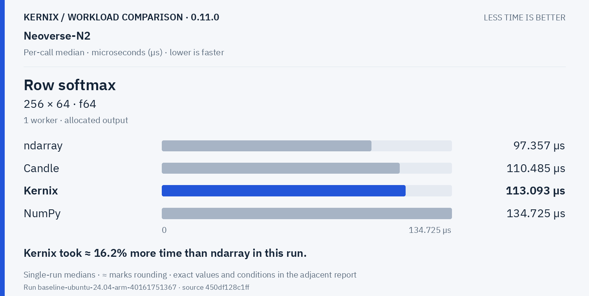

Kernix: **113.093 µs**. Kernix took ≈ 16.2% more time than ndarray in this run.

Tensor construction · 2 workloads

**Create zeros · 64 × 64 · f32**

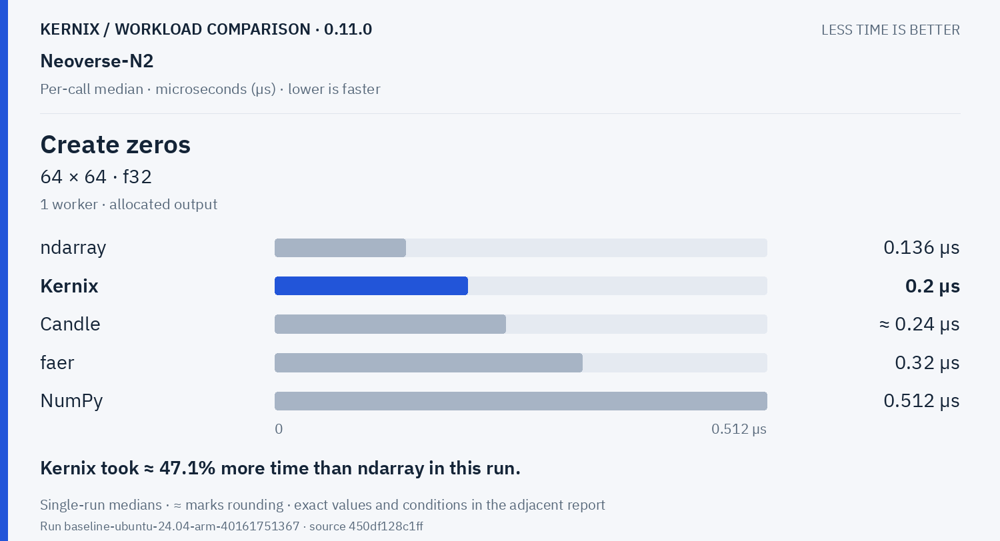

Kernix: **0.2 µs**. Kernix took ≈ 47.1% more time than ndarray in this run.

**Create ones · 64 × 64 · f32**

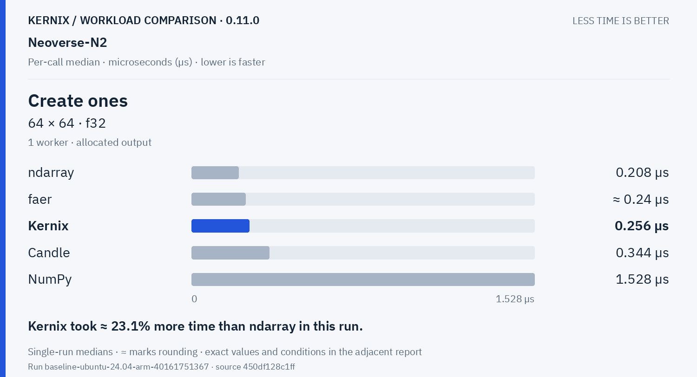

Kernix: **0.256 µs**. Kernix took ≈ 23.1% more time than ndarray in this run.

## Exact latency table

All values below are microseconds per operation. **Lower is faster.** Missing entries were not measured.

| Workload | Kernix | ndarray | nalgebra | faer | Candle | NumPy |
|---|---:|---:|---:|---:|---:|---:|
| Independent matrix operands · 128 × 128 · 128 × 128 · f64 | **168.795** | — | — | — | — | 196.274 |
| Independent matrix operands · 128 × 128 · 128 × 128 · f32 | **85.582** | — | — | — | — | 99.885 |
| Matrix multiplication · 32 × 32 · 32 × 32 · f64 | 3.232 | **3.048** | 3.216 | 3.495 | 3.448 | 8.208 |
| Matrix multiplication · 64 × 64 · 64 × 64 · f64 | 22.247 | **21.823** | 22.464 | 22.648 | 22.527 | 31.063 |
| Matrix multiplication · 128 × 128 · 128 × 128 · f64 | **167.995** | 206.538 | 210.899 | 169.027 | 168.42 | 195.537 |
| Matrix multiplication · 256 × 256 · 256 × 256 · f64 | **1319.501** | 1320.836 | 1327.05 | 1559.604 | 1320.265 | 1463.844 |
| Matrix multiplication · 64 × 64 · 64 × 64 · f32 | 11.752 | **11.263** | 11.264 | 12.304 | 11.96 | 20.119 |
| Matrix multiplication · 128 × 128 · 128 × 128 · f32 | **85.301** | 93.702 | 93.861 | 86.942 | 85.837 | 99.885 |
| Matrix multiplication · 256 × 256 · 256 × 256 · f32 | **660.774** | 759.795 | 757.89 | 675.365 | 757.364 | 724.059 |
| Batched multiplication · 4 × 16 × 32 · 1 × 32 × 16 · f64 | **3.8639999999999995** | — | — | — | 4.448 | 12.975 |
| Batched multiplication · 4 × 16 × 32 · 1 × 32 × 16 · f32 | **2.384** | — | — | — | 2.88 | 5.16 |
| Matmul · 2 workers · reused output · 64 × 64 · 64 × 64 · f64 | 16.472 | — | — | — | — | — |
| Matmul · 2 workers · reused output · 128 × 128 · 128 × 128 · f64 | 92.141 | — | — | — | — | — |
| Matmul · 2 workers · reused output · 256 × 256 · 256 × 256 · f64 | 700.219 | — | — | — | — | — |
| Matmul · 2 workers · reused output · 128 × 128 · 128 × 128 · f32 | 48.895 | — | — | — | — | — |
| Cholesky factorization · 512 × 512 · f64 | 4348.512 | — | 8577.06 | **2643.087** | — | 3888.242 |
| Column-pivoted QR · 96 × 32 · f64 | 88.806 | — | 114.221 | **62.25400000000001** | — | — |
| Column-pivoted QR · 256 × 64 · f64 | 786.083 | — | 1150.751 | **473.123** | — | — |
| Minimum-norm least squares · 64 × 32, rank 16, 4 RHS · f64 | **72.55** | — | 116.829 | — | — | 93.797 |
| Minimum-norm least squares · 32 × 64, rank 32, 4 RHS · f64 | **96.374** | — | 218.194 | — | — | 176.267 |
| Thin QR · 96 × 32 · f64 | 71.79 | — | **61.32700000000001** | 65.35899999999999 | — | 66.574 |
| Thin QR · 256 × 64 · f64 | 695.382 | — | 585.64 | **446.563** | — | 569.305 |
| Cholesky factorization · 64 × 64 · f64 | 27.287 | — | 20.431 | **13.208** | — | 18.088 |
| Cholesky factorization · 128 × 128 · f64 | 280.737 | — | 129.037 | **64.942** | — | 84.206 |
| Cholesky factorization · 256 × 256 · f64 | 768.276 | — | 1037.404 | **405.645** | — | 748.65 |
| Shared-variable backward · sum(X * X), 64 × 32; prepared graph · f64 | 8.415 | — | — | — | **4.968** | — |
| Record + backward · sum(A · W), 32 × 16 · 16 × 8 · f64 | **3.504** | — | — | — | 7.2 | — |
| Model inference · batched normalized/sliced MLP · f64 | **3.071** | — | — | — | 5.368 | — |
| Model recording + forward · batched normalized/sliced MLP · f64 | **3.824** | — | — | — | 7.655999999999999 | — |
| Model backward · prepared graph → fresh gradients · f64 | **4.184** | — | — | — | 21.408 | — |
| Parameter update · transactional SGD, fixed gradients · f64 | 0.728 | — | — | — | — | — |
| Coalesced tensor contraction · 16 × 32 × 8 · 32 × 8 × 16 · f64 | 46.759 | — | — | — | — | **16.488** |
| Row softmax · 256 × 64 · f64 | 113.093 | **97.357** | — | — | 110.485 | 134.725 |
| Create zeros · 64 × 64 · f32 | 0.2 | **0.136** | — | 0.32 | 0.23999999999999997 | 0.512 |
| Create ones · 64 × 64 · f32 | 0.256 | **0.208** | — | 0.23999999999999997 | 0.344 | 1.528 |

## Version comparison

0 of 35 workloads have paired evidence. Exploratory 95% intervals resample process pairs, not calls. No multiple-comparison adjustment.

| Workload | Current / baseline [95% interval] | Interpretation |
|---|---:|---|
| Independent matrix operands · 128 × 128 · 128 × 128 · f64 | — | No paired comparison |
| Independent matrix operands · 128 × 128 · 128 × 128 · f32 | — | No paired comparison |
| Matrix multiplication · 32 × 32 · 32 × 32 · f64 | — | No paired comparison |
| Matrix multiplication · 64 × 64 · 64 × 64 · f64 | — | No paired comparison |
| Matrix multiplication · 128 × 128 · 128 × 128 · f64 | — | No paired comparison |
| Matrix multiplication · 256 × 256 · 256 × 256 · f64 | — | No paired comparison |
| Matrix multiplication · 64 × 64 · 64 × 64 · f32 | — | No paired comparison |
| Matrix multiplication · 128 × 128 · 128 × 128 · f32 | — | No paired comparison |
| Matrix multiplication · 256 × 256 · 256 × 256 · f32 | — | No paired comparison |
| Batched multiplication · 4 × 16 × 32 · 1 × 32 × 16 · f64 | — | No paired comparison |
| Batched multiplication · 4 × 16 × 32 · 1 × 32 × 16 · f32 | — | No paired comparison |
| Matmul · 2 workers · reused output · 64 × 64 · 64 × 64 · f64 | — | No paired comparison |
| Matmul · 2 workers · reused output · 128 × 128 · 128 × 128 · f64 | — | No paired comparison |
| Matmul · 2 workers · reused output · 256 × 256 · 256 × 256 · f64 | — | No paired comparison |
| Matmul · 2 workers · reused output · 128 × 128 · 128 × 128 · f32 | — | No paired comparison |
| Cholesky factorization · 512 × 512 · f64 | — | No paired comparison |
| Column-pivoted QR · 96 × 32 · f64 | — | No paired comparison |
| Column-pivoted QR · 256 × 64 · f64 | — | No paired comparison |
| Minimum-norm least squares · 64 × 32, rank 16, 4 RHS · f64 | — | No paired comparison |
| Minimum-norm least squares · 32 × 64, rank 32, 4 RHS · f64 | — | No paired comparison |
| Thin QR · 96 × 32 · f64 | — | No paired comparison |
| Thin QR · 256 × 64 · f64 | — | No paired comparison |
| Cholesky factorization · 64 × 64 · f64 | — | No paired comparison |
| Cholesky factorization · 128 × 128 · f64 | — | No paired comparison |
| Cholesky factorization · 256 × 256 · f64 | — | No paired comparison |
| Shared-variable backward · sum(X * X), 64 × 32; prepared graph · f64 | — | No paired comparison |
| Record + backward · sum(A · W), 32 × 16 · 16 × 8 · f64 | — | No paired comparison |
| Model inference · batched normalized/sliced MLP · f64 | — | No paired comparison |
| Model recording + forward · batched normalized/sliced MLP · f64 | — | No paired comparison |
| Model backward · prepared graph → fresh gradients · f64 | — | No paired comparison |
| Parameter update · transactional SGD, fixed gradients · f64 | — | No paired comparison |
| Coalesced tensor contraction · 16 × 32 × 8 · 32 × 8 × 16 · f64 | — | No paired comparison |
| Row softmax · 256 × 64 · f64 | — | No paired comparison |
| Create zeros · 64 × 64 · f32 | — | No paired comparison |
| Create ones · 64 × 64 · f32 | — | No paired comparison |

## Method and provenance

CPU affinity pinned to logical CPU 0. Frequency and background load are uncontrolled.

Minimum-norm rows use pivoted QR plus scaled implicit RZ in Kernix; NumPy native lstsq; nalgebra native SVD/solve. Algorithm costs and rank policies differ. See original method for thresholds.

Numbers retain source precision; recorded digits do not imply equivalent physical measurement accuracy. Lowest observed medians are bold only when peers were measured. No aggregate winner or universal ranking is inferred.

[Original report and commentary](original-report.txt) · [Raw measurements](raw.json)

Measured source `450df128c1ffb55a9a861230edb6b9a5ac3ef5b4`. Run `baseline-ubuntu-24.04-arm-40161751367`. Rendering does not change measurements.
