# Kernix 0.11.0 · performance brief

AMD EPYC 7763 64-Core Processor / Linux

**Per-call median, microseconds per operation. Lower is faster. All recorded digits retained.**

35 workloads · 119 observations

No previous-version baseline attached. Sequential run changes are descriptive; paired process evidence is shown separately.

[Interactive HTML (open locally)](report.html) · [Vector PDF](latency.pdf) · [Raw measurements](raw.json)

## Charts by workload

**Shorter bars mean less time.** Blue is Kernix; grey is a comparison implementation; teal is an explicitly selected Kernix backend. Entries are sorted by the recorded median, with a separate zero-based scale per chart. These point observations do not establish a statistical ranking.

Expand a group to see every chart here on GitHub. Click a chart to enlarge it. The exact table below keeps every source digit.

Matrix multiplication · 11 workloads

**Independent matrix operands · 128 × 128 · 128 × 128 · f64**

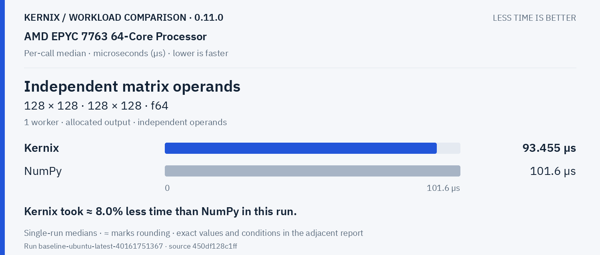

Kernix: **93.455 µs**. Kernix took ≈ 8.0% less time than NumPy in this run.

**Independent matrix operands · 128 × 128 · 128 × 128 · f32**

Kernix: **45.486 µs**. Kernix took ≈ 7.6% less time than NumPy in this run.

**Matrix multiplication · 32 × 32 · 32 × 32 · f64**

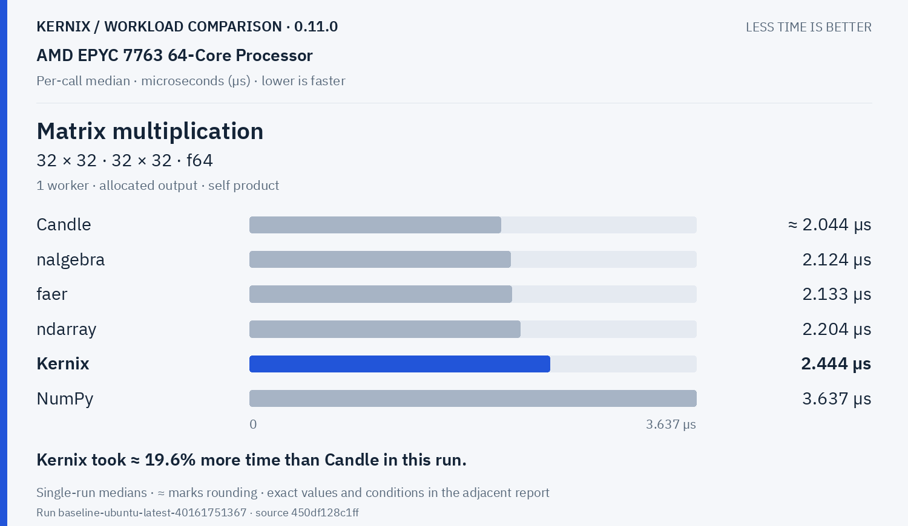

Kernix: **2.444 µs**. Kernix took ≈ 19.6% more time than Candle in this run.

**Matrix multiplication · 64 × 64 · 64 × 64 · f64**

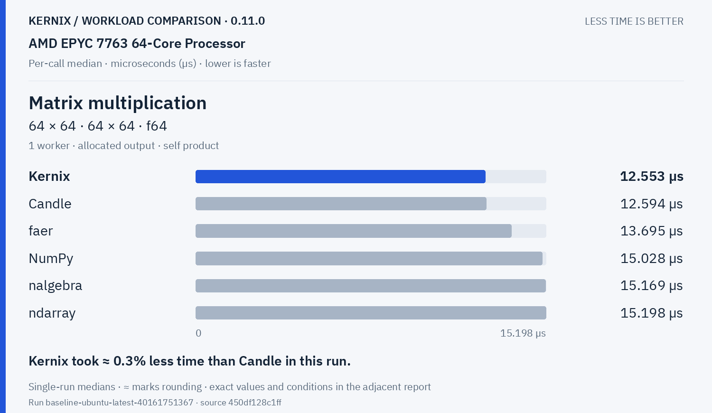

Kernix: **12.553 µs**. Kernix took ≈ 0.3% less time than Candle in this run.

**Matrix multiplication · 128 × 128 · 128 × 128 · f64**

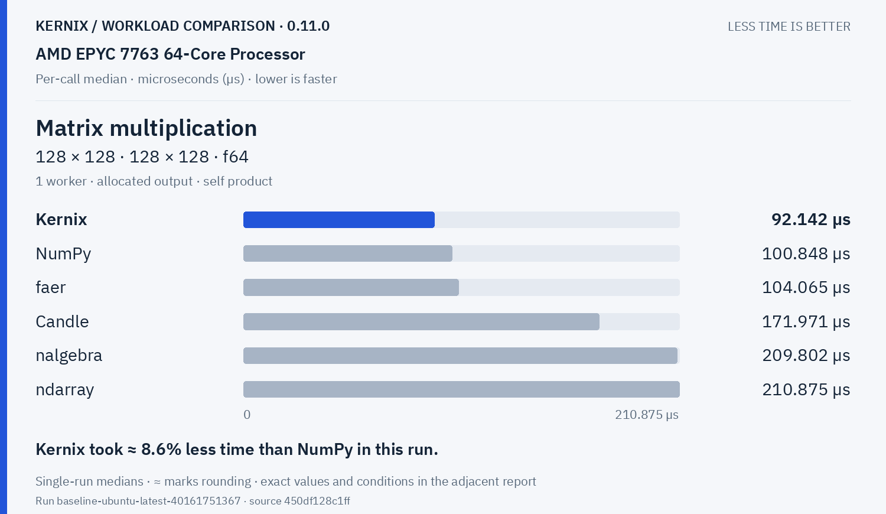

Kernix: **92.142 µs**. Kernix took ≈ 8.6% less time than NumPy in this run.

**Matrix multiplication · 256 × 256 · 256 × 256 · f64**

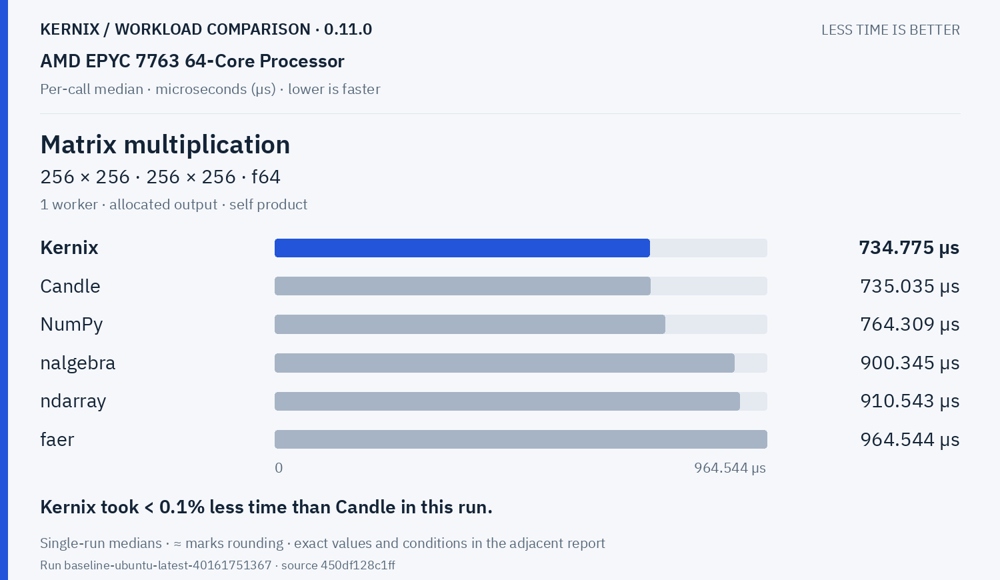

Kernix: **734.775 µs**. Kernix took &lt; 0.1% less time than Candle in this run.

**Matrix multiplication · 64 × 64 · 64 × 64 · f32**

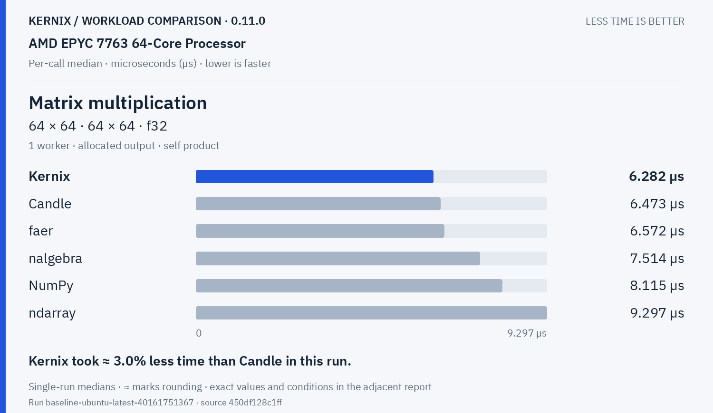

Kernix: **6.282 µs**. Kernix took ≈ 3.0% less time than Candle in this run.

**Matrix multiplication · 128 × 128 · 128 × 128 · f32**

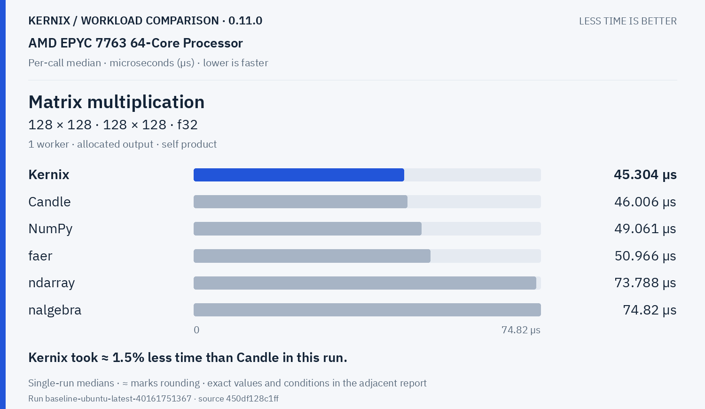

Kernix: **45.304 µs**. Kernix took ≈ 1.5% less time than Candle in this run.

**Matrix multiplication · 256 × 256 · 256 × 256 · f32**

Kernix: **353.331 µs**. Kernix took ≈ 0.8% less time than Candle in this run.

**Batched multiplication · 4 × 16 × 32 · 1 × 32 × 16 · f64**

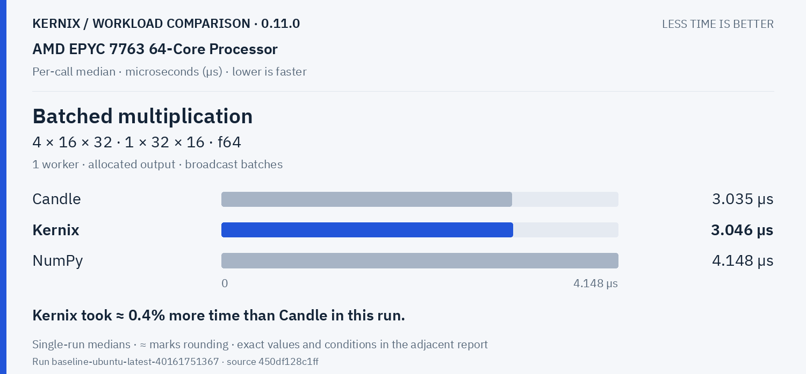

Kernix: **3.046 µs**. Kernix took ≈ 0.4% more time than Candle in this run.

**Batched multiplication · 4 × 16 × 32 · 1 × 32 × 16 · f32**

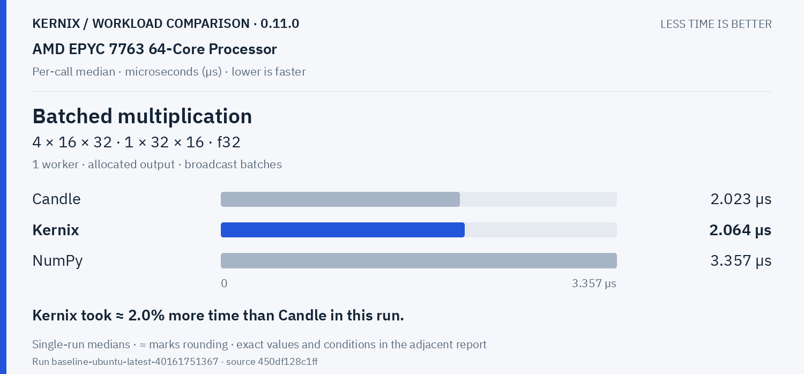

Kernix: **2.064 µs**. Kernix took ≈ 2.0% more time than Candle in this run.

Explicit parallel execution · 4 workloads

**Matmul · 2 workers · reused output · 64 × 64 · 64 × 64 · f64**

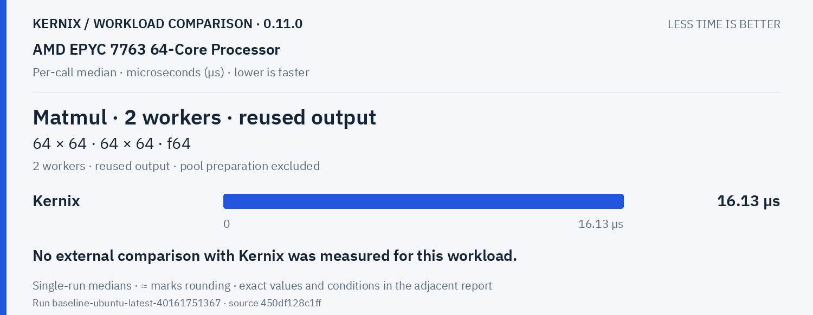

Kernix: **16.13 µs**. No external comparison with Kernix was measured for this workload.

**Matmul · 2 workers · reused output · 128 × 128 · 128 × 128 · f64**

Kernix: **56.005 µs**. No external comparison with Kernix was measured for this workload.

**Matmul · 2 workers · reused output · 256 × 256 · 256 × 256 · f64**

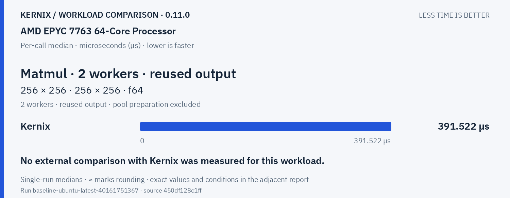

Kernix: **391.522 µs**. No external comparison with Kernix was measured for this workload.

**Matmul · 2 workers · reused output · 128 × 128 · 128 × 128 · f32**

Kernix: **31.189000000000004 µs**. No external comparison with Kernix was measured for this workload.

Decompositions & solvers · 10 workloads

**Cholesky factorization · 512 × 512 · f64**

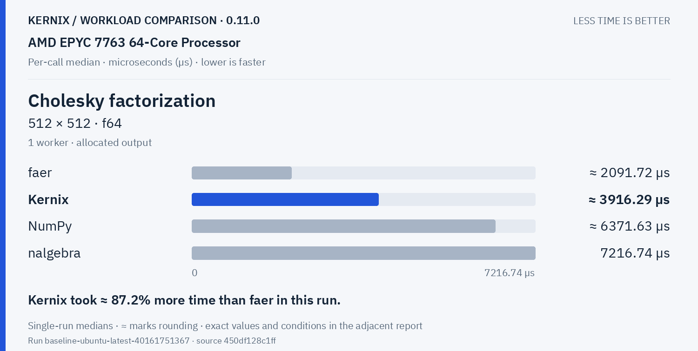

Kernix: **3916.2880000000005 µs**. Kernix took ≈ 87.2% more time than faer in this run.

**Column-pivoted QR · 96 × 32 · f64**

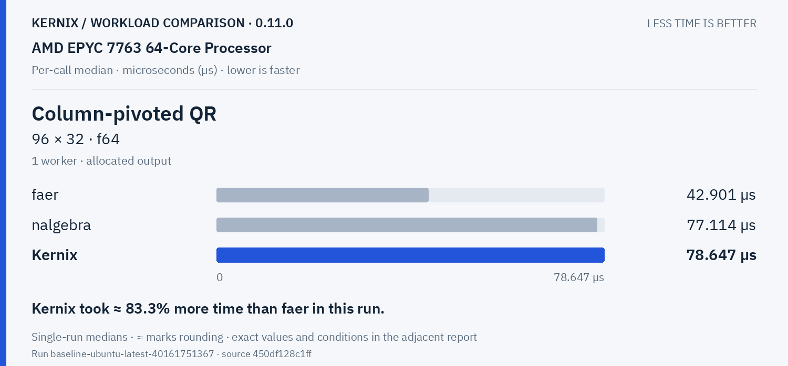

Kernix: **78.647 µs**. Kernix took ≈ 83.3% more time than faer in this run.

**Column-pivoted QR · 256 × 64 · f64**

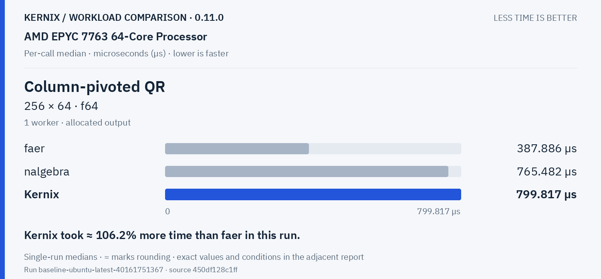

Kernix: **799.817 µs**. Kernix took ≈ 106.2% more time than faer in this run.

**Minimum-norm least squares · 64 × 32, rank 16, 4 RHS · f64**

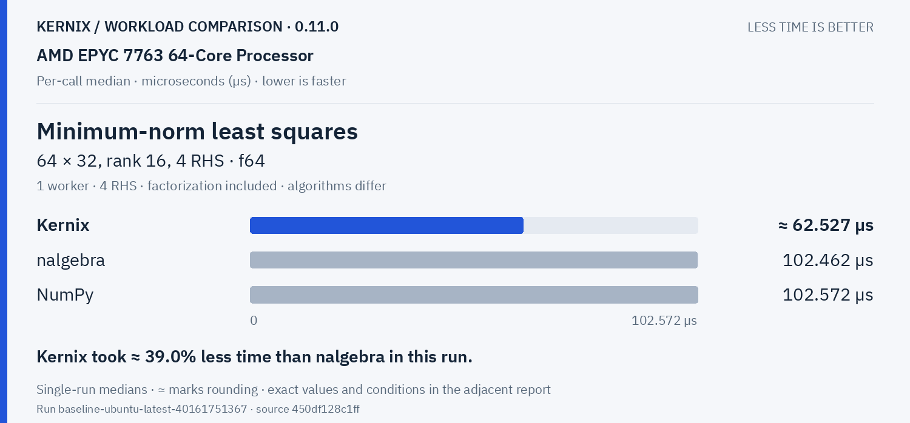

Kernix: **62.52700000000001 µs**. Kernix took ≈ 39.0% less time than nalgebra in this run.

**Minimum-norm least squares · 32 × 64, rank 32, 4 RHS · f64**

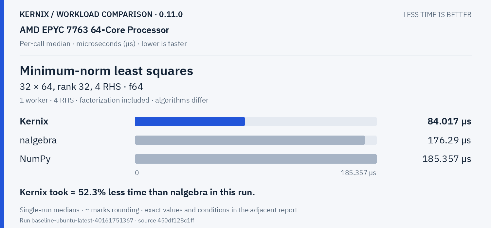

Kernix: **84.017 µs**. Kernix took ≈ 52.3% less time than nalgebra in this run.

**Thin QR · 96 × 32 · f64**

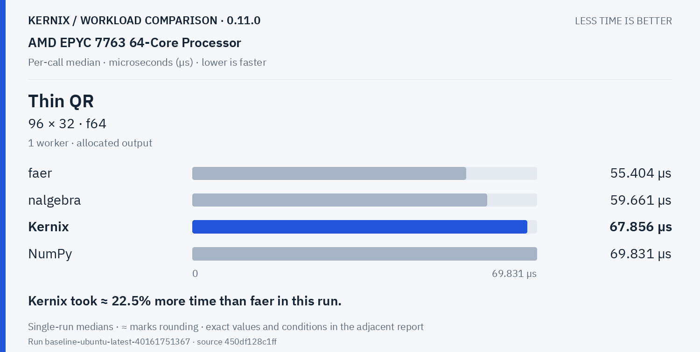

Kernix: **67.856 µs**. Kernix took ≈ 22.5% more time than faer in this run.

**Thin QR · 256 × 64 · f64**

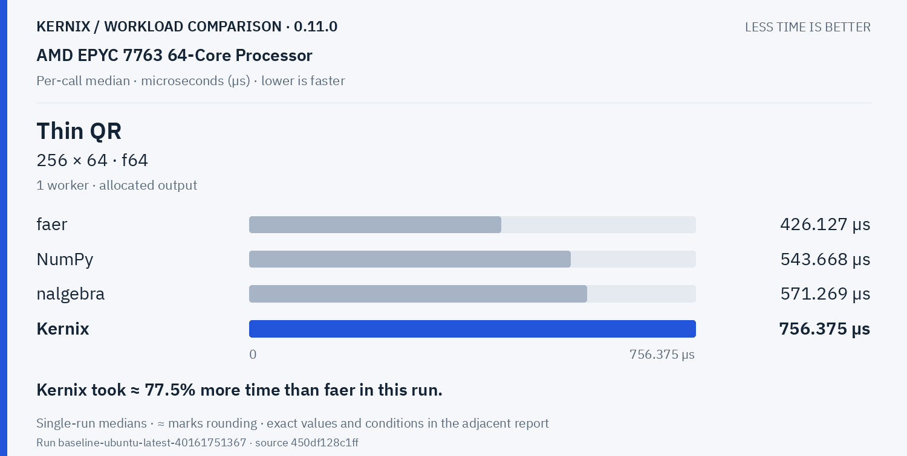

Kernix: **756.375 µs**. Kernix took ≈ 77.5% more time than faer in this run.

**Cholesky factorization · 64 × 64 · f64**

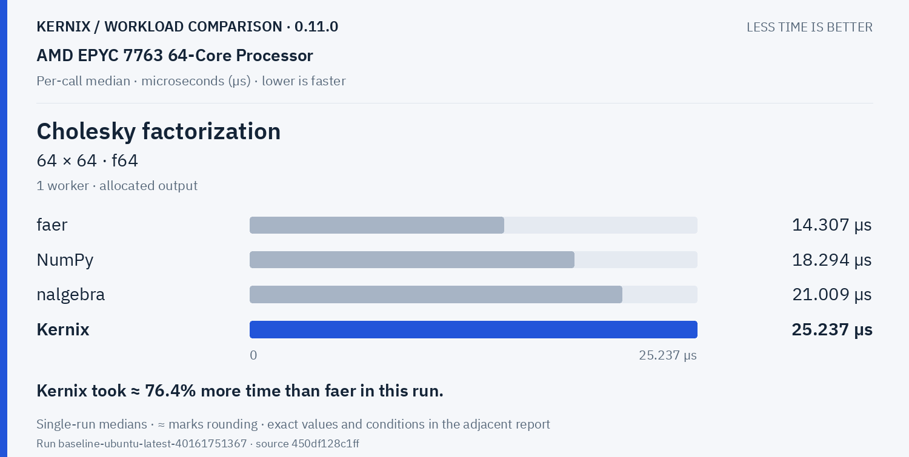

Kernix: **25.237 µs**. Kernix took ≈ 76.4% more time than faer in this run.

**Cholesky factorization · 128 × 128 · f64**

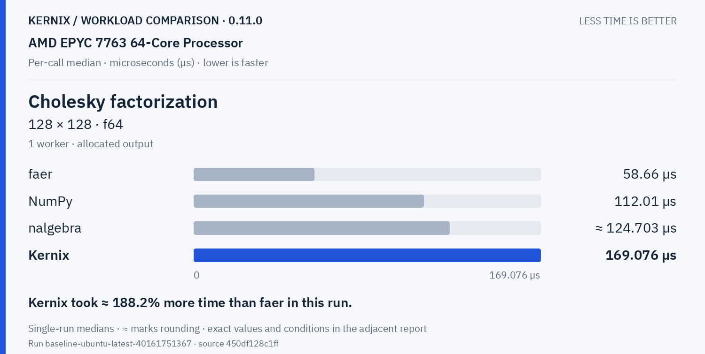

Kernix: **169.076 µs**. Kernix took ≈ 188.2% more time than faer in this run.

**Cholesky factorization · 256 × 256 · f64**

Kernix: **689.701 µs**. Kernix took ≈ 118.4% more time than faer in this run.

Training & autodiff · 6 workloads

**Shared-variable backward · sum(X * X), 64 × 32; prepared graph · f64**

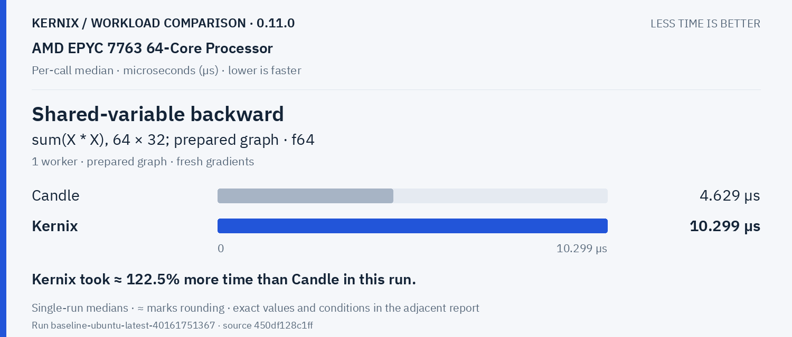

Kernix: **10.299 µs**. Kernix took ≈ 122.5% more time than Candle in this run.

**Record + backward · sum(A · W), 32 × 16 · 16 × 8 · f64**

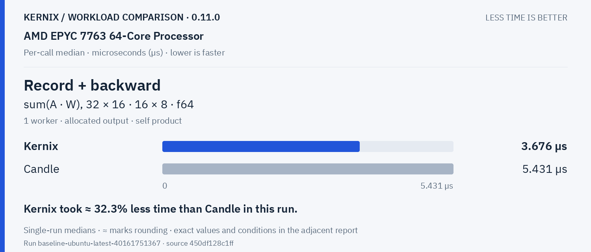

Kernix: **3.676 µs**. Kernix took ≈ 32.3% less time than Candle in this run.

**Model inference · batched normalized/sliced MLP · f64**

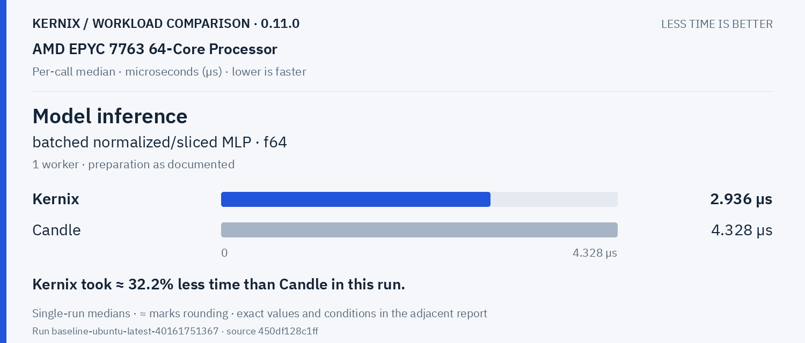

Kernix: **2.936 µs**. Kernix took ≈ 32.2% less time than Candle in this run.

**Model recording + forward · batched normalized/sliced MLP · f64**

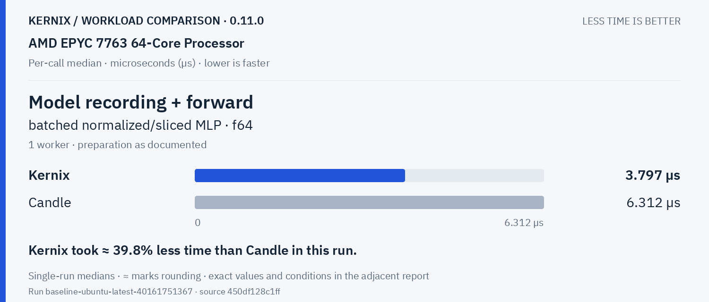

Kernix: **3.797 µs**. Kernix took ≈ 39.8% less time than Candle in this run.

**Model backward · prepared graph → fresh gradients · f64**

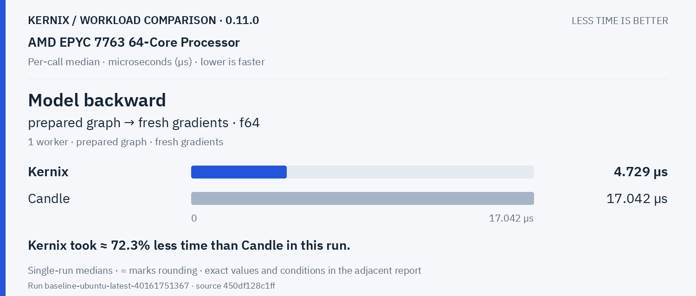

Kernix: **4.729 µs**. Kernix took ≈ 72.3% less time than Candle in this run.

**Parameter update · transactional SGD, fixed gradients · f64**

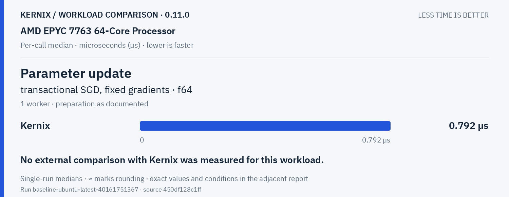

Kernix: **0.792 µs**. No external comparison with Kernix was measured for this workload.

Tensor contractions · 1 workloads

**Coalesced tensor contraction · 16 × 32 × 8 · 32 × 8 × 16 · f64**

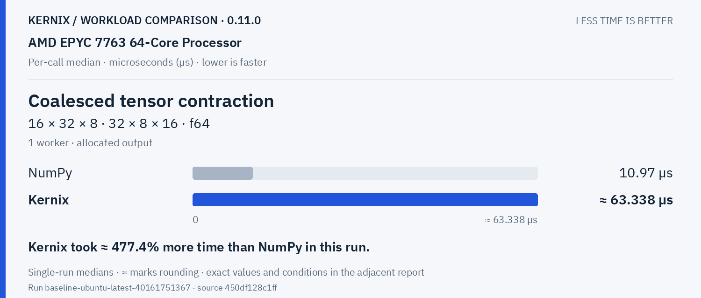

Kernix: **63.33799999999999 µs**. Kernix took ≈ 477.4% more time than NumPy in this run.

Statistics & activations · 1 workloads

**Row softmax · 256 × 64 · f64**

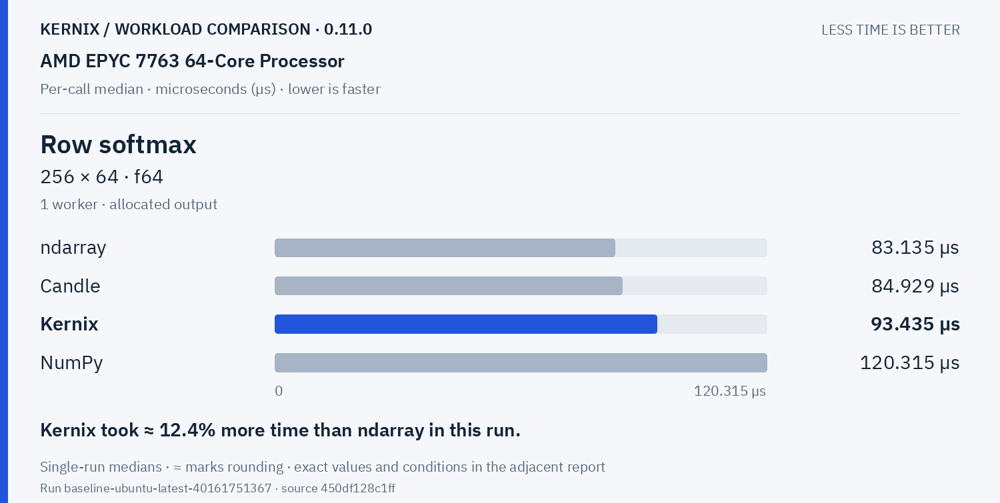

Kernix: **93.435 µs**. Kernix took ≈ 12.4% more time than ndarray in this run.

Tensor construction · 2 workloads

**Create zeros · 64 × 64 · f32**

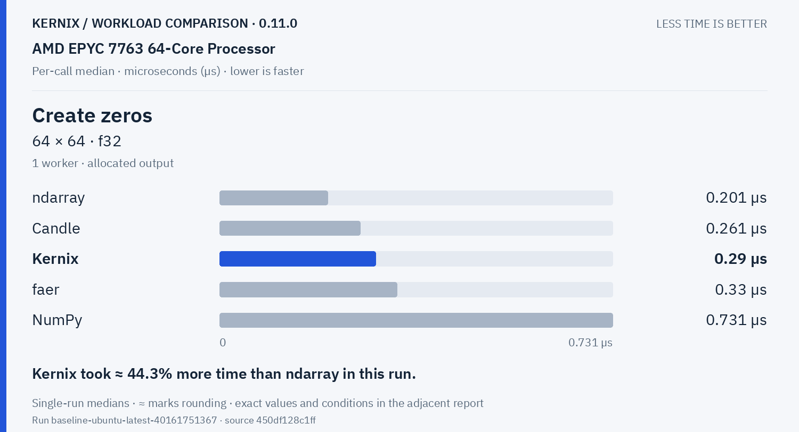

Kernix: **0.29 µs**. Kernix took ≈ 44.3% more time than ndarray in this run.

**Create ones · 64 × 64 · f32**

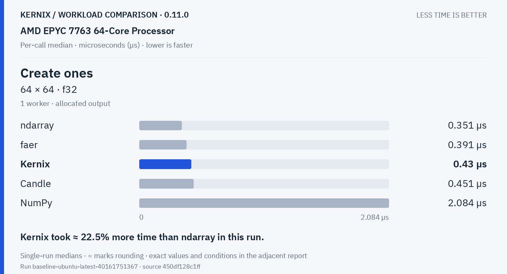

Kernix: **0.43 µs**. Kernix took ≈ 22.5% more time than ndarray in this run.

## Exact latency table

All values below are microseconds per operation. **Lower is faster.** Missing entries were not measured.

| Workload | Kernix | ndarray | nalgebra | faer | Candle | NumPy |
|---|---:|---:|---:|---:|---:|---:|
| Independent matrix operands · 128 × 128 · 128 × 128 · f64 | **93.455** | — | — | — | — | 101.6 |
| Independent matrix operands · 128 × 128 · 128 × 128 · f32 | **45.486** | — | — | — | — | 49.212 |
| Matrix multiplication · 32 × 32 · 32 × 32 · f64 | 2.444 | 2.204 | 2.124 | 2.133 | **2.0439999999999998** | 3.637 |
| Matrix multiplication · 64 × 64 · 64 × 64 · f64 | **12.553** | 15.198 | 15.169 | 13.695 | 12.594 | 15.028 |
| Matrix multiplication · 128 × 128 · 128 × 128 · f64 | **92.142** | 210.875 | 209.802 | 104.065 | 171.971 | 100.848 |
| Matrix multiplication · 256 × 256 · 256 × 256 · f64 | **734.775** | 910.543 | 900.345 | 964.544 | 735.035 | 764.309 |
| Matrix multiplication · 64 × 64 · 64 × 64 · f32 | **6.282** | 9.297 | 7.514 | 6.572 | 6.473 | 8.115 |
| Matrix multiplication · 128 × 128 · 128 × 128 · f32 | **45.304** | 73.788 | 74.82 | 50.966 | 46.006 | 49.061 |
| Matrix multiplication · 256 × 256 · 256 × 256 · f32 | **353.331** | 608.288 | 612.756 | 418.954 | 356.147 | 362.648 |
| Batched multiplication · 4 × 16 × 32 · 1 × 32 × 16 · f64 | 3.046 | — | — | — | **3.035** | 4.148 |
| Batched multiplication · 4 × 16 × 32 · 1 × 32 × 16 · f32 | 2.064 | — | — | — | **2.023** | 3.357 |
| Matmul · 2 workers · reused output · 64 × 64 · 64 × 64 · f64 | 16.13 | — | — | — | — | — |
| Matmul · 2 workers · reused output · 128 × 128 · 128 × 128 · f64 | 56.005 | — | — | — | — | — |
| Matmul · 2 workers · reused output · 256 × 256 · 256 × 256 · f64 | 391.522 | — | — | — | — | — |
| Matmul · 2 workers · reused output · 128 × 128 · 128 × 128 · f32 | 31.189000000000004 | — | — | — | — | — |
| Cholesky factorization · 512 × 512 · f64 | 3916.2880000000005 | — | 7216.74 | **2091.724** | — | 6371.631 |
| Column-pivoted QR · 96 × 32 · f64 | 78.647 | — | 77.114 | **42.901** | — | — |
| Column-pivoted QR · 256 × 64 · f64 | 799.817 | — | 765.482 | **387.886** | — | — |
| Minimum-norm least squares · 64 × 32, rank 16, 4 RHS · f64 | **62.52700000000001** | — | 102.462 | — | — | 102.572 |
| Minimum-norm least squares · 32 × 64, rank 32, 4 RHS · f64 | **84.017** | — | 176.29 | — | — | 185.357 |
| Thin QR · 96 × 32 · f64 | 67.856 | — | 59.661 | **55.404** | — | 69.831 |
| Thin QR · 256 × 64 · f64 | 756.375 | — | 571.269 | **426.127** | — | 543.668 |
| Cholesky factorization · 64 × 64 · f64 | 25.237 | — | 21.009 | **14.307** | — | 18.294 |
| Cholesky factorization · 128 × 128 · f64 | 169.076 | — | 124.70299999999999 | **58.66** | — | 112.01 |
| Cholesky factorization · 256 × 256 · f64 | 689.701 | — | 788.375 | **315.811** | — | 1120.085 |
| Shared-variable backward · sum(X * X), 64 × 32; prepared graph · f64 | 10.299 | — | — | — | **4.629** | — |
| Record + backward · sum(A · W), 32 × 16 · 16 × 8 · f64 | **3.676** | — | — | — | 5.431 | — |
| Model inference · batched normalized/sliced MLP · f64 | **2.936** | — | — | — | 4.328 | — |
| Model recording + forward · batched normalized/sliced MLP · f64 | **3.797** | — | — | — | 6.312 | — |
| Model backward · prepared graph → fresh gradients · f64 | **4.729** | — | — | — | 17.042 | — |
| Parameter update · transactional SGD, fixed gradients · f64 | 0.792 | — | — | — | — | — |
| Coalesced tensor contraction · 16 × 32 × 8 · 32 × 8 × 16 · f64 | 63.33799999999999 | — | — | — | — | **10.97** |
| Row softmax · 256 × 64 · f64 | 93.435 | **83.135** | — | — | 84.929 | 120.315 |
| Create zeros · 64 × 64 · f32 | 0.29 | **0.201** | — | 0.33 | 0.261 | 0.731 |
| Create ones · 64 × 64 · f32 | 0.43 | **0.351** | — | 0.391 | 0.451 | 2.084 |

## Version comparison

0 of 35 workloads have paired evidence. Exploratory 95% intervals resample process pairs, not calls. No multiple-comparison adjustment.

| Workload | Current / baseline [95% interval] | Interpretation |
|---|---:|---|
| Independent matrix operands · 128 × 128 · 128 × 128 · f64 | — | No paired comparison |
| Independent matrix operands · 128 × 128 · 128 × 128 · f32 | — | No paired comparison |
| Matrix multiplication · 32 × 32 · 32 × 32 · f64 | — | No paired comparison |
| Matrix multiplication · 64 × 64 · 64 × 64 · f64 | — | No paired comparison |
| Matrix multiplication · 128 × 128 · 128 × 128 · f64 | — | No paired comparison |
| Matrix multiplication · 256 × 256 · 256 × 256 · f64 | — | No paired comparison |
| Matrix multiplication · 64 × 64 · 64 × 64 · f32 | — | No paired comparison |
| Matrix multiplication · 128 × 128 · 128 × 128 · f32 | — | No paired comparison |
| Matrix multiplication · 256 × 256 · 256 × 256 · f32 | — | No paired comparison |
| Batched multiplication · 4 × 16 × 32 · 1 × 32 × 16 · f64 | — | No paired comparison |
| Batched multiplication · 4 × 16 × 32 · 1 × 32 × 16 · f32 | — | No paired comparison |
| Matmul · 2 workers · reused output · 64 × 64 · 64 × 64 · f64 | — | No paired comparison |
| Matmul · 2 workers · reused output · 128 × 128 · 128 × 128 · f64 | — | No paired comparison |
| Matmul · 2 workers · reused output · 256 × 256 · 256 × 256 · f64 | — | No paired comparison |
| Matmul · 2 workers · reused output · 128 × 128 · 128 × 128 · f32 | — | No paired comparison |
| Cholesky factorization · 512 × 512 · f64 | — | No paired comparison |
| Column-pivoted QR · 96 × 32 · f64 | — | No paired comparison |
| Column-pivoted QR · 256 × 64 · f64 | — | No paired comparison |
| Minimum-norm least squares · 64 × 32, rank 16, 4 RHS · f64 | — | No paired comparison |
| Minimum-norm least squares · 32 × 64, rank 32, 4 RHS · f64 | — | No paired comparison |
| Thin QR · 96 × 32 · f64 | — | No paired comparison |
| Thin QR · 256 × 64 · f64 | — | No paired comparison |
| Cholesky factorization · 64 × 64 · f64 | — | No paired comparison |
| Cholesky factorization · 128 × 128 · f64 | — | No paired comparison |
| Cholesky factorization · 256 × 256 · f64 | — | No paired comparison |
| Shared-variable backward · sum(X * X), 64 × 32; prepared graph · f64 | — | No paired comparison |
| Record + backward · sum(A · W), 32 × 16 · 16 × 8 · f64 | — | No paired comparison |
| Model inference · batched normalized/sliced MLP · f64 | — | No paired comparison |
| Model recording + forward · batched normalized/sliced MLP · f64 | — | No paired comparison |
| Model backward · prepared graph → fresh gradients · f64 | — | No paired comparison |
| Parameter update · transactional SGD, fixed gradients · f64 | — | No paired comparison |
| Coalesced tensor contraction · 16 × 32 × 8 · 32 × 8 × 16 · f64 | — | No paired comparison |
| Row softmax · 256 × 64 · f64 | — | No paired comparison |
| Create zeros · 64 × 64 · f32 | — | No paired comparison |
| Create ones · 64 × 64 · f32 | — | No paired comparison |

## Method and provenance

CPU affinity pinned to logical CPU 0. Frequency and background load are uncontrolled.

Minimum-norm rows use pivoted QR plus scaled implicit RZ in Kernix; NumPy native lstsq; nalgebra native SVD/solve. Algorithm costs and rank policies differ. See original method for thresholds.

Numbers retain source precision; recorded digits do not imply equivalent physical measurement accuracy. Lowest observed medians are bold only when peers were measured. No aggregate winner or universal ranking is inferred.

[Original report and commentary](original-report.txt) · [Raw measurements](raw.json)

Measured source `450df128c1ffb55a9a861230edb6b9a5ac3ef5b4`. Run `baseline-ubuntu-latest-40161751367`. Rendering does not change measurements.
