# Kernix 0.12.0 · performance brief

AMD EPYC 7763 64-Core Processor / Linux

**Per-call median, microseconds per operation. Lower is faster. All recorded digits retained.**

51 workloads · 170 observations

No previous-version baseline attached. Sequential run changes are descriptive; paired process evidence is shown separately.

[Interactive HTML (open locally)](report.html) · [Vector PDF](latency.pdf) · [Raw measurements](raw.json)

[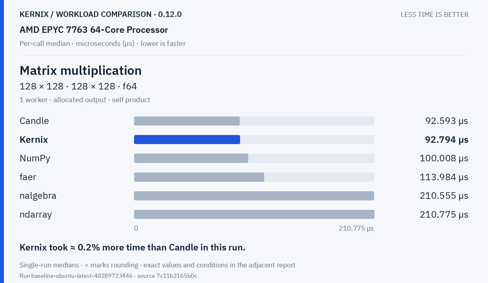](latency.pdf)

## Charts by workload

**Shorter bars mean less time.** Blue is Kernix; grey is a comparison implementation; teal is an explicitly selected Kernix backend. Entries are sorted by the recorded median, with a separate zero-based scale per chart. These point observations do not establish a statistical ranking.

Expand a group to see every chart here on GitHub. Click a chart to enlarge it. The exact table below keeps every source digit.

Sparse matrices & memory · 5 workloads

**Sparse matrix × vector · 2048 × 2048 · five diagonals · f64**

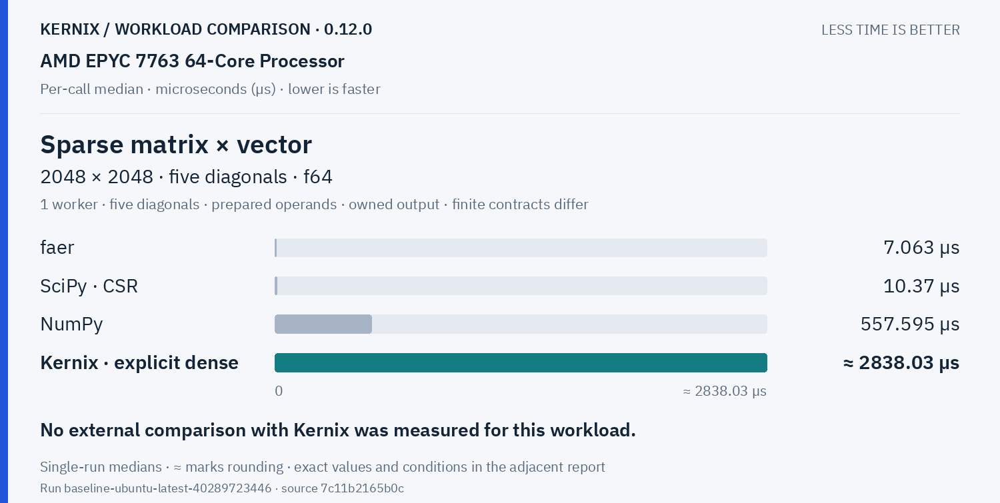

No external comparison with Kernix was measured for this workload.

**Sparse × dense matrix · 512 × 512 · 32 RHS · five diagonals · f64**

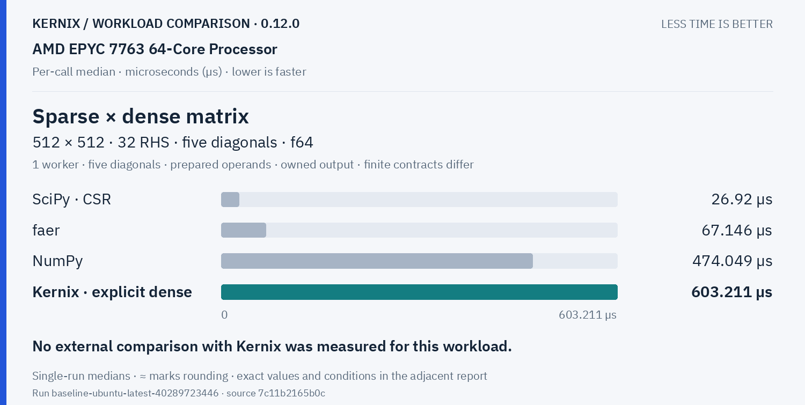

No external comparison with Kernix was measured for this workload.

**Sparse × dense matrix · 512 × 512 · 32 RHS · five diagonals · f32**

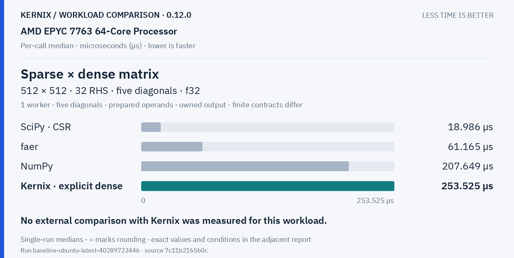

No external comparison with Kernix was measured for this workload.

**Sparse × sparse matrix · 256 × 256 · five diagonals each · f64**

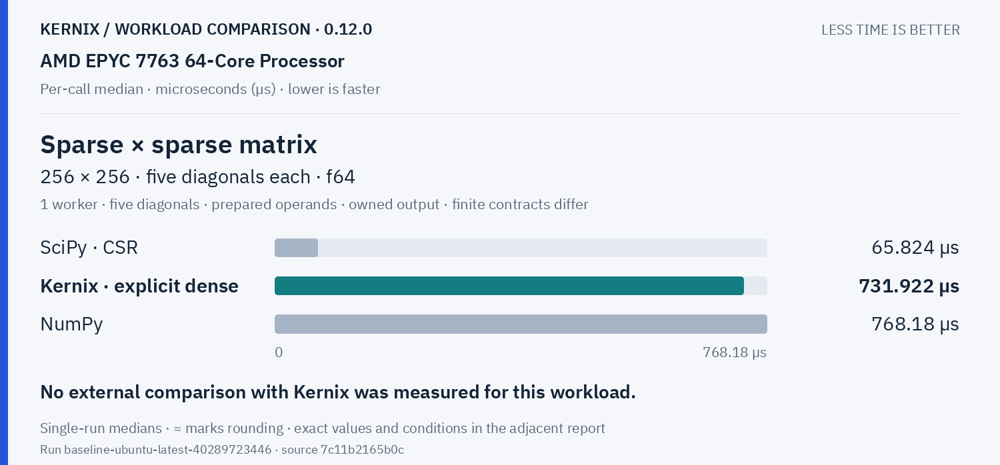

No external comparison with Kernix was measured for this workload.

**Automatic CSR construction · 512 × 512 · clone + scan + compress · f64**

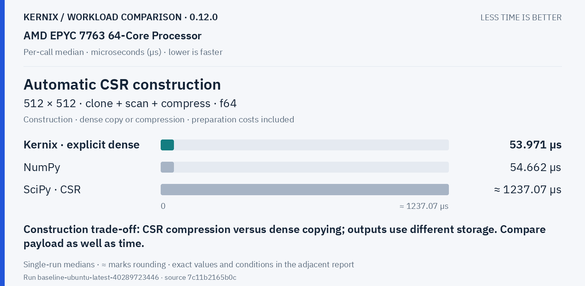

Construction trade-off: CSR compression versus dense copying; outputs use different storage. Compare payload as well as time.

Matrix multiplication · 13 workloads

**Matrix multiplication · transposed view · 128 × 128 · 128 × 128 · f64**

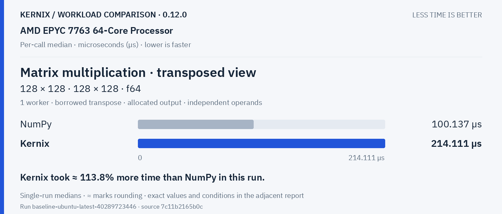

Kernix: **214.111 µs**. Kernix took ≈ 113.8% more time than NumPy in this run.

**Matrix multiplication · transposed view · 128 × 128 · 128 × 128 · f32**

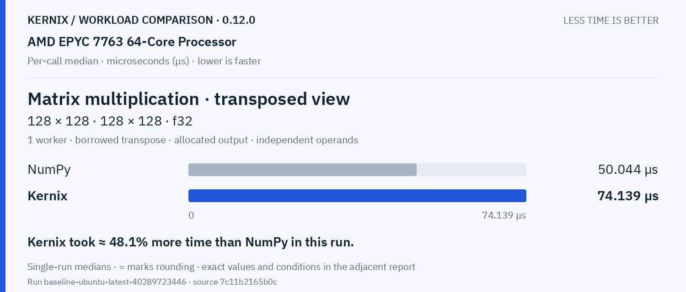

Kernix: **74.139 µs**. Kernix took ≈ 48.1% more time than NumPy in this run.

**Independent matrix operands · 128 × 128 · 128 × 128 · f64**

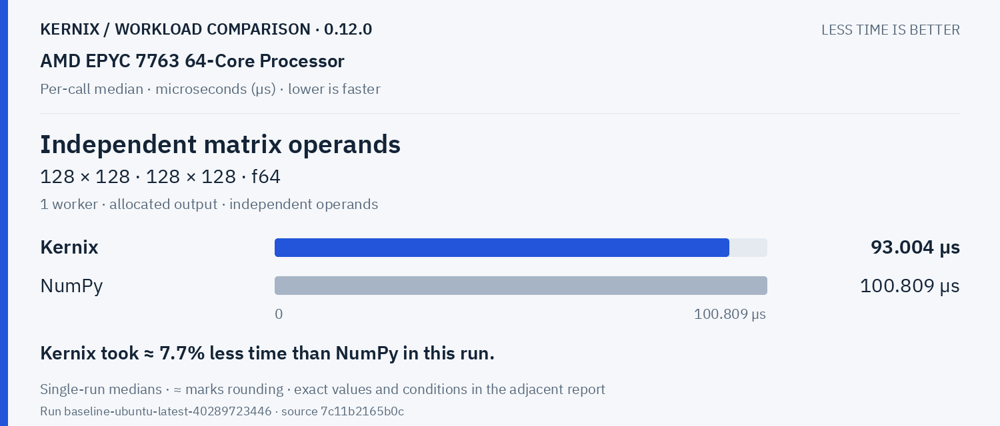

Kernix: **93.004 µs**. Kernix took ≈ 7.7% less time than NumPy in this run.

**Independent matrix operands · 128 × 128 · 128 × 128 · f32**

Kernix: **45.625 µs**. Kernix took ≈ 7.3% less time than NumPy in this run.

**Matrix multiplication · 32 × 32 · 32 × 32 · f64**

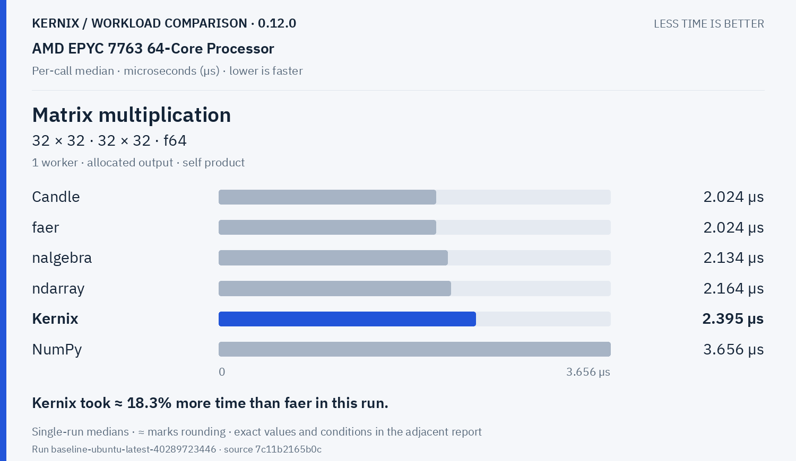

Kernix: **2.395 µs**. Kernix took ≈ 18.3% more time than faer in this run.

**Matrix multiplication · 64 × 64 · 64 × 64 · f64**

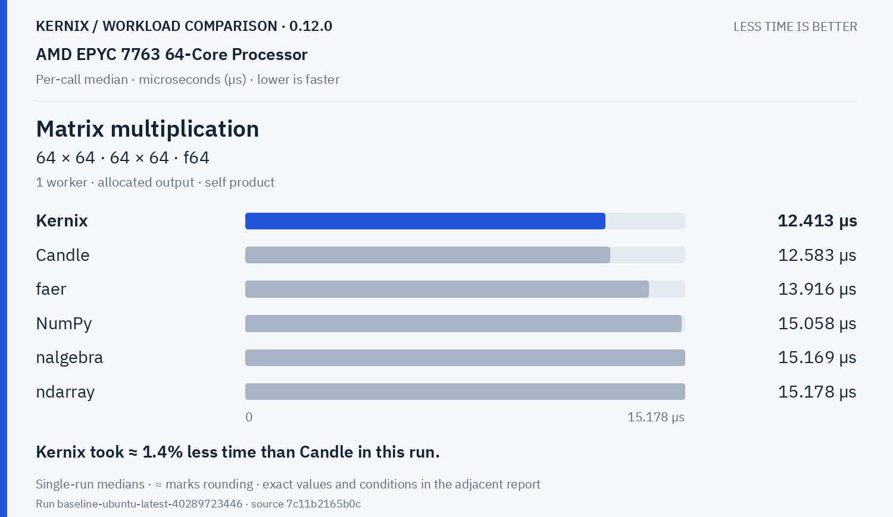

Kernix: **12.413 µs**. Kernix took ≈ 1.4% less time than Candle in this run.

**Matrix multiplication · 128 × 128 · 128 × 128 · f64**

Kernix: **92.794 µs**. Kernix took ≈ 0.2% more time than Candle in this run.

**Matrix multiplication · 256 × 256 · 256 × 256 · f64**

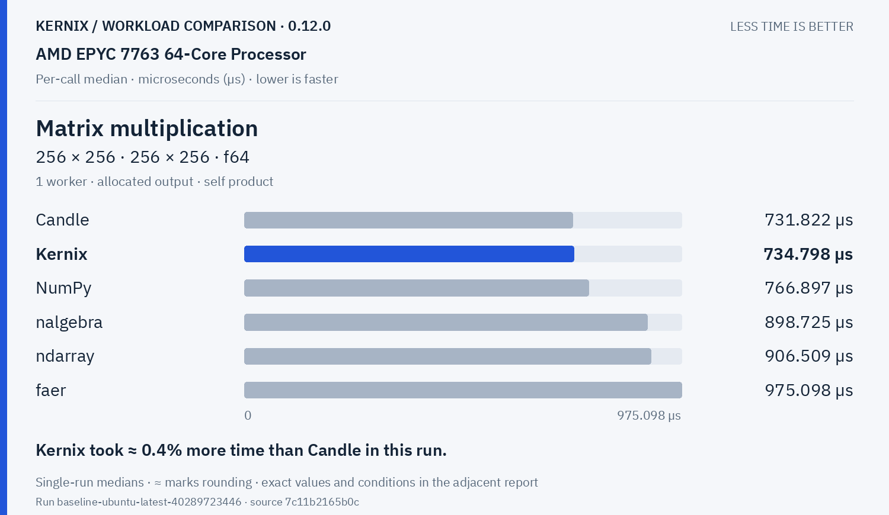

Kernix: **734.798 µs**. Kernix took ≈ 0.4% more time than Candle in this run.

**Matrix multiplication · 64 × 64 · 64 × 64 · f32**

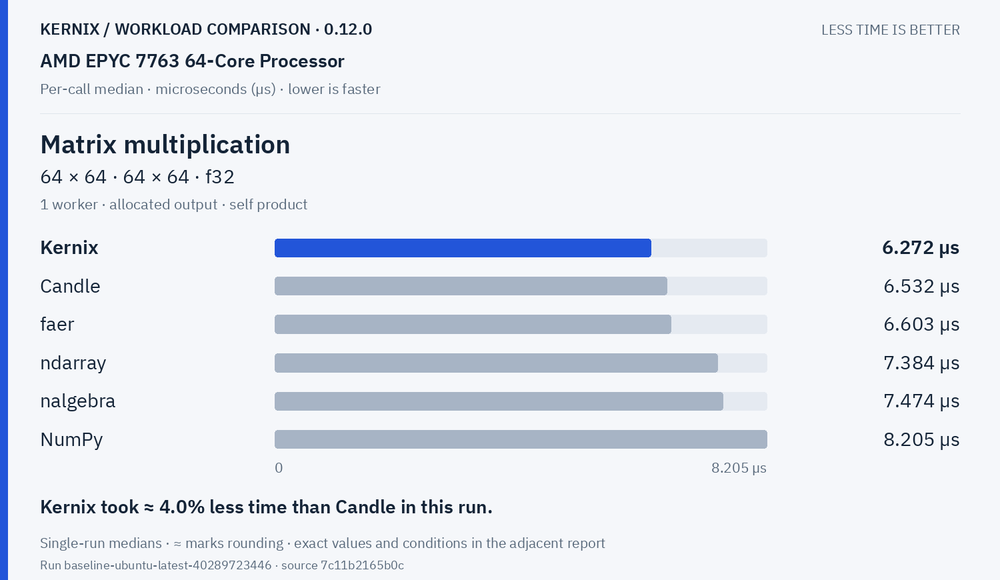

Kernix: **6.272 µs**. Kernix took ≈ 4.0% less time than Candle in this run.

**Matrix multiplication · 128 × 128 · 128 × 128 · f32**

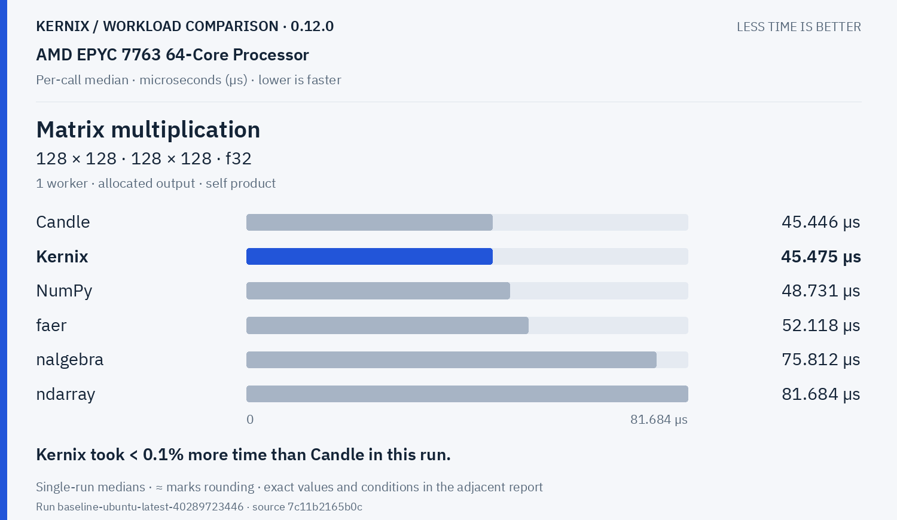

Kernix: **45.475 µs**. Kernix took &lt; 0.1% more time than Candle in this run.

**Matrix multiplication · 256 × 256 · 256 × 256 · f32**

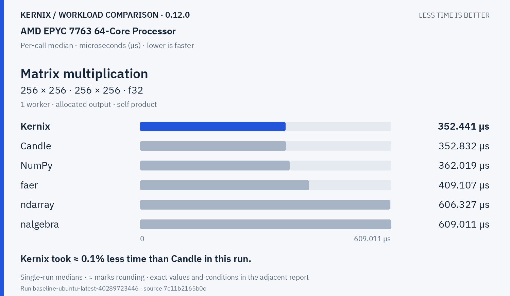

Kernix: **352.441 µs**. Kernix took ≈ 0.1% less time than Candle in this run.

**Batched multiplication · 4 × 16 × 32 · 1 × 32 × 16 · f64**

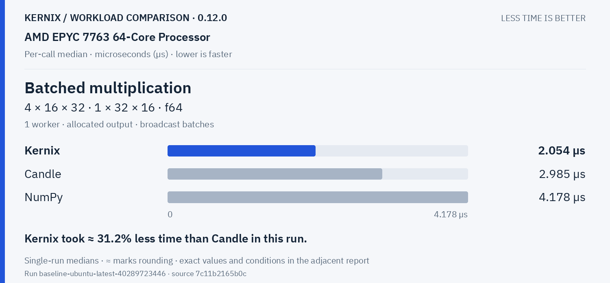

Kernix: **2.054 µs**. Kernix took ≈ 31.2% less time than Candle in this run.

**Batched multiplication · 4 × 16 × 32 · 1 × 32 × 16 · f32**

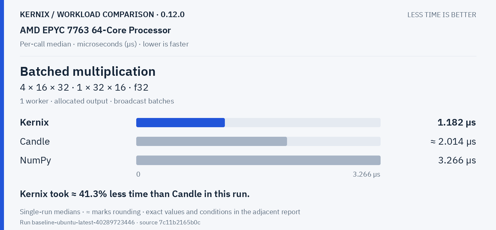

Kernix: **1.182 µs**. Kernix took ≈ 41.3% less time than Candle in this run.

Explicit parallel execution · 4 workloads

**Matmul · 2 workers · reused output · 64 × 64 · 64 × 64 · f64**

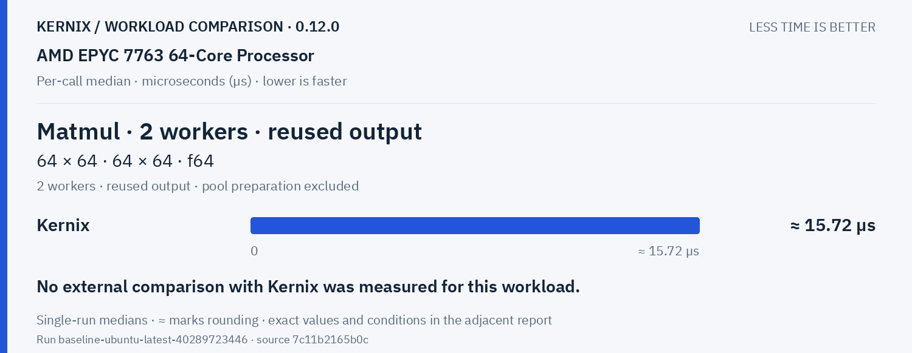

Kernix: **15.719999999999998 µs**. No external comparison with Kernix was measured for this workload.

**Matmul · 2 workers · reused output · 128 × 128 · 128 × 128 · f64**

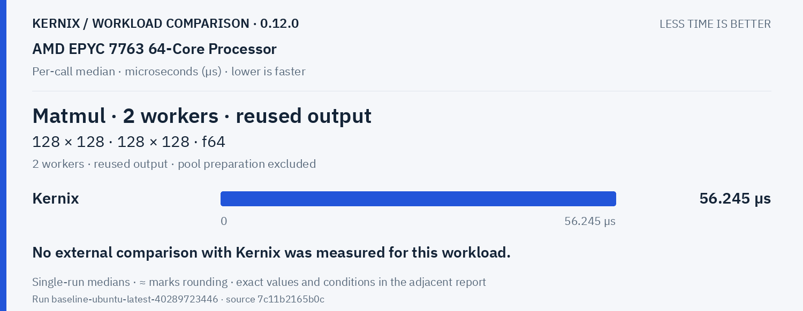

Kernix: **56.245 µs**. No external comparison with Kernix was measured for this workload.

**Matmul · 2 workers · reused output · 256 × 256 · 256 × 256 · f64**

Kernix: **391.394 µs**. No external comparison with Kernix was measured for this workload.

**Matmul · 2 workers · reused output · 128 × 128 · 128 × 128 · f32**

Kernix: **30.978 µs**. No external comparison with Kernix was measured for this workload.

Decompositions & solvers · 19 workloads

**Cholesky solve · reused factor · 128 × 128, 1 RHS · f64**

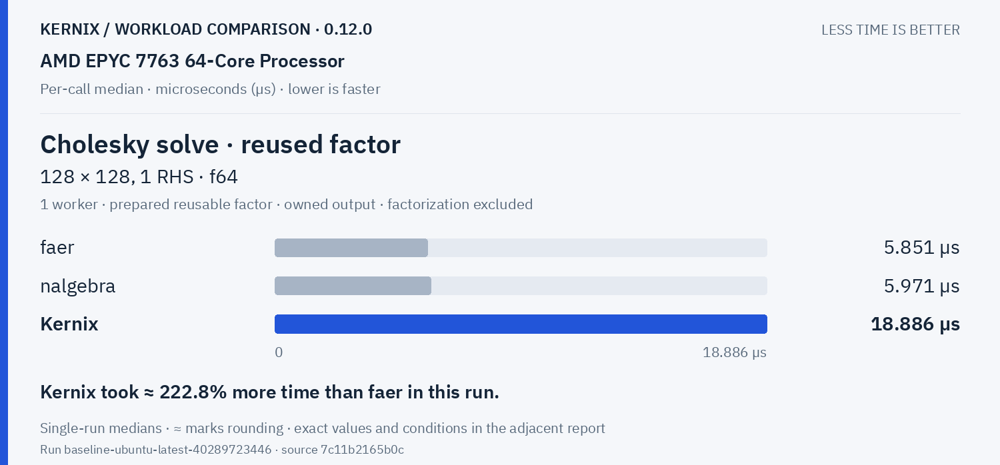

Kernix: **18.886 µs**. Kernix took ≈ 222.8% more time than faer in this run.

**Cholesky solve · reused factor · 256 × 256, 64 RHS · f64**

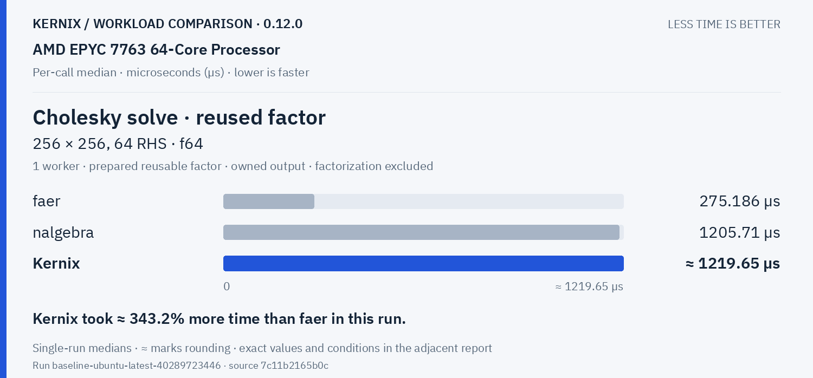

Kernix: **1219.647 µs**. Kernix took ≈ 343.2% more time than faer in this run.

**Cholesky solve · reused factor · 512 × 512, 128 RHS · f64**

Kernix: **9608.824 µs**. Kernix took ≈ 335.6% more time than faer in this run.

**LU solve · reused factor · 256 × 256, 64 RHS · f64**

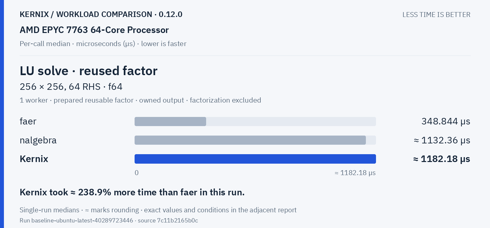

Kernix: **1182.177 µs**. Kernix took ≈ 238.9% more time than faer in this run.

**Cholesky rank-one update · 256 × 256 · f64**

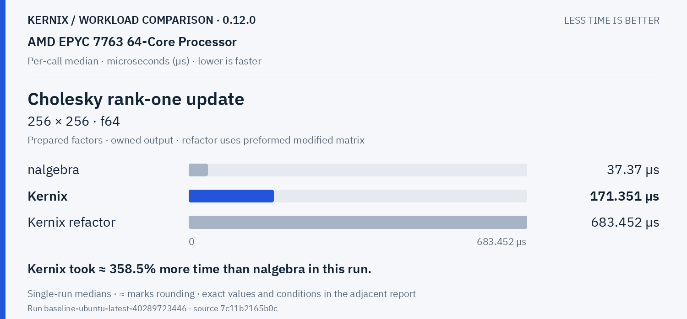

Kernix: **171.351 µs**. Kernix took ≈ 358.5% more time than nalgebra in this run.

**Cholesky rank-one downdate · 256 × 256 · f64**

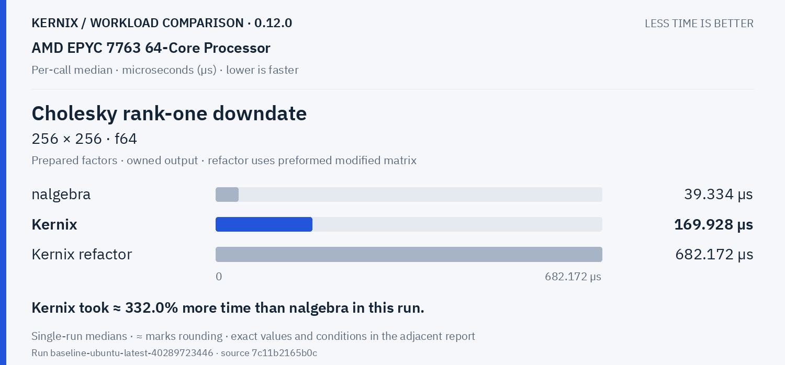

Kernix: **169.928 µs**. Kernix took ≈ 332.0% more time than nalgebra in this run.

**Cholesky rank-one update · 512 × 512 · f64**

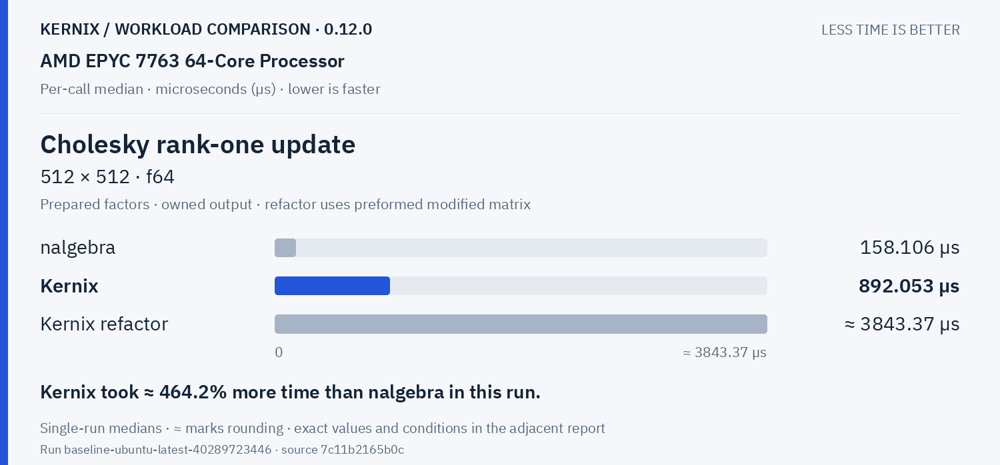

Kernix: **892.053 µs**. Kernix took ≈ 464.2% more time than nalgebra in this run.

**Thin QR · 512 × 128 · f64**

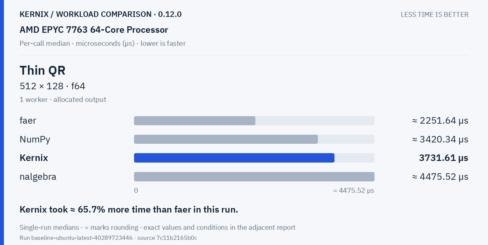

Kernix: **3731.61 µs**. Kernix took ≈ 65.7% more time than faer in this run.

**Thin QR · 1024 × 256 · f64**

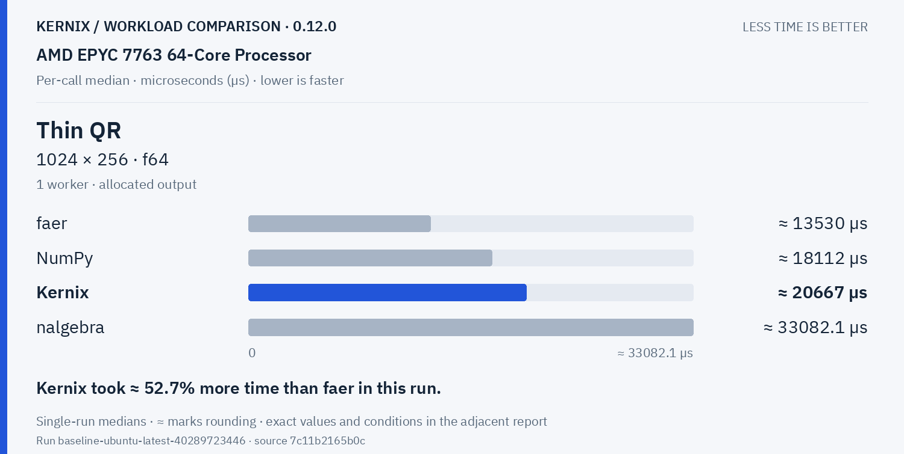

Kernix: **20667.047 µs**. Kernix took ≈ 52.7% more time than faer in this run.

**Cholesky factorization · 512 × 512 · f64**

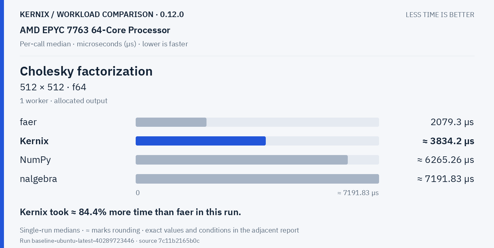

Kernix: **3834.198 µs**. Kernix took ≈ 84.4% more time than faer in this run.

**Column-pivoted QR · 96 × 32 · f64**

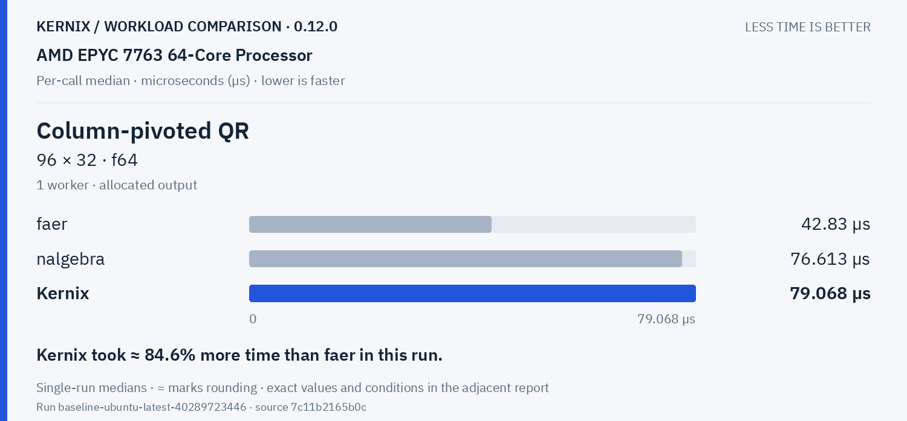

Kernix: **79.068 µs**. Kernix took ≈ 84.6% more time than faer in this run.

**Column-pivoted QR · 256 × 64 · f64**

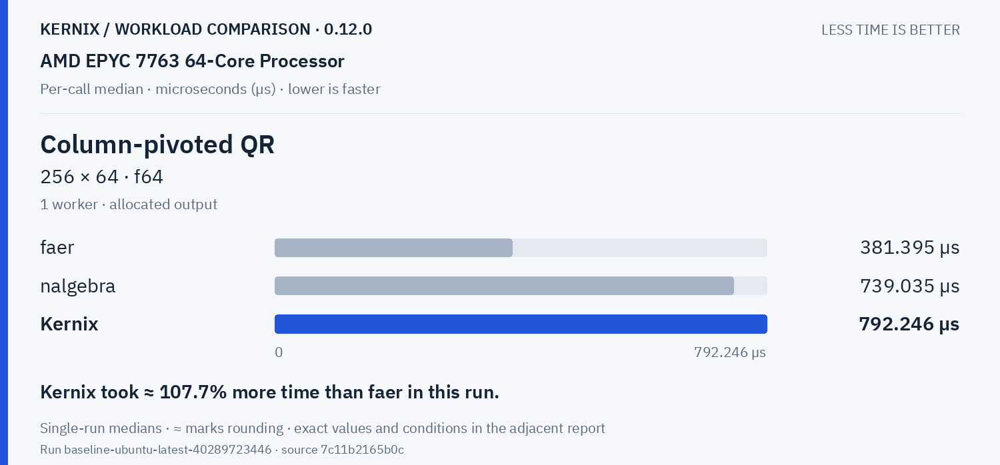

Kernix: **792.246 µs**. Kernix took ≈ 107.7% more time than faer in this run.

**Minimum-norm least squares · 64 × 32, rank 16, 4 RHS · f64**

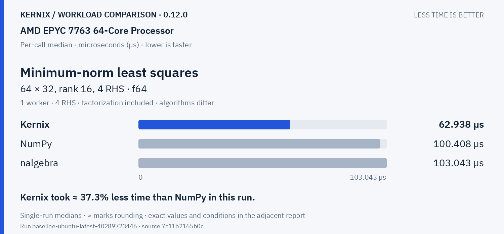

Kernix: **62.938 µs**. Kernix took ≈ 37.3% less time than NumPy in this run.

**Minimum-norm least squares · 32 × 64, rank 32, 4 RHS · f64**

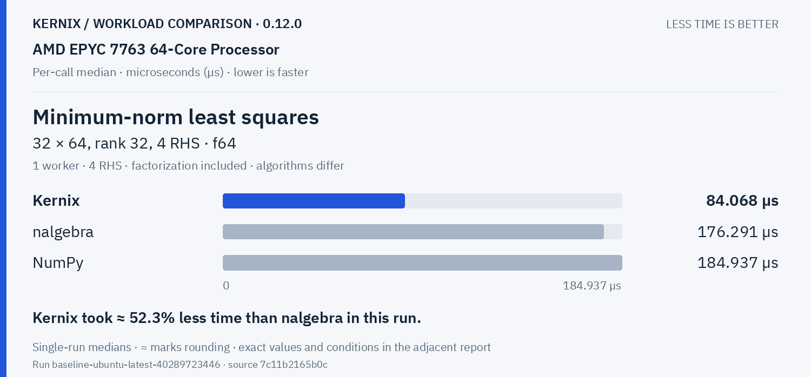

Kernix: **84.068 µs**. Kernix took ≈ 52.3% less time than nalgebra in this run.

**Thin QR · 96 × 32 · f64**

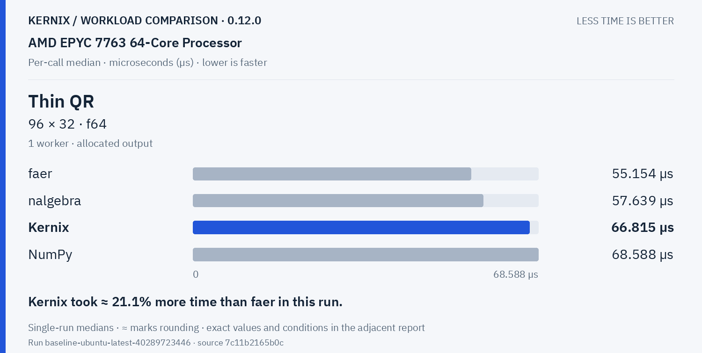

Kernix: **66.815 µs**. Kernix took ≈ 21.1% more time than faer in this run.

**Thin QR · 256 × 64 · f64**

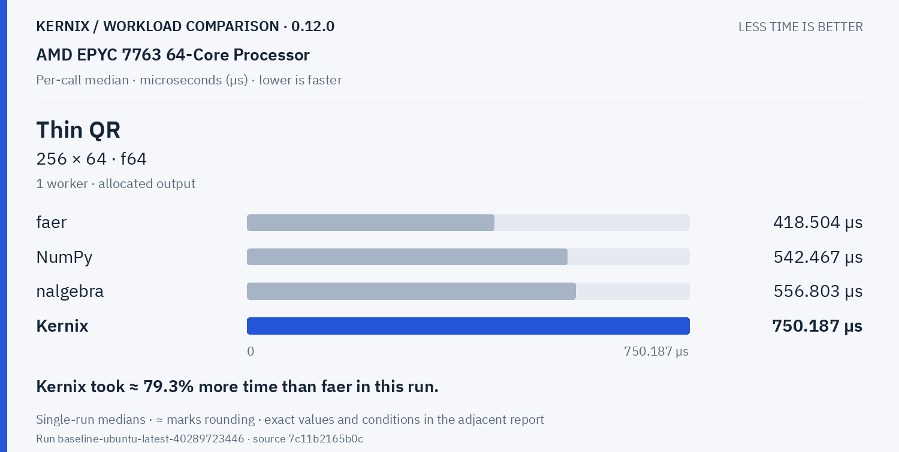

Kernix: **750.187 µs**. Kernix took ≈ 79.3% more time than faer in this run.

**Cholesky factorization · 64 × 64 · f64**

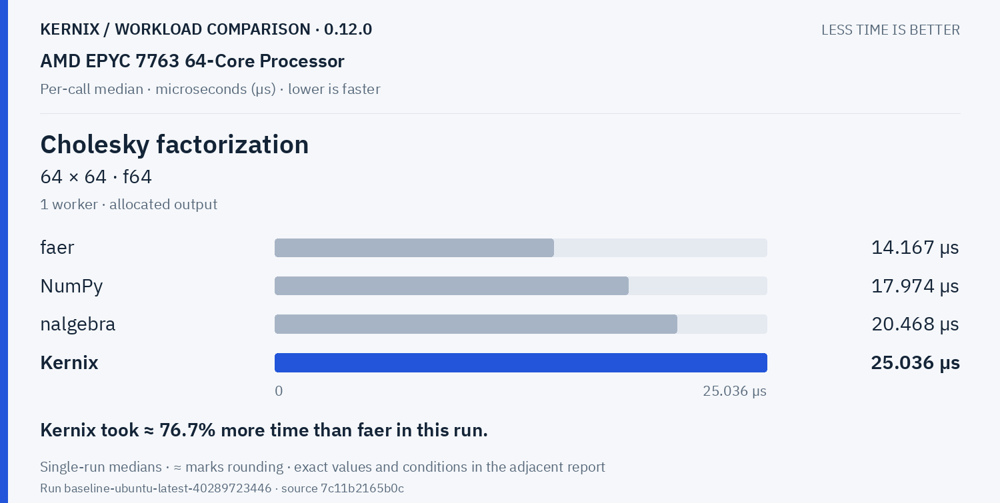

Kernix: **25.036 µs**. Kernix took ≈ 76.7% more time than faer in this run.

**Cholesky factorization · 128 × 128 · f64**

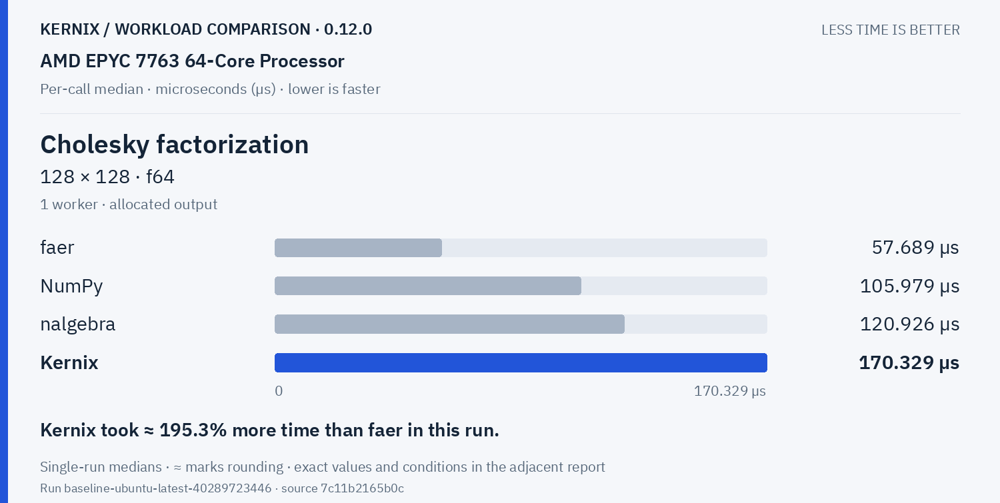

Kernix: **170.329 µs**. Kernix took ≈ 195.3% more time than faer in this run.

**Cholesky factorization · 256 × 256 · f64**

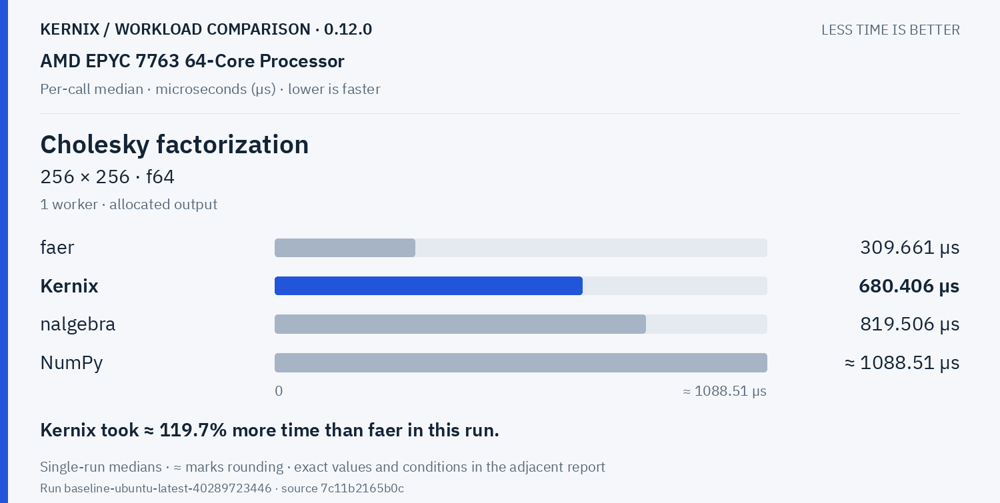

Kernix: **680.406 µs**. Kernix took ≈ 119.7% more time than faer in this run.

Training & autodiff · 6 workloads

**Shared-variable backward · sum(X * X), 64 × 32; prepared graph · f64**

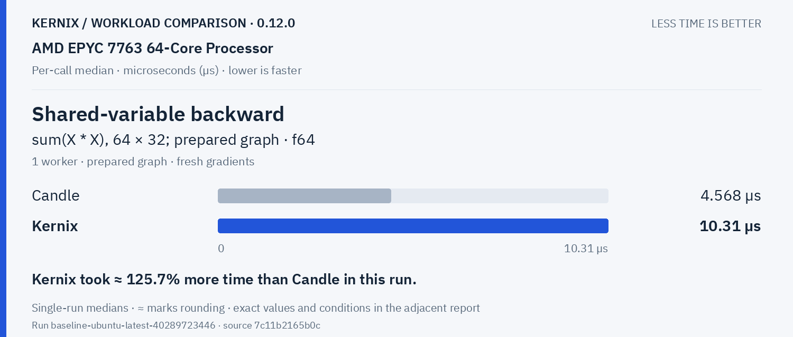

Kernix: **10.31 µs**. Kernix took ≈ 125.7% more time than Candle in this run.

**Record + backward · sum(A · W), 32 × 16 · 16 × 8 · f64**

Kernix: **3.647 µs**. Kernix took ≈ 34.3% less time than Candle in this run.

**Model inference · batched normalized/sliced MLP · f64**

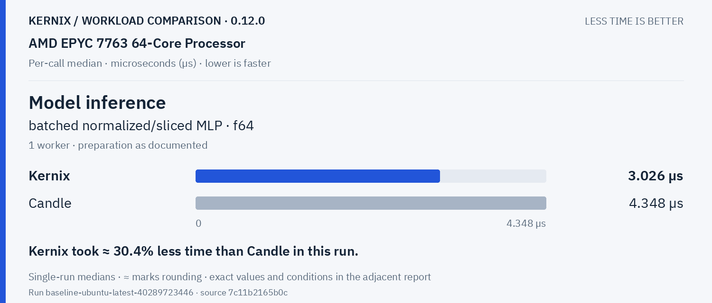

Kernix: **3.026 µs**. Kernix took ≈ 30.4% less time than Candle in this run.

**Model recording + forward · batched normalized/sliced MLP · f64**

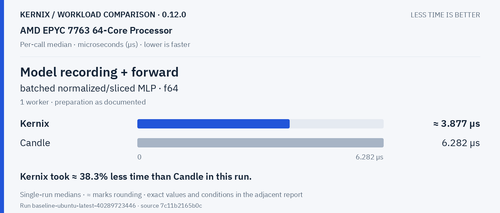

Kernix: **3.8770000000000005 µs**. Kernix took ≈ 38.3% less time than Candle in this run.

**Model backward · prepared graph → fresh gradients · f64**

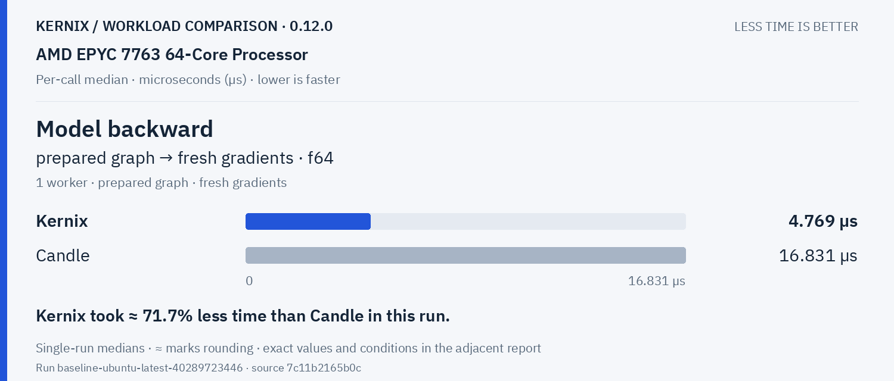

Kernix: **4.769 µs**. Kernix took ≈ 71.7% less time than Candle in this run.

**Parameter update · transactional SGD, fixed gradients · f64**

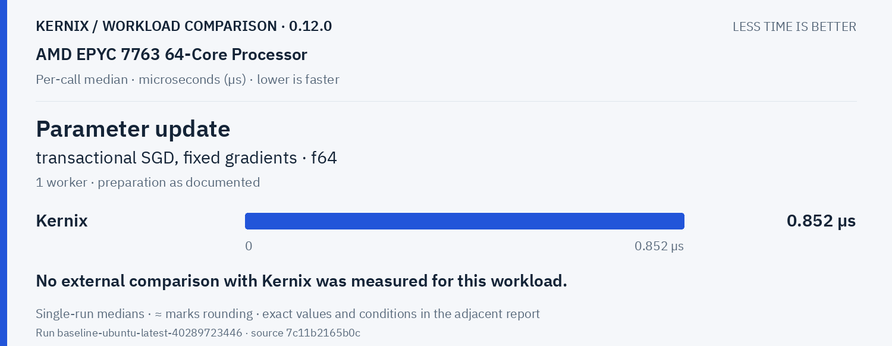

Kernix: **0.852 µs**. No external comparison with Kernix was measured for this workload.

Tensor contractions · 1 workloads

**Coalesced tensor contraction · 16 × 32 × 8 · 32 × 8 × 16 · f64**

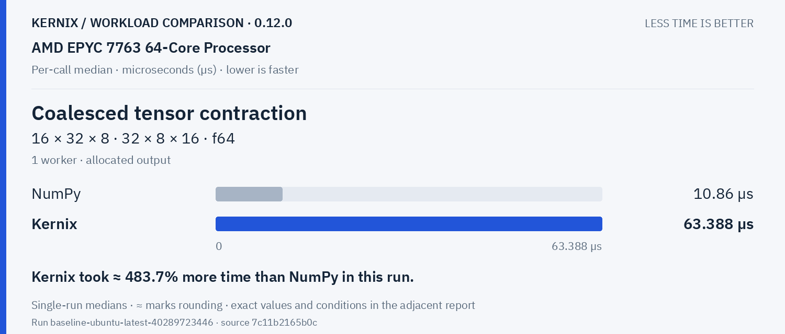

Kernix: **63.388 µs**. Kernix took ≈ 483.7% more time than NumPy in this run.

Statistics & activations · 1 workloads

**Row softmax · 256 × 64 · f64**

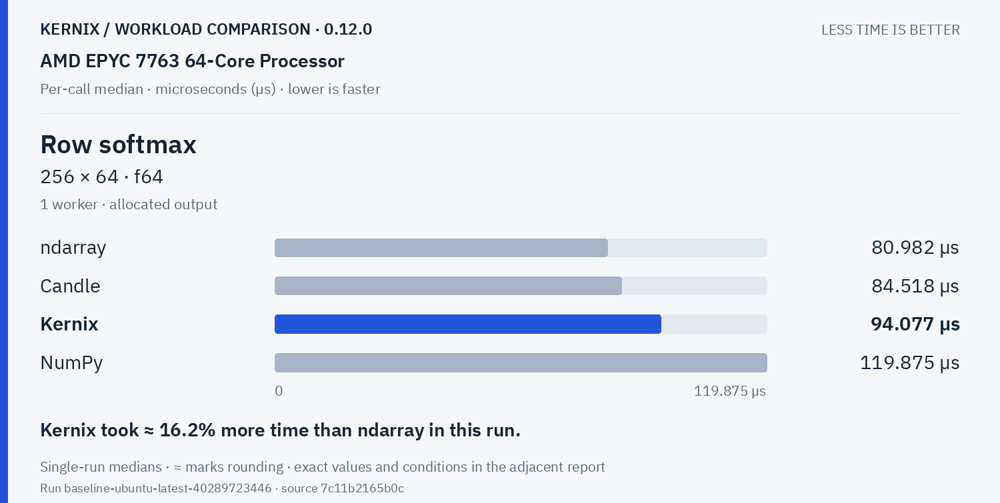

Kernix: **94.077 µs**. Kernix took ≈ 16.2% more time than ndarray in this run.

Tensor construction · 2 workloads

**Create zeros · 64 × 64 · f32**

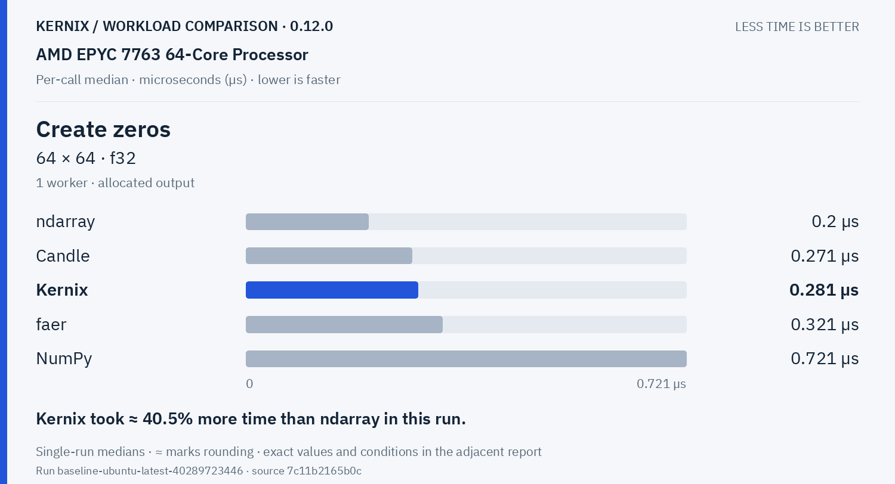

Kernix: **0.281 µs**. Kernix took ≈ 40.5% more time than ndarray in this run.

**Create ones · 64 × 64 · f32**

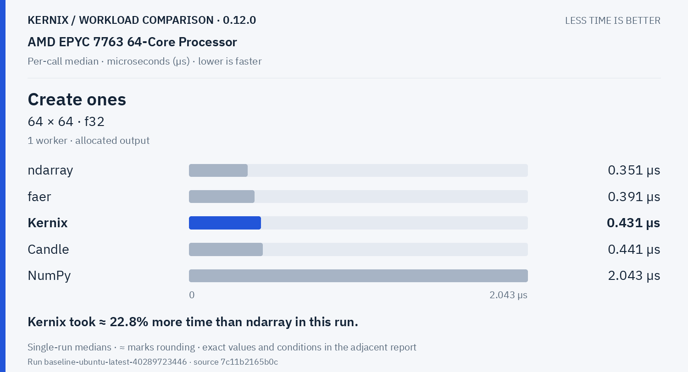

Kernix: **0.431 µs**. Kernix took ≈ 22.8% more time than ndarray in this run.

## Exact latency table

All values below are microseconds per operation. **Lower is faster.** Missing entries were not measured.

| Workload | Kernix | ndarray | nalgebra | faer | Candle | NumPy | Kernix refactor | Kernix · explicit dense | SciPy · CSR |
|---|---:|---:|---:|---:|---:|---:|---:|---:|---:|
| Sparse matrix × vector · 2048 × 2048 · five diagonals · f64 | — | — | — | **7.063** | — | 557.595 | — | 2838.031 | 10.37 |
| Sparse × dense matrix · 512 × 512 · 32 RHS · five diagonals · f64 | — | — | — | 67.146 | — | 474.049 | — | 603.211 | **26.92** |
| Sparse × dense matrix · 512 × 512 · 32 RHS · five diagonals · f32 | — | — | — | 61.165 | — | 207.649 | — | 253.525 | **18.986** |
| Sparse × sparse matrix · 256 × 256 · five diagonals each · f64 | — | — | — | — | — | 768.18 | — | 731.922 | **65.824** |
| Automatic CSR construction · 512 × 512 · clone + scan + compress · f64 | — | — | — | — | — | 54.662 | — | **53.971** | 1237.069 |
| Matrix multiplication · transposed view · 128 × 128 · 128 × 128 · f64 | 214.111 | — | — | — | — | **100.137** | — | — | — |
| Matrix multiplication · transposed view · 128 × 128 · 128 × 128 · f32 | 74.139 | — | — | — | — | **50.044** | — | — | — |
| Independent matrix operands · 128 × 128 · 128 × 128 · f64 | **93.004** | — | — | — | — | 100.809 | — | — | — |
| Independent matrix operands · 128 × 128 · 128 × 128 · f32 | **45.625** | — | — | — | — | 49.233 | — | — | — |
| Matrix multiplication · 32 × 32 · 32 × 32 · f64 | 2.395 | 2.164 | 2.134 | **2.024** | **2.024** | 3.656 | — | — | — |
| Matrix multiplication · 64 × 64 · 64 × 64 · f64 | **12.413** | 15.178 | 15.169 | 13.916 | 12.583 | 15.058 | — | — | — |
| Matrix multiplication · 128 × 128 · 128 × 128 · f64 | 92.794 | 210.775 | 210.555 | 113.984 | **92.593** | 100.008 | — | — | — |
| Matrix multiplication · 256 × 256 · 256 × 256 · f64 | 734.798 | 906.509 | 898.725 | 975.098 | **731.822** | 766.897 | — | — | — |
| Matrix multiplication · 64 × 64 · 64 × 64 · f32 | **6.272** | 7.384 | 7.474 | 6.603 | 6.532 | 8.205 | — | — | — |
| Matrix multiplication · 128 × 128 · 128 × 128 · f32 | 45.475 | 81.684 | 75.812 | 52.118 | **45.446** | 48.731 | — | — | — |
| Matrix multiplication · 256 × 256 · 256 × 256 · f32 | **352.441** | 606.327 | 609.011 | 409.107 | 352.832 | 362.019 | — | — | — |
| Batched multiplication · 4 × 16 × 32 · 1 × 32 × 16 · f64 | **2.054** | — | — | — | 2.985 | 4.178 | — | — | — |
| Batched multiplication · 4 × 16 × 32 · 1 × 32 × 16 · f32 | **1.182** | — | — | — | 2.0140000000000002 | 3.266 | — | — | — |
| Matmul · 2 workers · reused output · 64 × 64 · 64 × 64 · f64 | 15.719999999999998 | — | — | — | — | — | — | — | — |
| Matmul · 2 workers · reused output · 128 × 128 · 128 × 128 · f64 | 56.245 | — | — | — | — | — | — | — | — |
| Matmul · 2 workers · reused output · 256 × 256 · 256 × 256 · f64 | 391.394 | — | — | — | — | — | — | — | — |
| Matmul · 2 workers · reused output · 128 × 128 · 128 × 128 · f32 | 30.978 | — | — | — | — | — | — | — | — |
| Cholesky solve · reused factor · 128 × 128, 1 RHS · f64 | 18.886 | — | 5.971 | **5.851** | — | — | — | — | — |
| Cholesky solve · reused factor · 256 × 256, 64 RHS · f64 | 1219.647 | — | 1205.71 | **275.186** | — | — | — | — | — |
| Cholesky solve · reused factor · 512 × 512, 128 RHS · f64 | 9608.824 | — | 9558.176 | **2205.695** | — | — | — | — | — |
| LU solve · reused factor · 256 × 256, 64 RHS · f64 | 1182.177 | — | 1132.363 | **348.844** | — | — | — | — | — |
| Cholesky rank-one update · 256 × 256 · f64 | 171.351 | — | **37.37** | — | — | — | 683.452 | — | — |
| Cholesky rank-one downdate · 256 × 256 · f64 | 169.928 | — | **39.334** | — | — | — | 682.172 | — | — |
| Cholesky rank-one update · 512 × 512 · f64 | 892.053 | — | **158.106** | — | — | — | 3843.366 | — | — |
| Thin QR · 512 × 128 · f64 | 3731.61 | — | 4475.523 | **2251.642** | — | 3420.342 | — | — | — |
| Thin QR · 1024 × 256 · f64 | 20667.047 | — | 33082.110999999996 | **13530.048** | — | 18111.968 | — | — | — |
| Cholesky factorization · 512 × 512 · f64 | 3834.198 | — | 7191.831 | **2079.3** | — | 6265.265 | — | — | — |
| Column-pivoted QR · 96 × 32 · f64 | 79.068 | — | 76.613 | **42.83** | — | — | — | — | — |
| Column-pivoted QR · 256 × 64 · f64 | 792.246 | — | 739.035 | **381.395** | — | — | — | — | — |
| Minimum-norm least squares · 64 × 32, rank 16, 4 RHS · f64 | **62.938** | — | 103.043 | — | — | 100.408 | — | — | — |
| Minimum-norm least squares · 32 × 64, rank 32, 4 RHS · f64 | **84.068** | — | 176.291 | — | — | 184.937 | — | — | — |
| Thin QR · 96 × 32 · f64 | 66.815 | — | 57.639 | **55.154** | — | 68.588 | — | — | — |
| Thin QR · 256 × 64 · f64 | 750.187 | — | 556.803 | **418.504** | — | 542.467 | — | — | — |
| Cholesky factorization · 64 × 64 · f64 | 25.036 | — | 20.468 | **14.167** | — | 17.974 | — | — | — |
| Cholesky factorization · 128 × 128 · f64 | 170.329 | — | 120.926 | **57.689** | — | 105.979 | — | — | — |
| Cholesky factorization · 256 × 256 · f64 | 680.406 | — | 819.506 | **309.661** | — | 1088.511 | — | — | — |
| Shared-variable backward · sum(X * X), 64 × 32; prepared graph · f64 | 10.31 | — | — | — | **4.568** | — | — | — | — |
| Record + backward · sum(A · W), 32 × 16 · 16 × 8 · f64 | **3.647** | — | — | — | 5.551 | — | — | — | — |
| Model inference · batched normalized/sliced MLP · f64 | **3.026** | — | — | — | 4.348 | — | — | — | — |
| Model recording + forward · batched normalized/sliced MLP · f64 | **3.8770000000000005** | — | — | — | 6.282 | — | — | — | — |
| Model backward · prepared graph → fresh gradients · f64 | **4.769** | — | — | — | 16.831 | — | — | — | — |
| Parameter update · transactional SGD, fixed gradients · f64 | 0.852 | — | — | — | — | — | — | — | — |
| Coalesced tensor contraction · 16 × 32 × 8 · 32 × 8 × 16 · f64 | 63.388 | — | — | — | — | **10.86** | — | — | — |
| Row softmax · 256 × 64 · f64 | 94.077 | **80.982** | — | — | 84.518 | 119.875 | — | — | — |
| Create zeros · 64 × 64 · f32 | 0.281 | **0.2** | — | 0.321 | 0.271 | 0.721 | — | — | — |
| Create ones · 64 × 64 · f32 | 0.431 | **0.351** | — | 0.391 | 0.441 | 2.043 | — | — | — |

## Matrix memory

Initialized input payload bytes, including sparse indices/offsets. Excludes capacity, object metadata, allocator overhead and construction peak. Same five-diagonal values; SciPy index width is measured rather than assumed.

| Workload | Implementation | Stored entries | Payload bytes | Dense bytes | Index bytes |
|---|---|---:|---:|---:|---:|
| Sparse matrix × vector · 2048 × 2048 · five diagonals · f64 | SciPy · CSR | 10240 | 131076 | 33554432 | 4 |
| Sparse matrix × vector · 2048 × 2048 · five diagonals · f64 | NumPy | 10240 | 33554432 | 33554432 | 0 |
| Sparse matrix × vector · 2048 × 2048 · five diagonals · f64 | faer | 10240 | 180232 | 33554432 | 8 |
| Sparse matrix × vector · 2048 × 2048 · five diagonals · f64 | Kernix · explicit dense | 10240 | 33554432 | 33554432 | 0 |
| Sparse × dense matrix · 512 × 512 · 32 RHS · five diagonals · f64 | SciPy · CSR | 2560 | 32772 | 2097152 | 4 |
| Sparse × dense matrix · 512 × 512 · 32 RHS · five diagonals · f64 | Kernix · explicit dense | 2560 | 2097152 | 2097152 | 0 |
| Sparse × dense matrix · 512 × 512 · 32 RHS · five diagonals · f64 | NumPy | 2560 | 2097152 | 2097152 | 0 |
| Sparse × dense matrix · 512 × 512 · 32 RHS · five diagonals · f64 | faer | 2560 | 45064 | 2097152 | 8 |
| Sparse × dense matrix · 512 × 512 · 32 RHS · five diagonals · f32 | SciPy · CSR | 2560 | 22532 | 1048576 | 4 |
| Sparse × dense matrix · 512 × 512 · 32 RHS · five diagonals · f32 | Kernix · explicit dense | 2560 | 1048576 | 1048576 | 0 |
| Sparse × dense matrix · 512 × 512 · 32 RHS · five diagonals · f32 | faer | 2560 | 34824 | 1048576 | 8 |
| Sparse × dense matrix · 512 × 512 · 32 RHS · five diagonals · f32 | NumPy | 2560 | 1048576 | 1048576 | 0 |
| Sparse × sparse matrix · 256 × 256 · five diagonals each · f64 | SciPy · CSR | 1280 | 16388 | 524288 | 4 |
| Sparse × sparse matrix · 256 × 256 · five diagonals each · f64 | NumPy | 1280 | 524288 | 524288 | 0 |
| Sparse × sparse matrix · 256 × 256 · five diagonals each · f64 | Kernix · explicit dense | 1280 | 524288 | 524288 | 0 |
| Automatic CSR construction · 512 × 512 · clone + scan + compress · f64 | NumPy | 2560 | 2097152 | 2097152 | 0 |
| Automatic CSR construction · 512 × 512 · clone + scan + compress · f64 | SciPy · CSR | 2560 | 32772 | 2097152 | 4 |
| Automatic CSR construction · 512 × 512 · clone + scan + compress · f64 | Kernix · explicit dense | 2560 | 2097152 | 2097152 | 0 |

## Version comparison

0 of 51 workloads have paired evidence. Exploratory 95% intervals resample process pairs, not calls. No multiple-comparison adjustment.

| Workload | Current / baseline [95% interval] | Interpretation |
|---|---:|---|
| Sparse matrix × vector · 2048 × 2048 · five diagonals · f64 | — | No paired comparison |
| Sparse × dense matrix · 512 × 512 · 32 RHS · five diagonals · f64 | — | No paired comparison |
| Sparse × dense matrix · 512 × 512 · 32 RHS · five diagonals · f32 | — | No paired comparison |
| Sparse × sparse matrix · 256 × 256 · five diagonals each · f64 | — | No paired comparison |
| Automatic CSR construction · 512 × 512 · clone + scan + compress · f64 | — | No paired comparison |
| Matrix multiplication · transposed view · 128 × 128 · 128 × 128 · f64 | — | No paired comparison |
| Matrix multiplication · transposed view · 128 × 128 · 128 × 128 · f32 | — | No paired comparison |
| Independent matrix operands · 128 × 128 · 128 × 128 · f64 | — | No paired comparison |
| Independent matrix operands · 128 × 128 · 128 × 128 · f32 | — | No paired comparison |
| Matrix multiplication · 32 × 32 · 32 × 32 · f64 | — | No paired comparison |
| Matrix multiplication · 64 × 64 · 64 × 64 · f64 | — | No paired comparison |
| Matrix multiplication · 128 × 128 · 128 × 128 · f64 | — | No paired comparison |
| Matrix multiplication · 256 × 256 · 256 × 256 · f64 | — | No paired comparison |
| Matrix multiplication · 64 × 64 · 64 × 64 · f32 | — | No paired comparison |
| Matrix multiplication · 128 × 128 · 128 × 128 · f32 | — | No paired comparison |
| Matrix multiplication · 256 × 256 · 256 × 256 · f32 | — | No paired comparison |
| Batched multiplication · 4 × 16 × 32 · 1 × 32 × 16 · f64 | — | No paired comparison |
| Batched multiplication · 4 × 16 × 32 · 1 × 32 × 16 · f32 | — | No paired comparison |
| Matmul · 2 workers · reused output · 64 × 64 · 64 × 64 · f64 | — | No paired comparison |
| Matmul · 2 workers · reused output · 128 × 128 · 128 × 128 · f64 | — | No paired comparison |
| Matmul · 2 workers · reused output · 256 × 256 · 256 × 256 · f64 | — | No paired comparison |
| Matmul · 2 workers · reused output · 128 × 128 · 128 × 128 · f32 | — | No paired comparison |
| Cholesky solve · reused factor · 128 × 128, 1 RHS · f64 | — | No paired comparison |
| Cholesky solve · reused factor · 256 × 256, 64 RHS · f64 | — | No paired comparison |
| Cholesky solve · reused factor · 512 × 512, 128 RHS · f64 | — | No paired comparison |
| LU solve · reused factor · 256 × 256, 64 RHS · f64 | — | No paired comparison |
| Cholesky rank-one update · 256 × 256 · f64 | — | No paired comparison |
| Cholesky rank-one downdate · 256 × 256 · f64 | — | No paired comparison |
| Cholesky rank-one update · 512 × 512 · f64 | — | No paired comparison |
| Thin QR · 512 × 128 · f64 | — | No paired comparison |
| Thin QR · 1024 × 256 · f64 | — | No paired comparison |
| Cholesky factorization · 512 × 512 · f64 | — | No paired comparison |
| Column-pivoted QR · 96 × 32 · f64 | — | No paired comparison |
| Column-pivoted QR · 256 × 64 · f64 | — | No paired comparison |
| Minimum-norm least squares · 64 × 32, rank 16, 4 RHS · f64 | — | No paired comparison |
| Minimum-norm least squares · 32 × 64, rank 32, 4 RHS · f64 | — | No paired comparison |
| Thin QR · 96 × 32 · f64 | — | No paired comparison |
| Thin QR · 256 × 64 · f64 | — | No paired comparison |
| Cholesky factorization · 64 × 64 · f64 | — | No paired comparison |
| Cholesky factorization · 128 × 128 · f64 | — | No paired comparison |
| Cholesky factorization · 256 × 256 · f64 | — | No paired comparison |
| Shared-variable backward · sum(X * X), 64 × 32; prepared graph · f64 | — | No paired comparison |
| Record + backward · sum(A · W), 32 × 16 · 16 × 8 · f64 | — | No paired comparison |
| Model inference · batched normalized/sliced MLP · f64 | — | No paired comparison |
| Model recording + forward · batched normalized/sliced MLP · f64 | — | No paired comparison |
| Model backward · prepared graph → fresh gradients · f64 | — | No paired comparison |
| Parameter update · transactional SGD, fixed gradients · f64 | — | No paired comparison |
| Coalesced tensor contraction · 16 × 32 × 8 · 32 × 8 × 16 · f64 | — | No paired comparison |
| Row softmax · 256 × 64 · f64 | — | No paired comparison |
| Create zeros · 64 × 64 · f32 | — | No paired comparison |
| Create ones · 64 × 64 · f32 | — | No paired comparison |

## Method and provenance

CPU affinity pinned to logical CPU 0. Frequency and background load are uncontrolled.

Minimum-norm rows use pivoted QR plus scaled implicit RZ in Kernix; NumPy native lstsq; nalgebra native SVD/solve. Algorithm costs and rank policies differ. See original method for thresholds. Kernix/nalgebra: prepared base factor, owned modified factor; refactor: same Kernix version, full factorization of preformed modified matrix; base setup and matrix formation excluded Rank two; cyclic five diagonals; exact dyadic values; 1 worker; owned output; prepared operands except auto construction. Kernix Matrix finite checks vs peer IEEE policies; payload excludes capacity, metadata and allocator overhead. CSR indices usize in Kernix/faer and actual recorded SciPy width. SpGEMM heap merge vs SciPy column accumulator; fill-in depends on pattern. Construction: Kernix clones a Vec then validates/scans/compresses; SciPy borrows dense input and allocates CSR output; NumPy/dense Kernix copy only. Construction compares API trade-offs, not identical algorithms. No universal sparse speed or density threshold claim. This baseline has no Kernix Matrix API; missing observations are omitted, not fabricated.

Numbers retain source precision; recorded digits do not imply equivalent physical measurement accuracy. Lowest observed medians are bold only when peers were measured. No aggregate winner or universal ranking is inferred.

[Original report and commentary](original-report.txt) · [Raw measurements](raw.json)

Measured source `7c11b2165b0cb7b523db4d938a36f1396396a138`. Run `baseline-ubuntu-latest-40289723446`. Rendering does not change measurements.
