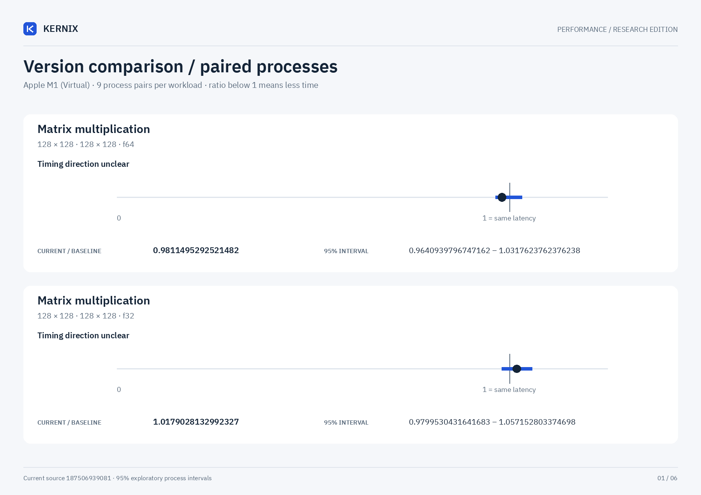

# Kernix 0.11.0 · paired process comparison

9 fresh-process pairs per workload. Ratios below 1 mean less time.

[Open visual comparison](report.html) · [Vector PDF](latency.pdf) · [Original process evidence](paired.json)

| Workload | Current / baseline [95% interval] | Interpretation |
|---|---:|---|
| Matrix multiplication · 128 × 128 · 128 × 128 · f64 | 0.9811495292521482× [0.9640939796747162, 1.0317623762376238] | Timing direction unclear |
| Matrix multiplication · 128 × 128 · 128 × 128 · f32 | 1.0179028132992327× [0.9799530431641683, 1.057152803374698] | Timing direction unclear |
| Matrix multiplication · 256 × 256 · 256 × 256 · f64 | 1.0055372096965587× [0.9167619146578, 1.0116898335997095] | Timing direction unclear |
| Matrix multiplication · 256 × 256 · 256 × 256 · f32 | 0.9812478690760313× [0.9126053787548315, 1.0005781117979278] | Timing direction unclear |
| Independent matrix operands · 128 × 128 · 128 × 128 · f64 | 0.9812× [0.9602777248236628, 1.0004283818658641] | Timing direction unclear |
| Independent matrix operands · 128 × 128 · 128 × 128 · f32 | 1× [0.9825582554268742, 1.0363957812595257] | Timing direction unclear |
| Cholesky factorization · 128 × 128 · f64 | 1.0010035092779541× [0.9997475582268971, 1.0615615615615615] | Timing direction unclear |
| Cholesky factorization · 256 × 256 · f64 | 0.520454357259916× [0.5096753203342619, 0.521812129502964] | Observed time reduction |
| Cholesky factorization · 512 × 512 · f64 | 0.3718924151845818× [0.3676295604130526, 0.39798777381558836] | Observed time reduction |
| Matmul · 2 workers · reused output · 128 × 128 · 128 × 128 · f64 | 0.9097270142703359× [0.8939063004846527, 0.9683136560953355] | Observed time reduction |
| Matmul · 2 workers · reused output · 256 × 256 · 256 × 256 · f64 | 0.8891034482758621× [0.8764368128463624, 0.9266004415011038] | Observed time reduction |
| Matmul · 2 workers · reused output · 128 × 128 · 128 × 128 · f32 | 0.7962008346079043× [0.7679718133772803, 0.8294814814814815] | Observed time reduction |

## Method

95% percentile bootstrap over paired process blocks; 10000 resamples; exploratory, no multiple-comparison adjustment

Current `runner-macos-latest-40059566395`; baseline `baseline-macos-latest-40059566395`. All source ratio digits, paired observations and process ordering are preserved. No absolute peer latencies are inferred.
