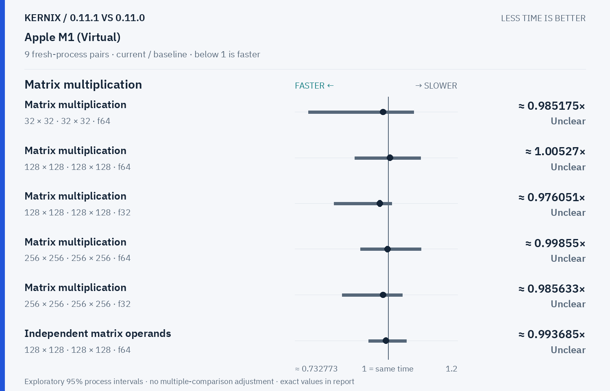
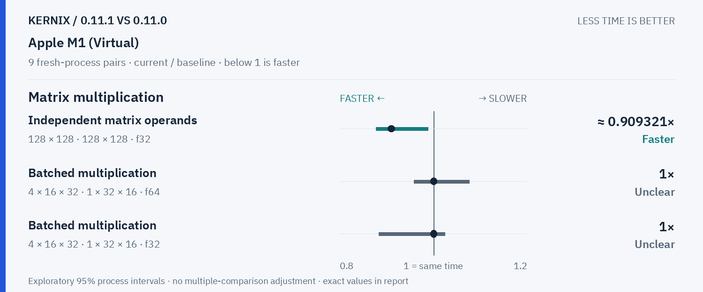
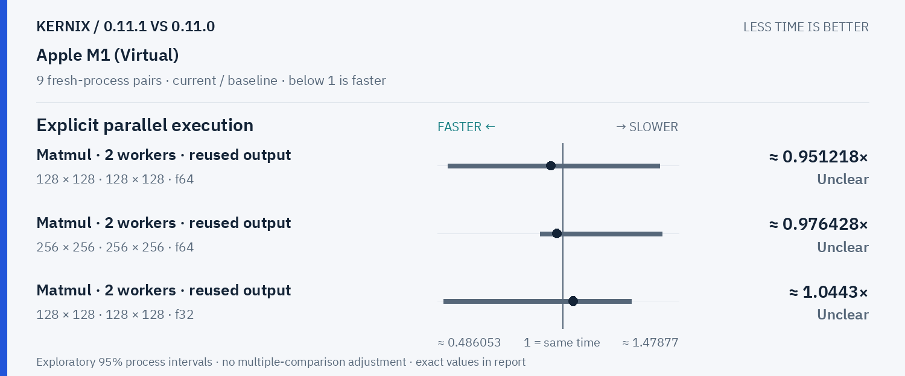
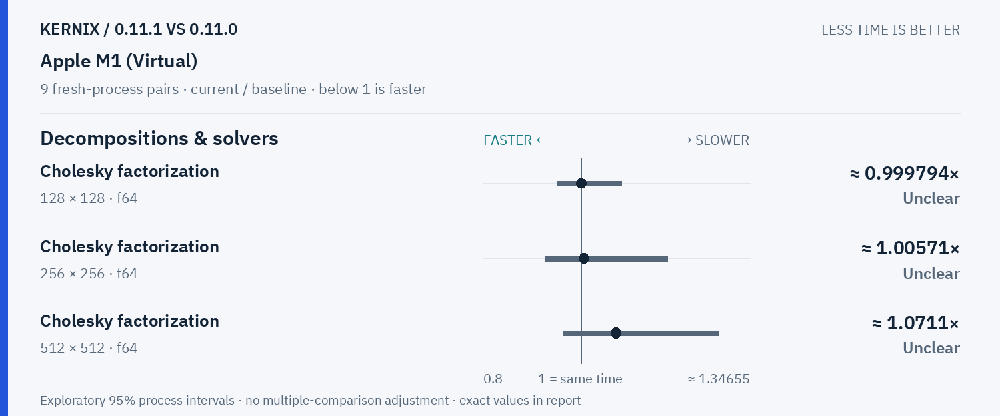
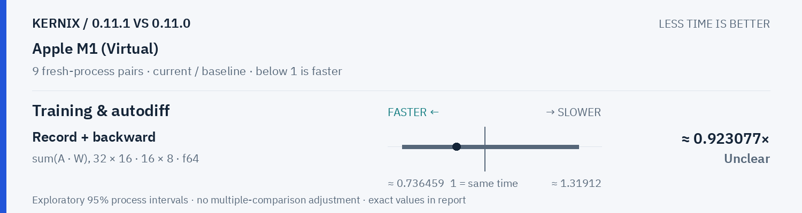

# Kernix 0.11.1 · paired process comparison

9 fresh-process pairs per workload. Ratios below 1 mean less time.

[Interactive HTML (open locally)](report.html) · [Vector PDF](latency.pdf) · [Original process evidence](paired.json)

### Version changes at a glance

The vertical line marks unchanged time. Left is faster; right is slower. Ranges are exploratory 95% intervals over fresh-process pairs. An interval crossing the line leaves direction unclear.

## Exact process ratios

| Workload | Current / baseline [95% interval] | Interpretation |
|---|---:|---|
| Matrix multiplication · 32 × 32 · 32 × 32 · f64 | 0.9851747264384045× [0.7713404182379157, 1.0742222222222222] | Timing direction unclear |
| Matrix multiplication · 128 × 128 · 128 × 128 · f64 | 1.0052673086097617× [0.9046403956437102, 1.0933024369821536] | Timing direction unclear |
| Matrix multiplication · 128 × 128 · 128 × 128 · f32 | 0.9760507399577167× [0.8449660678642713, 1.011104761904762] | Timing direction unclear |
| Matrix multiplication · 256 × 256 · 256 × 256 · f64 | 0.9985502367201311× [0.9208476303739065, 1.0949789086950605] | Timing direction unclear |
| Matrix multiplication · 256 × 256 · 256 × 256 · f32 | 0.9856326348566568× [0.8686482314018108, 1.0417187028280885] | Timing direction unclear |
| Record + backward · sum(A · W), 32 × 16 · 16 × 8 · f64 | 0.9230769230769231× [0.7752203721841332, 1.2563076923076921] | Timing direction unclear |
| Independent matrix operands · 128 × 128 · 128 × 128 · f64 | 0.9936854234101746× [0.9442126930923929, 1.052763970607238] | Timing direction unclear |
| Independent matrix operands · 128 × 128 · 128 × 128 · f32 | 0.9093212885529866× [0.8770501260982082, 0.9883292181069959] | Observed time reduction |
| Batched multiplication · 4 × 16 × 32 · 1 × 32 × 16 · f64 | 1× [0.9583333333333334, 1.076] | Timing direction unclear |
| Batched multiplication · 4 × 16 × 32 · 1 × 32 × 16 · f32 | 1× [0.8832, 1.024] | Timing direction unclear |
| Cholesky factorization · 128 × 128 · f64 | 0.9997944119201927× [0.9500575602961868, 1.0822704081632653] | Timing direction unclear |
| Cholesky factorization · 256 × 256 · f64 | 1.0057055889993636× [0.9257904545228178, 1.1766056170546626] | Timing direction unclear |
| Cholesky factorization · 512 × 512 · f64 | 1.0711008243106563× [0.9638131954788399, 1.282426526539142] | Timing direction unclear |
| Matmul · 2 workers · reused output · 128 × 128 · 128 × 128 · f64 | 0.9512175381610398× [0.5288740230405842, 1.398729942304536] | Timing direction unclear |
| Matmul · 2 workers · reused output · 256 × 256 · 256 × 256 · f64 | 0.9764277002242503× [0.9081814845657666, 1.4083494301625017] | Timing direction unclear |
| Matmul · 2 workers · reused output · 128 × 128 · 128 × 128 · f32 | 1.0443037974683544× [0.5116346525718706, 1.2821479846572525] | Timing direction unclear |

## Method

95% percentile bootstrap over paired process blocks; 10000 resamples; exploratory, no multiple-comparison adjustment

Current `runner-macos-latest-40161751367`; baseline `baseline-macos-latest-40161751367`. All source ratio digits, paired observations and process ordering are preserved. No absolute peer latencies are inferred.
