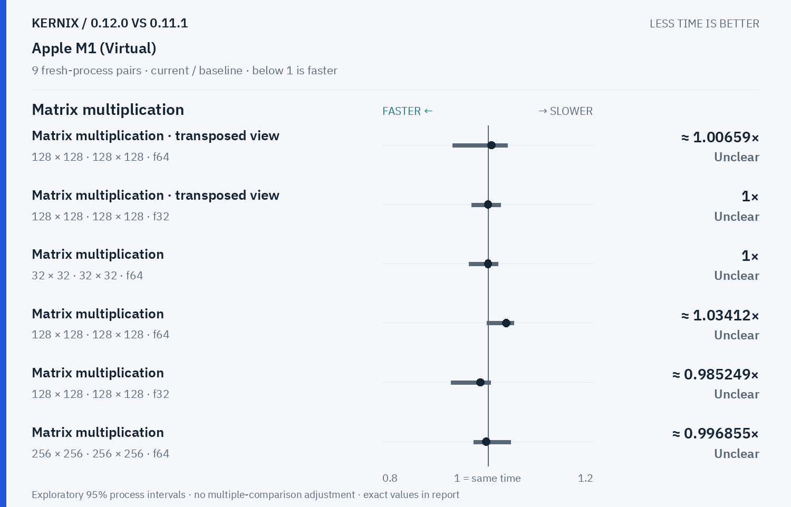
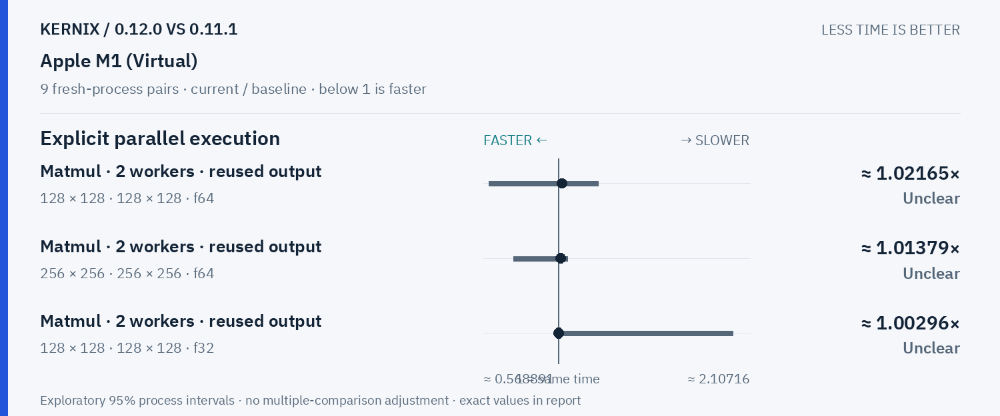
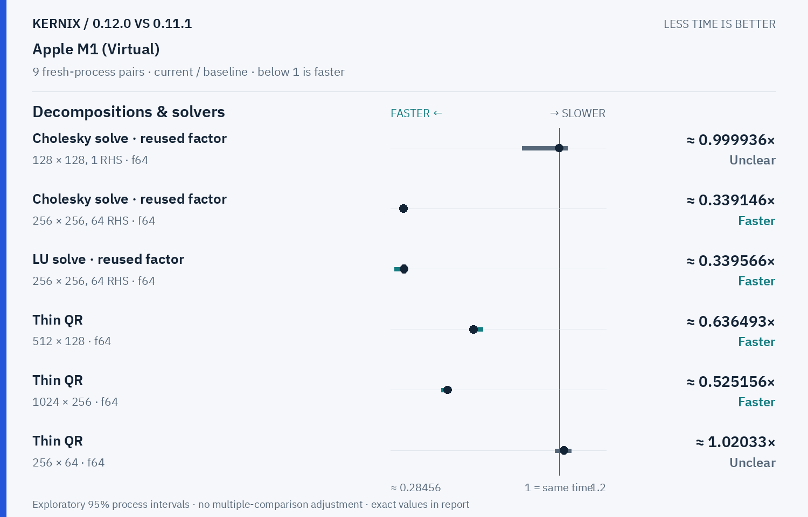
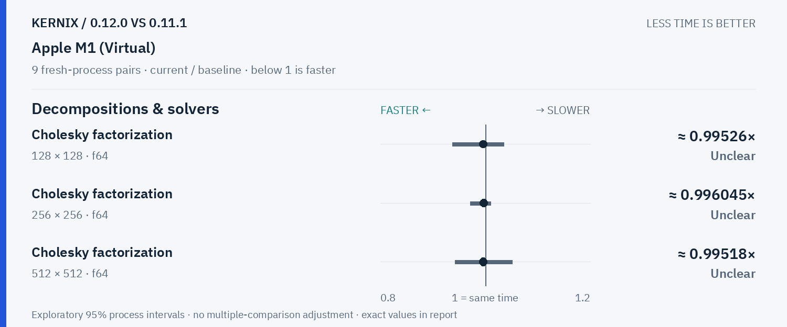
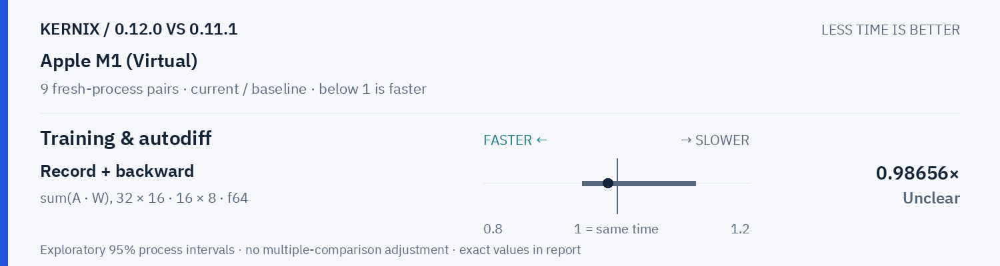

# Kernix 0.12.0 · paired process comparison

9 fresh-process pairs per workload. Ratios below 1 mean less time.

[Interactive HTML (open locally)](report.html) · [Vector PDF](latency.pdf) · [Original process evidence](paired.json)

### Version changes at a glance

The vertical line marks unchanged time. Left is faster; right is slower. Ranges are exploratory 95% intervals over fresh-process pairs. An interval crossing the line leaves direction unclear.

## Exact process ratios

| Workload | Current / baseline [95% interval] | Interpretation |
|---|---:|---|
| Cholesky solve · reused factor · 128 × 128, 1 RHS · f64 | 0.9999363422242026× [0.8434728164457894, 1.0342578520770012] | Timing direction unclear |
| Cholesky solve · reused factor · 256 × 256, 64 RHS · f64 | 0.3391463976714771× [0.3347444354363207, 0.34212995784873657] | Observed time reduction |
| LU solve · reused factor · 256 × 256, 64 RHS · f64 | 0.3395659435871721× [0.29953666777081356, 0.3520476746781338] | Observed time reduction |
| Thin QR · 512 × 128 · f64 | 0.6364933793072876× [0.6209107889725535, 0.6756612892776158] | Observed time reduction |
| Thin QR · 1024 × 256 · f64 | 0.5251560195707211× [0.4995823827409169, 0.533394334068534] | Observed time reduction |
| Matrix multiplication · transposed view · 128 × 128 · 128 × 128 · f64 | 1.0065869156092198× [0.9334875283446712, 1.0366644664466447] | Timing direction unclear |
| Matrix multiplication · transposed view · 128 × 128 · 128 × 128 · f32 | 1× [0.9692970033422081, 1.0242323200992556] | Timing direction unclear |
| Thin QR · 256 × 64 · f64 | 1.0203252032520325× [0.9828453796889296, 1.0506988647316935] | Timing direction unclear |
| Matrix multiplication · 32 × 32 · 32 × 32 · f64 | 1× [0.9642077695329551, 1.0186666666666666] | Timing direction unclear |
| Matrix multiplication · 128 × 128 · 128 × 128 · f64 | 1.0341187136270142× [0.9979659367396594, 1.0490804116484436] | Timing direction unclear |
| Matrix multiplication · 128 × 128 · 128 × 128 · f32 | 0.9852494088503547× [0.9299589318823753, 1.0053293424102498] | Timing direction unclear |
| Matrix multiplication · 256 × 256 · 256 × 256 · f64 | 0.9968545275313336× [0.9725039674746369, 1.0434932624259767] | Timing direction unclear |
| Matrix multiplication · 256 × 256 · 256 × 256 · f32 | 0.9854261083743843× [0.9696438041145655, 0.995589617708063] | Observed time reduction |
| Record + backward · sum(A · W), 32 × 16 · 16 × 8 · f64 | 0.98656× [0.9482543640897756, 1.1184085885696242] | Timing direction unclear |
| Independent matrix operands · 128 × 128 · 128 × 128 · f64 | 0.9959645031113004× [0.9219876288659794, 1.0164903225806452] | Timing direction unclear |
| Independent matrix operands · 128 × 128 · 128 × 128 · f32 | 1.0047169811320755× [0.9952867538931413, 1.039894165994258] | Timing direction unclear |
| Batched multiplication · 4 × 16 × 32 · 1 × 32 × 16 · f64 | 1× [0.8290898448931812, 1.0305454545454547] | Timing direction unclear |
| Batched multiplication · 4 × 16 × 32 · 1 × 32 × 16 · f32 | 1.0229132569558101× [0.9333333333333333, 1.0463169642857142] | Timing direction unclear |
| Cholesky factorization · 128 × 128 · f64 | 0.995259977566306× [0.9373491217847332, 1.0350073578595318] | Timing direction unclear |
| Cholesky factorization · 256 × 256 · f64 | 0.9960448117608732× [0.9707239802826404, 1.0095877952453927] | Timing direction unclear |
| Cholesky factorization · 512 × 512 · f64 | 0.9951801061606067× [0.9423570914820015, 1.0506741840165743] | Timing direction unclear |
| Matmul · 2 workers · reused output · 128 × 128 · 128 × 128 · f64 | 1.0216484838542095× [0.5988323603002502, 1.2320360685302074] | Timing direction unclear |
| Matmul · 2 workers · reused output · 256 × 256 · 256 × 256 · f64 | 1.0137858548492327× [0.7405825022956959, 1.0541735305919873] | Timing direction unclear |
| Matmul · 2 workers · reused output · 128 × 128 · 128 × 128 · f32 | 1.0029569620253165× [0.9843949367088608, 2.0068221741084193] | Timing direction unclear |

## Method

95% percentile bootstrap over paired process blocks; 10000 resamples; exploratory, no multiple-comparison adjustment

Current `runner-macos-latest-40270611933`; baseline `baseline-macos-latest-40270611933`. All source ratio digits, paired observations and process ordering are preserved. No absolute peer latencies are inferred.
