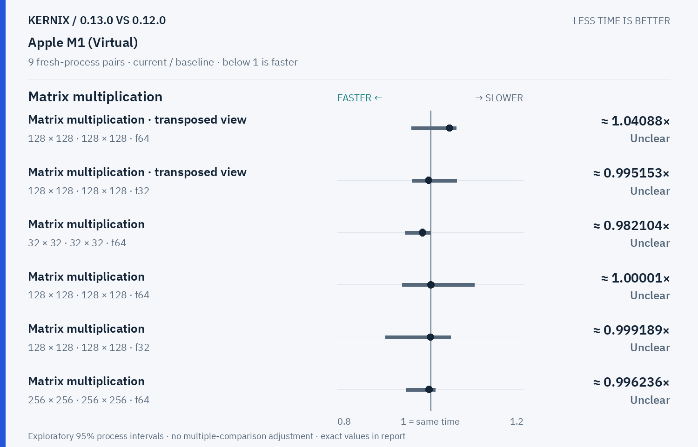
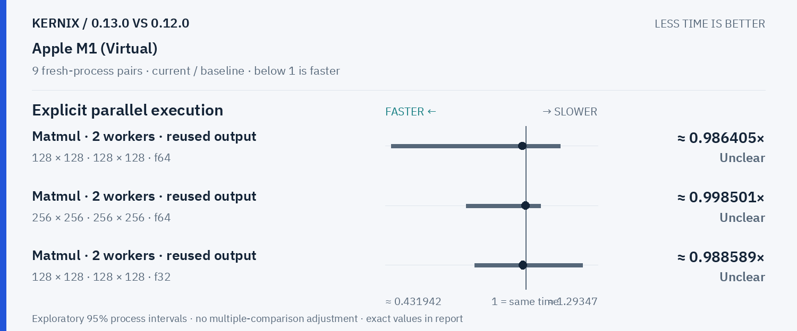

# Kernix 0.13.0 · paired process comparison

9 fresh-process pairs per workload. Ratios below 1 mean less time.

[Interactive HTML (open locally)](report.html) · [Vector PDF](latency.pdf) · [Original process evidence](paired.json)

### Version changes at a glance

The vertical line marks unchanged time. Left is faster; right is slower. Ranges are exploratory 95% intervals over fresh-process pairs. An interval crossing the line leaves direction unclear.

## Exact process ratios

| Workload | Current / baseline [95% interval] | Interpretation |
|---|---:|---|
| Cholesky solve · reused factor · 128 × 128, 1 RHS · f64 | 0.9921669382128087× [0.9164682291013913, 1.0027768595041322] | Timing direction unclear |
| Cholesky solve · reused factor · 256 × 256, 64 RHS · f64 | 0.9885282882882883× [0.8586642621355661, 1.079443083541639] | Timing direction unclear |
| LU solve · reused factor · 256 × 256, 64 RHS · f64 | 1.209485633752933× [1.1546833718414344, 1.3779067180145486] | Observed time increase |
| Thin QR · 512 × 128 · f64 | 0.9936245424891716× [0.8976748411295378, 1.0586904929547531] | Timing direction unclear |
| Thin QR · 1024 × 256 · f64 | 1.0182715183366788× [0.9539091491294941, 1.0669591519324717] | Timing direction unclear |
| Matrix multiplication · transposed view · 128 × 128 · 128 × 128 · f64 | 1.0408798988621997× [0.9586351199098664, 1.0546903947744524] | Timing direction unclear |
| Matrix multiplication · transposed view · 128 × 128 · 128 × 128 · f32 | 0.9951534420254735× [0.961185853240413, 1.0564999190545572] | Timing direction unclear |
| Thin QR · 256 × 64 · f64 | 0.9986932253431998× [0.9374925164989188, 1.0351285018554286] | Timing direction unclear |
| Matrix multiplication · 32 × 32 · 32 × 32 · f64 | 0.9821038847664775× [0.945438673068529, 1] | Timing direction unclear |
| Matrix multiplication · 128 × 128 · 128 × 128 · f64 | 1.00001011807797× [0.9388606238475425, 1.0940139622787055] | Timing direction unclear |
| Matrix multiplication · 128 × 128 · 128 × 128 · f32 | 0.9991894510013245× [0.9028559547324492, 1.0428752324799178] | Timing direction unclear |
| Matrix multiplication · 256 × 256 · 256 × 256 · f64 | 0.9962362276819777× [0.9468969486462286, 1.0104691648198838] | Timing direction unclear |
| Matrix multiplication · 256 × 256 · 256 × 256 · f32 | 1.0213066491832494× [0.8922478299910207, 1.1183833501174891] | Timing direction unclear |
| Record + backward · sum(A · W), 32 × 16 · 16 × 8 · f64 | 0.9727626459143969× [0.9375937593759376, 0.9869077306733167] | Observed time reduction |
| Independent matrix operands · 128 × 128 · 128 × 128 · f64 | 1× [0.8936943272386311, 1.0455315505683473] | Timing direction unclear |
| Independent matrix operands · 128 × 128 · 128 × 128 · f32 | 0.9991960784313726× [0.9549636566040207, 1.0070588235294118] | Timing direction unclear |
| Batched multiplication · 4 × 16 × 32 · 1 × 32 × 16 · f64 | 0.9853099247581512× [0.9565217391304348, 1] | Timing direction unclear |
| Batched multiplication · 4 × 16 × 32 · 1 × 32 × 16 · f32 | 1.0474285714285714× [0.9541984732824428, 1.158669574700109] | Timing direction unclear |
| Cholesky factorization · 128 × 128 · f64 | 0.9675904789281748× [0.916102372139973, 1.0378457059679767] | Timing direction unclear |
| Cholesky factorization · 256 × 256 · f64 | 1.000398406374502× [0.9715976292854505, 1.0930526315789473] | Timing direction unclear |
| Cholesky factorization · 512 × 512 · f64 | 1.0001606038705533× [0.9693697400669682, 1.1191409331409332] | Timing direction unclear |
| Matmul · 2 workers · reused output · 128 × 128 · 128 × 128 · f64 | 0.9864052621133509× [0.4546756756756757, 1.1396162361623616] | Timing direction unclear |
| Matmul · 2 workers · reused output · 256 × 256 · 256 × 256 · f64 | 0.9985013499839345× [0.7590126712952051, 1.061062513641804] | Timing direction unclear |
| Matmul · 2 workers · reused output · 128 × 128 · 128 × 128 · f32 | 0.9885894736842106× [0.7937915742793792, 1.2318772378516625] | Timing direction unclear |

## Method

95% percentile bootstrap over paired process blocks; 10000 resamples; exploratory, no multiple-comparison adjustment

Current `runner-macos-latest-40289723446`; baseline `baseline-macos-latest-40289723446`. All source ratio digits, paired observations and process ordering are preserved. No absolute peer latencies are inferred.
