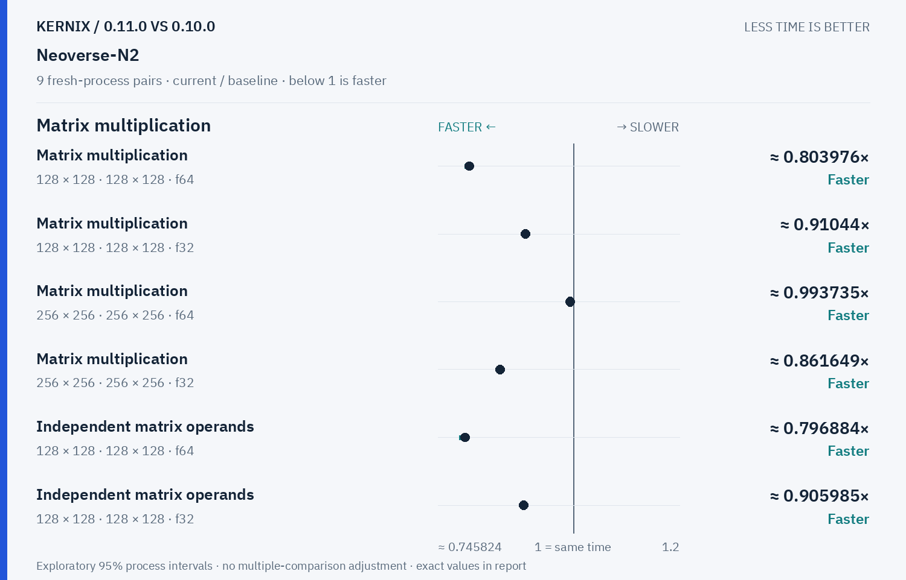

# Kernix 0.11.0 · paired process comparison

9 fresh-process pairs per workload. Ratios below 1 mean less time.

[Interactive HTML (open locally)](report.html) · [Vector PDF](latency.pdf) · [Original process evidence](paired.json)

### Version changes at a glance

The vertical line marks unchanged time. Left is faster; right is slower. Ranges are exploratory 95% intervals over fresh-process pairs. An interval crossing the line leaves direction unclear.

## Exact process ratios

| Workload | Current / baseline [95% interval] | Interpretation |
|---|---:|---|
| Matrix multiplication · 128 × 128 · 128 × 128 · f64 | 0.8039757672973089× [0.7961028439858441, 0.8075187028214404] | Observed time reduction |
| Matrix multiplication · 128 × 128 · 128 × 128 · f32 | 0.9104404550339998× [0.9083013425523341, 0.9116032637490727] | Observed time reduction |
| Matrix multiplication · 256 × 256 · 256 × 256 · f64 | 0.9937348734791259× [0.9925390619170559, 0.9968513537905461] | Observed time reduction |
| Matrix multiplication · 256 × 256 · 256 × 256 · f32 | 0.8616485177090156× [0.8596499666554435, 0.8637385121301779] | Observed time reduction |
| Independent matrix operands · 128 × 128 · 128 × 128 · f64 | 0.7968843618933493× [0.7850777114855892, 0.8007173985605017] | Observed time reduction |
| Independent matrix operands · 128 × 128 · 128 × 128 · f32 | 0.9059853428794695× [0.9014599690978463, 0.9103167103740432] | Observed time reduction |
| Cholesky factorization · 128 × 128 · f64 | 1.00357375150991× [1.0008964317729707, 1.0050536592369261] | Observed time increase |
| Cholesky factorization · 256 × 256 · f64 | 0.3869933969656744× [0.3851419972722835, 0.38939434067885376] | Observed time reduction |
| Cholesky factorization · 512 × 512 · f64 | 0.2852289637520951× [0.2845246063012664, 0.2860102284176894] | Observed time reduction |
| Matmul · 2 workers · reused output · 128 × 128 · 128 × 128 · f64 | 0.9447061485610845× [0.9284550919482365, 0.9752992394224139] | Observed time reduction |
| Matmul · 2 workers · reused output · 256 × 256 · 256 × 256 · f64 | 0.8347739732517124× [0.8272963184491992, 0.8406043323345531] | Observed time reduction |
| Matmul · 2 workers · reused output · 128 × 128 · 128 × 128 · f32 | 0.9857735743644997× [0.981228974660111, 0.9936317176395433] | Observed time reduction |

## Method

95% percentile bootstrap over paired process blocks; 10000 resamples; exploratory, no multiple-comparison adjustment

Current `runner-ubuntu-24.04-arm-40059566395`; baseline `baseline-ubuntu-24.04-arm-40059566395`. All source ratio digits, paired observations and process ordering are preserved. No absolute peer latencies are inferred.
