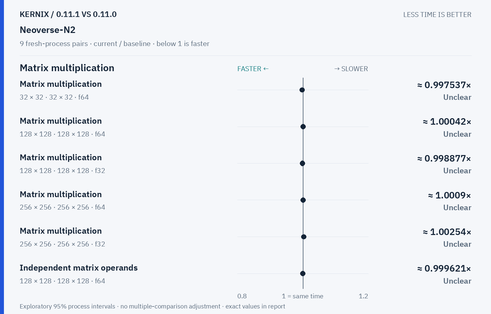
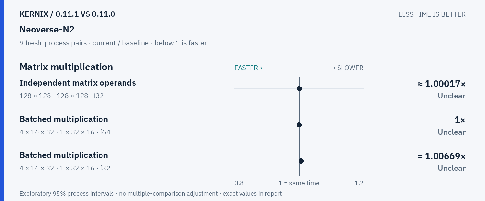
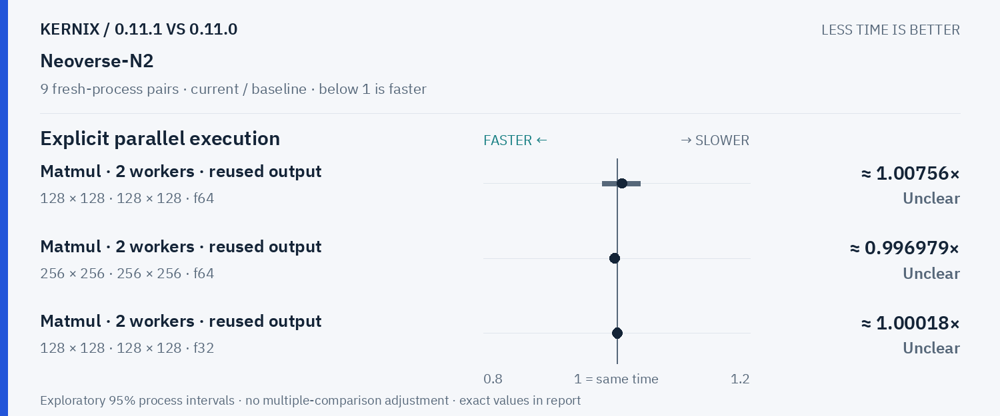
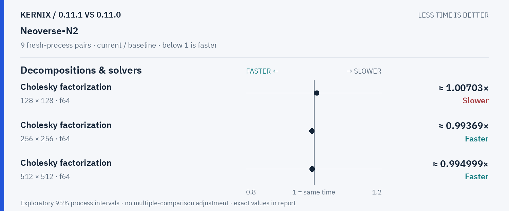
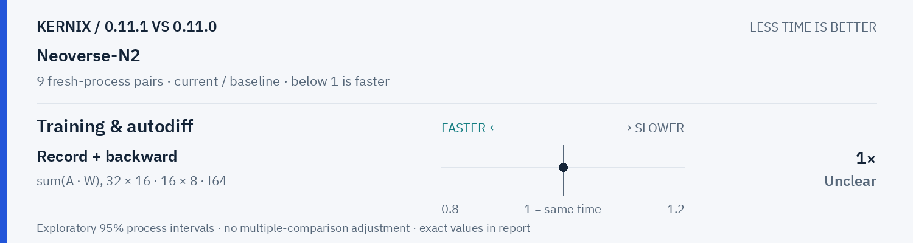

# Kernix 0.11.1 · paired process comparison

9 fresh-process pairs per workload. Ratios below 1 mean less time.

[Interactive HTML (open locally)](report.html) · [Vector PDF](latency.pdf) · [Original process evidence](paired.json)

### Version changes at a glance

The vertical line marks unchanged time. Left is faster; right is slower. Ranges are exploratory 95% intervals over fresh-process pairs. An interval crossing the line leaves direction unclear.

## Exact process ratios

| Workload | Current / baseline [95% interval] | Interpretation |
|---|---:|---|
| Matrix multiplication · 32 × 32 · 32 × 32 · f64 | 0.9975369458128078× [0.995085995085995, 1.002469135802469] | Timing direction unclear |
| Matrix multiplication · 128 × 128 · 128 × 128 · f64 | 1.0004237364001505× [0.9950299033165496, 1.0027191413237926] | Timing direction unclear |
| Matrix multiplication · 128 × 128 · 128 × 128 · f32 | 0.9988765885739697× [0.9974782263525346, 1.00074901107132] | Timing direction unclear |
| Matrix multiplication · 256 × 256 · 256 × 256 · f64 | 1.0009046751669703× [0.9990133896044252, 1.0019451996064153] | Timing direction unclear |
| Matrix multiplication · 256 × 256 · 256 × 256 · f32 | 1.0025442864866585× [0.997745055627488, 1.0037790825210626] | Timing direction unclear |
| Record + backward · sum(A · W), 32 × 16 · 16 × 8 · f64 | 1× [0.9977220956719818, 1.0045766590389016] | Timing direction unclear |
| Independent matrix operands · 128 × 128 · 128 × 128 · f64 | 0.9996209159618072× [0.9968862813218238, 1.003373351119016] | Timing direction unclear |
| Independent matrix operands · 128 × 128 · 128 × 128 · f32 | 1.0001749760866014× [0.9966533344216799, 1.0017720987711893] | Timing direction unclear |
| Batched multiplication · 4 × 16 × 32 · 1 × 32 × 16 · f64 | 1× [0.9979209979209976, 1.0020876826722338] | Timing direction unclear |
| Batched multiplication · 4 × 16 × 32 · 1 × 32 × 16 · f32 | 1.0066889632107023× [1, 1.0067114093959733] | Timing direction unclear |
| Cholesky factorization · 128 × 128 · f64 | 1.0070253462053007× [1.0043716947147794, 1.010413578148842] | Observed time increase |
| Cholesky factorization · 256 × 256 · f64 | 0.9936900729098042× [0.9904663726385025, 0.9961985447269444] | Observed time reduction |
| Cholesky factorization · 512 × 512 · f64 | 0.9949989260086665× [0.9933922773224124, 0.9990776670261271] | Observed time reduction |
| Matmul · 2 workers · reused output · 128 × 128 · 128 × 128 · f64 | 1.0075606057275983× [0.9775864660039932, 1.0349407616669952] | Timing direction unclear |
| Matmul · 2 workers · reused output · 256 × 256 · 256 × 256 · f64 | 0.9969792279009496× [0.9902385219515536, 1.0019951031910102] | Timing direction unclear |
| Matmul · 2 workers · reused output · 128 × 128 · 128 × 128 · f32 | 1.0001844035569398× [0.9954224992336773, 1.0014575763174642] | Timing direction unclear |

## Method

95% percentile bootstrap over paired process blocks; 10000 resamples; exploratory, no multiple-comparison adjustment

Current `runner-ubuntu-24.04-arm-40161751367`; baseline `baseline-ubuntu-24.04-arm-40161751367`. All source ratio digits, paired observations and process ordering are preserved. No absolute peer latencies are inferred.
