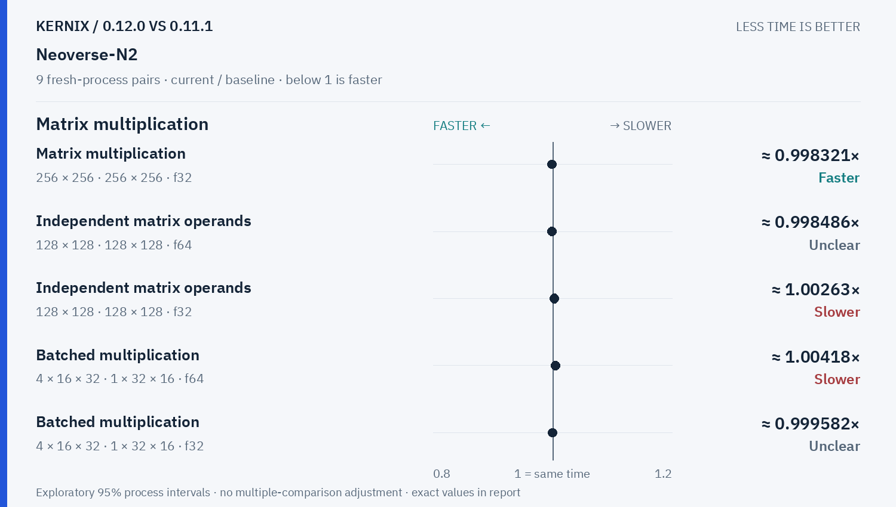
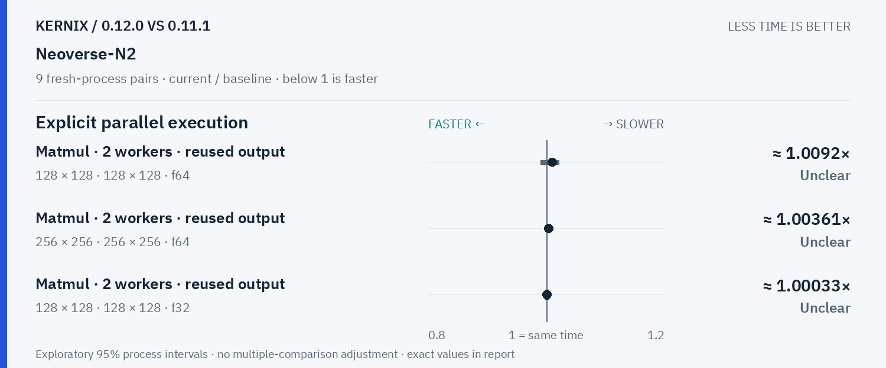

# Kernix 0.12.0 · paired process comparison

9 fresh-process pairs per workload. Ratios below 1 mean less time.

[Interactive HTML (open locally)](report.html) · [Vector PDF](latency.pdf) · [Original process evidence](paired.json)

### Version changes at a glance

The vertical line marks unchanged time. Left is faster; right is slower. Ranges are exploratory 95% intervals over fresh-process pairs. An interval crossing the line leaves direction unclear.

## Exact process ratios

| Workload | Current / baseline [95% interval] | Interpretation |
|---|---:|---|
| Cholesky solve · reused factor · 128 × 128, 1 RHS · f64 | 1.0234986945169713× [1.0037549870922318, 1.028179190751445] | Observed time increase |
| Cholesky solve · reused factor · 256 × 256, 64 RHS · f64 | 0.33792112617530035× [0.3375684915229404, 0.3384791160852235] | Observed time reduction |
| LU solve · reused factor · 256 × 256, 64 RHS · f64 | 0.47913481363078275× [0.47624069058659213, 0.48246535292720216] | Observed time reduction |
| Thin QR · 512 × 128 · f64 | 0.8726855191223079× [0.8695658207967547, 0.8755869170594145] | Observed time reduction |
| Thin QR · 1024 × 256 · f64 | 0.6789324478702599× [0.6782241501332267, 0.6818595664936169] | Observed time reduction |
| Matrix multiplication · transposed view · 128 × 128 · 128 × 128 · f64 | 0.9997738334754727× [0.9953238460306846, 1.0194679976178997] | Timing direction unclear |
| Matrix multiplication · transposed view · 128 × 128 · 128 × 128 · f32 | 0.9970730657484128× [0.9917739551423491, 1.0087548004946951] | Timing direction unclear |
| Thin QR · 256 × 64 · f64 | 0.9995848863933859× [0.9948733492097857, 1.0002446010470083] | Timing direction unclear |
| Matrix multiplication · 32 × 32 · 32 × 32 · f64 | 1× [0.995085995085995, 1.0003087372645878] | Timing direction unclear |
| Matrix multiplication · 128 × 128 · 128 × 128 · f64 | 0.9988561419813765× [0.9961922526300783, 1.0001961530231342] | Timing direction unclear |
| Matrix multiplication · 128 × 128 · 128 × 128 · f32 | 1.002169477214626× [1.0002808134228816, 1.0036371291239314] | Observed time increase |
| Matrix multiplication · 256 × 256 · 256 × 256 · f64 | 1.0001756182785322× [0.9991833617518403, 1.0009622780930691] | Timing direction unclear |
| Matrix multiplication · 256 × 256 · 256 × 256 · f32 | 0.9983208921448529× [0.9957323002012497, 0.9991901500488781] | Observed time reduction |
| Record + backward · sum(A · W), 32 × 16 · 16 × 8 · f64 | 0.9954545454545455× [0.9889674681753889, 1.0002854695974879] | Timing direction unclear |
| Independent matrix operands · 128 × 128 · 128 × 128 · f64 | 0.998486398278278× [0.9957582184517497, 1.003750007416945] | Timing direction unclear |
| Independent matrix operands · 128 × 128 · 128 × 128 · f32 | 1.0026257439607889× [1.000093394662495, 1.0043065616552176] | Observed time increase |
| Batched multiplication · 4 × 16 × 32 · 1 × 32 × 16 · f64 | 1.0041753653444678× [1.0020876826722338, 1.0062761506276152] | Observed time increase |
| Batched multiplication · 4 × 16 × 32 · 1 × 32 × 16 · f32 | 0.9995819397993311× [0.9966555183946488, 1] | Timing direction unclear |
| Cholesky factorization · 128 × 128 · f64 | 1.0067263843058276× [1.000258549180004, 1.0133176513163846] | Observed time increase |
| Cholesky factorization · 256 × 256 · f64 | 0.9993030841457505× [0.9967016127769105, 1.0029723941355255] | Timing direction unclear |
| Cholesky factorization · 512 × 512 · f64 | 0.9962459765630284× [0.994448678774562, 0.999483314139962] | Observed time reduction |
| Matmul · 2 workers · reused output · 128 × 128 · 128 × 128 · f64 | 1.0091958049613556× [0.9895708760248662, 1.0212185378419087] | Timing direction unclear |
| Matmul · 2 workers · reused output · 256 × 256 · 256 × 256 · f64 | 1.0036071534217699× [0.997541024812381, 1.006617502894442] | Timing direction unclear |
| Matmul · 2 workers · reused output · 128 × 128 · 128 × 128 · f32 | 1.0003274059219547× [0.9985314514155177, 1.0022661848471857] | Timing direction unclear |

## Method

95% percentile bootstrap over paired process blocks; 10000 resamples; exploratory, no multiple-comparison adjustment

Current `runner-ubuntu-24.04-arm-40270611933`; baseline `baseline-ubuntu-24.04-arm-40270611933`. All source ratio digits, paired observations and process ordering are preserved. No absolute peer latencies are inferred.
