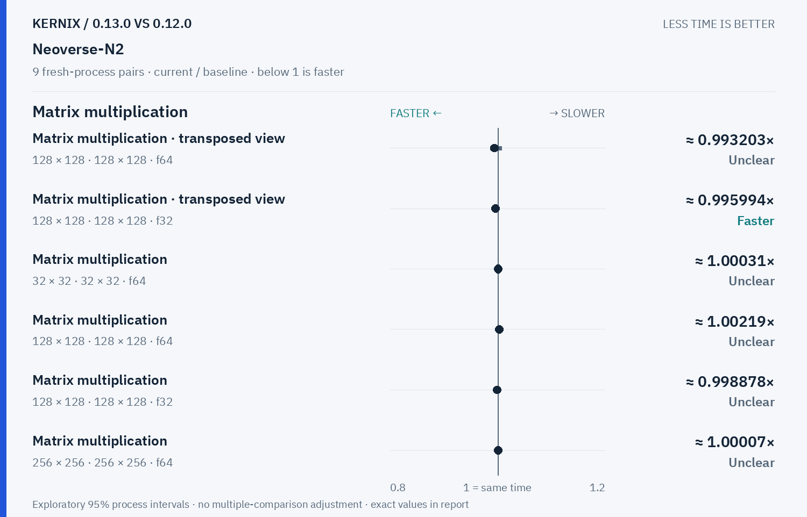
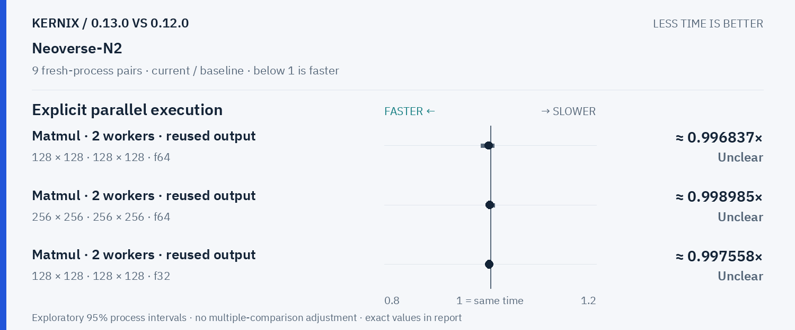
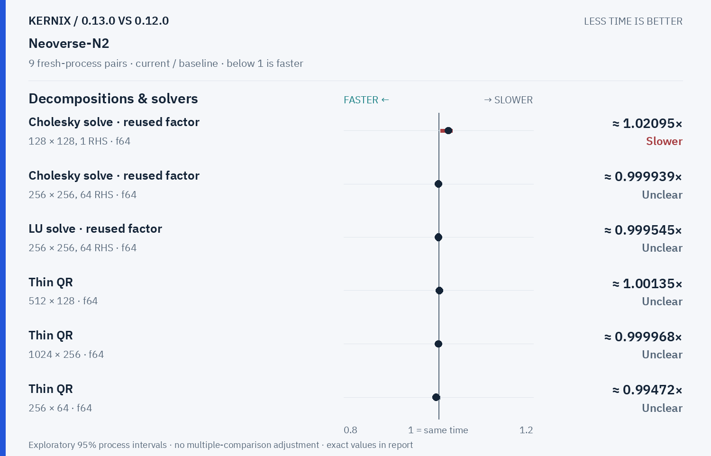

# Kernix 0.13.0 · paired process comparison

9 fresh-process pairs per workload. Ratios below 1 mean less time.

[Interactive HTML (open locally)](report.html) · [Vector PDF](latency.pdf) · [Original process evidence](paired.json)

### Version changes at a glance

The vertical line marks unchanged time. Left is faster; right is slower. Ranges are exploratory 95% intervals over fresh-process pairs. An interval crossing the line leaves direction unclear.

## Exact process ratios

| Workload | Current / baseline [95% interval] | Interpretation |
|---|---:|---|
| Cholesky solve · reused factor · 128 × 128, 1 RHS · f64 | 1.0209528362014022× [1.0044167521097878, 1.028552992418132] | Observed time increase |
| Cholesky solve · reused factor · 256 × 256, 64 RHS · f64 | 0.9999389678238367× [0.9988822449399083, 1.0019213770644335] | Timing direction unclear |
| LU solve · reused factor · 256 × 256, 64 RHS · f64 | 0.999545442181394× [0.9989342808541711, 1.0014338340055817] | Timing direction unclear |
| Thin QR · 512 × 128 · f64 | 1.0013490003755645× [0.9992072846344657, 1.0035722503949913] | Timing direction unclear |
| Thin QR · 1024 × 256 · f64 | 0.9999680183567204× [0.998100644669221, 1.006039028938504] | Timing direction unclear |
| Matrix multiplication · transposed view · 128 × 128 · 128 × 128 · f64 | 0.9932030905284503× [0.9862801868789893, 1.007483188743173] | Timing direction unclear |
| Matrix multiplication · transposed view · 128 × 128 · 128 × 128 · f32 | 0.9959944736588449× [0.9920063778899814, 0.9988831974914898] | Observed time reduction |
| Thin QR · 256 × 64 · f64 | 0.9947204933445353× [0.9924569352137417, 1.0028312037757108] | Timing direction unclear |
| Matrix multiplication · 32 × 32 · 32 × 32 · f64 | 1.0003095017022594× [0.9996913580246913, 1.0024752475247525] | Timing direction unclear |
| Matrix multiplication · 128 × 128 · 128 × 128 · f64 | 1.002187844645146× [0.9990965717274499, 1.0042834705630383] | Timing direction unclear |
| Matrix multiplication · 128 × 128 · 128 × 128 · f32 | 0.9988776130571014× [0.9974802855676357, 1.0012975171833356] | Timing direction unclear |
| Matrix multiplication · 256 × 256 · 256 × 256 · f64 | 1.0000733170524125× [0.9988657096941796, 1.0012095566320618] | Timing direction unclear |
| Matrix multiplication · 256 × 256 · 256 × 256 · f32 | 1.0003351722513611× [0.9982475085060689, 1.0032564327396971] | Timing direction unclear |
| Record + backward · sum(A · W), 32 × 16 · 16 × 8 · f64 | 1.0022779043280183× [1.0002841716396704, 1.0113895216400912] | Observed time increase |
| Independent matrix operands · 128 × 128 · 128 × 128 · f64 | 1.0021819561711414× [0.992643247573273, 1.0048934706273134] | Timing direction unclear |
| Independent matrix operands · 128 × 128 · 128 × 128 · f32 | 0.9977473271394556× [0.9967462797966133, 1.0013204173921173] | Timing direction unclear |
| Batched multiplication · 4 × 16 × 32 · 1 × 32 × 16 · f64 | 1.0020833333333337× [0.9979209979209976, 1.004428236519927] | Timing direction unclear |
| Batched multiplication · 4 × 16 × 32 · 1 × 32 × 16 · f32 | 1.0033444816053512× [1.000418235048097, 1.0033444816053512] | Observed time increase |
| Cholesky factorization · 128 × 128 · f64 | 1.0025886337406835× [0.9989399875376913, 1.0068572085058107] | Timing direction unclear |
| Cholesky factorization · 256 × 256 · f64 | 0.9943369422082682× [0.9896212753455892, 1.001343488214958] | Timing direction unclear |
| Cholesky factorization · 512 × 512 · f64 | 0.9991390368849621× [0.994341539844011, 1.0006276015852136] | Timing direction unclear |
| Matmul · 2 workers · reused output · 128 × 128 · 128 × 128 · f64 | 0.9968366943455912× [0.9819406051349345, 1.0067972337839728] | Timing direction unclear |
| Matmul · 2 workers · reused output · 256 × 256 · 256 × 256 · f64 | 0.9989854787615325× [0.9964796177870741, 1.008395017412424] | Timing direction unclear |
| Matmul · 2 workers · reused output · 128 × 128 · 128 × 128 · f32 | 0.9975581228325775× [0.9960705660840735, 1.000474285478616] | Timing direction unclear |

## Method

95% percentile bootstrap over paired process blocks; 10000 resamples; exploratory, no multiple-comparison adjustment

Current `runner-ubuntu-24.04-arm-40289723446`; baseline `baseline-ubuntu-24.04-arm-40289723446`. All source ratio digits, paired observations and process ordering are preserved. No absolute peer latencies are inferred.
