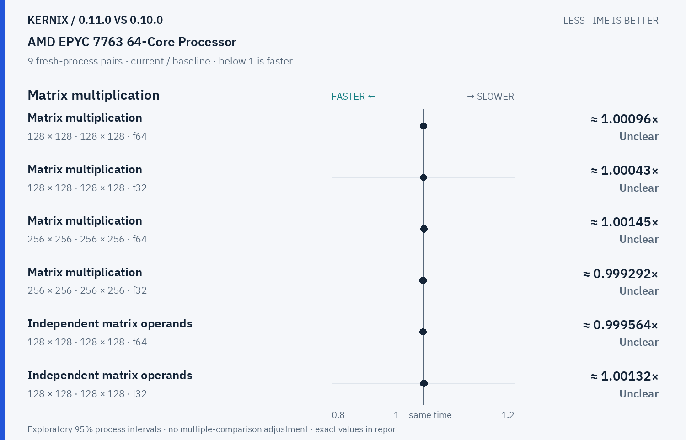

# Kernix 0.11.0 · paired process comparison

9 fresh-process pairs per workload. Ratios below 1 mean less time.

[Interactive HTML (open locally)](report.html) · [Vector PDF](latency.pdf) · [Original process evidence](paired.json)

### Version changes at a glance

The vertical line marks unchanged time. Left is faster; right is slower. Ranges are exploratory 95% intervals over fresh-process pairs. An interval crossing the line leaves direction unclear.

## Exact process ratios

| Workload | Current / baseline [95% interval] | Interpretation |
|---|---:|---|
| Matrix multiplication · 128 × 128 · 128 × 128 · f64 | 1.0009641651936365× [0.9952760966204274, 1.0073507188808772] | Timing direction unclear |
| Matrix multiplication · 128 × 128 · 128 × 128 · f32 | 1.0004347259053168× [0.9980513997445168, 1.0019336476416016] | Timing direction unclear |
| Matrix multiplication · 256 × 256 · 256 × 256 · f64 | 1.001448242726027× [0.9985006212294634, 1.0042017208478298] | Timing direction unclear |
| Matrix multiplication · 256 × 256 · 256 × 256 · f32 | 0.999291967226579× [0.9974740323731636, 1.0009405573441617] | Timing direction unclear |
| Independent matrix operands · 128 × 128 · 128 × 128 · f64 | 0.9995639040163377× [0.9955594464602143, 1.003105490635505] | Timing direction unclear |
| Independent matrix operands · 128 × 128 · 128 × 128 · f32 | 1.001321604991767× [0.9934858354794728, 1.0058788947677837] | Timing direction unclear |
| Cholesky factorization · 128 × 128 · f64 | 1.0105549175378568× [1.0039669636470052, 1.0137466886231832] | Observed time increase |
| Cholesky factorization · 256 × 256 · f64 | 0.6790232533939629× [0.6733664516997802, 0.6847512849206271] | Observed time reduction |
| Cholesky factorization · 512 × 512 · f64 | 0.5090629428301201× [0.5064715577820311, 0.5154443163666095] | Observed time reduction |
| Matmul · 2 workers · reused output · 128 × 128 · 128 × 128 · f64 | 1.0058258237116304× [1.0012331107861963, 1.019572302490545] | Observed time increase |
| Matmul · 2 workers · reused output · 256 × 256 · 256 × 256 · f64 | 1.0005125276025437× [0.9991821128070911, 1.0050150348855331] | Timing direction unclear |
| Matmul · 2 workers · reused output · 128 × 128 · 128 × 128 · f32 | 1.0015813276827221× [0.9912324492979719, 1.061308636493387] | Timing direction unclear |

## Method

95% percentile bootstrap over paired process blocks; 10000 resamples; exploratory, no multiple-comparison adjustment

Current `runner-ubuntu-latest-40059566395`; baseline `baseline-ubuntu-latest-40059566395`. All source ratio digits, paired observations and process ordering are preserved. No absolute peer latencies are inferred.
