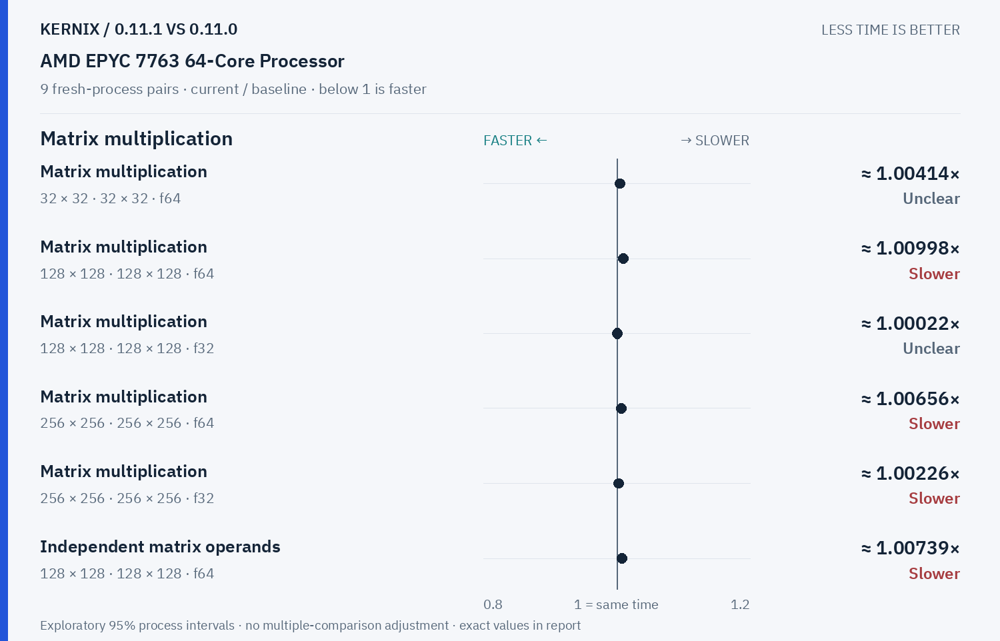
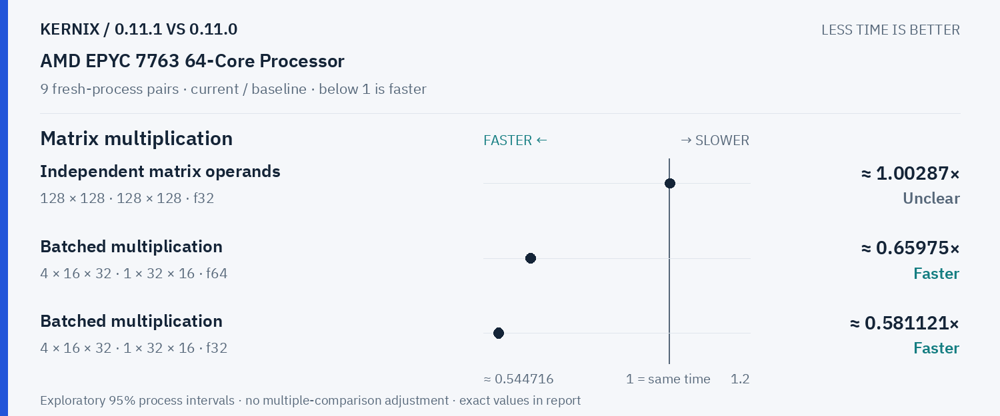
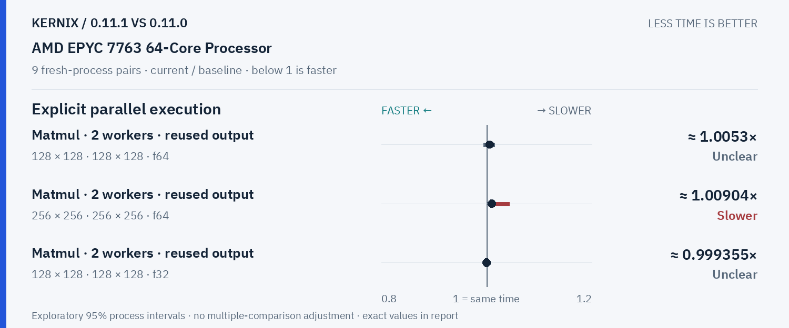
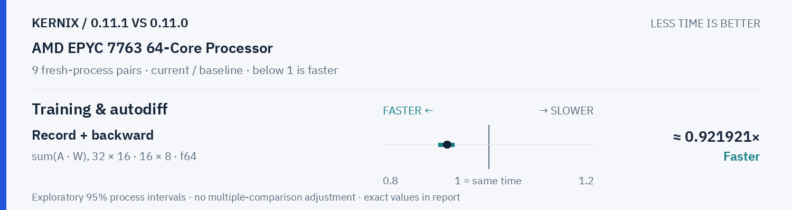

# Kernix 0.11.1 · paired process comparison

9 fresh-process pairs per workload. Ratios below 1 mean less time.

[Interactive HTML (open locally)](report.html) · [Vector PDF](latency.pdf) · [Original process evidence](paired.json)

### Version changes at a glance

The vertical line marks unchanged time. Left is faster; right is slower. Ranges are exploratory 95% intervals over fresh-process pairs. An interval crossing the line leaves direction unclear.

## Exact process ratios

| Workload | Current / baseline [95% interval] | Interpretation |
|---|---:|---|
| Matrix multiplication · 32 × 32 · 32 × 32 · f64 | 1.0041407867494825× [1, 1.0045379537953796] | Timing direction unclear |
| Matrix multiplication · 128 × 128 · 128 × 128 · f64 | 1.0099791109716103× [1.0052981990439502, 1.0114145589878802] | Observed time increase |
| Matrix multiplication · 128 × 128 · 128 × 128 · f32 | 1.000220482857458× [0.9982380795066622, 1.0015236833388539] | Timing direction unclear |
| Matrix multiplication · 256 × 256 · 256 × 256 · f64 | 1.006558129554634× [1.0040813729657436, 1.0097556013671134] | Observed time increase |
| Matrix multiplication · 256 × 256 · 256 × 256 · f32 | 1.0022646283129366× [1.0001415744780857, 1.0036768129396727] | Observed time increase |
| Record + backward · sum(A · W), 32 × 16 · 16 × 8 · f64 | 0.9219211161792327× [0.9046610169491526, 0.9351600651112317] | Observed time reduction |
| Independent matrix operands · 128 × 128 · 128 × 128 · f64 | 1.0073907695598696× [1.0036293584230918, 1.0111569141817014] | Observed time increase |
| Independent matrix operands · 128 × 128 · 128 × 128 · f32 | 1.0028731220528566× [0.9951774102038144, 1.0099328267811916] | Timing direction unclear |
| Batched multiplication · 4 × 16 × 32 · 1 × 32 × 16 · f64 | 0.659749670619236× [0.6589557171183079, 0.6666666666666666] | Observed time reduction |
| Batched multiplication · 4 × 16 × 32 · 1 × 32 × 16 · f32 | 0.5811209439528023× [0.5733855185909981, 0.5885518590998043] | Observed time reduction |
| Cholesky factorization · 128 × 128 · f64 | 0.9937565403473292× [0.9928150613248039, 1.0013695787507781] | Timing direction unclear |
| Cholesky factorization · 256 × 256 · f64 | 0.994797745689799× [0.9879273217853035, 1.0047720257365078] | Timing direction unclear |
| Cholesky factorization · 512 × 512 · f64 | 0.9983466021802162× [0.9966300720587722, 1.002325631779009] | Timing direction unclear |
| Matmul · 2 workers · reused output · 128 × 128 · 128 × 128 · f64 | 1.0052951143744704× [0.9939748392112516, 1.0154761476794765] | Timing direction unclear |
| Matmul · 2 workers · reused output · 256 × 256 · 256 × 256 · f64 | 1.009035905294692× [1.0026501946355793, 1.0426416803806298] | Observed time increase |
| Matmul · 2 workers · reused output · 128 × 128 · 128 × 128 · f32 | 0.9993552131020697× [0.9974357330598115, 1.0067443286327409] | Timing direction unclear |

## Method

95% percentile bootstrap over paired process blocks; 10000 resamples; exploratory, no multiple-comparison adjustment

Current `runner-ubuntu-latest-40161751367`; baseline `baseline-ubuntu-latest-40161751367`. All source ratio digits, paired observations and process ordering are preserved. No absolute peer latencies are inferred.
