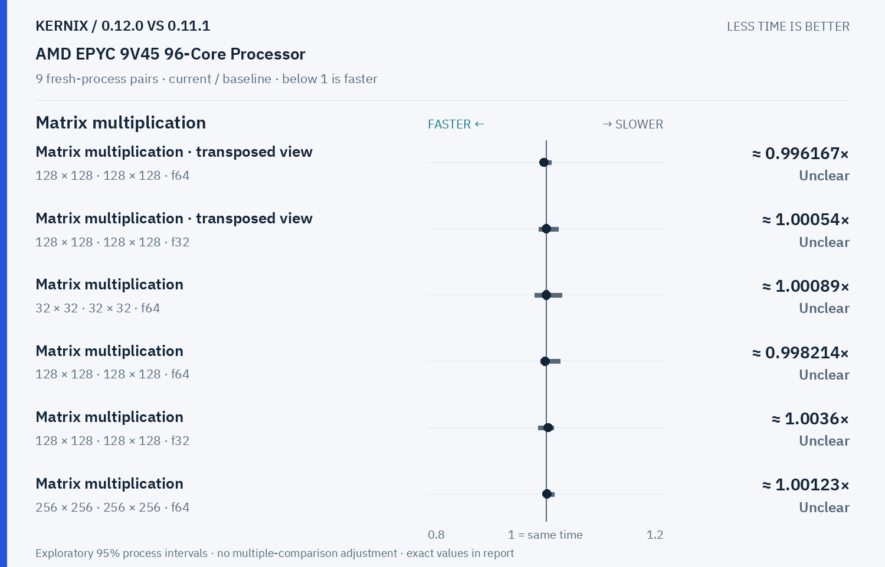
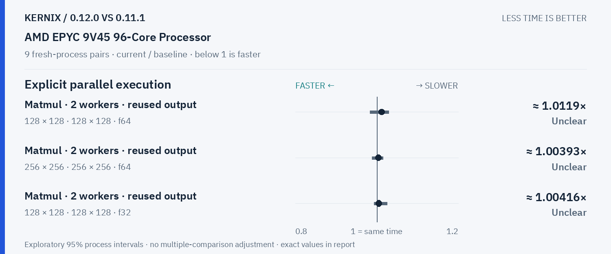
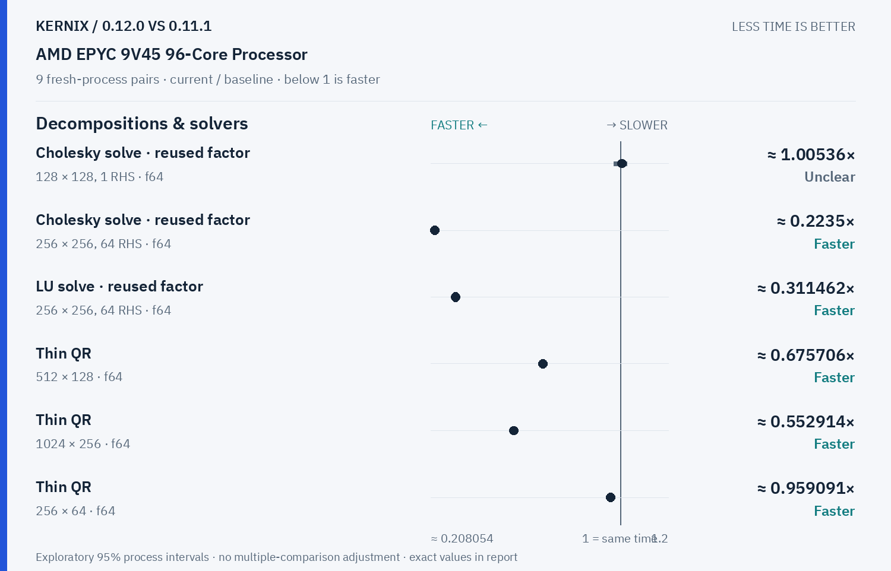
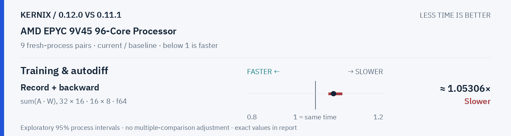

# Kernix 0.12.0 · paired process comparison

9 fresh-process pairs per workload. Ratios below 1 mean less time.

[Interactive HTML (open locally)](report.html) · [Vector PDF](latency.pdf) · [Original process evidence](paired.json)

### Version changes at a glance

The vertical line marks unchanged time. Left is faster; right is slower. Ranges are exploratory 95% intervals over fresh-process pairs. An interval crossing the line leaves direction unclear.

## Exact process ratios

| Workload | Current / baseline [95% interval] | Interpretation |
|---|---:|---|
| Cholesky solve · reused factor · 128 × 128, 1 RHS · f64 | 1.0053625053625053× [0.9724108658743633, 1.0274227029389271] | Timing direction unclear |
| Cholesky solve · reused factor · 256 × 256, 64 RHS · f64 | 0.22349955049075287× [0.21900384782544965, 0.22888203630554305] | Observed time reduction |
| LU solve · reused factor · 256 × 256, 64 RHS · f64 | 0.3114620050231865× [0.30519189639903604, 0.31553349932267266] | Observed time reduction |
| Thin QR · 512 × 128 · f64 | 0.6757057230163083× [0.6720568966832867, 0.6879233649014185] | Observed time reduction |
| Thin QR · 1024 × 256 · f64 | 0.5529138855671462× [0.5445555682362697, 0.556903078560186] | Observed time reduction |
| Matrix multiplication · transposed view · 128 × 128 · 128 × 128 · f64 | 0.9961673082199184× [0.9935358919393151, 1.0091649948805888] | Timing direction unclear |
| Matrix multiplication · transposed view · 128 × 128 · 128 × 128 · f32 | 1.0005362505362505× [0.9877411308939422, 1.0212528876206006] | Timing direction unclear |
| Thin QR · 256 × 64 · f64 | 0.9590911843475237× [0.9536949327442831, 0.9682737393033156] | Observed time reduction |
| Matrix multiplication · 32 × 32 · 32 × 32 · f64 | 1.0008920606601248× [0.9812834224598931, 1.0268022181146026] | Timing direction unclear |
| Matrix multiplication · 128 × 128 · 128 × 128 · f64 | 0.9982135475107777× [0.991413560752696, 1.0239473217976731] | Timing direction unclear |
| Matrix multiplication · 128 × 128 · 128 × 128 · f32 | 1.0035971223021583× [0.9870526408502392, 1.0125065441219243] | Timing direction unclear |
| Matrix multiplication · 256 × 256 · 256 × 256 · f64 | 1.0012324316956442× [0.9986771773084744, 1.0135525631939524] | Timing direction unclear |
| Matrix multiplication · 256 × 256 · 256 × 256 · f32 | 1.001817487237072× [0.9901220464195274, 1.0192704641580272] | Timing direction unclear |
| Record + backward · sum(A · W), 32 × 16 · 16 × 8 · f64 | 1.0530631934394596× [1.0391581008321096, 1.0794833581718828] | Observed time increase |
| Independent matrix operands · 128 × 128 · 128 × 128 · f64 | 1.0054114825363514× [0.9929526907242172, 1.008696674109766] | Timing direction unclear |
| Independent matrix operands · 128 × 128 · 128 × 128 · f32 | 1.002366793881838× [0.9940516705631677, 1.0146177023358491] | Timing direction unclear |
| Batched multiplication · 4 × 16 × 32 · 1 × 32 × 16 · f64 | 1× [0.9773071104387292, 1.0152439024390243] | Timing direction unclear |
| Batched multiplication · 4 × 16 × 32 · 1 × 32 × 16 · f32 | 1× [0.9986522911051213, 1.015047879616963] | Timing direction unclear |
| Cholesky factorization · 128 × 128 · f64 | 0.9936608393422213× [0.9854601575826497, 1.009468378111521] | Timing direction unclear |
| Cholesky factorization · 256 × 256 · f64 | 1.0032612891221793× [0.9983964429344863, 1.0177890307996873] | Timing direction unclear |
| Cholesky factorization · 512 × 512 · f64 | 0.9988555053724515× [0.9935237240137919, 1.0168522189687361] | Timing direction unclear |
| Matmul · 2 workers · reused output · 128 × 128 · 128 × 128 · f64 | 1.0118995686103436× [0.9831246342890579, 1.029130116094862] | Timing direction unclear |
| Matmul · 2 workers · reused output · 256 × 256 · 256 × 256 · f64 | 1.0039262481234843× [0.987681647914046, 1.0154321417140948] | Timing direction unclear |
| Matmul · 2 workers · reused output · 128 × 128 · 128 × 128 · f32 | 1.0041587746026517× [0.9931137845829789, 1.0251479289940828] | Timing direction unclear |

## Method

95% percentile bootstrap over paired process blocks; 10000 resamples; exploratory, no multiple-comparison adjustment

Current `runner-ubuntu-latest-40270611933`; baseline `baseline-ubuntu-latest-40270611933`. All source ratio digits, paired observations and process ordering are preserved. No absolute peer latencies are inferred.
