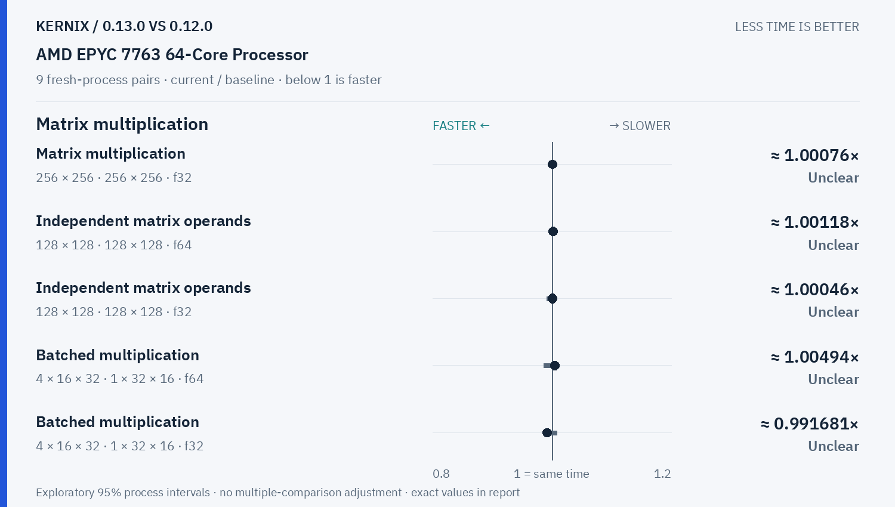
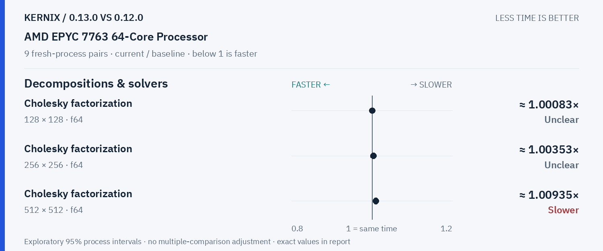
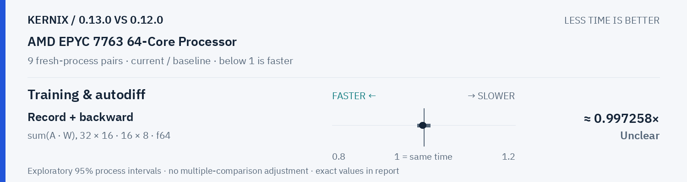

# Kernix 0.13.0 · paired process comparison

9 fresh-process pairs per workload. Ratios below 1 mean less time.

[Interactive HTML (open locally)](report.html) · [Vector PDF](latency.pdf) · [Original process evidence](paired.json)

### Version changes at a glance

The vertical line marks unchanged time. Left is faster; right is slower. Ranges are exploratory 95% intervals over fresh-process pairs. An interval crossing the line leaves direction unclear.

## Exact process ratios

| Workload | Current / baseline [95% interval] | Interpretation |
|---|---:|---|
| Cholesky solve · reused factor · 128 × 128, 1 RHS · f64 | 0.999471067386015× [0.9973565952947396, 1.0020628371945415] | Timing direction unclear |
| Cholesky solve · reused factor · 256 × 256, 64 RHS · f64 | 1.083568245363017× [1.0802557742871344, 1.08517793042905] | Observed time increase |
| LU solve · reused factor · 256 × 256, 64 RHS · f64 | 0.996840299031319× [0.9959151607706278, 0.9975877328672669] | Observed time reduction |
| Thin QR · 512 × 128 · f64 | 0.9967563158814609× [0.9918963979065318, 1.0046826330122811] | Timing direction unclear |
| Thin QR · 1024 × 256 · f64 | 0.9871204439911031× [0.9779744047084407, 0.9891396504940139] | Observed time reduction |
| Matrix multiplication · transposed view · 128 × 128 · 128 × 128 · f64 | 0.9998129801151108× [0.9957627512381872, 1.0028547266517467] | Timing direction unclear |
| Matrix multiplication · transposed view · 128 × 128 · 128 × 128 · f32 | 1.0028165236051503× [0.9960981496379726, 1.0098207241763921] | Timing direction unclear |
| Thin QR · 256 × 64 · f64 | 0.9987499230413007× [0.9846317345901487, 1.0057244869354816] | Timing direction unclear |
| Matrix multiplication · 32 × 32 · 32 × 32 · f64 | 0.9963023829087921× [0.9837728194726166, 1.0041597337770383] | Timing direction unclear |
| Matrix multiplication · 128 × 128 · 128 × 128 · f64 | 1.0013946850606525× [0.9919242970052153, 1.597163381838276] | Timing direction unclear |
| Matrix multiplication · 128 × 128 · 128 × 128 · f32 | 1.000878445152081× [0.9969261170271161, 1.0062039122179538] | Timing direction unclear |
| Matrix multiplication · 256 × 256 · 256 × 256 · f64 | 0.9981894802135081× [0.9808812825940344, 0.9992079677625157] | Observed time reduction |
| Matrix multiplication · 256 × 256 · 256 × 256 · f32 | 1.0007649743733584× [0.996856598178352, 1.001591439699754] | Timing direction unclear |
| Record + backward · sum(A · W), 32 × 16 · 16 × 8 · f64 | 0.9972580202906498× [0.9864755206924534, 1.0137098985467508] | Timing direction unclear |
| Independent matrix operands · 128 × 128 · 128 × 128 · f64 | 1.0011809544258952× [0.994669793721017, 1.0053511348464619] | Timing direction unclear |
| Independent matrix operands · 128 × 128 · 128 × 128 · f32 | 1.000462300495322× [0.9910861814070788, 1.0065968862696808] | Timing direction unclear |
| Batched multiplication · 4 × 16 × 32 · 1 × 32 × 16 · f64 | 1.0049407114624507× [0.9856648541769648, 1.009930486593843] | Timing direction unclear |
| Batched multiplication · 4 × 16 × 32 · 1 × 32 × 16 · f32 | 0.9916805324459235× [0.9916107382550335, 1.007607776838546] | Timing direction unclear |
| Cholesky factorization · 128 × 128 · f64 | 1.000831230693046× [0.9978279884237653, 1.004733574143589] | Timing direction unclear |
| Cholesky factorization · 256 × 256 · f64 | 1.0035265993610598× [0.9962365833107335, 1.0075267678861823] | Timing direction unclear |
| Cholesky factorization · 512 × 512 · f64 | 1.009350517607689× [1.0043837900899306, 1.0151540833691663] | Observed time increase |
| Matmul · 2 workers · reused output · 128 × 128 · 128 × 128 · f64 | 0.9973336177474402× [0.9863506001487095, 1.0044559308439533] | Timing direction unclear |
| Matmul · 2 workers · reused output · 256 × 256 · 256 × 256 · f64 | 1.00182105104314× [0.9877555854589073, 1.0068579077147009] | Timing direction unclear |
| Matmul · 2 workers · reused output · 128 × 128 · 128 × 128 · f32 | 1.0022567541427556× [0.9981015509363537, 1.004204377687913] | Timing direction unclear |

## Method

95% percentile bootstrap over paired process blocks; 10000 resamples; exploratory, no multiple-comparison adjustment

Current `runner-ubuntu-latest-40289723446`; baseline `baseline-ubuntu-latest-40289723446`. All source ratio digits, paired observations and process ordering are preserved. No absolute peer latencies are inferred.
