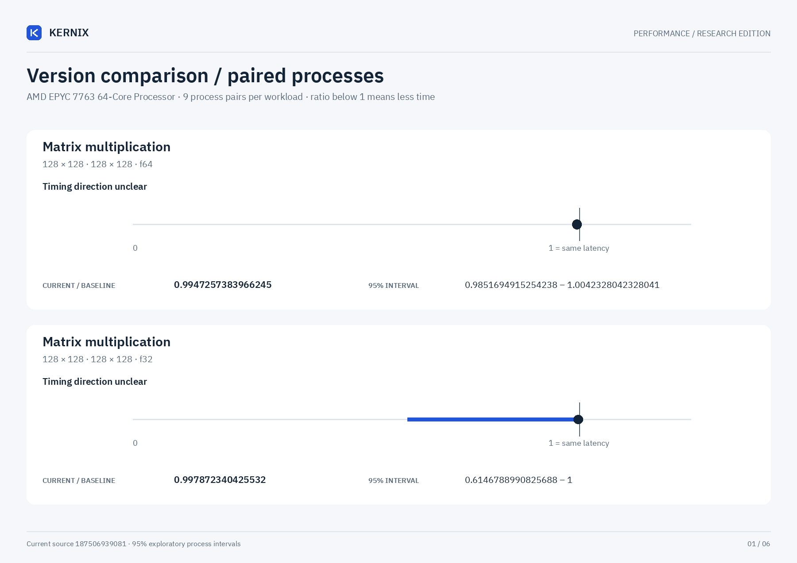

# Kernix 0.11.0 · paired process comparison

9 fresh-process pairs per workload. Ratios below 1 mean less time.

[Open visual comparison](report.html) · [Vector PDF](latency.pdf) · [Original process evidence](paired.json)

| Workload | Current / baseline [95% interval] | Interpretation |
|---|---:|---|
| Matrix multiplication · 128 × 128 · 128 × 128 · f64 | 0.9947257383966245× [0.9851694915254238, 1.0042328042328041] | Timing direction unclear |
| Matrix multiplication · 128 × 128 · 128 × 128 · f32 | 0.997872340425532× [0.6146788990825688, 1] | Timing direction unclear |
| Matrix multiplication · 256 × 256 · 256 × 256 · f64 | 1.0014998636487593× [0.8458338148618976, 1.0089151008092168] | Timing direction unclear |
| Matrix multiplication · 256 × 256 · 256 × 256 · f32 | 1.0002831257078142× [0.9943804439449283, 1.0014124293785311] | Timing direction unclear |
| Independent matrix operands · 128 × 128 · 128 × 128 · f64 | 0.9985915492957746× [0.9950980392156863, 1.4880581516095535] | Timing direction unclear |
| Independent matrix operands · 128 × 128 · 128 × 128 · f32 | 1× [0.9974059662775616, 1.0039011703511054] | Timing direction unclear |
| Cholesky factorization · 128 × 128 · f64 | 1.0076957899502037× [0.972101133391456, 1.0108790252393385] | Timing direction unclear |
| Cholesky factorization · 256 × 256 · f64 | 0.695573074590661× [0.6864988558352402, 0.7127808988764045] | Observed time reduction |
| Cholesky factorization · 512 × 512 · f64 | 0.5457797784753895× [0.5446214676125131, 0.5541659264523006] | Observed time reduction |
| Matmul · 2 workers · reused output · 128 × 128 · 128 × 128 · f64 | 1× [0.9640371229698376, 1.0133010882708586] | Timing direction unclear |
| Matmul · 2 workers · reused output · 256 × 256 · 256 × 256 · f64 | 0.9986489529385274× [0.9724872420678944, 1.0055121727147451] | Timing direction unclear |
| Matmul · 2 workers · reused output · 128 × 128 · 128 × 128 · f32 | 1.008695652173913× [0.9948186528497409, 1.0373001776198933] | Timing direction unclear |

## Method

95% percentile bootstrap over paired process blocks; 10000 resamples; exploratory, no multiple-comparison adjustment

Current `runner-windows-latest-40059566395`; baseline `baseline-windows-latest-40059566395`. All source ratio digits, paired observations and process ordering are preserved. No absolute peer latencies are inferred.
