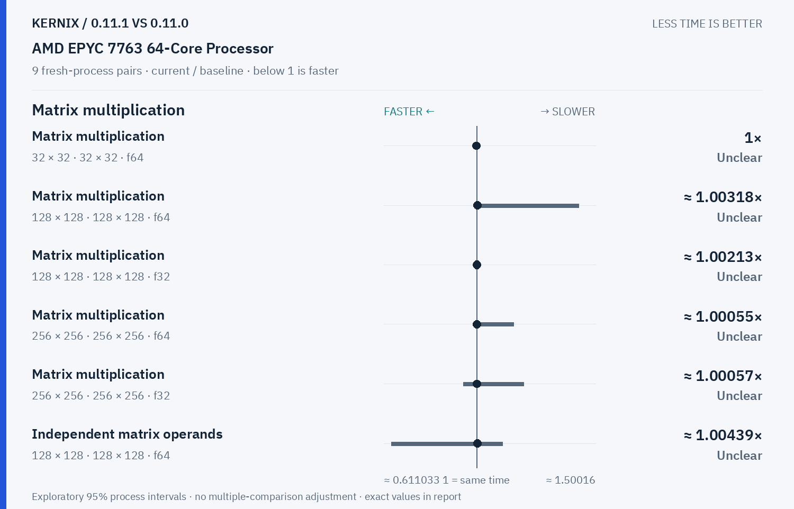

# Kernix 0.11.1 · paired process comparison

9 fresh-process pairs per workload. Ratios below 1 mean less time.

[Interactive HTML (open locally)](report.html) · [Vector PDF](latency.pdf) · [Original process evidence](paired.json)

### Version changes at a glance

The vertical line marks unchanged time. Left is faster; right is slower. Ranges are exploratory 95% intervals over fresh-process pairs. An interval crossing the line leaves direction unclear.

## Exact process ratios

| Workload | Current / baseline [95% interval] | Interpretation |
|---|---:|---|
| Matrix multiplication · 32 × 32 · 32 × 32 · f64 | 1× [1, 1] | Timing direction unclear |
| Matrix multiplication · 128 × 128 · 128 × 128 · f64 | 1.0031813361611877× [0.9947478991596639, 1.4287222808870117] | Timing direction unclear |
| Matrix multiplication · 128 × 128 · 128 × 128 · f32 | 1.0021276595744681× [0.9978768577494692, 1.004255319148936] | Timing direction unclear |
| Matrix multiplication · 256 × 256 · 256 × 256 · f64 | 1.0005473453749316× [0.9873041599135602, 1.155377946356001] | Timing direction unclear |
| Matrix multiplication · 256 × 256 · 256 × 256 · f32 | 1.0005652911249294× [0.9435931601154786, 1.1982515510434293] | Timing direction unclear |
| Record + backward · sum(A · W), 32 × 16 · 16 × 8 · f64 | 0.9245283018867925× [0.9074074074074074, 0.9433962264150944] | Observed time reduction |
| Independent matrix operands · 128 × 128 · 128 × 128 · f64 | 1.0043859649122806× [0.6431924882629108, 1.1081277213352685] | Timing direction unclear |
| Independent matrix operands · 128 × 128 · 128 × 128 · f32 | 1.0027510316368637× [0.9773936170212766, 1.0097087378640777] | Timing direction unclear |
| Batched multiplication · 4 × 16 × 32 · 1 × 32 × 16 · f64 | 0.7142857142857143× [0.6944444444444444, 0.7222222222222222] | Observed time reduction |
| Batched multiplication · 4 × 16 × 32 · 1 × 32 × 16 · f32 | 0.6666666666666666× [0.6666666666666666, 0.75] | Observed time reduction |
| Cholesky factorization · 128 × 128 · f64 | 1.0004301075268818× [0.9575835475578406, 1.0379633765073693] | Timing direction unclear |
| Cholesky factorization · 256 × 256 · f64 | 0.9966810966810967× [0.9867199771526489, 1.0048934945308001] | Timing direction unclear |
| Cholesky factorization · 512 × 512 · f64 | 1.0021162437741817× [0.9961633557848069, 1.0049226291120006] | Timing direction unclear |
| Matmul · 2 workers · reused output · 128 × 128 · 128 × 128 · f64 | 0.9976331360946745× [0.9316427783902976, 1.005966587112172] | Timing direction unclear |
| Matmul · 2 workers · reused output · 256 × 256 · 256 × 256 · f64 | 1.0054669703872436× [0.9654383154039826, 1.0339377033937704] | Timing direction unclear |
| Matmul · 2 workers · reused output · 128 × 128 · 128 × 128 · f32 | 0.99673735725938× [0.9522240527182867, 1.0662020905923344] | Timing direction unclear |

## Method

95% percentile bootstrap over paired process blocks; 10000 resamples; exploratory, no multiple-comparison adjustment

Current `runner-windows-latest-40161751367`; baseline `baseline-windows-latest-40161751367`. All source ratio digits, paired observations and process ordering are preserved. No absolute peer latencies are inferred.
